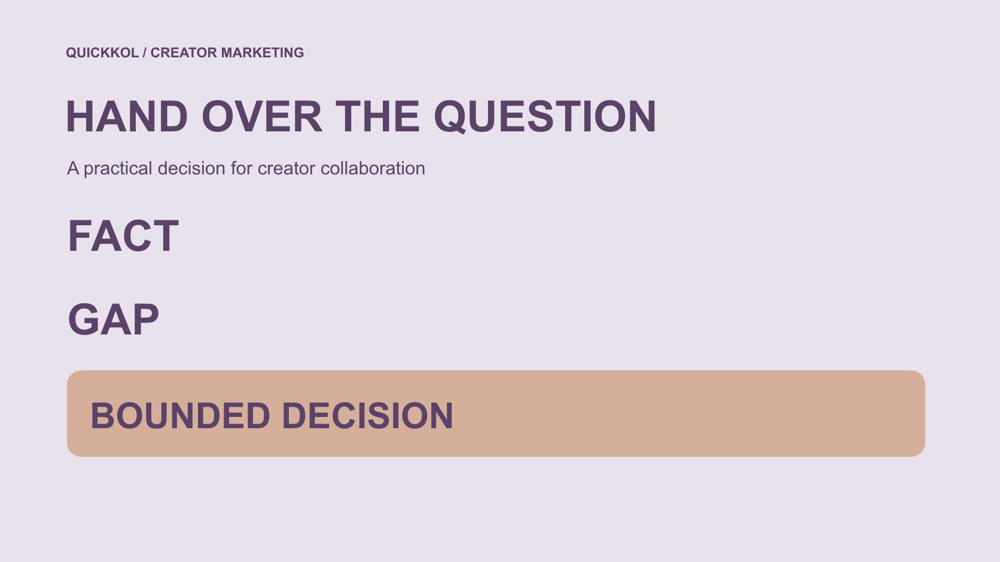
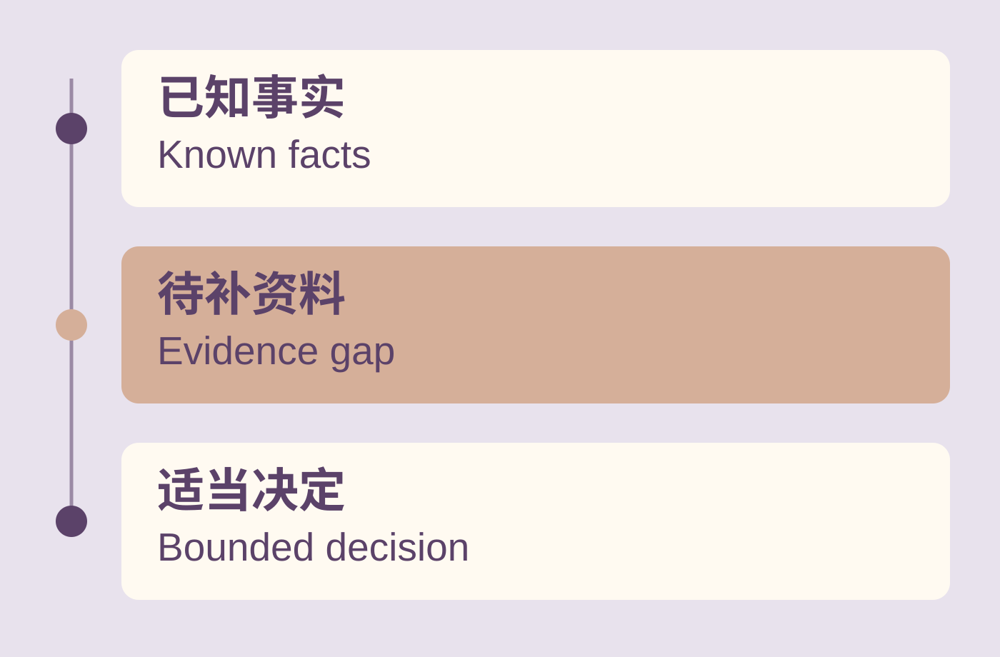

# 免费点赞疑问怎样公平交接

状态：本地审阅稿；正式发布日期待确认。

免费点赞相关问题交给采购、内容与账号负责人时，应区分申请、审批和执行。用同一份有限事实记录推进决定，避免把待核实问题变成达人标签。

QuickKOL 编辑图形；不呈现真实账号指标或平台界面。

涉及“free tik tok likes”的问题，交接给另一团队时要说明真正需要决定什么：是否采购、是否批准访问，还是某个报表解释是否可用。收到提案不等于已批准，批准也不等于实际执行。保留必要原始资料、来源独立性与未知，指定能处理具体问题的人。品牌可以暂不采购或暂停依赖不足的决定，不必先把某位创作者认定为违规。本篇提供教育性协作框架，不提供刷量服务或保证识别方法。

## 交接先写需要决定的事项

不要把一堆截图发给采购同事，只说看看有没有问题。说明当前是有人提出购买、申请连接账号，还是希望把某个数字放进报告。三种任务需要不同负责人和资料。

假设内容团队收到免费点赞介绍，但没有采购需求。交接可以只请求确认不纳入供应范围，而不是启动针对某位达人的全面调查。范围清楚，团队才不会为了完成一个模糊风险任务而收集过多个人资料。

把决定写成一句可回答问题，再说明当前受影响工作。不要把所有合作一并标为可疑；一个不必要服务的提议，不会自动改变既有制作完成状态，也不证明有人已经执行。

## 区分申请、审批与执行状态

申请可能未被批准，批准可能附带尚未满足条件，执行也可能只发生部分步骤。把真实状态写清，不用“已经接触过”代替全部流程。

记录谁提出、谁有权批准、目前知道做了什么。权限不明时，把它列为待确认，而不是让发消息的人因为最先看到材料就被默认为采购人或账号负责人。

不要为补齐记录要求重做操作。已有状态可以通过适当业务记录与本人说明核对，不能为证明某一步能否发生而再次授权或提交资料。交接的价值是减少混乱，不是让更多人参与一个本来就没有必要执行的流程。

## 保留证据来路，不只保留数量

每份资料说明原出处、时间、对象与如何取得。来自同一宣传图的多个副本，不能算成多次独立核验；提供方的解释也不能自动被改写成已确认事实。

[NIST 的离群观察说明](https://www.itl.nist.gov/div898/handbook/eda/section3/eda35h.htm)提醒不同寻常的数值有多种可能解释。这里引用一般方法边界，不代表运行过真假用户测试。计数突变是问题线索，仍需核对窗口、来源与同时事件。

交接可以把已确认资料、原始声明与待核实信息分开放。若某页面打不开，准确记录读取限制；不要为补充细节编出完整体验。接手人需要知道证据能回答什么，也需要知道本次审阅没有执行哪些动作。

## 让事实、缺口与决定各占位置

配图将三者分开，避免交接时从一条线索直接跳到个人结论。事实说明观察到什么，缺口说明还不知道什么，决定说明在当前资料下准备怎样处理。

假设某材料承诺即时点赞，已知只收到介绍，没有批准或执行记录。缺口可以是动作来源与访问要求；决定可以是当前不采购。无需把这个决定写成已经证明对方欺诈，也不需假设某位创作者暗中使用。

三部分应互相关联。决定的理由是任务不需要或证据不足，就按这个范围表达。后续新资料改变缺口时，可以重新评估，而不是让一个永久标签阻碍更新。记录越清楚，接手人越容易采取比例适当的动作。

将问题交给能处理的人，不把未知升级成个人结论。

## 规则背景不能代替事实核验

[FTC 的虚假影响力指标问答](https://www.ftc.gov/business-guidance/resources/consumer-reviews-testimonials-rule-questions-answers)讨论美国规则中的知情与商业误导条件，也区分真实自愿动作。不能把规则标题附在截图后面，就当作已经证明具体购买、知情或虚假指标。

交接可以说明为什么这类承诺值得谨慎，但实际事实仍要单独支持。平台政策、法律条件与品牌自身采购选择，也应分开；不采购不必要服务，不要求先完成违规裁定。

接手人若负责具体法律或政策问题，应得到与问题有关的准确材料和适用范围，而不是一段已经替其作好结论的措辞。市场团队可以描述事实与需求，不应通过强烈词语越过专业判断，或把一篇教育博客当作完整审计证明。

## 账号疑问走独立安全路径

如果交接涉及已经提交秘密或批准访问的疑问，应优先把实际状态交给账号负责人，沿独立找到的官方安全与支持渠道处理。不要要求采购同事点击原链接来验证。

[FBI 的创作者账号安全提醒](https://www.fbi.gov/contact-us/field-offices/atlanta/news/verified-influencer-accounts-are-being-hijacked-to-spread-scams-and-malicious-software)指出熟悉或已验证账号也可能被劫持传播恶意内容。它支持独立核对的重要性，不证明本次任何账号已经被劫持。

交接中不要放密码、验证码、恢复信息或无关个人资料。必要敏感事实由适当人员在合适路径处理，普通项目状态只说明受影响事项与负责角色。这样既能推进处理，也不会因为多人转发材料而扩大账号与隐私风险。

## 指定负责人和下一项核对

每个问题都要有能处理的人。采购判断任务与供应范围，账号负责人处理实际访问，内容负责人判断哪些报表解释还能使用。角色可以在小团队重合，但职责不能因此消失。

[承诺审阅指南](https://www.quickkol.com/zh/blog/tiktok-free-likes-provider-promise-check/#answer)帮助整理供应方原话与证据。

[报表更正指南](https://www.quickkol.com/zh/blog/instagram-free-likes-report-correction/#answer)则处理原推论。交接中把需要哪类处理写清，避免每个人都等待另一个部门先行动。

下一步应是具体核对，不是“继续看看”。可以请求确认某项业务状态或补充已有来源，不要求无范围地收集达人全部资料。更新时间按实际工作确定，并保留未完成状态；时间过去本身不等于默认批准，更不等于风险已经被证明不存在。

## 让决定与证据强度相称

当前不采购、暂不授权或暂缓某项解释，都是有限决定。它们不等于封禁某人、否定全部合作或认定所有互动虚假。理由与范围应一起写出。

如果材料仅支持信息不足，就不要升级成恶意结论。若新增可靠资料，按具体事项更新；不能只因为同一截图在更多群里出现，就提高确定程度。

涉及费用、合同或责任判断，需要由适当人员按真实安排处理。教育性证据交接不替他们裁定。品牌可以保持正常制作任务，同时暂停依赖不足的采购或数据使用，让慎重处理与公平合作并行，而不是在全盘接受和全部否定之间被迫二选一。

## 交付可以继续更新的工作记录

假设交接可分别写内容团队已收到提案、采购尚未批准、账号负责人说明未连接。哪一项未确认，就标出哪项，不能压成一句供应方已查，让不同问题的实际答案消失。

最终交接包含决定问题、实际状态、证据来路、未知、处理人和下一步。原资料与解释分开保存，新版本说明改变了什么，而不是覆盖旧判断后让来路消失。

品牌需要的是可执行协作，不是一份看起来确定的指控。创作者也应能就具体事项提供相关说明，而不是被要求证明一个没有明确边界的否定命题。

Free tik tok likes 作为教育主题，合理结果是帮助团队认识权限、虚假互动与报告风险，并以有限事实推进有限决定。保留真实制作的价值、限制不必要信息收集，也给未来可靠新资料留下更新空间。

## 免费点赞问题如何交接

| 问题 | 适当角色 | 所需状态 |
| --- | --- | --- |
| 是否采购 | 采购或项目负责人 | 任务、申请与批准范围 |
| 账号访问 | 账号与安全负责人 | 实际步骤与必要事实 |
| 报告解释 | 内容与数据负责人 | 来源、窗口与受影响结论 |
| 下一步决定 | 对应事项负责人 | 资料缺口、更新与边界 |

教育性工作交接，不是采购推荐、完整审计或个人裁决。

## 转交之前先写清

用一份有限事实记录减少误解。

- [ ] 需要谁决定哪件事？
- [ ] 申请、批准与执行分别是什么状态？
- [ ] 资料是否独立，缺口在哪里？
- [ ] 哪些秘密不应传播？
- [ ] 当前决定影响哪些工作？
- [ ] 由谁在什么条件下更新？

## 研究日期与使用边界

资料核验于 2026 年 11 月 16 日。文中方法、表格和决策规则为编辑建议，标为假设的示例不是实际客户结果或行业基准。外部资料的适用地区与时期按各段说明。

## 继续学习指标与证据

理解来源、窗口、权限与未知；不凭单一信号判断个人，也不承诺完整检测。

[阅读指标决策指南](https://www.quickkol.com/zh/blog/social-media-metrics-creator-decision-tree/)

## 来源

- [NIST：离群值检测的解释边界](https://www.itl.nist.gov/div898/handbook/eda/section3/eda35h.htm)
- [FTC 的虚假影响力指标问答](https://www.ftc.gov/business-guidance/resources/consumer-reviews-testimonials-rule-questions-answers)
- [FBI 的创作者账号安全提醒](https://www.fbi.gov/contact-us/field-offices/atlanta/news/verified-influencer-accounts-are-being-hijacked-to-spread-scams-and-malicious-software)
