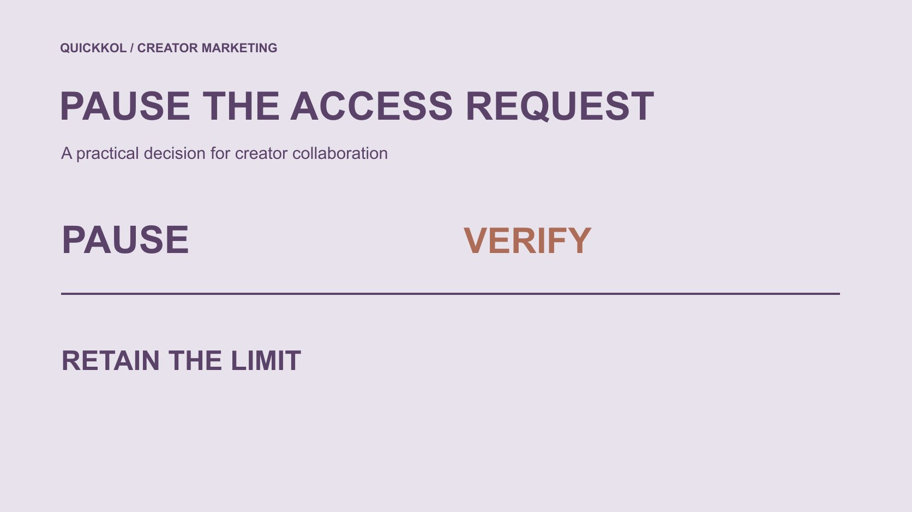
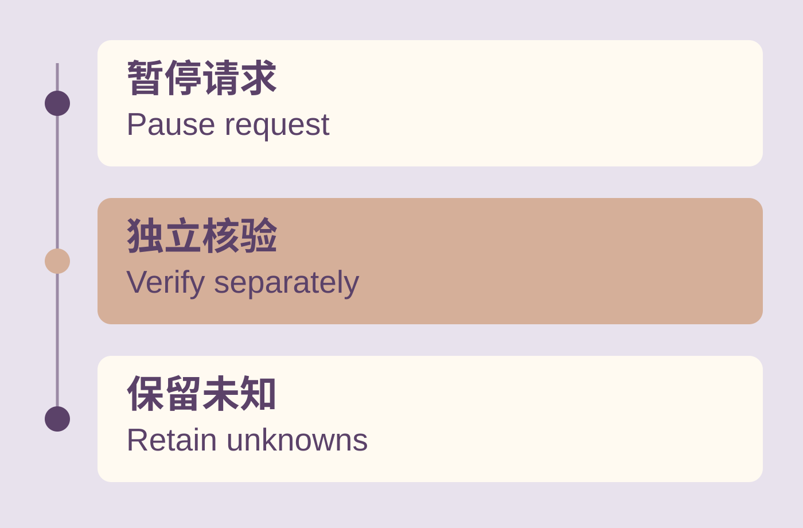

# Free TikTok Like: Triage an Access Request

Status: local review draft; confirm the publication date before release.

Pause a free-like request and verify independently. Distinguish receipt, page opening, submitted information and granted access without turning a risk signal into a personal allegation.

QuickKOL editorial graphic; not actual account metrics or a platform interface.

Receiving a “free tiktok like” link does not require logging in or trialing it to prove reliability. Pause the action, verify through an independently located official or established business route, and distinguish receipt from clicking, submitting information or approving access. These states are different. Brands and creators should protect passwords, verification codes and recovery information, and share necessary facts with an appropriate owner. This is risk triage, not a finding against a named service or a promise of complete detection or account recovery.

## Pause the request rather than follow its urgency

A request may arrive through email, a direct message, a forward or a familiar account. A claim that a slot is expiring should not replace verification. A brand should not pressure a creator into an unconfirmed link to meet a reporting deadline.

[FBI’s creator-account security alert](https://www.fbi.gov/contact-us/field-offices/atlanta/news/verified-influencer-accounts-are-being-hijacked-to-spread-scams-and-malicious-software) discusses verified accounts being hijacked to distribute malicious material. A familiar portrait or verification badge does not independently establish that the present message is safe. This is a general risk alert, not a finding that this sender has been compromised.

Retain necessary context, stop additional actions and identify what needs verification. Pausing is not a judgment against a person or cancellation of every legitimate collaboration. It allows the team to confirm the real task and source instead of exchanging account access for a promised number under pressure. A calm internal message can explain that the request is pending verification, without forwarding the link widely or inviting colleagues to open it to see what happens.

## Describe the actual interaction state

Receiving a message, opening a page, submitting information, installing software and approving access are different states. Record known facts without declaring an account stolen because a page opened or declaring no risk because no warning arrived.

If a step is uncertain, identify the uncertainty and approximate time. Do not reopen a link, repeat a submission or ask a colleague to imitate the action to complete the record. The team needs an accurate state, not an expanded incident created by reproduction.

Collect only information relevant to handling the matter. A creator should not post passwords, verification codes, recovery keys or full identity documents into a group chat. An appropriate owner can obtain necessary facts through a suitable private route, while marketing receives a status explanation without secrets to pause affected work and revise plans. That separation also prevents a normal campaign update from becoming another place where sensitive material is copied and retained by people who do not need it.

## Distinguish account secrets from access capabilities

Passwords, codes and recovery information are account secrets and should not be supplied to an unfamiliar like offer. An authorization screen can concern an access capability; that differs from directly requesting a password, but a consent button does not automatically make the request suitable.

[FTC’s app-permission advice](https://consumer.ftc.gov/articles/how-websites-and-apps-collect-and-use-your-information) discusses data collection and unnecessary permissions. Here it supports the principle of necessary information. Device permissions, platform-connected access and business approval should be understood separately rather than collapsed into already authorized.

Check whether the request explains the real task, needed capability and responsible party. Not supplying credentials does not mean other information lacks value: contact data, page management and publishing capabilities still need to fit a task. If necessity is unclear, retain the pause rather than exchange additional personal information for a process that merely looks more official. The question is what the arrangement actually needs and what was actually granted, not whether its screen contains reassuring words about verification.

## Verify through a route independent of the request

Independent verification is not opening a second official-proof link supplied by the same request. Use an independently located official entry point, established business contact or already confirmed channel to check the specific matter. A similar appearance or brand word in a domain does not establish affiliation.

The diagram separates pausing, independent verification and retained unknowns. If suitable evidence is unavailable, the action can remain unperformed. Do not fill missing support with a safety promise or infer that every unverified party is malicious.

Ask concrete questions: whether this brand assignment exists, who requested it and why a capability is involved. Do not send a verification code to prove identity or accept pressure to pay before a request can be checked or withdrawn. The task is confirming source and purpose rather than following another step supplied by the original message. Keep the verified contact route separate in the record so someone later can tell it was not simply another address copied from the same offer.

Verification does not require trialing a service; record only steps that actually occurred.

## Notice a shift from free promises to payment

[FTC’s task-scam alert](https://consumer.ftc.gov/consumer-alerts/2025/08/how-spot-avoid-task-scams) describes false balances, small initial payments and demands for deposits to unlock money, and advises against paying to get paid. It does not establish a finding against a named website, but helps a team recognize a request changing in a concerning direction.

If free becomes a top-up, unlock, upgrade or refund guarantee, record the actual wording and state rather than keep paying to justify the earlier decision. Time already spent does not justify giving more money or secrets.

A brand should also avoid pushing creators into risk through reward targets. Free likes are not a necessary production task. Pause the request while preserving records of legitimate work. Actual payment or account problems need appropriate owners handling the real circumstances, not a content team promising recovery in a chat. A useful status update states what happened and which assistance route is being used, while keeping uncertain outcomes explicitly uncertain.

## Route an existing access concern to an appropriate owner

If secrets may have been disclosed or unnecessary access approved, stop additional actions and use independently located official support and account-security routes, involving the actual account owner. Do not continue through a rescue link supplied by an unfamiliar message.

This article supplies no fixed current-menu instructions or guarantee that changing one setting resolves everything. Credentials, active sessions, connected apps, devices and already shared data are separate issues requiring review against actual circumstances and platform guidance.

Marketing can pause affected publication or payment arrangements, retain necessary records and limit circulation. Do not take over a creator’s personal account or demand their entire message history. Appropriate collaboration states which status information is needed, who handles it and what condition allows affected work to resume. A brand can support that process without pretending to be the platform’s recovery team or making decisions about someone else’s account based only on an incomplete forwarded description. Record the responsible owner so repeated requests do not reach the creator from several different departments.

## Do not turn a request into a personal allegation

Receiving an offer is not using it, clicking is not knowingly procuring engagement, and a rising count does not establish that the request was carried out. Preserve those distinctions in brand discussions and handoffs.

The [free-follower permission-review guide](https://www.quickkol.com/blog/tiktok-free-follower-offer-permissions-review/#answer) expands request boundaries. This article handles pausing and verifying an unexpected message, not searching the identities of people who liked a post for incriminating evidence. Account security and interaction authenticity are different questions.

If a report needs a note, state the request type, current action state and next verification rather than an unconfirmed motive. Avoid broad screenshot circulation that lets others mistake unfinished review for a finding. Protecting an account and treating a creator fairly can be simultaneous goals. A narrowly worded note can lead to necessary action without attaching an enduring suspicion to the person who reported the message, which is especially important if the team wants creators to raise future concerns early rather than hide them out of fear of blame.

## Use a status note to define resumption

A status note can identify affected work, known actions, unknowns, owner and next update. It does not need account secrets and should not translate being handled into confirmed safe.

The [account-recovery handoff guide](https://www.quickkol.com/blog/instagram-free-followers-access-recovery-handoff/#answer) expands states and ownership. Before resuming work, check that appropriate people have confirmed the actual dependencies, such as handling the relevant access concern and verifying a normal contact route. A newly supplied success screen alone does not establish that everything is resolved.

Each team should receive necessary information only. Content staff may need to know a publication remains paused, while a security owner needs more specific facts. Separating them protects the creator’s privacy and shows each person what they can do, rather than leaving everyone waiting for an ownerless all clear. Set the next update around a meaningful check or responsible response so repeated messages do not pressure someone into declaring an outcome they have not actually confirmed.

## Keep triage within the creator-collaboration task

The goal is protecting legitimate collaboration rather than researching how to obtain free numbers. A brand should explicitly avoid requiring creators to trial like services or treat account access as the default cost of a marketing task.

A sound outcome may simply be an unperformed request, an unverified source and affected work on hold. It need not produce a definitive verdict about a service or person, and it cannot guarantee similar messages never arrive again.

Give each update a clear time so an earlier state is not mistaken for a current confirmation. Within influencer marketing, accurate states, independent routes and appropriate ownership are more useful than following promises or spreading panic. Preserve real production work and keep unknowns at the question level; stronger decisions should follow new reliable information. A creator who can report an unexpected message without being forced to prove innocence is better placed to cooperate with a careful review, while the brand retains the information needed to protect its actual campaign responsibilities.

## Different states need different descriptions

| Known state | Describe | Do not infer |
| --- | --- | --- |
| Message received | Source, wording and time | Service was used |
| Opened or submitted | Actual steps and unknowns | Definite compromise or definite safety |
| Access concern | Appropriate owner and handling route | One success screen resolves everything |
| Work resumption | Confirmation of actual dependencies | All future risk disappears |

An educational triage framework, not a service audit, recovery guarantee or personal misconduct finding.

## When an unexpected like request arrives

Pause action and hand over accurate facts.

- [ ] Retain necessary context without circulating secrets.
- [ ] Separate receipt, clicking, submission and approval.
- [ ] Do not exchange credentials or payment for verification.
- [ ] Confirm the task through an independent route.
- [ ] Have appropriate people handle existing concerns.
- [ ] Use confirmed states to decide resumption.

## Research date and limitations

Sources reviewed November 16, 2026. Methods, tables and decision rules are editorial recommendations. Hypothetical examples are not actual client results or industry benchmarks. Source geography and periods are specified where relevant.

## Continue learning about metrics and evidence

Understand sources, windows, permissions and unknowns without judging a person from one signal or promising complete detection.

[Read the metrics decision guide](https://www.quickkol.com/blog/social-media-metrics-creator-decision-tree/)

## Sources

- [FBI’s creator-account security alert](https://www.fbi.gov/contact-us/field-offices/atlanta/news/verified-influencer-accounts-are-being-hijacked-to-spread-scams-and-malicious-software)
- [FTC: information use by websites and apps](https://consumer.ftc.gov/articles/how-websites-and-apps-collect-and-use-your-information)
- [FTC’s task-scam alert](https://consumer.ftc.gov/consumer-alerts/2025/08/how-spot-avoid-task-scams)
