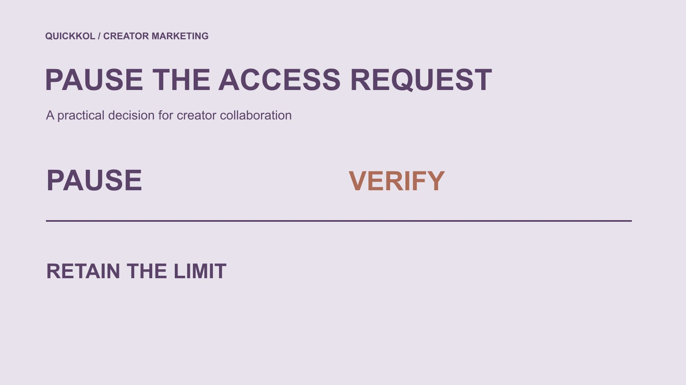
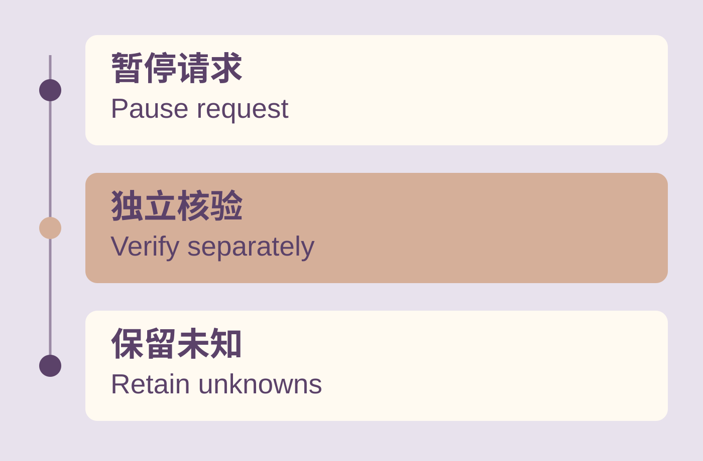

# 免费点赞请求怎样判断账号风险

状态：本地审阅稿；正式发布日期待确认。

面对免费点赞链接，先暂停请求并从独立路径确认。区分收到了消息、点开页面、提交资料与授权状态，避免把风险提示变成对个人的指控。

QuickKOL 编辑图形；不呈现真实账号指标或平台界面。

收到“free tiktok like”链接，不需要通过登录或试用来证明它是否可靠。先暂停动作，从自己找到的官方或既有业务路径核对，再说明目前只是收到了消息，还是已经点击、填写资料或批准访问。这些状态不同，不能互相代替。品牌和达人应保护密码、验证码与恢复信息，把必要事实交给合适负责人。本文讨论风险处理，不认定任何特定服务违法，也不承诺能完整识别或恢复所有账号问题。

## 先暂停请求，不追随紧迫感

请求可能来自邮件、私信、转发或熟悉账号。不要因为对方说名额快到期，就跳过核对。品牌团队也不应让创作者为了赶报告而尝试未经确认的链接。

[FBI 的创作者账号安全提醒](https://www.fbi.gov/contact-us/field-offices/atlanta/news/verified-influencer-accounts-are-being-hijacked-to-spread-scams-and-malicious-software)讨论已验证账号也可能遭劫持并传播恶意内容。熟悉头像或认证标记不能独立证明当前消息安全；这是一项一般风险提醒，不代表本次发件人确实出事。

可以先保存必要消息背景，停止新增动作，再说明要核对哪项请求。暂停不是对人作结论，也不等于取消所有正常合作。它给团队时间确认真正的任务与来源，而不是在压力下把账号权限作为免费数字的交换条件。

## 准确说出已经发生哪一步

只收到消息、打开页面、提交资料、安装软件与批准访问，是不同状态。记录已知事实，不因打开过页面就断言账号失窃，也不因没收到警报就断言没有风险。

如果不能确定，写明不确定的步骤与时间。不要为补齐记录再次打开链接、重复提交，或要求同事模仿操作。团队需要的是准确状态，而不是为了重现而增加影响。

品牌只收集与处理有关的最少信息。不要让创作者在群里发密码、验证码、恢复密钥或完整个人证件。适当负责人可以通过合适私密路径了解必要事实；市场团队可获得不包含秘密的状态说明，以便暂停相关工作与调整计划。

## 区分账号秘密与访问能力

密码、验证码与恢复信息是账号秘密，不应交给提供点赞的陌生请求。授权页面可能涉及某种访问能力；它与直接索要密码不同，但也不能因为有同意按钮就自动视为适合。

[FTC 的应用权限提醒](https://consumer.ftc.gov/articles/how-websites-and-apps-collect-and-use-your-information)讨论信息收集与不必要权限。这里把它作为最少必要信息的原则；手机设备权限、平台连接权限与业务同意需要分别理解，不能混成一个“已经授权”。

核对请求是否能解释真实任务、所需能力与负责人。不提供凭证也不等于其他信息没有价值；联系方式、页面管理或发布能力同样要与任务相称。无法说明必要性时保持暂停，不用更多个人资料换取一个看起来更正式的验证过程。

## 沿独立路径核对请求

独立核对不是打开请求附带的第二个“官方证明”链接。应通过自己查找的官方入口、已有业务联系人或已确认渠道，核对具体事项。外观相似或域名含某品牌词不自动证明关联。

配图把暂停、独立核对与保留未知分开。若查不到合适证据，可以继续不执行，不必把缺少证明补成安全承诺，也不要反向认定所有未核对对象都有恶意。

核对的问题要具体，例如是否确有本次品牌任务、谁提出、为什么涉及某项权限。不要向对方发验证码来“证明本人”，也不接受要求先付钱才能撤销或核实的压力。真正需要解决的是来源与任务能否确认，而不是继续追逐请求提供的下一道步骤。

核对不需要试用服务；只记录实际发生的步骤。

## 识别从免费承诺到付款的变化

[FTC 的任务骗局提醒](https://consumer.ftc.gov/consumer-alerts/2025/08/how-spot-avoid-task-scams)描述虚假余额、小额初始支付与要求存钱解锁等风险路径，并提醒不要为得到报酬而先付款。这个提醒不能用来直接认定某个具名网站，但能帮助团队识别需要停止的请求变化。

如果一开始说免费，随后出现充值、解锁、升级或退款保证，记录实际措辞与状态，而不是继续付出以证明此前决定正确。已经投入时间，不构成继续交出资金或秘密的理由。

品牌也要避免用奖励目标推动创作者冒险。免费点赞不是必要制作任务；可以暂停相关请求，同时保留原来正常工作的记录。涉及已经发生的付款或账号问题，应交给适当负责人按实际情况处理，不由内容团队在聊天里保证一定追回。

## 已有访问疑问交给谁

如果怀疑已经泄露秘密或批准不必要访问，停止新增动作，通过自己找到的官方支持与账号安全路径处理，并联系实际负责账号的人。不要按陌生消息提供的“救援”入口继续操作。

本文不提供某个当前菜单的固定步骤，也不保证改一个设置就解决全部问题。凭证、活动会话、连接应用、设备与已分享数据是不同事项，具体处理需要按实际情况与平台指导核对。

市场团队可以暂停相关发布或付款安排，保留必要记录并减少扩散。不要擅自接管创作者个人账号，或要求交出全部历史聊天。适当协作应说明需要什么状态信息、由谁处理，以及哪个条件满足后才能恢复受影响的工作。

## 不要把请求转成个人指控

收到提议不等于使用，点击不等于知情采购，数字上升也不等于请求已经执行。这些区别必须保留在品牌讨论与交接中。

[免费涨粉权限审阅指南](https://www.quickkol.com/zh/blog/tiktok-free-follower-offer-permissions-review/#answer)进一步讨论请求的权限边界。本篇处理的是突发消息的暂停与核对，不鼓励通过检查点赞用户身份来寻找“罪证”。账号安全处理与互动真实性判断是不同问题。

如果报告需要记录，可以说收到某类请求、当前动作状态与下一项核对，不写未经证实的动机。避免将截图大范围转发，使其他人把未完成核验误读成确定结论。保护账号与公平处理达人关系，可以同时成为团队目标。

## 用状态说明恢复条件

状态说明可以包含受影响任务、已知动作、仍未知事项、处理人和下一次更新时间。它不需要包含账号秘密，也不应把“处理中”写成已经安全。

[账号恢复交接指南](https://www.quickkol.com/zh/blog/instagram-free-followers-access-recovery-handoff/#answer)进一步区分状态与负责人。恢复工作前，先看实际依赖是否由适当人员确认，例如相关访问疑问是否已处理、正常联系渠道能否确认。不能仅凭对方重新发来一张成功页面就认定所有事项完成。

每个团队只接收必要信息。内容团队可能只需知道某次发布继续暂停，而安全负责人需要更具体事实。将两者分开，有助于保护创作者隐私，也让每个人知道自己可以执行什么，而不是在没有责任人时等待一个笼统的“没事了”。

## 用风险处理保护达人合作

最终目标是保护正常合作，而不是研究如何获得免费数字。品牌应明确不要求创作者试用点赞服务，也不把账号访问作为完成营销任务的默认代价。

一项好的处理结果可能只是请求未执行、来源待核实、受影响工作暂缓。它不一定产生对某个服务或个人的确定判定，也不保证以后不会再收到类似消息。

让每次更新都有明确时间，避免旧状态被误认为当前确认。在达人营销中，准确状态、独立路径与适当负责人，比追随承诺或恐慌式扩散更有用。团队保留真实完成的制作工作，同时把未知留在问题层面；只有新的可靠资料，才推动下一步决定。

## 不同状态需要不同说明

| 已知状态 | 应说明 | 不能推定 |
| --- | --- | --- |
| 收到消息 | 来源、措辞与时间 | 已经使用服务 |
| 点开或提交 | 实际步骤与未知 | 必定失窃或必定无事 |
| 授权疑问 | 适当负责人和处理路径 | 一张成功页证明全部解决 |
| 工作恢复 | 实际依赖的确认 | 所有风险永远消失 |

教育性风险处理框架，不是服务审计、账号恢复保证或个人违规结论。

## 突然收到点赞请求时

暂停动作，准确交接。

- [ ] 保留必要背景，不扩散秘密。
- [ ] 区分收到、点击、提交与批准。
- [ ] 不用凭证或付款换核对。
- [ ] 沿独立路径确认任务。
- [ ] 由适当人员处理已有疑问。
- [ ] 用确认状态决定工作是否恢复。

## 研究日期与使用边界

资料核验于 2026 年 11 月 16 日。文中方法、表格和决策规则为编辑建议，标为假设的示例不是实际客户结果或行业基准。外部资料的适用地区与时期按各段说明。

## 继续学习指标与证据

理解来源、窗口、权限与未知；不凭单一信号判断个人，也不承诺完整检测。

[阅读指标决策指南](https://www.quickkol.com/zh/blog/social-media-metrics-creator-decision-tree/)

## 来源

- [FBI 的创作者账号安全提醒](https://www.fbi.gov/contact-us/field-offices/atlanta/news/verified-influencer-accounts-are-being-hijacked-to-spread-scams-and-malicious-software)
- [FTC：网站与应用的信息使用](https://consumer.ftc.gov/articles/how-websites-and-apps-collect-and-use-your-information)
- [FTC 的任务骗局提醒](https://consumer.ftc.gov/consumer-alerts/2025/08/how-spot-avoid-task-scams)
