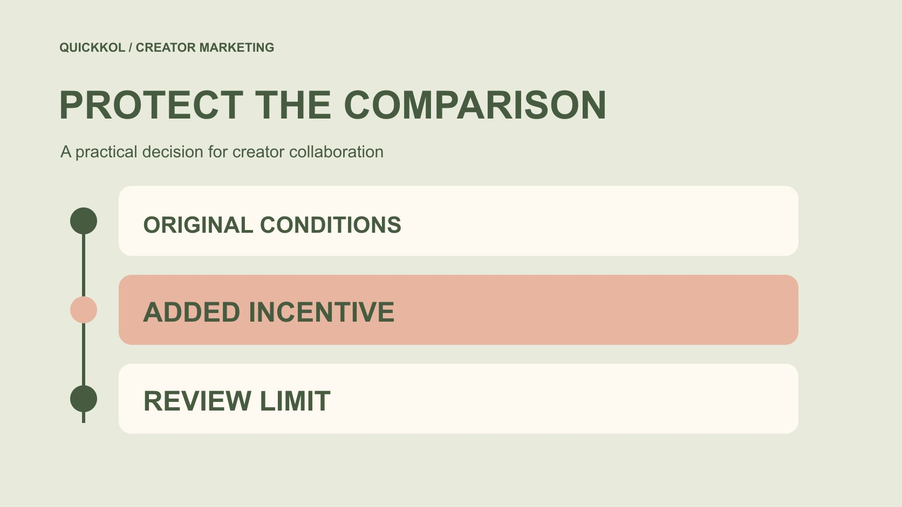
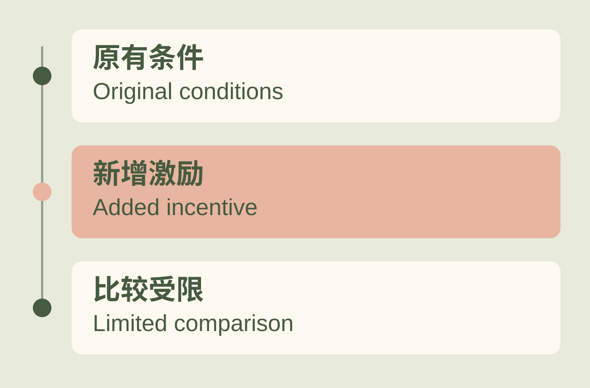

# Free Likes TikTok: Protect a Creator Content Test

Status: local review draft; confirm the publication date before release.

Free-like offers or added incentives can change content-test conditions. Preserve records and assess which comparisons remain usable without treating a change as a verdict about a creator.

QuickKOL editorial graphic; not actual account metrics or a platform interface.

A number offered through “free likes tiktok” does not prove better content or make a brand test comparable. If one version has added incentives or interactions of uncertain origin, record known changes, preserve the original figures and narrow the conclusion. Do not trial a service to validate its effect or accuse someone from a single increase. The brand’s question is what the comparison can still answer, what independent information is needed and whether another observation under clear conditions is appropriate, rather than how to label a creator.

## State the question before judging a test

A brand may want to know whether an opening explains a product or compare two creators’ expressions. These are different questions requiring different information. Write the specific question before results appear rather than select whichever metric looks favorable afterward.

[NIST’s experiment-objective guidance](https://www.itl.nist.gov/div898/handbook/pri/section3/pri31.htm) recommends identifying and prioritizing objectives before choosing factors and design. This borrows a planning principle; it does not turn ordinary social publication into a randomized scientific experiment.

For a hypothetical comparison of openings, record content, audience arrangements, timing, promotion and observation window. Likes alone may not answer whether information was understood. A defined objective lets the team identify what an added incentive changed and distinguish a work sample that remains observable from a comparison that no longer supports its original conclusion. It also creates an honest stopping point: the team can say the available observation does not answer the question, instead of inventing a new objective that makes the highest displayed count appear to be a successful test.

## Record changed conditions before explaining causes

If a free-like offer arrives, record its wording, time and source without treating receipt as confirmed use. If a creator reports a changed promotion arrangement, record the known scope rather than assign every simultaneous increase to it.

Sequence is useful, but one event preceding another does not establish causation. Other posts, paid distribution, brand activity or attention to a topic may also need checking. Missing information should remain unknown rather than be filled with the easiest narrative.

Separate original plan, confirmed changes and questions awaiting verification. Later readers can then distinguish facts from questions and avoid turning a forwarded message into a finding against an entire project. The focus is test suitability, not gathering personal information unrelated to that decision. Ask for the smallest relevant clarification, such as whether distribution conditions changed during the stated window, rather than demand unrestricted account access to resolve a question that the available campaign records may already explain more appropriately.

## Policy does not replace project facts

[TikTok’s integrity rules](https://www.tiktok.com/community-guidelines/en/integrity-authenticity), in the reviewed 2025 version, prohibit services that artificially inflate engagement and related manipulation, and describe removal of detected false metrics. This is platform policy, not an investigation finding about any person or service.

Do not merge legitimate production, clearly identified commercial promotion and purchasing false audience actions into one concept. Whether an activity meets applicable policy depends on its actual arrangement; a change in likes cannot perform that assessment for you.

A brand can state that it does not procure or require artificial inflation while recording unconfirmed matters fairly. Avoid logging in, granting access or testing a service to validate its promise. That introduces additional account and data risks and changes the observation conditions further. The educational purpose is understanding boundaries, not finding a way around platform controls or discovering which artificial actions remain counted. A sensible project rule should reduce pressure to manufacture a result, rather than leave creators believing the brand only cares whether the final displayed number reaches a target.

## Preserve the count and limit the comparison

Suppose two versions display 120 and 210 likes, and one is later confirmed to have different incentive conditions. Record those observations without concluding that the latter creative is better, viewers prefer it or sales improved. These are hypothetical figures, not benchmarks.

The diagram separates original conditions, added incentives and a limited comparison, reminding the team not to delete inconvenient context to make a result neater. Values under different conditions are not necessarily useless; their supported question becomes narrower.

When retaining a screenshot or appropriate export, record time, object and window so a later cumulative value is not mistaken for the count at the original endpoint. If the influence on individual actions is unknown, do not subtract an invented portion to produce cleaned genuine engagement. Accurate limitations are more reliable than a fabricated precise net figure. Preserve the historical observation as an observation, while changing the interpretation separately so another analyst can see exactly which part of the report was reconsidered.

After conditions change, narrow the conclusion before deciding whether another observation is needed.

## Distinguish likes, views and understanding

[TikTok’s video-field reference](https://developers.tiktok.com/docs/en/tiktok-api-v2-video-object) defines likes, comments, shares and views as separate counts. Preserve their names instead of merging them into genuine audience approval to give the content test one score.

A like is an action count, not distinct people, purchases or a complete opinion survey. Viewing also does not automatically establish understanding. If the question is whether an explanation is clear, appropriate content review and specific feedback may help without making likes the only answer.

Keep the denominator and object with comparisons. A calculated rate does not automatically resolve differences in distribution, audience, window or incentives. Decimal places should not give authority to an unsupported causal conclusion. Data can describe what was observed, but the brand still needs to explain its relevance to this decision. Before adding another metric, ask which uncertainty it addresses; collecting more numbers with the same unexamined conditions can make a report longer without making the comparison any more informative.

## Decide which material remains usable

A limited comparison does not require rejecting every production output. Product visibility, accurate captions and agreed presentation can be reviewed separately from engagement results.

Conversely, technical acceptance does not establish market preference. A team can accept a clear demonstration while declining to use its changed like count as winner evidence. Separating production acceptance from distribution conclusions supports fair collaboration instead of allowing one uncertain number to erase all real work.

The [Trial Reels concept-test guide](https://www.quickkol.com/blog/trial-reels-creator-concept-test-design/#answer) expands comparison design. Current material might be described as a descriptive observation, suitable only for limited use or unable to answer the original question. Labels should identify the conclusion, not permanently classify a person as a suspicious creator. New information can then update the judgment without first undoing a broad accusation. The review should explain which decision remains possible now, so uncertainty about comparative response does not silently become an unsupported conclusion that the creator produced nothing useful or that the entire collaboration failed.

## Explain conditions for a follow-up observation

If the original question still matters, discuss another observation under defined conditions. A new round is not an automatic remedy and should not require a creator to guarantee restoration of a like count. Decide what needs comparing before selecting the method.

Record content changes, distribution arrangements and windows, reducing irrelevant differences where feasible while acknowledging factors an ordinary platform publication cannot control. Posting on another day does not automatically prove causation or eliminate prior uncertainty.

Give follow-up work a reasonable scope and resources. Discuss added filming or publication separately instead of demanding it unconditionally because a count disappointed. The method should clarify questions and limitations rather than repeat work until the brand gets its preferred outcome. Decide beforehand when to stop comparing or retain only a descriptive conclusion. That prevents an open-ended retest from becoming another numerical pressure on the creator, and gives the team a defensible reason for its next decision even when the available evidence remains inconclusive.

## Write a conclusion that can be updated

A report can state which versions were observed, which changed conditions are confirmed, what remains unknown and which judgment is currently unsupported. Data anomaly alone leaves readers to supply an allegation.

The [like-evidence basics guide](https://www.quickkol.com/blog/free-tiktok-likes-engagement-literacy/#answer) explains the boundary between an action and preference. Here the focus is test usability: a limitation may affect winner selection without affecting production acceptance, or further independent information may be needed before deciding.

Name the next specific question and responsible role in the handoff, retaining original observations and versions. A stronger conclusion should follow genuinely new information rather than another repetition of the same number. Accurately stating that a comparison is inconclusive can support the next creator collaboration better than inventing a winner. It also makes the report easier to correct later, because each judgment is attached to a defined question instead of being embedded in an overall narrative that treats uncertainty as evidence of personal misconduct.

## Make the purpose learning rather than inflated numbers

A content test should help a brand understand expression and assignment rather than manufacture high-looking engagement. A free-likes keyword should lead to data literacy and account protection, not service recommendations or trial instructions.

The team can explicitly avoid requiring artificial inflation, discuss real production under clear conditions and keep conclusions limited when evidence is limited. Suspicious signals and established facts remain separate; a changed action count does not automatically establish a creator’s knowing participation.

The final decision should answer what work was completed, which observations remain usable, which comparisons need pausing and what information is needed next. With those boundaries, the brand can learn from content instead of turning one unclear numerical change into a definite accusation. This gives both the analyst and creator a practical outcome: a decision about the use of evidence, with reasons that can be reviewed, rather than an unsupported judgment about a person’s character or an invitation to inflate the next result.

## Responding to a limited test

| Material | Retain | Avoid concluding |
| --- | --- | --- |
| Original count | Source, time and object | Count equals preference |
| Changed conditions | Confirmed details and unknowns | Sequence proves causation |
| Production output | Agreed facts and technical review | Engagement questions erase all work |
| Follow-up observation | Question, scope and limitations | Retesting guarantees a winner |

An education and research framework, not inflation detection, personal adjudication or experimental certification.

## Six questions for preserving test meaning

Separate observations from conclusions.

- [ ] What was the original question?
- [ ] Which conditions actually changed?
- [ ] Are sources and windows comparable?
- [ ] Which production judgments remain usable?
- [ ] Which conclusions need narrowing?
- [ ] Who confirms the next information?

## Research date and limitations

Sources reviewed November 16, 2026. Methods, tables and decision rules are editorial recommendations. Hypothetical examples are not actual client results or industry benchmarks. Source geography and periods are specified where relevant.

## Continue learning about metrics and evidence

Understand sources, windows, permissions and unknowns without judging a person from one signal or promising complete detection.

[Read the metrics decision guide](https://www.quickkol.com/blog/social-media-metrics-creator-decision-tree/)

## Sources

- [NIST’s experiment-objective guidance](https://www.itl.nist.gov/div898/handbook/pri/section3/pri31.htm)
- [TikTok’s integrity rules](https://www.tiktok.com/community-guidelines/en/integrity-authenticity)
- [TikTok’s video-field reference](https://developers.tiktok.com/docs/en/tiktok-api-v2-video-object)
