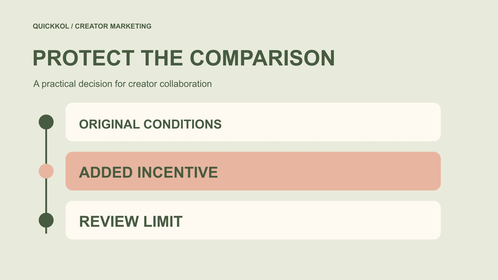
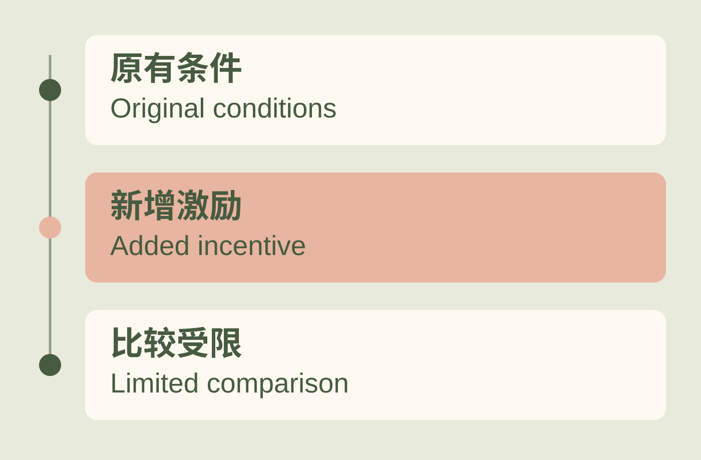

# 免费点赞怎样影响品牌内容测试

状态：本地审阅稿；正式发布日期待确认。

免费点赞或额外激励可能改变内容测试条件。先保留原始记录，再判断哪些比较仍可用，不把互动变化当作某位达人的违规证据。

QuickKOL 编辑图形；不呈现真实账号指标或平台界面。

“free likes tiktok”提供的数字不能证明内容更好，也不能让品牌测试自动具有可比性。如果某个版本加入额外激励或来源不明互动，先记录已知条件变化、保留原始数字，并缩小能作出的结论。不要尝试服务来验证效果，也不凭单次增长指控个人。品牌要解决的是比较还能回答什么问题、需要哪些独立资料，以及是否应在清楚条件下重新观察，而不是给某位创作者贴标签。

## 先说明测试要回答的问题

品牌可能想知道开头是否讲清产品，也可能想比较两种创作者表达。这些问题不同，需要的资料也不同。先写具体问题，不要在看到数字以后才挑最有利的指标。

[NIST 的实验目标说明](https://www.itl.nist.gov/div898/handbook/pri/section3/pri31.htm)建议在选择因素与设计前明确并排列目标。这里借用的是研究规划原则，不把普通社交发布自动当作经过随机设计的科学实验。

例如假设品牌比较两种开场，它可以记录内容、受众安排、发布时间、投放与观察窗口。若只有点赞数，未必能回答信息是否被理解。明确目标后，团队才知道额外激励改变了什么，也能区分一个仍可观察的作品与一项已经无法支持原来结论的比较。

## 先记录变化，再核对原因

如果收到免费点赞提议，记录的是提议内容、时间与来源，并不等于确认已经使用。如果创作者说明曾改变推广安排，记录实际已知范围，不把所有同时发生的增长都归给这个变化。

时间顺序有帮助，但先后发生不直接证明因果。同期其他发布、付费传播、品牌活动或话题关注，都可能需要核对。来源缺失时应保留未知，而不是挑一种最容易讲的解释。

团队可以把条件分成原先计划、已确认变更与待核实事项。这样后续人员知道哪些是事实，哪些只是问题，也不会因为一条转发消息就把一个完整项目写成确定违规。关注的是测试适用性，而不是搜集与判断无关的个人信息。

## 平台规则不能替代项目事实

[TikTok 的真实性规则](https://www.tiktok.com/community-guidelines/en/integrity-authenticity)在所读的 2025 年版本中禁止人工增加互动的服务与相关操纵，并说明检测到的虚假指标可能被移除。这是平台规则，不是本篇对任何人或服务的调查结论。

不要把一般合规内容制作、清楚标明的商业推广与购买虚假观众动作混成同一个概念。实际活动是否符合规则，需要按真实安排与适用政策判断；点赞变化本身不能替你完成这一步。

品牌可以明确不采购或要求人工膨胀指标，同时公平记录未确认事项。避免为了验证承诺而登录、授权或测试服务；那会引入更多账号与数据风险，也会进一步改变原来的观察条件。教育目的在于理解边界，不是教人绕过平台或试出哪种刷量能保留。

## 保留原数，限制比较的意义

假设两个版本分别显示 120 与 210 次点赞，其中一个的激励条件后来被确认不同。可以记录这些观察，但不能直接写后者创意更好、观众更喜欢或销量提升。这里的数字仅是假设，不是基准。

配图将原条件、额外激励与受限比较分开，提醒团队不要通过删掉不方便的背景，让结果看起来更整齐。不同条件下的数值并非毫无用途，只是能支持的问题变窄。

保留截图或适当导出时记录时间、对象与窗口，避免把后来累计值误当作原来测试结束的值。若无法确认激励实际影响哪些动作，就不要自行扣除一部分，制造所谓清洗后真实互动。准确说明限制，比虚构一个精确净数更可靠。

条件变化后，先缩小结论，再决定是否需要新的观察。

## 点赞、观看与理解分别判断

[TikTok 的视频字段说明](https://developers.tiktok.com/docs/en/tiktok-api-v2-video-object)分别定义点赞、评论、分享和观看数量。字段不同就应保留名称，不能为了给内容测试一个总分而把它们全部称作真实用户认可。

点赞是动作计数，不是独立人数、购买结果或完整意见调查。观看也不自动表示理解。若品牌的问题是某句解释是否清楚，可以考虑适当的内容审阅与具体反馈，不必把点赞当作唯一答案。

比较应保留分母与对象。如果一个版本分发条件不同，即使算出比例，也不自动解决受众、窗口或激励差异。不要让小数位给缺乏依据的因果结论增加权威感。数据可以帮助描述发生了什么，但品牌仍要解释它为什么与当前决策有关。

## 决定哪些材料仍然可用

比较受到限制，不代表所有制作成果都必须否定。产品是否被拍清、字幕是否准确、创作者表达是否符合约定，可以与互动结果分开审阅。

反过来，技术合格也不证明市场偏好。团队可以接受一段清楚的产品演示，同时不把其点赞变化当作优胜证据。把制作验收与传播结论分开，有助于公平处理合作，而不是让一个不确定数字吞掉所有真实工作。

[试用 Reels 内容测试指南](https://www.quickkol.com/zh/blog/trial-reels-creator-concept-test-design/#answer)进一步讨论概念比较。当前材料可以标为描述性观察、需限定使用或不能回答原问题。标签要指向具体结论，不是给人贴“可疑达人”的永久标记。这样后来有新资料时，能够更新判断，而不必先推翻对人的笼统评价。

## 重新观察也要说明条件

如果原问题仍重要，可以讨论在明确条件下重新观察。但新一轮不是自动补救，也不应要求创作者保证恢复某个点赞数量。先决定需要比较什么，再安排合适方法。

记录内容变化、分发安排与窗口，尽量避免无关差异，同时承认普通平台发布仍可能有无法控制的因素。不要声称只要换一天发就能证明因果，或把先前不确定性全部消除。

品牌应给后续工作合理范围与资源。若新增拍摄或发布，单独讨论，而不是以数字没达到预期为由无条件索取。方法的价值在于让问题和限制更清楚，不是不断重做直到出现品牌喜欢的结果。也要预先确定什么情况会让团队停止比较或只保留描述性结论。

## 把结论写成可更新的说明

报告可以说明观察了哪些版本、什么条件变化已确认、哪些仍未知，以及现在不能支持哪项判断。不要只写数据异常，留下读者自行补成违规结论。

[点赞证据基础指南](https://www.quickkol.com/zh/blog/free-tiktok-likes-engagement-literacy/#answer)帮助理解动作与偏好的边界。本篇的重点是测试是否仍适用：一项限制可能只影响优胜比较，不影响产品演示的制作验收；也可能需要新的独立资料才能决定。

在交接中写出下一项具体问题与负责角色，保留原观察和版本记录。只有真实新资料，才应推动进一步结论，而不是重复同一个数字。准确说明不能判断，往往比给出一个没有依据的赢家更有利于下一轮达人合作。

## 让品牌学习而不是制造数字

内容测试的价值是帮助品牌理解表达与任务，而不是制造看起来高的互动。免费点赞关键词应引向数据素养与账号保护，不是服务推荐或试用步骤。

团队可以明确不要求人工膨胀指标，按真实制作与清楚条件讨论合作，并在证据有限时保持结论有限。可疑信号与已证实事实需要分开，某个动作变化也不自动说明创作者知情参与。

最后决定应回答：哪些工作确实完成，哪些观察可以使用，哪些比较需要暂停，以及下一步需要什么资料。保留这些边界，品牌才能从内容中学习，而不是把一次不清楚的数字变化变成对人的确定指控。

## 测试受到影响后如何处理

| 材料 | 可以保留 | 避免结论 |
| --- | --- | --- |
| 原始计数 | 来源、时间与对象 | 数字等于偏好 |
| 条件变更 | 确认事项与未知 | 先后发生即因果 |
| 制作成果 | 约定事实与技术审阅 | 互动疑问抹去全部工作 |
| 后续观察 | 问题、范围与限制 | 重做必定证明赢家 |

教育与研究框架，不是刷量检测、个人判断或科学实验认证。

## 保留测试意义的六个问题

把观察与结论分开。

- [ ] 原本要回答什么？
- [ ] 哪些条件实际改变？
- [ ] 来源与窗口能否比较？
- [ ] 哪些制作判断仍可保留？
- [ ] 哪些结论需要缩小？
- [ ] 下一步资料由谁确认？

## 研究日期与使用边界

资料核验于 2026 年 11 月 16 日。文中方法、表格和决策规则为编辑建议，标为假设的示例不是实际客户结果或行业基准。外部资料的适用地区与时期按各段说明。

## 继续学习指标与证据

理解来源、窗口、权限与未知；不凭单一信号判断个人，也不承诺完整检测。

[阅读指标决策指南](https://www.quickkol.com/zh/blog/social-media-metrics-creator-decision-tree/)

## 来源

- [NIST 的实验目标说明](https://www.itl.nist.gov/div898/handbook/pri/section3/pri31.htm)
- [TikTok 的真实性规则](https://www.tiktok.com/community-guidelines/en/integrity-authenticity)
- [TikTok 的视频字段说明](https://developers.tiktok.com/docs/en/tiktok-api-v2-video-object)
