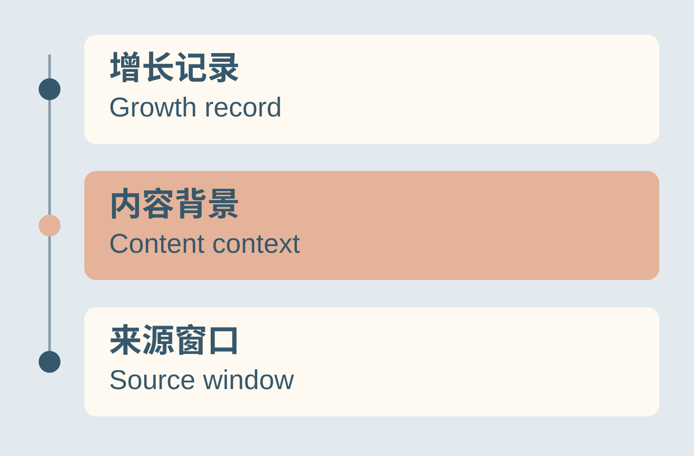

# Instagram Bot Followers: Triangulate Suspicious Signals

Status: local review draft; confirm the publication date before release.

Cross-check suspected Instagram bot-follower signals through record definitions, content context and source relationships, rather than repeated screenshots of one source.

Instagram bot followers cannot reliably be established from one growth curve, interaction ratio or account appearance. Cross-check three things: whether records are comparable, what relevant content and campaign context exists, and whether the sources are genuinely independent. An anomaly can justify further review without proving personal purchase or manipulation. Preserve original observations, alternatives and unknowns, request only appropriate aggregate material and avoid private follower surveillance or claims that a score perfectly separates real from false audiences.

## Treat an anomaly as the start of a question

“This movement differs from earlier observations” can be accurate. “Therefore this creator bought bot followers” adds claims about conduct and responsibility. Retain the visible change and source before asking what needs checking, rather than start with a label and search for supporting material.

[NIST’s outlier explanation](https://www.itl.nist.gov/div898/handbook/eda/section3/eda35h.htm) notes that an observation differing from others can involve error, random variation or an interesting phenomenon. The application here is interpretive caution, not a social-account detection standard. No statistical test of a real account was performed.

A brand can pause an unexplained promise without classifying a person. Withholding an immediate accusation does not mean ignoring risk; retaining uncertainty does not prove the absence of a problem. Name the question according to the available evidence so cross-checking has a clear object. This leaves room for a source correction, additional context or a genuinely unresolved concern, rather than requiring every new fact to fit a conclusion chosen before the review began.

## Align the aggregate records first

Before comparison, confirm account, field, retrieval time, window and precision. A shortened public display, a full total and a period change should not occupy one column as equivalents. Ask the supplier about an unclear source instead of guessing missing conditions.

[Meta’s account-Insights field reference](https://developers.facebook.com/documentation/instagram-platform/api-reference/instagram-user/insights) notes that unavailable data can return an empty dataset and that some data may be delayed. Those conditions remind us that missing is not zero and nearby retrieval times do not necessarily describe the same state. They are not a universal explanation for every third-party delay.

Separate aligned records from unresolved ones. Correct the comparison if different fields explain the difference; retain a question where they do not. Reconciliation narrows uncertainty without certifying the entire audience. Finding one ordinary explanation does not prove all followers authentic, just as an unresolved difference does not establish personal misconduct. The report should state exactly which comparison has improved and which broader question remains unanswered.

## Observe the relevant content context

Examine relevant work and project events instead of a count chart alone. Record a new publication, renewed discussion of existing work or another confirmed activity without automatically calling it the cause of growth. Unverified comments remain leads.

The [shared follower-record guide](https://www.quickkol.com/blog/instagram-follower-tracking-campaign-event-log/#answer) keeps observations and events separate. Cross-checking asks the next question: does the contextual material change the interpretation of the signal? If a piece merely supplies one possible explanation, retain possible. Temporal proximity does not prove causation.

Do not classify audiences through a creator’s language, nationality, appearance or a type of avatar. A brand can assess task-related audience relevance through appropriate material. An unfamiliar language or a new content community is not proof of bots. Keep review tied to records and checkable actions. This helps avoid a particular analytical mistake: treating a background the reviewer does not recognize as an anomaly in the creator’s behavior, instead of identifying which factual question would actually distinguish relevant explanations.

## Independence is more than different interfaces

Two tools may display the same public source, while three screenshots may come from one retrieval. Different interfaces do not guarantee independent information, and more copies do not automatically strengthen proof. Explain where each record actually comes from.

Cross-check aggregate material, relevant original work and an appropriate first-party field while retaining each scope. A creator’s explanation deserves consideration rather than dismissal because it comes from the person concerned; their confirmation alone should not be called independent validation either.

If tool-source relationships are unknown, retain that unknown instead of assigning weights and calculating a true-versus-false audience percentage. This article provides no universal detection score. A useful outcome identifies complementary material, repeated information and the kind of evidence still needed to answer the current question. That helps the team request something specific rather than collect another visually different screenshot that repeats the same original observation and leaves the underlying uncertainty unchanged.

For example, a product launch and renewed circulation of an older piece may both be confirmed. Keep both in context instead of removing the one that fits the brand’s preferred explanation less well. The record can support several relevant circumstances without supporting allocation of their individual contributions. Independent confirmation of an event still does not establish that event as the sole cause of audience movement.

Complementary material is still not complete detection; retain sources and unknowns.

## Distinguish a definition from detection capability

[FTC’s fake-influence indicator FAQ](https://www.ftc.gov/business-guidance/resources/consumer-reviews-testimonials-rule-questions-answers) explains relevant indicators and distinguishes real people choosing to follow within a US regulatory context. Definitions clarify the issue without supplying an algorithm that classifies a person by appearance or ratio.

Bot, automation, inactivity and purchased false indicators are not interchangeable. A scheduling tool may perform an ordinary workflow, while a quiet real viewer does not become a false identity through silence. Examine actions and evidence instead of word association.

This article determines no account’s legal status. A definition identifies potentially relevant facts; detection requires material supporting an individual finding. Confidence cannot fill the gap between them. A brand reviewer should check that the gap has not been silently skipped. Otherwise, an accurate policy definition can become an inaccurate claim that the team has measured something it has only named, giving a technical-looking label more authority than the actual research can justify.

## Retain material that could challenge the first interpretation

Cross-checking should not mean seeking only more signals pointing in one direction. Retain evidence that a difference shrinks after window alignment or that content offers a reasonable explanation. Do not remove inconvenient records to preserve the original suspicion.

Suppose two curves initially differ sharply and one later proves weekly while the other is daily. This is an exercise, not a case. After correction, the original discrepancy no longer supports the same question, although other genuine unknowns may remain. One explained signal proves neither complete innocence nor complete fabrication.

A conclusion can be narrow: the basis issue is explained and current material does not establish purchasing conduct. That statement can change with new evidence while telling the owner which question can close and which remains. It avoids making review an argument in which someone must defend an initial position. A stronger process is willing to update the interpretation while preserving the original observation and explaining why it no longer carries the meaning first assigned to it.

## Match an evidence request to a specific gap

Do not request a complete follower list to answer an aggregate-window question. Ask for a relevant redacted field, original period or event confirmation from an authorized person, without passwords, verification codes or unrelated private information.

Explain why the material is needed, which gap it could resolve and how the conclusion will be limited if it is unavailable. The recipient can assess the request instead of supplying endless records to satisfy a vague demand to prove all followers real.

Unavailable evidence can reflect access, retention or other unknown conditions; it is not automatically noncooperation or fabrication. If the assignment depends on an unsupported promise, pause that promise while handling other defined work according to its state. Keep educational review proportionate rather than convert a commercial discussion into personal-identity inspection. A bounded request also makes the answer more useful, because the team can tell whether the returned material addresses the actual gap instead of treating the volume of files supplied as a proxy for credibility.

## Use layered findings for bounded decisions

Write separate findings for records, context and conduct. Aligned records do not establish conduct; relevant context does not identify one cause. Each layer should carry only what its material supports.

The [revisable anomaly-review memo guide](https://www.quickkol.com/blog/fake-instagram-followers-review-memo/#answer) helps separate observation and decision. A brand may continue content review, request material or stop relying on a guarantee without publicly labeling a person on unverified evidence.

Route material requiring further handling to an appropriate owner and identify what was and was not done. A manuscript check is not a forensic investigation, and a third-party score is not platform certification. A bounded decision can protect the project while leaving room for factual correction. It also gives another reviewer a usable starting point: they can see whether the remaining concern is a missing window, an unexplained event or an allegation needing a different kind of evidence, rather than inherit one broad label covering all three.

## Return data education to real collaboration

The deliverable is not a true-or-false creator list. It is a sourced, explainable finding with clear boundaries. The brand can assign a next step and the creator can answer a specific question without being required to prove that no anomaly exists anywhere in the audience.

Actual marketing still concerns content capability, accurate expression and a suitable task. An unproven cause of growth does not eliminate every collaboration value; an open question also does not justify accepting an unsupported guarantee.

Instagram bot followers is a useful phrase for learning evidence relationships. Bring records, context and sources together while retaining unknowns. That helps a brand avoid distorted data without turning incomplete signals into definite personal allegations. The outcome should improve a real decision and remain open to revision, rather than promise perfect classification of people through a handful of visible metrics.

## How three evidence types complement one another

| Material | Helps answer | Does not establish alone |
| --- | --- | --- |
| Aggregate movement | Which movement was observed | Personal purchase or manipulation |
| Content context | Which relevant events are known | One cause of growth |
| Source and window | Whether a comparison holds | The entire audience is authentic |
| Contrary material | Which interpretations need revision | Every concern is resolved |

An educational review framework; no real-account test, false-audience percentage or personal classification was performed.

## Before and after cross-checking

Retain material that supports and challenges an interpretation.

- [ ] Write the observation before assigning a label.
- [ ] Align account, field, window and precision.
- [ ] Examine actual content and confirmed events.
- [ ] Check whether sources are genuinely independent.
- [ ] Limit requests to the relevant gap.
- [ ] Layer findings and allow correction.

## Research date and limitations

Sources reviewed November 16, 2026. Methods, tables and decision rules are editorial recommendations. Hypothetical examples are not actual client results or industry benchmarks. Source geography and periods are specified where relevant.

## Continue learning about metrics and evidence

Understand sources, windows, permissions and unknowns without judging a person from one signal or promising complete detection.

[Read the metrics decision guide](https://www.quickkol.com/blog/social-media-metrics-creator-decision-tree/)

## Sources

- [NIST: interpreting outlying observations](https://www.itl.nist.gov/div898/handbook/eda/section3/eda35h.htm)
- [Meta’s account-Insights field reference](https://developers.facebook.com/documentation/instagram-platform/api-reference/instagram-user/insights)
- [FTC’s fake-influence indicator FAQ](https://www.ftc.gov/business-guidance/resources/consumer-reviews-testimonials-rule-questions-answers)
