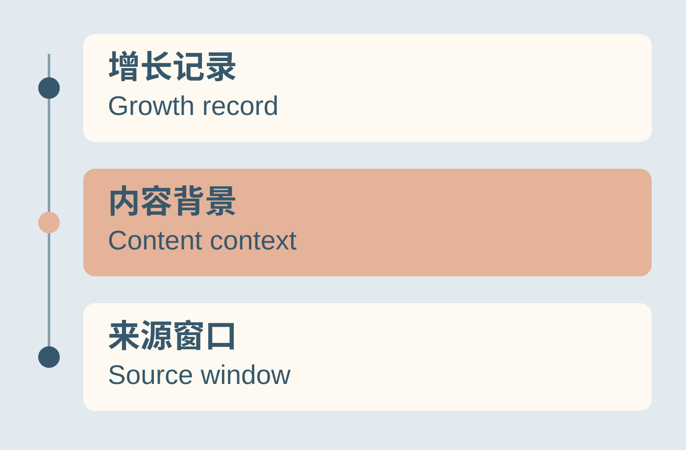

# 机器人粉丝信号怎样交叉复核

状态：本地审阅稿；正式发布日期待确认。

交叉复核 Instagram 机器人粉丝信号，先比较记录口径、内容背景与来源关系，不把多个相同来源截图当作独立检测。

Instagram 机器人粉丝不能凭一条增长曲线、互动比例或账号外观可靠判定。交叉复核先问三个问题：记录是否可比较、相关内容与项目背景是什么、不同资料是否真正独立。异常可以支持进一步核验，但不等于已证实个人购买或操纵。保留原始观察、替代解释和未知，只请求适当汇总资料，不监控私人粉丝身份，也不承诺某个分数能够百分百区分真实与虚假受众。

## 把异常当成问题起点

“这次变化与之前不同”可以是准确观察，“因此某位达人购买机器人粉丝”则新增了关于行为与责任的判断。先保留可见变化及其来源，再问还有什么需要核实，不从一个标签开始找证据配合。

[NIST 的离群观察说明](https://www.itl.nist.gov/div898/handbook/eda/section3/eda35h.htm)提醒，偏离其他观察的点可能涉及错误、随机变化或值得研究的现象。这里借用的是统计解释上的谨慎，不把该手册当成社交账号检测标准，也没有对本次账号执行统计检验。

品牌可以暂停一个无法解释的承诺，同时不对个人定性。没有立刻作指控，不等于忽略风险；保留未知，也不等于已经证明没有异常。让问题名称符合当前材料，后续交叉复核才有清楚对象。

## 先对齐汇总记录的基础

比较前确认同一账号、字段、读取时间、窗口与精度。公开简写数字、完整总数与期间变化，不应直接放在同一列里假装等价。实际来源不清楚时，先问提供者，不用猜测补齐。

[Meta 的账号 Insights 字段说明](https://developers.facebook.com/documentation/instagram-platform/api-reference/instagram-user/insights)指出数据不可用可返回空集，并说明部分资料可能有延迟。这种条件提醒我们缺失不是零、时间相近也不必然代表同一状态；它不是对所有第三方记录延迟的统一解释。

把已经对齐与尚未对齐的记录分开。若差异来自字段不同，修正比较方式；若仍未解释，保留问题。核对能缩小不确定性，但不能因为找到一个正常解释，就宣称全部受众已经验证真实。

## 内容背景需要实际观察

看相关作品与项目事件，不只看计数图。可以记录新内容发布、已有作品再次被讨论或其他已确认活动，但不要把它们自动写成增长原因。未核实的评论说法仍是线索。

[多团队粉丝记录指南](https://www.quickkol.com/zh/blog/instagram-follower-tracking-campaign-event-log/#answer)帮助让观察与事件保持分开。这里的交叉复核进一步问：背景资料是否改变了对原信号的理解？如果相关作品只是提供一种可能解释，应准确写成可能，不把接近时间当成因果证明。

不要根据创作者语言、国籍、外貌或某类头像认定受众真假。品牌可以关心实际受众与任务相关性，但需要适当资料。看到不熟悉的语言或新的内容群体，不等于已经发现机器人；审阅应围绕记录与可验证动作。

## 独立资料不是不同界面而已

两个工具可能展示同一公开来源，三张截图可能来自同一次读取。界面不同不保证信息独立，数量更多也不自动增加证明力度。先说明每项资料实际来自哪里。

可以交叉看汇总记录、相关原始作品与适当的第一方字段，但每项都有范围。创作者解释是需要认真理解的资料，不应因来自本人就忽略，也不能只因本人确认就称为独立验证。

如果无法确定不同工具是否共享来源，保留来源关系未知。不要擅自给它们加权后算出真假比例。这里没有提供通用检测分数；有用结果是知道哪些资料相互补充、哪些只是重复，以及还缺哪一种能回答当前问题的证据。

例如一次产品发布与一次旧作品重新传播都已确认，二者可以同时进入背景记录，但不能因为其中一项更符合品牌期待，就删除另一项。记录可以支持存在多种相关背景，而暂不支持分配各自贡献。

资料相互补充仍不等于完整检测；来源与未知需要保留。

## 把定义与检测能力分开

[FTC 的虚假影响力指标问答](https://www.ftc.gov/business-guidance/resources/consumer-reviews-testimonials-rule-questions-answers)在美国规则语境下解释相关虚假指标，并区分真实用户自主关注等情况。这些定义有助于理解问题，但不提供凭外观或比率判定个人的算法。

“机器人”“自动化”“不活跃”与“被购买的虚假指标”也不应任意互换。自动发布工具可能只是工作流程；一个不常互动的真实用户也不因为沉默就变成虚假身份。应看实际动作与证据，不能只靠词语关联。

本篇不对任何账号的法律状态作结论。定义说明何种事实可能重要，检测则需要能够支持个别判断的资料；两者之间的缺口不能用自信语气补齐。品牌审稿应检查这一步是否被悄悄跳过。

## 保留能反驳原判断的资料

交叉复核不是只寻找更多同方向信号。若窗口对齐后变化缩小，或作品背景提供了合理解释，应保留这些资料；不能为了维持最初怀疑而删掉不方便的记录。

假设两张曲线原来差异很大，后来发现一张按周、一张按日，这是练习，不是实际案例。修正口径后，原差异不再支持同样问题，但其他真实未知仍可能存在。不要从一项被解释的信号跳到完整清白或完整造假的结论。

适当结论可以很有限：目前只有数据口径问题已解释，尚无资料支持购买行为。这样的句子能被新证据修正，也让负责人知道可以关闭哪项问题、还需要讨论什么，而不是让复核成为一场必须证明最初立场正确的争论。

## 请求补证要对应具体缺口

不要让达人提交所有粉丝名单来回答一个汇总窗口问题。可以请求适当去敏的相关字段、原始期间或某项事件确认，由有权分享的人提供，不要求密码、验证码或无关私人信息。

先写为什么需要这项资料、它能解决哪个问题，以及如果没有会如何限定结论。这样对方能判断请求是否合理，也不必为一个模糊“证明粉丝真实”的要求无限提供材料。

缺少资料可能来自权限、保存范围或其他未知条件，不能自动当作拒绝配合或造假证据。若项目必须依赖尚未支持的承诺，可以暂缓该承诺；其他已定义工作按实际状态处理。教育复核应适度，不将商业沟通变成个人身份审查。

## 用分层结论支持有限决定

可以分别写记录层、背景层与行为层结论。记录已对齐，不代表行为已证实；有内容背景，也不代表已经找到唯一原因。每层只承担资料能够支持的范围。

[异常复核备忘录指南](https://www.quickkol.com/zh/blog/fake-instagram-followers-review-memo/#answer)帮助把观察与决定写成可修订说明。品牌可决定继续内容审阅、补充资料或停止采用某项保证，但不应在未核实情况下公开贴个人标签。

如果有确实需要进一步处理的材料，交给适当负责人，并说明已经做过什么、没有做过什么。别把文稿检查写成取证调查，也不把第三方分数称为平台认证。有限决定能够保护实际项目，同时给后续事实留下更正空间。

## 让数据教育回到真实合作

交叉复核的交付不是一张真假达人名单，而是一项有来源、可解释且边界清楚的结论。品牌能据此安排下一步，创作者也能针对具体问题回应，而非被要求证明整个互联网受众不存在异常。

实际营销仍应讨论内容能力、表达准确性与合适任务。没有证实某项增长原因，不意味着没有任何合作价值；存在疑问，也不应让团队接受未经支持的保证。

Instagram bot followers 这个关键词适合用来学习证据关系。把记录、背景与来源放在一起，同时保留未知，能帮助品牌避免数据失真，也避免让不完整信号变成对个人的确定指控。

## 三类资料怎样相互补充

| 资料 | 帮助回答 | 不能单独证明 |
| --- | --- | --- |
| 汇总变化 | 观察到了什么变化 | 某人购买或操纵 |
| 内容背景 | 有哪些相关已知事件 | 唯一增长原因 |
| 来源与窗口 | 比较是否成立 | 全部受众真实 |
| 反向资料 | 哪些解释需要修正 | 所有问题都已关闭 |

教育复核框架；没有实际账号检测、虚假比例或个人真假分类。

## 交叉复核前后

保留能支持和挑战解释的资料。

- [ ] 先写具体观察，不先贴标签。
- [ ] 对齐账号、字段、窗口与精度。
- [ ] 查看实际内容与已确认事件。
- [ ] 核对资料是否真正独立。
- [ ] 补证请求只针对相关缺口。
- [ ] 结论分层并允许更正。

## 研究日期与使用边界

资料核验于 2026 年 11 月 16 日。文中方法、表格和决策规则为编辑建议，标为假设的示例不是实际客户结果或行业基准。外部资料的适用地区与时期按各段说明。

## 继续学习指标与证据

理解来源、窗口、权限与未知；不凭单一信号判断个人，也不承诺完整检测。

[阅读指标决策指南](https://www.quickkol.com/zh/blog/social-media-metrics-creator-decision-tree/)

## 来源

- [NIST：离群值检测的解释边界](https://www.itl.nist.gov/div898/handbook/eda/section3/eda35h.htm)
- [Meta 的账号 Insights 字段说明](https://developers.facebook.com/documentation/instagram-platform/api-reference/instagram-user/insights)
- [FTC 的虚假影响力指标问答](https://www.ftc.gov/business-guidance/resources/consumer-reviews-testimonials-rule-questions-answers)
