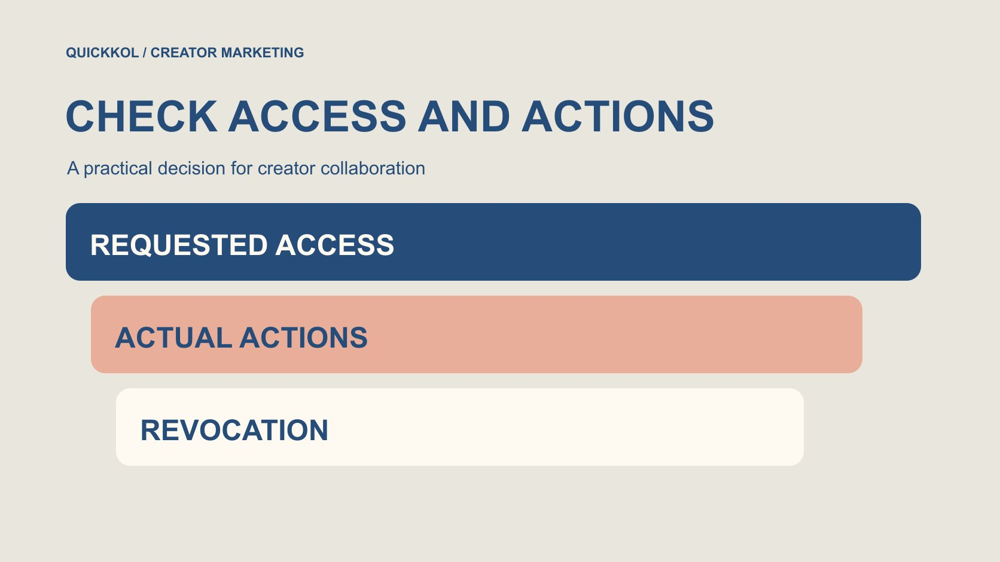
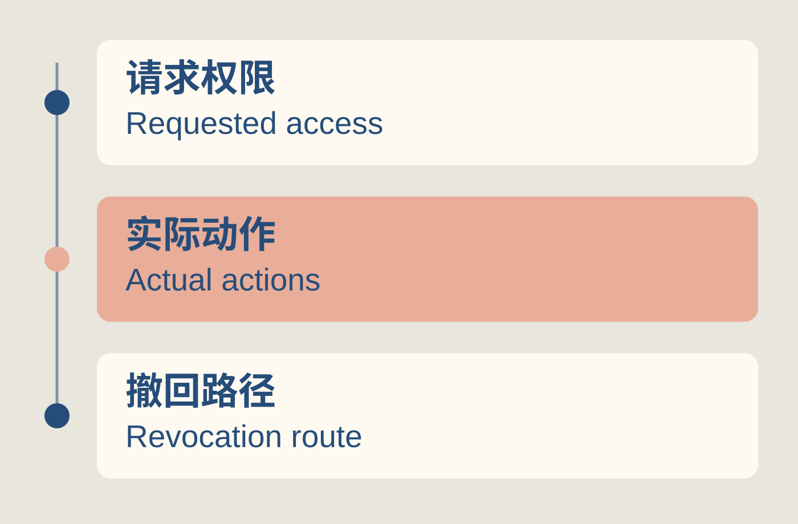

# Instagram Follower Bot: Review Authorization and Actions

Status: local review draft; confirm the publication date before release.

Before connecting a tool described as a follower bot, separate task, requested capability, granted access and observed action. Login consent is not a business decision.

QuickKOL editorial graphic; not actual account metrics or a platform interface.

When an Instagram follower bot is proposed, do not connect first. Ask for the real task, required access and intended actions, then have an authorized owner assess suitability for the collaboration. A product name, a login-consent screen and business approval are different objects. Requested access is not granted access, and granted access does not prove an action occurred. Record those states separately and understand revocation and data questions in advance. This guide supplies no bot installation, policy bypass or simulated-follower method.

## Replace the label with a task description

Bot can describe several software arrangements without establishing an action by name alone. Request specific behavior: reading an appropriate aggregate, preparing a content schedule or claiming to manufacture follows and interactions for an account. These are different tasks.

The [automation-and-engagement boundary guide](https://www.quickkol.com/blog/instagram-robot-followers-automation-boundaries/#answer) explains why tools should not all be classified identically. This article goes deeper into the decision before connection, rather than recovery after a service has been connected or selection of an inflation tool.

A brand should write the work it actually needs before matching the proposal. If the task is organizing creator work, a request to follow strangers on the account’s behalf needs explanation. There is no need to consent because a supplier calls it standard procedure. An unsupported task does not become reasonable through a login button. Clear task wording also helps the creator understand whether the brand is asking for a normal collaboration record or introducing an unrelated service that could affect their account and audience.

## Separate request, grant and action

A proposal asking for access is a request. An appropriate owner consenting through a suitable route concerns the grant state. Whether software actually performed an action requires relevant evidence. One does not establish the other two.

Read capability does not mean every record was read. Publishing capability does not mean something was published or that a growth number resulted from it. Conversely, not seeing one interface does not prove no other access route exists. Establish the state through actual material.

Retain object, source and state for each item. During procurement, the brand then avoids describing a planned action as completed or ignoring access merely because no action has yet occurred. The record should be specific enough for an authorized owner to see what is being approved, declined or clarified. It also keeps a later report from inferring conduct through capability alone, an error that can turn a legitimate technical permission into an unsupported claim about what a supplier or creator actually did.

## Review reading and action capabilities separately

[Meta’s Insights access guide](https://developers.facebook.com/documentation/instagram-platform/insights) lists permissions and conditions for professional-account data, showing that even analytics access has a scope. The documentation is not permission to inspect every private account and does not establish that a supplier uses the API it names.

Define the needed material assessably: account, aggregate type, period and recipients. If publication, management or another action is also requested, explain its task relationship separately instead of compressing all capabilities into connection required.

Where the proposal cannot explain access, discuss an option that does not depend on connection. A limited content collaboration should not require unrelated control from a creator. Need and capability are different questions; access should correspond to real work rather than every possible future convenience for a supplier. This lets the owner assess a bounded request and makes a later scope change visible, instead of having a broad initial grant quietly become the justification for an unrelated new action.

## Device permission is not account permission

[FTC’s app-permission advice](https://consumer.ftc.gov/articles/how-websites-and-apps-collect-and-use-your-information) recommends reviewing device information accessed by apps and considering unnecessary permissions. Keep device access, such as contacts, photos or location, distinct from data or actions inside a platform account.

Software may request no particular device permission while still asking for account access. Or a material-production task may request device information unrelated to that work. No phone dialog is not proof of risk-free access, and one permission list is not a complete review.

An appropriate owner should inspect the actual tool and device, with the content team retaining a suitable conclusion. Complete personal photo libraries, contacts and login secrets are not editorial attachments. Explain why the marketing task needs information before collecting it. A free trial does not reduce the importance of that question. Distinguishing these layers gives a reviewer a practical way to ask for clarification without treating every permission as identical or assuming that refusal of one device dialog resolves the account connection separately requested elsewhere.

Technical access, business approval and observed actions are different objects; one does not establish the others.

## Do not delegate business approval to a consent screen

A technical consent screen can describe a request without deciding whether the task is necessary, the statement accurate or the arrangement suitable for this collaboration. Confirm decision authority instead of making whoever holds a logged-in device the owner of every business decision.

The creator or authorized account owner needs to understand the request, and the brand needs to explain why it is made. An agency saying the client asked, or a client saying the supplier requires it, should not remove responsibility from the conversation.

Pause an unexplained condition rather than consent first to keep the schedule moving. If a smaller workable scope exists, present it clearly. Proper login consent does not establish genuine growth, certify every tool action or approve every future use and regional requirement. It is one state in the arrangement. Keeping that state separate helps the team evaluate the proposal without attributing more authority to a recognizable platform screen than the screen actually supplies.

## Protect authentication secrets separately

[Meta’s Instagram security explanation](https://about.fb.com/news/2021/07/keeping-instagram-safe-and-secure/) describes measures such as two-factor authentication, login activity and recovery information. It is a dated public explanation, not an up-to-date menu tutorial for every device, and this article operated no account.

If a supplier requests passwords, verification codes or session information through chat, do not put those secrets in a project sheet forwarded among people. An authorized owner should inspect the actual request through current official routes and obtain appropriate technical help where needed. Secrets should not buy supposed collaboration certification.

Identity, authorization and security remain distinct. A genuine contact does not justify unlimited access, and refusal of a grant does not establish poor creative professionalism. A brand can continue discussing ordinary content work while protecting the account, rather than turn sensitive access into a test of commitment. This keeps commercial progress connected to a real assignment and gives the creator a way to respond without accepting an unnecessary exposure merely to appear cooperative.

## Understand exit dependencies before connecting

Before connection, ask how access can stop, who performs that step, which legitimate work it may affect and how already retained information is handled. Do not promise one button revokes access, deletes existing copies and repairs historical data simultaneously.

This is not an instruction to disconnect now; it clarifies the arrangement’s boundary. If a tool also supports ordinary scheduling or reporting, understand the effect of a change and arrange an appropriate alternative. A legitimate dependency should not force acceptance of unexplained actions.

The [connected-service exit guide](https://www.quickkol.com/blog/free-ig-followers-website-vendor-exit/#answer) addresses an actual handoff after connection. Here, retain questions before the grant so the team does not discover at exit that nobody knows who controls access, which dependencies exist or what stopped actually means. A plan can remain provisional where a supplier has not answered. That is a more accurate state than approved with an assumed exit route nobody has checked or assigned to an authorized owner.

## Rehearse two proposals without connecting either

Suppose proposal A requests a relevant account aggregate for a bounded brand report. Proposal B promises rapid follower growth while requesting broad actions. These are editorial examples, not product comparisons.

A still needs source, scope and authorization checked; a normal-sounding task is not automatic safety. B needs its actual actions and evidence explained, and a similar login screen does not make it equivalent to A. Neither must be connected before questions can be asked.

The decision may be clarification, narrower scope or refusal of an unexplained task. There is no need to test inflation to decide. Keep claimed capability, permitted scope and observed action separate throughout. That is more workable than one safe-or-dangerous label covering every detail. The exercise also shows why an owner can reasonably reject an unnecessary request while remaining open to an appropriate data-sharing method, instead of treating acceptance of the supplier’s original setup as the only way the collaboration can proceed.

## Write approval as a specific scope

The final record should include task, required capability, authorized owner, confirmed scope, open questions and exit dependencies. Retain no secrets, describe no unperformed action as fact and present no technical grant as brand endorsement of every behavior.

When a task or permission changes, revisit the affected part rather than assume the first consent covers it forever. The content team should know what it can confirm and what needs a technical, account or commercial owner. A new scope version should identify added actions and needed evidence before a decision to continue, so a later request does not silently inherit approval granted for a different task.

The educational value of Instagram follower bot is understanding an actual request before connection and protecting both account and interpretation. Marketing can proceed through genuine work and suitable processes without unexplained access or fabricated interaction as proof of efficiency. A reviewable decision identifies the permitted work and its limits, leaving future changes assessable instead of hidden behind the memory that somebody once clicked a consent button.

## Four states before connection

| State | Question | Do not rewrite as |
| --- | --- | --- |
| Proposed task | Why does it relate to this collaboration? | Already approved |
| Requested capability | Why is this access needed? | Access already granted |
| Granted scope | Who permitted what, on which basis? | Every action was performed |
| Observed action | What does the actual record support? | Every growth cause is established |

Educational pre-connection review; no tool installation, inflation test or account operation was performed.

## Before connecting a tool

Make an explainable business decision first.

- [ ] Define the actual task rather than the label.
- [ ] Separate request, grant and action.
- [ ] Review reading, actions and device access separately.
- [ ] Have an authorized owner confirm scope.
- [ ] Protect secrets and understand exit dependencies.
- [ ] Revisit affected conditions after scope changes.

## Research date and limitations

Sources reviewed November 16, 2026. Methods, tables and decision rules are editorial recommendations. Hypothetical examples are not actual client results or industry benchmarks. Source geography and periods are specified where relevant.

## Continue learning about metrics and evidence

Understand sources, windows, permissions and unknowns without judging a person from one signal or promising complete detection.

[Read the metrics decision guide](https://www.quickkol.com/blog/social-media-metrics-creator-decision-tree/)

## Sources

- [Meta’s Insights access guide](https://developers.facebook.com/documentation/instagram-platform/insights)
- [FTC: information use by websites and apps](https://consumer.ftc.gov/articles/how-websites-and-apps-collect-and-use-your-information)
- [Meta’s Instagram security explanation](https://about.fb.com/news/2021/07/keeping-instagram-safe-and-secure/)
