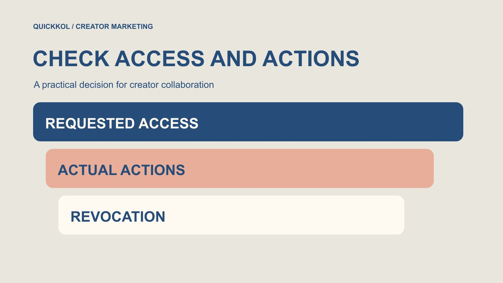
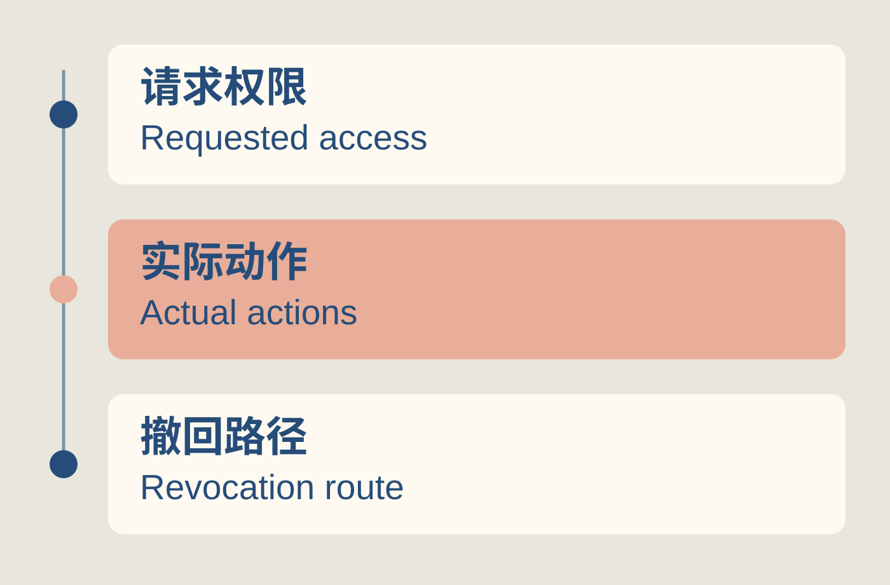

# 涨粉自动化工具怎样检查授权

状态：本地审阅稿；正式发布日期待确认。

接入任何自称 follower bot 的工具前，分开任务、请求能力、实际授权与已观察动作，不让登录同意替代品牌的业务判断。

QuickKOL 编辑图形；不呈现真实账号指标或平台界面。

看到 Instagram follower bot 的提案，先不要连接账号。请对方说明实际任务、需要哪类权限与准备执行哪些动作，再由合法负责人判断是否适合本次合作。软件名称、登录同意页与品牌业务批准是不同对象；请求权限不等于已经取得，取得权限也不证明做过某项动作。把这些状态分开记录，并提前了解撤回与后续数据问题。不提供刷量工具安装、绕过规则或模拟粉丝的方法。

## 用任务描述替代工具标签

“bot”可能被用来指多种软件安排，不能仅凭名称判断它一定做什么。要求提供具体动作：读取适当汇总资料、制作内容排期，还是声称替账号制造关注与互动。它们并不是同一种任务。

[自动化与虚假互动边界指南](https://www.quickkol.com/zh/blog/instagram-robot-followers-automation-boundaries/#answer)已解释不能把所有工具归成一类。本篇进一步处理连接前的授权判断，不重复服务已接入后的恢复步骤，也不帮助选择哪款刷量工具。

品牌先写自己真正需要的工作，再看软件提案是否对应。若任务是整理达人作品，要求账号代为关注陌生人就需要解释；没有必要因为供应商说这是标准流程而先同意。任务不成立时，不应靠一个登录按钮让它看起来合理。

## 分开请求、授权与动作

提案写需要权限，是请求；负责人在适当路径同意，是授权状态；软件是否实际执行某项动作，则需要相应记录。不能从其中一项直接推断另外两项。

例如读取能力不等于已经读取全部资料，发布能力不等于已经发布，也不说明某个增长数字由它造成。反过来，没有看到某项界面，也不自动证明不存在其他访问路径；应按实际资料确认。

工作表可以给每项保留对象、来源与状态。这样品牌在讨论是否采用时，不会把计划动作写成已发生，也不会因为某项动作尚未发生就跳过权限问题。记录足够具体，才能让合法负责人判断当前要批准、拒绝或进一步解释的到底是什么。

## 把读取与操作能力分别审阅

[Meta 的 Insights 使用说明](https://developers.facebook.com/documentation/instagram-platform/insights)列出专业账号数据访问的权限与条件，说明即使只是分析资料，也有适用范围。文档不是任意查看所有私人账号的许可，也不证明某个供应商真的使用了所称接口。

把所需资料写到能判断的程度：哪个账号、哪类汇总、什么期间、谁可以看到。若还请求发布、管理或其他操作，另说明与任务的关系，不把所有权限合成一个含糊的“需要连接”。

提案无法解释时，可以先讨论不依赖接入的方案。品牌也不应要求创作者为一次有限内容合作授予无关控制。需要访问和能够访问是两个问题；具体权限应对应真实工作，而不是为了让供应商今后可能方便就全部预先开放。

## 设备权限也不等于账号权限

[FTC 的应用权限提醒](https://consumer.ftc.gov/articles/how-websites-and-apps-collect-and-use-your-information)建议查看应用取得的设备信息，并考虑关闭不必要权限。这里需要分清，手机联系人、照片或位置等设备访问，与某个平台账号的资料或操作权限，是不同层面。

一个软件可能不要求某项设备权限，但仍要求账号接入；也可能只需要制作素材，却请求与本次工作无关的设备信息。不能用“手机没有弹窗”证明所有访问都没有风险，也不能只看一个权限列表就宣称已经全面审查。

由相关负责人按实际工具与设备检查，内容团队记录适当结论即可。不要把完整个人相册、联系人或登录秘密当作审稿附件。营销任务需要什么资料，应先能解释；免费试用并不会减少这个问题的重要性。

技术权限、业务批准与已发生动作是不同对象，不能彼此推定。

## 业务批准不能交给同意页

技术同意页可以说明某项请求，但不会替品牌决定这项任务是否必要、陈述是否准确、是否符合本次合作。还应确认谁有权作决定，不把持有登录设备的人自动当成全部业务负责人。

创作者本人或账号合法负责人，需要理解请求内容；品牌也要解释为什么提出。代理商不能只说客户要求，客户也不能只说供应商标准做法，就把责任从沟通中消失。

对未理解条件可以暂缓，不必为了推进排期先同意再研究。若存在可行的较小范围，先提出明确选项。一次正确的登录同意，不自动证明增长结果真实，也不构成对工具全部行为、所有未来用途或所有地区要求的认证。

## 登录秘密另有保护责任

[Meta 的 Instagram 安全说明](https://about.fb.com/news/2021/07/keeping-instagram-safe-and-secure/)介绍双重验证、登录活动与恢复资料等保护建议。它是有日期的公开说明，本篇不把旧菜单复制成当前所有设备教程，也没有实际操作任何账号。

如果供应商要求通过聊天发送密码、验证码或会话信息，不应把这些内容交给多人转发的项目表。由合法负责人沿官方当前路径核对实际请求，必要时寻求适当技术协助，不用分享秘密换取所谓合作认证。

身份、授权与安全状态仍需分别理解。一个联系人真实，不意味着可以无限接入；一次授权被拒绝，也不说明对方作品不专业。品牌可以在保护账号的前提下继续讨论正常内容任务，不把敏感访问变成合作诚意测试。

## 在连接前理解退出依赖

先问怎样停止本次访问、由谁操作、可能影响哪项合法工作，以及服务已经保存的资料怎样处理。不承诺一个按钮可以同时完成撤回、删除既有资料与修复历史数据。

这不是要求现在就执行退出，而是让负责人知道接入的边界。若某项工具还承担正常排期或报告工作，要理解调整会影响什么，再安排合适替代。不得以保留正常任务为由强迫继续接受不明动作。

[服务已接入后的退出指南](https://www.quickkol.com/zh/blog/free-ig-followers-website-vendor-exit/#answer)另行处理实际交接。本篇在连接前保留需要回答的条件，避免团队等到想停用时才发现无人知道谁拥有访问、有哪些依赖，以及哪一项“已停止”其实只代表取消了一个表面操作。

## 用两个提案练习权限判断

假设方案甲需要相关账号汇总记录，以完成品牌要求的有限报告；方案乙只说保证快速增加粉丝，却要求广泛操作权限。这是编辑练习，不代表真实产品比较。

甲也需要核对来源、范围与授权，并非因为任务听起来正常就默认安全。乙需要解释实际动作与依据，不能因为同样出现登录页就被视为与甲等价。两个方案都不需要先接入，才能提出问题。

判断结果可以是继续澄清、收窄范围或拒绝不明任务。没有必要为了做出决定试运行刷量行为。工具声称能完成什么、被允许做什么和实际做了什么，始终分别记录；这比用一个安全或危险标签替代所有细节更可执行。

## 把批准条件写成具体范围

最终记录包括任务、所需能力、合法负责人、已确认范围、未决问题与退出依赖。不保存登录秘密，不把未执行动作写成事实，也不把技术授权说成品牌对所有行为的背书。

如果任务或权限发生变化，重新看受影响部分，而不是认为第一次同意永久覆盖。内容团队应知道自己能确认哪些信息，哪些需要技术、账号或商业负责人判断。用新的范围版本说明新增动作与所需依据，再决定是否继续，不能让后续要求悄悄借用原来的批准。

Instagram follower bot 的教育价值，是让读者在连接前理解实际请求，保护账号与数据解释。营销合作可以依靠真实作品与适当流程推进，不需要通过不明权限或虚假互动来证明效率。

## 连接前的四种状态

| 状态 | 问题 | 不要改写成 |
| --- | --- | --- |
| 提议任务 | 为什么与本次合作有关 | 已经获准 |
| 请求能力 | 为何需要这类权限 | 已经取得访问 |
| 授权范围 | 谁允许什么、依据何在 | 所有动作均被执行 |
| 观察动作 | 实际记录支持了什么 | 全部增长原因已确定 |

教育向的接入前审阅，不安装工具、不测试刷量、不操作账号。

## 连接任何工具前

先形成可解释的业务决定。

- [ ] 说清实际任务而非只看名称。
- [ ] 分开请求、授权和动作。
- [ ] 分别审阅读取、操作与设备权限。
- [ ] 由有权人员确认范围。
- [ ] 保护秘密并理解退出依赖。
- [ ] 范围变化后重看相关条件。

## 研究日期与使用边界

资料核验于 2026 年 11 月 16 日。文中方法、表格和决策规则为编辑建议，标为假设的示例不是实际客户结果或行业基准。外部资料的适用地区与时期按各段说明。

## 继续学习指标与证据

理解来源、窗口、权限与未知；不凭单一信号判断个人，也不承诺完整检测。

[阅读指标决策指南](https://www.quickkol.com/zh/blog/social-media-metrics-creator-decision-tree/)

## 来源

- [Meta 的 Insights 使用说明](https://developers.facebook.com/documentation/instagram-platform/insights)
- [FTC：网站与应用的信息使用](https://consumer.ftc.gov/articles/how-websites-and-apps-collect-and-use-your-information)
- [Meta 的 Instagram 安全说明](https://about.fb.com/news/2021/07/keeping-instagram-safe-and-secure/)
