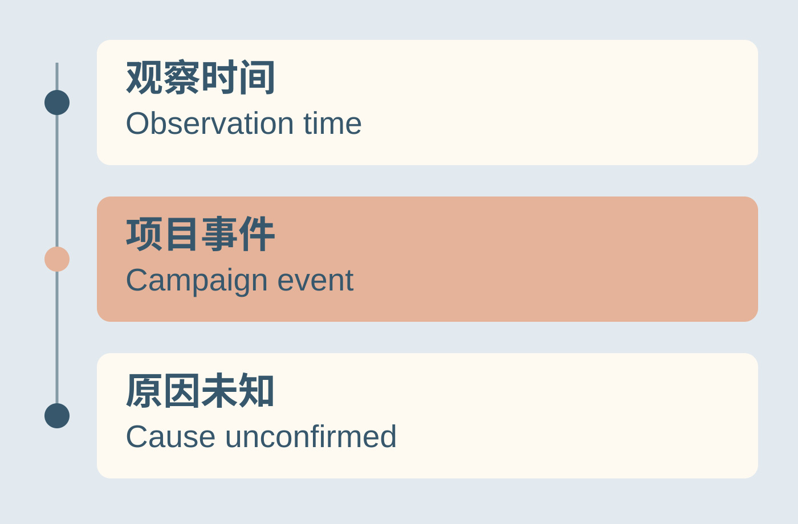

# Track Instagram Followers Across a Campaign Team

Status: local review draft; confirm the publication date before release.

When a team tracks Instagram followers, separate counts, campaign events and causal interpretation, with versions and additions that do not overwrite one another.

To track Instagram followers across teams, use one sourced aggregate record that distinguishes observations, confirmed campaign events, unverified information and interpretation. Assign collection, event confirmation and current-report ownership. Handle late evidence through additions or corrections rather than silently overwriting originals. A change occurring alongside a campaign does not establish attribution. Share only appropriate, task-related aggregates, without private follower surveillance or a promise that a tool can reconstruct all history.

## Separate observation from team handoff

The [follower observation-window guide](https://www.quickkol.com/blog/instagram-follower-tracker-campaign-observation/#answer) already addresses windows and snapshots. This article handles another layer: preventing separate brand, agency and creator records from being merged into one apparently certain narrative when their objects and interpretations differ.

Decide what the shared record is for. It can explain known changes during a phase or help a closeout owner find relevant material without performing every growth-attribution task or judging the creator’s suitability daily.

Write count observations separately from project events. A total retrieved on Tuesday is an observation. Publication of an agreed piece on Monday is an event that can be checked. Saying that piece caused all growth is another interpretation needing support. A shared document is useful when those distinctions remain visible to each person who receives it. The objective is not collecting the most rows; it is ensuring that a colleague can understand what a row means without having to reconstruct the conversations in which the original author formed an opinion.

## Assign a count object and owner

[Meta’s account-count field reference](https://developers.facebook.com/docs/graph-api/reference/shadow-ig-user) lists followers_count as an aggregate account field. A total does not contain the cause of each change or identify which viewer followed because of which sponsorship. This article called no API and accessed no private account.

Assign an appropriate person to retain a source record for the same account, with retrieval time and precision. Another person can check that the correct object is cited. These can be simple roles without adding a dedicated approval hierarchy.

If a colleague obtains material elsewhere, add its source before replacing an existing value. Decide which record serves the current report only after understanding the fields’ relationship. Ownership is not possession of a unique truth; it is responsibility for explaining how the record changes. Other members then know which object to cite and its limits. This is especially useful when a creator’s team and a brand’s analyst normally work in different tools, because a shared account name alone cannot guarantee that their displayed totals have the same basis.

## Make event labels describe facts

Distinguish planned, completed and unconfirmed events. A schedule is not evidence of publication. An event should point to the relevant work or an appropriate nonsensitive reference, such as the actual piece, an approved date or confirmation from its owner.

Use action labels: sponsored piece published, destination revised or budget arrangement changed. Labels such as growth explosion or cause of follower loss found embed interpretations in the fact column, where uncertainty can disappear when the file is forwarded.

Keep a short reason for an event correction. If the brand expected publication on one day and the creator confirms the next, correct that date without pretending the whole report is invalid. Clear event meanings support better questions without assigning all nearby movement to the event. They also let someone add another relevant fact later without choosing between contradictory stories that arose only because two authors used a causal label where a neutral description of an action would have been enough.

## Do not force attribution across simultaneous work

An account may publish self-initiated work, other partnerships and activity outside the platform simultaneously. Request only information reasonably relevant to this assignment, without demanding another client’s confidential arrangements. The record can acknowledge other contemporaneous activity whose details were not shared instead of declaring none existed.

Do not divide all follower movement by post count, budget or an intuitive percentage unless explicitly presenting an assumed model with a defined purpose. An ordinary event log does not supply that attribution evidence, and this article offers no default allocation formula.

Where the brand cannot isolate its contribution, report the observation and limitation while still assessing agreed work. A creator need not deny other activity to show that one collaboration was performed. The shared log should support accuracy rather than force parties to compete for ownership of the same growth. Acknowledging overlap gives the final reviewer a more defensible basis than assigning a complete percentage to every sponsor merely because a presentation template expects the total to add to one hundred.

An event log adds context; co-occurrence alone does not establish cause.

## First-party material still has access limits

[Meta’s Insights access guide](https://developers.facebook.com/documentation/instagram-platform/insights) concerns an app user’s professional account and specifies permissions and conditions. It is not a route to anybody else’s private analytics. This article uses documentation to explain boundaries without connecting an account or testing a tool.

When relevant material is needed, an authorized person can share an appropriate subset or use an actually permitted access route. Do not place passwords, verification codes or access tokens in a widely forwarded worksheet, or treat refusal to surrender secrets as a collaboration concern.

Retain source category and use scope instead of copying every underlying detail. Brand, agency and creator can have different access rights, and the report should remain understandable within them. Legitimate access to one record does not mean every participant needs its full version or every future project can reuse it. This allows a practical handoff based on the evidence required for the current task rather than an increasingly broad request for account control.

## Name missing values and net movement accurately

[Meta’s account-Insights field reference](https://developers.facebook.com/documentation/instagram-platform/api-reference/instagram-user/insights) records certain follow changes over a selected period and includes unfollowing or leaving Instagram in its description. It also notes that unavailable data can return an empty dataset rather than zero. Missing values must not become no change.

A total rising by 100 does not establish that only 100 accounts newly followed; it can summarize movement in different directions. Without the applicable fields, do not invent new-follow and unfollow totals. The brand needs to understand what its actual source supports.

If a shared series moves from an exact value to a shortened display, record the precision change. Moving from an account total to a period field changes the object. Similar-looking numbers do not make them identical material. Accurate names prevent later colleagues from merging blank, zero, net movement and new follows into one growth narrative. A chart can remain incomplete where the underlying evidence is incomplete, rather than filling every cell at the cost of changing its meaning.

## Handle late information through additions and corrections

After a project, a more accurate publication time, filter explanation or fuller record may arrive. State when it was received and which period it concerns before deciding whether it changes a conclusion. Late receipt does not mean the event just happened.

Retain the prior version and reason for correction, identifying the current report’s source where needed. Do not delete an earlier snapshot and claim no discrepancy ever existed. New context need not be described as an old data error; a genuinely wrong object should be corrected explicitly.

Suppose a team thought promotion began Wednesday and its owner later confirms Thursday. This is an editorial exercise. Update the event and examine interpretations depending on the old time without declaring the cause of all follower movement resolved. Additional material should narrow uncertainty rather than expand slogans of certainty. A disciplined correction can therefore be small: one date, one source and one affected statement, leaving the rest of the record intact where the new evidence does not concern it.

## Separate facts from recommendations at handoff

A report can distinguish observation, event, interpretation and recommendation without becoming a complicated system. What matters is that a forwarded passage still reveals which parts are facts, which are inferences and who can answer the next question.

The [follower-management reporting guide](https://www.quickkol.com/blog/instagram-follower-removal-campaign-record-change/#answer) addresses account actions and campaign records. Where an actual management event exists, retain an appropriate explanation from an authorized owner. Do not invent an unconfirmed action on the person’s behalf simply because a curve changed.

Recommendations should concern this assignment: confirm the basis, obtain suitable evidence or refine a content-learning question. One anomaly does not establish personal misconduct, and a log cannot promise complete detection of false accounts. Collaboration needs explainable evidence rather than every team member endorsing an absolute conclusion the material cannot support. The same separation protects useful findings too, because a narrow verified observation can remain valid even when the broader interpretation needs revision after new context arrives.

## Make the record useful for the next collaboration

The final handoff should identify current version, sources, open questions and maintenance responsibility. Retain an appropriate archive without carrying every old assumption into the next collaboration. Content, assignments and available evidence can change.

The brand can improve its questions and the creator can explain work and context without being forced to accept unproven growth attribution. The record serves real collaboration; it should not justify persistent private-audience surveillance or a demand to manufacture numbers.

Tracking Instagram followers across a team is useful when colleagues can continue a discussion from shared material. Retained ownership, versions and unknowns support a next decision better than making every presentation display a perfect curve. The deliverable is a maintained explanation of what the team knows and how it knows it, with a bounded path for correction. It is not an assertion that every movement has one campaign cause or that a complete follower history has been reconstructed from a few observations.

## Four kinds of shared-record content

| Type | Retain | Avoid |
| --- | --- | --- |
| Observation | Source, object, time and precision | A total automatically explaining cause |
| Event | Actual action and confirmation | Calling a plan completed |
| Interpretation | Evidence, assumptions and unknowns | Treating co-occurrence as attribution |
| Correction | Prior version, new material and effect | Overwriting without a reason |

A team-record method, not full history recovery, private surveillance or a one-metric misconduct finding.

## Before sharing a follower record

Explain how the recipient can use the material.

- [ ] Assign collection and current-version ownership.
- [ ] Separate factual events from causal explanations.
- [ ] Do not force attribution across simultaneous work.
- [ ] Share only appropriate aggregate material.
- [ ] Do not rewrite missing values as zero.
- [ ] Retain a correction reason for late material.

## Research date and limitations

Sources reviewed November 16, 2026. Methods, tables and decision rules are editorial recommendations. Hypothetical examples are not actual client results or industry benchmarks. Source geography and periods are specified where relevant.

## Start creator research with a clear task

Use QuickKOL to interpret a brief, discover relevant creators and research their work and contact routes. Verify data, commercial terms and outcomes at their source.

[Explore QuickKOL](https://www.quickkol.com/#capabilities)

## Sources

- [Meta’s account-count field reference](https://developers.facebook.com/docs/graph-api/reference/shadow-ig-user)
- [Meta’s Insights access guide](https://developers.facebook.com/documentation/instagram-platform/insights)
- [Meta’s account-Insights field reference](https://developers.facebook.com/documentation/instagram-platform/api-reference/instagram-user/insights)
