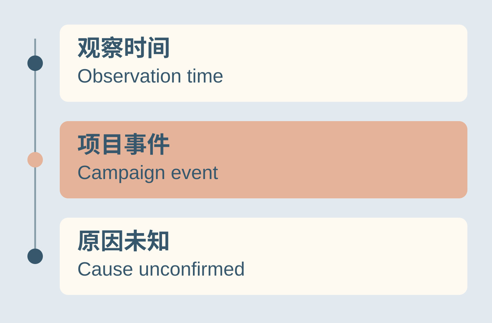

# 团队怎样共用 Instagram 粉丝记录

状态：本地审阅稿；正式发布日期待确认。

团队共同跟踪 Instagram 粉丝时，让计数、项目事件和原因判断分开，并保留版本与补充说明，避免不同报告互相覆盖。

多团队跟踪 Instagram 粉丝，应共用一个有来源的汇总记录：分别保留计数观察、已确认项目事件、待核实信息和编辑解释。指定谁采集、谁确认事件、谁维护当前报告；晚到资料用补充或更正处理，不悄悄覆盖原记录。粉丝变化与活动同期发生，不等于已证实归因。只分享与合作有关且适当的汇总信息，不把这项工作变成私人粉丝身份监控，也不承诺任何工具能还原全部历史。

## 先区分观察方法与团队交接

[粉丝观察窗口指南](https://www.quickkol.com/zh/blog/instagram-follower-tracker-campaign-observation/#answer)已经讨论怎样设置窗口与保留快照。本篇处理另一层问题：品牌、代理与创作者各自有记录时，怎样避免把不同对象与解释合成一条看似确定的故事。

团队先决定共用记录用于什么。它可以帮助说明某个阶段发生了哪些已知变化，或让结项人员找到相关资料；不必承担所有增长归因，也不需要每天评价创作者是否合格。

将计数观察与项目事件分开写。例如“周二读取到某个总数”是观察，“周一发布约定内容”是可以核对的事件，而“内容造成全部增长”是另一项需要依据的解释。共享文件的价值，是让这些区别对每个接手人仍然可见。

## 为计数指定同一对象与负责人

[Meta 的账号计数字段说明](https://developers.facebook.com/docs/graph-api/reference/shadow-ig-user)将 followers_count 列为账号汇总字段。这样一个总数不包含每次变化的原因，也不能独立说明哪位观众因哪条赞助而关注。本文没有调用接口或读取任何私人账号。

实际团队可以指定适当人员保存同一账号的来源记录，并保留读取时间与精度。另一个人负责检查是否引用了正确对象。角色可以很简单，不需要专门增加多人审批。

同事若从另一入口取得资料，先新增来源说明，不直接覆盖已有数值。只有确认新旧字段关系，才决定哪项用于当前报告。负责人不是拥有唯一真相，而是保证记录怎样变化能够被解释，让其他成员知道应该引用什么及其限制。

## 让事件标签描述事实

项目事件可以分为计划、实际发生与尚待确认，不把排期表直接当作已经发布。记录需要能指向相关内容或适当非敏感依据，例如实际作品、批准的活动日期或负责人确认。

标签尽量描述动作：“合作内容发布”“落地页改版”“预算安排改变”，而不是“增长爆发”“粉丝流失原因已找到”。后者把解释写进事实栏，后续转发时容易丢失原来的不确定性。

为修改后的事件保留简短原因。若品牌以为某天发布、创作者确认实际晚一天，修正时间即可，不必把整份报告全部推翻。清楚事件含义能帮助团队提问，但不能因为记录旁边出现一条活动，就认定附近所有变化都归它。

## 同期合作不能强行分摊

一个账号可能同时有自主内容、其他合作与平台外活动。品牌只需要与本次合理相关的信息，不应要求泄露其他客户的保密安排。记录可以写有其他同期活动但细节未共享，而不是填成不存在。

不能按发帖数量、预算或某个主观比例分配全部粉丝变化，除非明确这只是有假设的模型并解释其用途；普通项目日志本身并没有提供这样的归因证据。本篇不提供默认分摊公式。

若品牌无法隔离本次影响，可以报告观察与限制，仍然验收约定作品。创作者不需要为了证明某个合作有效，否认自己的其他活动。共享日志应支持准确沟通，而不是迫使各方争夺同一段增长的所有权。

事件日志能补充背景，不能单凭同期出现证明原因。

## 第一方资料仍有权限与范围

[Meta 的 Insights 使用说明](https://developers.facebook.com/documentation/instagram-platform/insights)面向应用用户的专业账号，并列出权限与适用条件。它不是任意查看别人的私人分析资料的入口。本篇引用文档理解边界，没有建立连接或测试某个工具。

团队需要相关资料时，由有权分享的人提供适当范围，或沿实际获准路径查看。不要在广泛转发的工作表里放密码、验证码或访问令牌，也不因对方不交出秘密就把它写成合作风险。

共享记录保留来源类别与使用范围，而不是复制所有底层信息。品牌、代理与创作者可能有不同访问权限，报告应能在这些限制内被理解。合法取得一份资料，也不意味着所有参与者都需要看到完整版本，或以后所有项目都可以继续使用。

## 空值与净变化需要准确命名

[Meta 的账号 Insights 字段说明](https://developers.facebook.com/documentation/instagram-platform/api-reference/instagram-user/insights)将某些关注变化按选定期间记录，并说明取消关注或离开 Instagram 等情况。文档也提醒，数据不可用可能返回空集，而不是零。因此不能把缺失值直接当作没有变化。

一个总数增加 100，也不说明只有 100 人新增关注；它可能概括不同方向的变化。没有相应字段时，不自行编出新增与取消数量。品牌要知道当前来源实际能支持什么。

同步记录若从精确值换成简写展示，说明精度变化；从账号总数换成期间字段，说明对象变化。数字看起来相近也不等于同一种资料。准确名称帮助后续成员不把空白、零、净变化和新增量混在同一个趋势叙事里。

## 晚到资料用补充与更正处理

项目结束后，可能收到更准确发布时间、补充筛选条件或更完整记录。先注明资料何时取得、它描述什么时期，再判断是否改变原结论。资料晚到，不代表事件刚刚发生。

保留先前版本与更正原因，必要时标出当前报告使用哪项。不要删除原快照后又声称从未存在差异。若新资料只补充语境，不需要把它写成旧数据错误；若确实引用错对象，应明确修正。

假设团队原以为周三开始投放，后来负责人确认周四，这是编辑练习。日志应更新事件时间，并检查哪些解释依赖旧时间，不能据此宣布所有粉丝变化已找到原因。补充资料应缩小未知，而不是扩大确定性口号。

## 交接时区分事实与建议

报告可以分成观察、事件、解释与建议四种内容，但不必做复杂系统。重点是另一位同事转发某段时，仍知道哪些是事实、哪些是推断，以及下一步要问谁。

[粉丝管理后报表变更指南](https://www.quickkol.com/zh/blog/instagram-follower-removal-campaign-record-change/#answer)处理账号操作与合作记录的关系。如果确有账号管理事件，可以保留由合法负责人确认的适当说明；不要因为曲线变化就替对方补写从未证实的操作。

建议应指向本次任务：确认记录口径、补充适当资料或调整内容学习问题。不把单个异常当作认定个人造假的依据，也不承诺一份日志能完整识别虚假账号。团队协作需要的是可解释证据，而非让所有成员签署一个材料无法支持的绝对结论。

## 让记录帮助下一次真实合作

最终交付说明当前版本、相关来源、未决问题与维护责任。可以保留适当归档，但下一次合作不要把上一次所有假设自动延续；账号内容、项目与可用资料可能已经不同。

品牌可据此改进提问，创作者也能解释实际工作与背景，而不被迫接受某项未经证实的增长归因。记录服务真实合作，不应成为持续监控私人观众或要求人为制造数字的理由。

Track Instagram followers 的团队价值，在于同事能基于相同资料继续讨论。把责任、版本和未知留下来，比让每份汇报都画出看似完美的曲线更能帮助决定下一步。

## 共享记录的四种内容

| 类型 | 保留 | 避免 |
| --- | --- | --- |
| 观察 | 来源、对象、时间与精度 | 总数自动说明原因 |
| 事件 | 实际动作与确认依据 | 把计划写成完成 |
| 解释 | 依据、假设与未知 | 同期即归因 |
| 更正 | 旧版本、新资料与影响 | 覆盖后不留理由 |

团队记录方法，不是完整历史恢复、私人监控或单一指标造假判断。

## 共享粉丝记录之前

让接手人知道资料怎样使用。

- [ ] 指定采集与当前版本负责人。
- [ ] 事实事件与原因解释分开。
- [ ] 不强行分摊同期合作变化。
- [ ] 只分享适当范围的汇总资料。
- [ ] 空值不改写成零。
- [ ] 晚到资料保留更正原因。

## 研究日期与使用边界

资料核验于 2026 年 11 月 16 日。文中方法、表格和决策规则为编辑建议，标为假设的示例不是实际客户结果或行业基准。外部资料的适用地区与时期按各段说明。

## 从任务开始达人研究

用 QuickKOL 理解 Brief、发现相关达人并研究作品与联系路径；数据、合作条件和结果仍需核验。

[了解 QuickKOL](https://www.quickkol.com/#capabilities)

## 来源

- [Meta 的账号计数字段说明](https://developers.facebook.com/docs/graph-api/reference/shadow-ig-user)
- [Meta 的 Insights 使用说明](https://developers.facebook.com/documentation/instagram-platform/insights)
- [Meta 的账号 Insights 字段说明](https://developers.facebook.com/documentation/instagram-platform/api-reference/instagram-user/insights)
