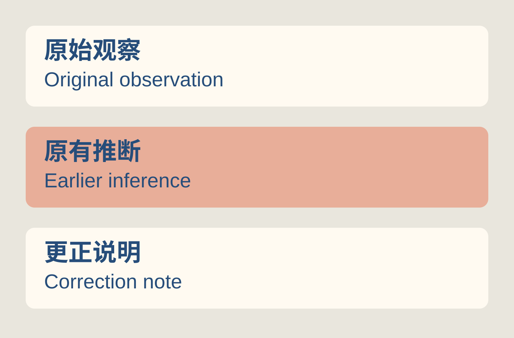

# Instagram Likes Free: Keep Campaign Reports Accurate

Status: local review draft; confirm the publication date before release.

When a free-like concern affects reporting, preserve the observation, correct the interpretation and explain the decision separately without inventing a genuine count or finding personal misconduct.

When an “instagram likes free” concern emerges, separate a recorded figure from the team’s interpretation. Retain what a source displayed at a stated time while withdrawing unsupported claims about genuine preference, distinct people or sales lift. Unverified information remains a question, not an allegation against a creator. Do not subtract guessed false likes to fabricate a precise genuine count. Explain which judgment changed, why it changed and which later decisions still need support. Correction should improve the report’s meaning without pretending uncertainty has been resolved.

## Identify the sentence requiring correction

Keep the correction attached to the original decision it was meant to support.

Do not begin by rewriting the entire report. Find the sentence that exceeds its evidence: likes described as distinct consumers, growth presented as a creative winner or interaction turned directly into sales. Different errors require different corrections.

Suppose a draft says more likes prove viewers prefer the product. The available figure may support a change in actions under one source without establishing full preference. Correct that inference first rather than arbitrarily reject every observation.

Place the original sentence, its supporting material and proposed replacement together so a reviewer can identify the issue. If a source name or window is wrong, correct it accurately instead of hiding the change behind data optimization. The aim is explaining what evidence supports, not making a new version appear as though no problem ever arose. A narrow, visible correction is easier to assess than a rewritten headline whose numbers and meaning have both changed without an account of what led to either change.

## Preserve the observation and retrieval conditions

Retain an appropriate screenshot, export or record with object, source, retrieval time and observation window. A later cumulative page value does not automatically establish fabrication of the earlier record; windows and processing also need checking.

[Meta’s account-Insights field reference](https://developers.facebook.com/documentation/instagram-platform/api-reference/instagram-user/insights) notes that fields can be delayed and an empty result is not zero. It describes conditions for relevant professional-account interfaces, not private data accessed by this article or a replacement definition for a public page count.

Check which source the team actually used. Public pages, authorized exports and third-party estimates should not replace one another without explanation. Add a short change entry to the hypothetical report: the original chart is retained, the preference claim is withdrawn and the current description concerns action counts from the specified source. If new information changes the count, add a separate explanation rather than merge the two revisions. Preserve source changes so readers can tell whether a difference reflects a new observation, another field or an earlier transcription error. Unknown provenance should remain a gap rather than acquire certainty through extra decimal places. Keep the original artifact separate from the corrected working table so the team can inspect what was observed without mistaking an edited summary for the source itself.

## Classify new information by its evidence state

A free-like offer, forwarded screenshot or sudden increase raises questions to verify. Receiving an offer is not accepting it, an unusual value is not necessarily artificial activity and neither establishes a creator’s knowledge.

[NIST’s outlier explanation](https://www.itl.nist.gov/div898/handbook/eda/section3/eda35h.htm) notes that a value differing from others can reflect an error, variation or a phenomenon worth investigating. This is a general statistical principle, not a tool for detecting false interaction; no personal classification test was performed.

Separate observed, confirmed and unconfirmed information. For example, a message may have been received while execution remains unknown. Only new reliable information should update a specific fact. Several screenshots derived from one original are not several independent supports; understand how information was produced rather than count copies. This classification should travel with the material so another team does not accidentally promote an unresolved question into a confirmed cause when it summarizes the report for a meeting or presentation.

## Keep observation, inference and correction separate

The diagram separates the original observation, earlier inference and correction. A revision can withdraw an unsupported interpretation while retaining a figure accurately recorded at the time. These are compatible actions.

Suppose a draft records 500 likes and calls them 500 prospective buyers. Without distinct-person and intent information, withdraw the latter description. Do not change 500 to a supposedly conservative 350 and call those genuine buyers. This is a recording example, not an industry ratio.

State which layer changed. If the count itself needs correction, explain the new source and difference from the original record rather than blend interpretation changes into a data update. That preserves traceability and supports later information without restarting from an unsourced conclusion. A reader should be able to understand the revision without access to every private conversation that preceded it, while the internal source record remains available to the appropriate reviewer for a more detailed check.

Preserve sources while correcting interpretation; do not subtract unknowns to invent genuine interaction.

## Do not invent a cleaned genuine count

Without a reliable method identifying affected actions, do not subtract a portion merely from the size of an anomaly. Fast growth, few comments or another source language cannot directly establish a false-like count.

The team can explain that the count is unsuitable for a particular comparison under current limitations instead of offering precise net engagement. Even a supplier score needs a definition, source and validation scope; it is not the whole fact.

The value of correction is narrowing the decisions affected by uncertainty rather than manufacturing an easier answer. If an estimate is needed, identify its assumptions and sensitivity rather than present it as observation. Personal judgments especially should not rest on arbitrary subtraction; data processing and misconduct findings need different support. Keep the proposed analytical adjustment separate until someone can explain why it is appropriate for the actual question, rather than accept it because the resulting number appears less surprising than the original one.

## Separate policy context from personal facts

[FTC’s fake-influence indicator FAQ](https://www.ftc.gov/business-guidance/resources/consumer-reviews-testimonials-rule-questions-answers) discusses knowledge conditions and commercial misrepresentation under the US rule, and distinguishes certain genuine voluntary follows from false indicators. Growth, promotion and creator collaboration do not automatically support one shared conclusion.

This context explains risks of artificial inflation without proving who purchased it, who knew or which actions are actually false. Legal and platform determinations need relevant facts and applicable conditions.

A correction should not use a policy paragraph to imply personal misconduct has already been established. A commercial interpretation can lack support without proving a creator inflated metrics. The brand may pause a decision dependent on insufficient evidence, provided the stated reason is the information gap rather than unconfirmed matters packaged as fact. This preserves a practical ability to act cautiously while preventing the report from turning a limited analytical concern into an accusation that its sources were never capable of establishing.

## Identify the decision affected by correction

Withdrawing an engagement-winner conclusion does not automatically withdraw production acceptance, stop every collaboration or change confirmed product facts. Review which decisions actually depended on the original inference.

The [metrics decision guide](https://www.quickkol.com/blog/social-media-metrics-creator-decision-tree/#answer) connects data to specific questions. A number unsuitable for proving sales may remain a sourced observation; a limited comparison does not mean a creator failed to deliver agreed material.

Explain affected scope and retained support internally so later teams do not expand a vague label into broader action. Payment, responsibility and contract questions belong with appropriate owners considering the actual arrangement. A data report should not decide every commercial consequence or silently change agreed work through a renamed field. A useful correction can therefore identify a narrowly affected recommendation, such as postponing selection of a winning opening, while leaving a separately reviewed production deliverable in its actual confirmed state. The decision record should make that distinction explicit enough for another team to follow.

## Keep versions and communicate the correction

Keep original and revised versions with a revision date, reason and specific changes in an appropriate record. Overwriting a file does not automatically notify everyone who read the earlier conclusion.

The [report-lineage guide](https://www.quickkol.com/blog/instagram-followers-free-growth-report-lineage/#answer) expands versions and source provenance. Here the emphasis is correcting interpretation: notify people who actually rely on the conclusion, supply necessary context and limitations, and avoid circulating unrelated personal information or unverified allegations.

If information remains under review, assign the next update. A correction need not contain a final answer to communicate the present state accurately. The team should know which version to use, which decision is deferred and which figures require limitations, preventing an old chart from resurfacing in the next proposal. Keep the public or client-facing correction proportionate to the error while preserving enough internal detail for an appropriate reviewer to understand the source change, rather than force every recipient to handle unnecessary sensitive background.

## Make the correction a more reliable collaboration record

An educational discussion of free likes should protect brand judgment and creator fairness rather than provide subtler cosmetic adjustments. Retaining observations, withdrawing unsupported inference and explaining the state of new information makes reporting more reliable.

The team can state that genuine preference is unconfirmed or that available information does not support a comparison. That is a better foundation for collaboration and research than a personal accusation from one signal or an invented precise deduction.

The revised conclusion should answer what changed, why, where it matters and what happens next. The report then continues serving actual influencer-marketing work without automatically converting interaction into business performance or uncertainty into a fact about a person. A clear correction also improves the next brief: the brand can specify better definitions and evidence needs in advance rather than carry an unsupported headline forward as the target another creator must somehow reproduce.

## Four layers in a report correction

| Layer | Retain or change | Avoid |
| --- | --- | --- |
| Observation | Source, object, window and original record | Overwrite figures without explanation |
| Interpretation | Withdraw unsupported inference | Counts automatically equal preference |
| New information | Evidence state and independence | An offer equals execution |
| Decision | Affected scope and next check | Report correction equals personal misconduct |

An educational correction framework, not false-interaction detection or personal adjudication.

## Before sending the revised report

Make clear which layer changed.

- [ ] Locate the sentence exceeding evidence.
- [ ] Preserve original sources and versions.
- [ ] Separate new facts from unverified information.
- [ ] Do not invent a genuine count by subtraction.
- [ ] Identify the decision actually affected.
- [ ] Notify relevant people and assign the next update.

## Research date and limitations

Sources reviewed November 16, 2026. Methods, tables and decision rules are editorial recommendations. Hypothetical examples are not actual client results or industry benchmarks. Source geography and periods are specified where relevant.

## Continue learning about metrics and evidence

Understand sources, windows, permissions and unknowns without judging a person from one signal or promising complete detection.

[Read the metrics decision guide](https://www.quickkol.com/blog/social-media-metrics-creator-decision-tree/)

## Sources

- [Meta’s account-Insights field reference](https://developers.facebook.com/documentation/instagram-platform/api-reference/instagram-user/insights)
- [NIST: interpreting outlying observations](https://www.itl.nist.gov/div898/handbook/eda/section3/eda35h.htm)
- [FTC’s fake-influence indicator FAQ](https://www.ftc.gov/business-guidance/resources/consumer-reviews-testimonials-rule-questions-answers)
