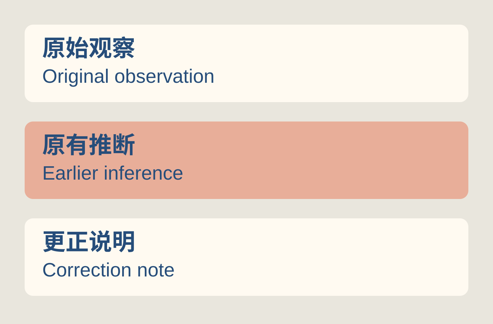

# 免费点赞相关报表怎样更正

状态：本地审阅稿；正式发布日期待确认。

报表发现免费点赞相关疑问时，分别保留原观察、更正解释和说明决定。不能凭未知来源扣出真实数，更不能把报表修订写成个人违规结论。

“instagram likes free”相关疑问出现后，更正报告应先区分原来记录的数字与团队对数字的解释。可以保留某时某来源显示多少点赞，同时撤回没有依据的真实偏好、独立人数或销售提升结论。新信息未核实，就把它记作待确认，不直接指控创作者。不要凭估计扣除所谓假点赞，制造一个精确真实数；应说明改变了哪项判断、为什么，以及后续哪些决定仍需资料支持。

## 先找到需要更正的句子

让更正对应原来需要支持的那项决定。

不要一开始就重写全部报告。先找到哪句话超出了证据：是把点赞称为独立消费者，把增长写成创意优胜，还是把互动直接写成销售结果。不同错误需要不同修改。

例如假设原稿写“点赞增加，证明观众更喜欢产品”。已有数字可能支持某个来源下的动作变化，却不足以支持完整偏好判断。更正对象首先是这个推论，不是凭空否定每个观察。

把原句、对应资料与拟修改句放在一起，让审阅人知道具体问题。若只是来源名或窗口写错，也应准确修正，不用模糊的“数据优化”掩盖变化。目标是让读者理解证据实际支持什么，而不是让新版看起来从未发生过问题。

## 保留原始观察与获取条件

保留适当的原截图、导出或记录，并注明对象、来源、获取时间与观察窗口。后来页面显示不同累计值，不自动说明原记录被伪造；窗口与数据处理也需要核对。

[Meta 的账号 Insights 字段说明](https://developers.facebook.com/documentation/instagram-platform/api-reference/instagram-user/insights)提示字段可能延迟，空结果也不等于零。该资料解释专业账号相关接口的条件，不代表本篇获取了账号私有数据，也不能直接拿它替代某个公开页面计数定义。

团队要核对实际使用哪种来源。公开页面、授权导出与第三方估算不能无说明互相替换。修正时保留来源变化，给假设报告增加一条简短变更记录：原图表继续保留，偏好结论已撤回，当前只描述指定来源的动作计数。新资料若改变计数，应再增加独立说明，而不是把两次修改混在一起。让读者知道数值差异是来自新观察、字段更换还是原先录入错误。来源不明的资料应标出缺口，不用更多小数位制造确定感。

## 把新增信息放回证据状态

免费点赞提议、转发截图或突然增长，提供的是需要核对的问题。收到提议不等于接受，存在异常也不等于人为操作，更不证明某位创作者知情。

[NIST 的离群观察说明](https://www.itl.nist.gov/div898/handbook/eda/section3/eda35h.htm)指出，不同于其他观察的值可能来自错误、变化或值得研究的现象。这里引用一般统计思路，不把它当作检测虚假互动的工具，也未运行个人分类测试。

报告可以分别写已观察、已确认与未确认。例如已收到某条消息，而是否执行未知。只有新可靠资料，才能更新具体事实。不要把多张来自同一原图的截图当作多份独立支持；核对资料如何产生，比看数量是否多更有意义。

## 分别保存观察、推论与更正

配图将原始观察、先前解释与更正分为三个区块。修订可以撤回无依据解释，同时保留当时准确记录的值。两者并不矛盾。

假设原稿记录 500 次点赞并称为 500 位潜在购买者。若没有独立人数与意向资料，应撤回后半句；不能把 500 改成一个看似更保守的 350，再称其为真实买家。本例只解释记录方式，不是行业比例。

新版本要写清改变的是哪一层。若计数本身也需要修正，说明新来源与原记录差异，而不是把解释调整混成数字更新。这样团队可以追溯，并在以后获得更好资料时继续更新，而不是每次都从一段没有来源的结论重新开始。

更正解释时保留来源；不凭未知扣出所谓真实互动。

## 不要自行生成清洗后的真实数

没有可靠方法识别哪些动作受到影响，就不能仅凭异常大小自行扣除。某天增长很快、评论很少或来源语言不同，都不足以直接确定假点赞数量。

团队可以报告计数在当前限制下不适合某项比较，而不是提供所谓精确净互动。即使供应方给出评分，也要核对定义、来源与验证范围，不把一个分数当作完整事实。

修订的价值是缩小不确定性影响的决策，而不是制造一个更容易汇报的答案。如果品牌需要估计，应明确它是何种假设与敏感性讨论，不能装成真实观测。对人的判断更不能建立在这类人为扣减上；数据处理与违规结论需要不同依据。

## 规则背景与个人事实分开

[FTC 的虚假影响力指标问答](https://www.ftc.gov/business-guidance/resources/consumer-reviews-testimonials-rule-questions-answers)讨论美国规则下的知情条件与商业误导，也指出某些真实自愿关注不属于虚假指标。不能把任何增长、推广或创作者合作自动放进同一个结论。

这类规则帮助理解为什么人工膨胀会有风险，不替报告证明谁购买、谁知情或哪些动作确实不真实。实际法律与平台判断需要相应事实与适用条件。

更正说明应避免用一段规则文字暗示已经找到个人违规。可以说某个商业解释缺乏支持，而不把它写成某位达人被证实刷量。品牌仍可以暂停依赖不足的决定，只要准确说明暂停理由是当前资料不够，而不是把未确认事项包装成事实。

## 明确更正影响哪项决定

撤回互动优胜结论，不自动意味着撤回制作验收、停掉所有合作或修改已经确认的产品事实。逐项看哪些决定真正依赖原推论。

[指标决策指南](https://www.quickkol.com/zh/blog/social-media-metrics-creator-decision-tree/#answer)帮助把数据连接到具体问题。某个数字不适合证明销售，不代表它不能作为带来源的观察；某个测试比较受限，也不代表创作者没有按约完成素材。

在内部说明受影响范围与未受影响依据，避免后续团队用一个模糊标签扩大处理。涉及费用、责任或合同判断时，交给有相应职责的人按真实安排处理。数据报告本身不应擅自裁定全部商业后果，更不能通过更换一个字段名暗中改变双方已经约定的实际工作。

## 发布更正时保留版本与通知

保存原版与新版，并在适当记录中写明修订日期、原因和具体变化。不能只覆盖文件，假设所有看过旧结论的人都会自动知道。

[报表来源链指南](https://www.quickkol.com/zh/blog/instagram-followers-free-growth-report-lineage/#answer)进一步讨论版本与资料来路。本篇强调解释层面的更正：通知实际依赖结论的相关人，提供必要背景与新限制，不扩散无关个人信息或未经证实指控。

如果某项资料仍在核对，写明下次更新由谁负责。更正不一定马上有最终答案，仍可准确交付当前状态。团队应知道使用哪个版本、哪项决定暂缓，以及哪些数字只能带着限制引用，避免旧图表在下一份提案中重新出现。

## 让更正成为更可靠的合作记录

教育向讨论免费点赞，最终是保护品牌判断与达人公平，而不是提供一种更隐蔽的数字修饰。保留原观察、撤回无依据推论、说明新资料状态，就能让报告更可靠。

团队可以坦诚写出不能确认真实偏好，或当前资料无法支持某项比较。它比凭单个信号指控个人，或扣出一个假装精确的数，更适合继续合作与研究。

更正后的结论应回答什么变了、为什么变、影响哪里与下一步是什么。这样报表仍然服务达人营销中的真实任务，既不把互动自动写成业绩，也不把未知写成对人的事实。

## 更正报表时的四个层次

| 层次 | 保留或修改 | 避免 |
| --- | --- | --- |
| 观察 | 来源、对象、窗口与原记录 | 无说明覆盖数字 |
| 解释 | 撤回不受支持推论 | 计数自动等于偏好 |
| 新资料 | 事实状态与独立性 | 提议等于已经执行 |
| 决定 | 影响范围与下一项核对 | 报告修订等于个人违规 |

教育性更正框架，不是虚假互动识别或个人裁定。

## 发出新版报告之前

让读者看懂改变的是哪一层。

- [ ] 定位原来超出证据的句子。
- [ ] 保存原始来源与版本。
- [ ] 区分新事实与待核实信息。
- [ ] 不自行扣出真实数。
- [ ] 说明实际影响的决定。
- [ ] 通知相关人并指定下一次更新。

## 研究日期与使用边界

资料核验于 2026 年 11 月 16 日。文中方法、表格和决策规则为编辑建议，标为假设的示例不是实际客户结果或行业基准。外部资料的适用地区与时期按各段说明。

## 继续学习指标与证据

理解来源、窗口、权限与未知；不凭单一信号判断个人，也不承诺完整检测。

[阅读指标决策指南](https://www.quickkol.com/zh/blog/social-media-metrics-creator-decision-tree/)

## 来源

- [Meta 的账号 Insights 字段说明](https://developers.facebook.com/documentation/instagram-platform/api-reference/instagram-user/insights)
- [NIST：离群值检测的解释边界](https://www.itl.nist.gov/div898/handbook/eda/section3/eda35h.htm)
- [FTC 的虚假影响力指标问答](https://www.ftc.gov/business-guidance/resources/consumer-reviews-testimonials-rule-questions-answers)
