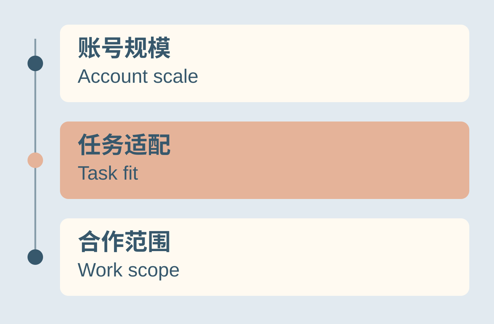

# 超大 Instagram 账号怎样写提案

状态：本地审阅稿；正式发布日期待确认。

超大 Instagram 账号不是一块自动可购买的广告位。将知名度转为具体提案，需要说明表达、出镜、发布与后续使用分别要什么。

若问题指个人账号，吉尼斯公开纪录页以 2024 年 2 月 19 日为日期列出 Cristiano Ronaldo，记录为 621,979,902 粉丝；这不是本篇核实的 2026 年实时数。品牌接下来不应把这个量级直接变成报价或触达承诺，而应明确希望购买什么：本人表达、场景出镜、账号发布，还是后续素材使用。高知名度合作需要一份说明任务与条件的提案，不能只写“希望接触你的全部粉丝”。

## 用有日期答案结束排名猜测

[吉尼斯的 Instagram 纪录页](https://www.guinnessworldrecords.com/world-records/397515-most-followers-on-instagram)支持上面的有日期个人账号记录。本次直接读取 Instagram 个人主页受到访问限制，因此不把旧记录改标为今日排名，也不补写未经核实的当前总数。平台自有账号与个人账号还需要分别理解。

需要构建候选榜单时，可阅读 [Instagram 榜单使用指南](https://www.quickkol.com/zh/blog/instagram-most-followed-kol-ranking-scope/#answer)。本篇不重做名单，也不预测某条内容会触达多少人，而是处理榜单之后的工作：怎样写出对方团队能理解并评估的合作提案。

[超大账号任务适配指南](https://www.quickkol.com/zh/blog/high-instagram-followers-low-campaign-fit/#answer)帮助先判断是否需要这种规模。品牌可以承认某人有广泛知名度，同时保留本次任务的未知。排名答案解决“记录中是谁”；商业提案解决“希望他做什么”。两者需要连接，但不能把第一个问题的确定性借给第二个问题中尚未确认的工作、费用或结果。

## 把知名度转成明确表达任务

先写品牌希望观众理解哪项事实，为什么这个人适合表达，以及需要何种参与。本人讲述经验、主持一段演示和只是出现在画面里，承担的工作与可能形成的理解不同。

“借用影响力”太宽，无法让对方估计准备时间或判断是否符合自身定位。可以说明需要解释一个产品场景、参与一项有真实背景的活动，或共同制作某种叙事；不要要求先保证所有粉丝都会看见。

若提案离开姓名后仍说不清内容，说明任务还没形成。品牌可以先做小范围概念讨论，但应准确称为讨论，而不是未经对方同意就把名字放进已确定合作名单。知名度是背景，实际表达才是需要协商的工作对象。

## 区分本人推荐与单纯出镜

一个人在镜头里拿着产品，可能让观众理解为推荐。品牌不能只在内部文件写“只是出镜”，却让成品语言暗示真实使用或承诺。提案与最终对象的整体含义需要一致。

如果需要本人经验，应先确认对方确实具备相应经验，并允许真实表达。没有使用过的产品，不应要求编造长期体验。若任务适合主持或场景演绎，可以明确设计，而不是把表演包装成个人事实。

品牌也不应根据过去某次公开合作，推断当前对所有产品或品牌都存在推荐关系。提案需要自己的范围与确认。把参与方式讲清，有助于创作者团队判断是否愿意接受，也让后续文案、字幕和销售团队知道哪些表达没有获准。

## 分别说明制作与账号发布

[Meta 的达人合作公告](https://about.fb.com/news/2024/02/creator-marketplace-for-brands-and-creators-to-collaborate-on-instagram/)在 2024 年介绍作品集、合作要求与费用讨论等安排。它说明合作需要具体信息，不是本篇对当前全球可用入口或某个账号资格的验证，也不代表任何知名人一定接单。

提案应分清是否需要对方制作、参与品牌制作，或在本人账号发布。品牌拍摄一段素材，不自动获得账号发布；本人发布某条内容，也不自动提供所有原片与广告改编权限。

列出需要的内容形式、对象与时机，再说明仍可协商的部分。避免把发布与制作合成一个未定义项目，之后再逐项追加。对方才能按实际资源回应，品牌也更容易比较不同范围，而不是只围绕总粉丝数讨论一个没有依据的套餐。

提案需要明确购买的表达与范围，不能只写账号总规模。

## 给审批者具体可回答的问题

高知名度合作可能涉及经纪、创意、品牌、产品及其他适当人员，但不应预设每个账号组织完全相同。先请合法商业联系人说明本次由谁确认什么，不从公开照片猜团队职务。

产品事实、个人表达、制作可行性与商业使用范围，可能需要不同判断。把问题交给相应负责人，例如“这项产品描述有何依据”与“是否允许这个后续用途”，不要都写成“请确认全部没问题”。

审批记录保持适度，不收集不相关私人信息。联系人说愿意继续沟通，也不等于所有参与人已同意。明确未决事项能减少误传，避免品牌内部把一封积极回复当成正式合作、最终价格或无限使用许可。

## 把语言与地区改编写进范围

同一位创作者的内容可能面向不同受众，但不能因此默认一个成品可无条件用于所有市场。语言、产品名称、供货条件和陈述依据可能影响表达，需要按实际任务讨论。

品牌若计划另做字幕、配音、裁切或地区版本，提案阶段就说明。翻译不能新增本人没有说过的推荐，也不能把有限体验扩成普遍效果。即使不改变原始画面，新增文案也可能改变整体含义。

可以先选择一个明确受众与版本完成讨论，再决定其他改编是否需要。不是所有合作都需要复杂多市场方案。与其列出无限潜在用途，不如把品牌真正需要的范围写清，并保留新增需求重新确认的路径。

## 商业背景不能靠知名度代替

[ASA 的广告识别指导](https://www.asa.org.uk/advice-online/recognising-ads-social-media.html)在英国情境下要求相关广告可被识别，并指出不需要达到某个粉丝门槛才可能涉及达人广告。高知名度不意味着观众自然知道这次关系，也不能只依赖个人简介中的长期身份。

实际项目要按地区与形式检查，不能把一份英国指导说成全球完整规则。品牌与创作者都应理解成品如何表达商业背景，尤其当内容看起来与其日常作品相近时。

把必要信息放进制作与审稿范围，而不是发布后再由运营临时猜测。清楚背景与自然表达可以共存。不能因为购买了知名度，就要求对方隐藏关系以获得所谓更真实的反应，也不把标识存在当成所有产品说法已被证实。

## 用有限方案代替全面保证

如果第一次提案需要太多工作，可以提出较小的真实方案，例如单一语言的一项演示，明确是否含发布与后续使用。这是范围选择，不应包装成一定有效的试点模型。

品牌仍需确认预算、准备条件与实际受众依据。不要为了促成合作，承诺将全账号粉丝转换为观看或订单；创作者也不需要替品牌承担所有库存、定价或落地页问题。

拒绝可能来自时间、定位、现有关系或其他未知条件，不能从没有回复推断不专业。保留合适联系频率与清楚任务，比不断发送相同夸张提案更有用。一个小而明确的讨论结果，也比把所有潜在用途都写成已经获得的合作更可靠。

## 以可审阅提案结束研究

最后交付应能回答：为什么找这个人、需要他做什么、谁确认哪些条件、准备如何发布与使用，以及什么仍未确定。粉丝规模可以作为有来源、有日期的背景，不能覆盖这些问题。

提案不需要靠私人收入猜测、实时排名口号或不存在的关系来增强说服力。清楚工作、尊重本人表达并保留适当协商空间，更容易让负责人作出具体决定。

搜索最多 Instagram 粉丝可以是研究起点。达人营销真正要完成的，是把认知度连接到合适且获准的创作任务。没有某位名人的合作，也仍可以寻找其他能解释产品的创作者；成功不以拿到最大账号为唯一前提。

## 高知名度提案的独立对象

| 对象 | 要说明 | 不自动包含 |
| --- | --- | --- |
| 本人表达 | 经验、主持或演绎的实际角色 | 未经历的推荐 |
| 制作 | 内容、资源与版本 | 本人账号发布 |
| 发布 | 约定对象与安排 | 全体粉丝触达 |
| 复用 | 实际用途与改编范围 | 无限市场与期限 |

提案方法；不代表与任何文中提及人物存在合作，也不是实时榜单。

## 发出提案之前

让对方能按具体工作回应。

- [ ] 保留规模记录的日期与类别。
- [ ] 说明实际需要的表达。
- [ ] 区分出镜、推荐、制作和发布。
- [ ] 确定合适的确认角色。
- [ ] 写清语言、市场与后续用途。
- [ ] 不承诺全部粉丝转化。

## 研究日期与使用边界

资料核验于 2026 年 11 月 16 日。文中方法、表格和决策规则为编辑建议，标为假设的示例不是实际客户结果或行业基准。外部资料的适用地区与时期按各段说明。

## 从任务开始达人研究

用 QuickKOL 理解 Brief、发现相关达人并研究作品与联系路径；数据、合作条件和结果仍需核验。

[了解 QuickKOL](https://www.quickkol.com/#capabilities)

## 来源

- [吉尼斯的 Instagram 纪录页](https://www.guinnessworldrecords.com/world-records/397515-most-followers-on-instagram)
- [Meta 的达人合作公告](https://about.fb.com/news/2024/02/creator-marketplace-for-brands-and-creators-to-collaborate-on-instagram/)
- [ASA 的广告识别指导](https://www.asa.org.uk/advice-online/recognising-ads-social-media.html)
