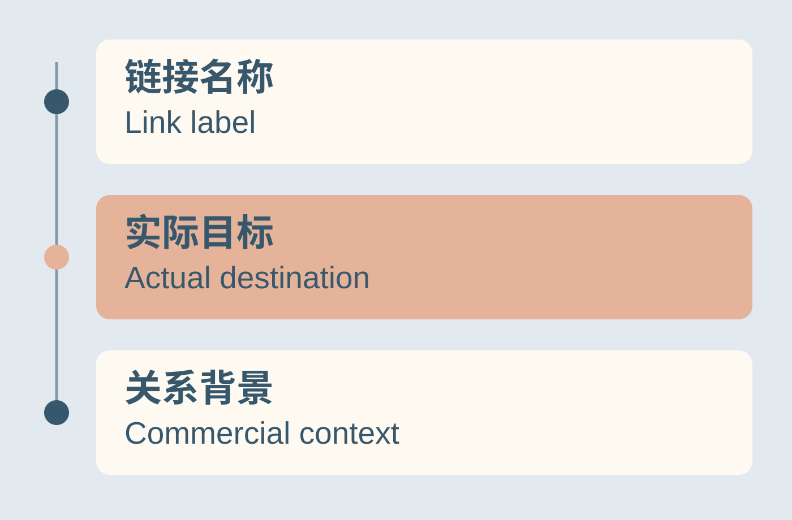

# Linktreee: Clear Creator Links

Status: local review draft; confirm the publication date before release.

Make a sponsored Linktree button an understandable invitation: identify its object, action and commercial context, then compare the wording with the destination.

“Linktreee” is commonly a spelling query for Linktree; check the official service name and domain rather than trust a similar-looking name. For influencer marketing, the useful question is whether a sponsored entry explains where a person will go, what they can do and the relevant commercial relationship. Button wording, adjacent context and the actual destination should describe the same task. Clear labels can reduce misunderstanding without guaranteeing clicks, purchases or accessibility conformance. Each outcome and assessment needs its own evidence.

## Resolve the name before the assignment

An extra letter in linktreee does not require inventing another platform. This article discusses Linktree, while any actual invitation still needs its source and address checked. A familiar product name does not establish that a message, campaign page or sender is associated with that service.

When a brand prepares a creator campaign entry, identify the real object first: a product page, an application, a collection of sponsored work or an introduction on another platform. Do not write “my exclusive benefit” and leave the implementer to guess which kind of destination is intended.

The [creator destination-ownership guide](https://www.quickkol.com/blog/creator-link-bio-tools-destination-ownership/#answer) addresses control and maintenance. This article takes the next, narrower step of examining the button’s meaning. Describe in an ordinary sentence what the visitor will encounter before deciding whether a hub is needed. Resolving a service name and defining an assignment are separate decisions. Correct identification does not establish suitability for this particular brief, endorsement or audience. Keep the actual campaign object visible throughout the wording review rather than allow a recognizable platform name to stand in for an explanation.

## Record the title and URL separately

[Linktree’s link-creation guide](https://linktr.ee/help/articles/5434135-how-to-create-a-link-on-linktree) separates a URL from a title, which becomes the button text. An editable name is useful, but the text cannot independently establish what the address contains. This article relies on public guidance and does not claim an account operation or testing across every version.

Retain the current wording, actual address and intended action for each sponsored entry. Read the label first, then inspect the destination and record whether they agree. Asking only whether the link opens misses the central issue: a working purchase page can still contradict a button promising a free tutorial.

Let product, creator-expression and page-implementation owners examine the same combination. Where destination access is unavailable, review the wording provisionally and identify that dependency instead of marking the unseen page confirmed. Separate fields make a promise checkable; they are not an invitation to build an unrelated administration system. They also prevent a later destination change from quietly inheriting a label written for an earlier task, product or commercial arrangement.

## Name the object and action

“Look here,” “do not miss this” and “my favorite” provide little independent explanation of the task. Consider “See the sponsored mug’s dimensions” or “Read the brand’s material guide,” provided the destination contains those things. Specificity does not mean exaggerating an offer or squeezing every detail into a button.

[W3C’s link-purpose explanation](https://www.w3.org/WAI/WCAG22/Understanding/link-purpose-in-context.html) describes understanding a link through its text or associated context. It is used here as a design reference, not a whole-site accessibility certification. Context can sit beside the link; it should not depend on remembering another video or interpreting an image alone.

Different destinations need distinguishable names, while the same task benefits from consistent wording. Two buttons called “Shop” remain confusing if one leads to a product purchase and another to a membership application. Add necessary nearby explanation to a short label instead of stuffing it with keywords. Preserve the creator’s voice while retaining the action’s meaning. Review this relationship in the actual layout, because a descriptive sentence placed far away may cease to provide useful context for the button it was meant to explain.

## Keep commercial context with the relevant expression

A button saying “What I use” does not automatically tell a visitor whether the item was gifted, sponsored or shared independently. [FTC’s influencer disclosure guide](https://www.ftc.gov/business-guidance/resources/disclosures-101-social-media-influencers) addresses the United States and calls for clear material-connection disclosures with the endorsement, warning against relying only on places such as a profile where people may miss them.

Check requirements for the actual audience, region and format. One explanation on a link hub should not be treated as sufficient disclosure for every related sponsored piece. Conversely, a disclosure in an earlier video does not establish that everyone encountering the later entry has seen it.

Read the relationship explanation together with the recommendation instead of merely checking whether a particular word appears. Even after a gift or payment is explained, examine whether the label implies nonexistent firsthand experience, exclusivity or a guarantee. Commercial context and statement accuracy are related responsibilities without substituting for each other. The review should address what a visitor can reasonably understand from this particular object, rather than an ideal journey assembled from several pieces the visitor might never encounter.

Check the promise itself; a working link does not establish an accurate label.

## Compare the promise with the destination

Consider a hypothetical insulated-mug collaboration. The creator’s button originally says “Get this one free,” but the destination is an ordinary product page with no free-item arrangement. The technical link works while its meaning fails. Correct the promise or confirm the real offer before using click performance to distract from the contradiction.

Changing it to “See mug sizes and colors” still requires those details to be reasonably findable. A label is not a disclaimer, and vague wording cannot repair missing information. Where price, supply region or timing materially affects the action, place the necessary context appropriately and confirm it with the brand.

Use specific review states: wording agrees, context needs improvement, destination remains unverified or the promise conflicts with the page. These should not all become approved. This is not a client result. It shows how brand facts and creator expression jointly determine the entry. The person reviewing can then request an actionable correction rather than make a general preference statement about whether the wording sounds persuasive, premium or sufficiently on brand.

## Include small-screen reading in the review

On a phone, inspect whether wording is complete, long labels are truncated and explanations remain beside the correct buttons. A thumbnail can help identify an object, but the product and action should not exist only inside a picture. Multilingual pages also need review at the translated text’s actual length.

Chinese and English do not need word-for-word symmetry; they need equivalent promises. A Chinese label about dimensions must not become an English free-trial offer merely to sound more attractive. A reader familiar with the audience’s language should inspect the finished object rather than rely exclusively on a translation sheet.

The question is comprehension where content meets interface, not whether one desktop screenshot looks finished. Record the device width, page version and conditions not covered. Without assistive-technology testing, do not claim complete accessibility. State the narrower work actually performed, such as meaning and visible-layout review. This helps another reviewer understand which questions have evidence and which still require a different method or expertise.

## Keep clicks distinct from business outcomes

Clearer wording may help people understand an entry, but this article promises no click or sales lift. Button taps, destination sessions and purchases are different events and may come from different systems. Calling a button “Buy” does not make every tap an order.

The [profile-to-destination review method](https://www.quickkol.com/blog/link-in-bio-destination-attribution/#answer) helps examine the path. A report separately needs source, window, object and known gaps. Link wording cannot replace attribution evidence.

If the team compares two versions, define the objects and conditions first. A small change in a low-volume observation does not establish that wording caused every difference or support a judgment about the creator’s integrity. A more accurate entry can be the direct deliverable of naming work. Conversion assessment still needs appropriate business data and analysis. This keeps copy review useful without assigning it responsibility for every marketing outcome, and it prevents a creator from receiving an unjustified performance claim simply because a destination’s intended task was confused with an event that actually occurred.

## Resolve confusing branches before handoff

If a button leads to a regional selector, explain that a choice is needed rather than imply arrival at a local product. A document, application or another app likewise needs wording suited to that object. “Read the guide” and “Apply for the trial” describe different commitments, even if both eventually concern the same brand.

For a temporarily unavailable entry, explain its state or let the responsible owner determine its treatment. Do not replace the destination with an unrelated page merely to preserve a prominent button while leaving its wording unchanged. Creators can retain personal expression without being asked to promise an unconfirmed campaign. When two labels compete for limited space, prioritize the distinction that changes a visitor’s decision rather than whichever phrase contains more promotional language.

## Hand over a maintainable naming decision

The handoff should retain button text, adjacent explanation, destination, associated sponsored work and unresolved facts. Identify who confirms product statements, who can edit the entry and which changes require another look. Do not collect unrelated private information to make the record appear complete.

When a collaboration ends or a page changes tasks, the earlier recommendation may cease to be accurate. A maintainer needs to know which promise to revisit instead of receiving only “the link is ready.” Retaining previous wording and the reason for revision can also explain why a more enticing old phrase was not reused.

Linktree is one tool for carrying an entry. The joint brand-creator responsibility is an understandable invitation that lets a visitor decide whether to continue. Correct spelling, a working address and attractive wording are partial conditions. The practical work is to make wording, destination and commercial context hold together for the same current task. That is a reviewable result even before the campaign has generated performance data or any visitor has chosen to act.

## Sponsored-entry wording decisions

| Situation | Review | Action |
| --- | --- | --- |
| Label says free | Whether the destination provides that arrangement | Do not promise before confirmation |
| Label says here | Whether object and action are understandable | Add specific wording or associated context |
| Material connection exists | Whether relevant context is clear | Review for the actual audience and format |
| Destination changed | Whether the old label remains accurate | Compare against the current task again |

An editorial review framework, not accessibility certification or guaranteed conversion improvement.

## Before handing over a button

Review against the same current destination.

- [ ] Confirm the service name and actual address.
- [ ] Describe the object and subsequent action.
- [ ] Verify the promise against the destination.
- [ ] Retain relevant commercial context.
- [ ] Read the full expression on a phone.
- [ ] Record dependencies and edit responsibility.

## Research date and limitations

Sources reviewed November 16, 2026. Methods, tables and decision rules are editorial recommendations. Hypothetical examples are not actual client results or industry benchmarks. Source geography and periods are specified where relevant.

## Start creator research with a clear task

Use QuickKOL to interpret a brief, discover relevant creators and research their work and contact routes. Verify data, commercial terms and outcomes at their source.

[Explore QuickKOL](https://www.quickkol.com/#capabilities)

## Sources

- [Linktree: creating a link](https://linktr.ee/help/articles/5434135-how-to-create-a-link-on-linktree)
- [W3C: link purpose in context](https://www.w3.org/WAI/WCAG22/Understanding/link-purpose-in-context.html)
- [FTC: disclosures for influencers](https://www.ftc.gov/business-guidance/resources/disclosures-101-social-media-influencers)
