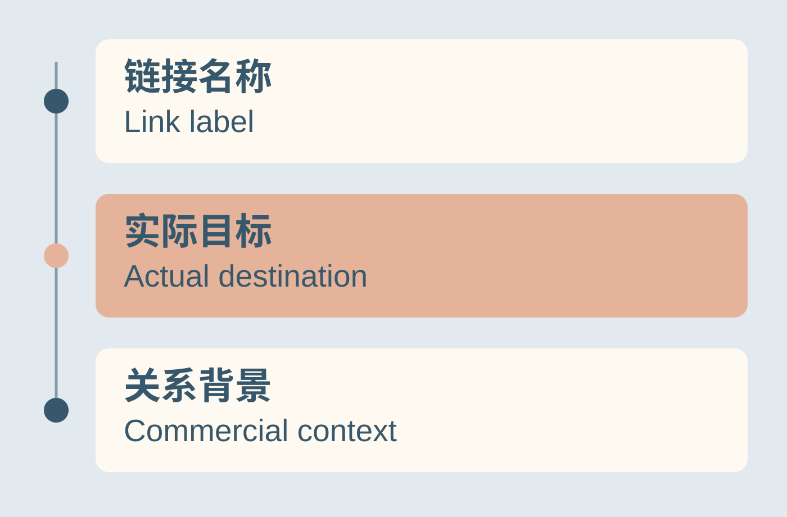

# Linktree 合作入口怎样命名清楚

状态：本地审阅稿；正式发布日期待确认。

把 Linktree 合作按钮写成可理解的邀请：说明对象、动作和商业背景，再与实际落地页核对，避免把好听的标题当作真实承诺。

“linktreee”通常是 Linktree 的拼写搜索；若要寻找该服务，应核对官方名称与域名，而不是信任相似名称。对达人营销而言，更有价值的问题是合作入口是否让人知道会去哪里、做什么，以及与谁存在商业关系。按钮文字、邻近说明与实际落地页应表达一致的任务。清楚命名可以减少误解，但不保证点击、购买或无障碍合规；这些结果与检查需要各自的依据。

## 先把拼写与合作对象分清

看到 linktreee，不需要把多一个字母解释成新平台。本篇按 Linktree 讨论，但具体邀请仍要检查来源与地址。一个熟悉的产品名称，不足以证明某条私信、合作页面或发件人与该服务有关。

品牌准备给达人一项活动入口时，应先说明真实对象：是品牌产品页、报名页、合作内容合集，还是另一个平台的介绍。不要先写“我的专属福利”，再让执行者猜它指向哪类页面。

[主页链接目的地管理指南](https://www.quickkol.com/zh/blog/creator-link-bio-tools-destination-ownership/#answer)讨论谁管理入口与后续维护；这里进一步处理按钮本身的语义。团队最好用一句普通话说明点击后会看到什么，再决定是否需要聚合页。名称澄清与合作范围是两件事，正确识别服务也不代表适合本次任务。

## 分别记录文字与真实地址

[Linktree 的链接创建说明](https://linktr.ee/help/articles/5434135-how-to-create-a-link-on-linktree)将 URL 与标题字段分开，标题会作为按钮文字显示。可编辑名称有实际好处，也意味着文字并不能独立证明它描述的地址。本文依据公开说明，不声称已经操作某个账号或测试所有版本。

给每个赞助入口保留当前文字、实际地址与预期动作。检查时先读按钮，再查看落地页，写下二者是否匹配；不要只问链接能不能打开。可打开的购买页，仍可能与按钮所说的免费教程不一致。

让负责产品、创作者表达与页面实现的人看到同一组合。没有页面访问权限时，可以先审文字并标出依赖项，不能把尚未看到的目的地标为已确认。字段分开记录的目的，是让承诺能被检查，不是增加一套无关后台。

## 用对象和动作取代空泛诱导

“看看这里”“别错过”和“我的最爱”很难独立解释任务。可以考虑“查看本次合作的杯子尺寸”或“阅读品牌提供的材料说明”，前提是页面确实包含这些信息。具体不等于夸大优惠或挤入所有细节。

[W3C 的链接目的说明](https://www.w3.org/WAI/WCAG22/Understanding/link-purpose-in-context.html)强调人们应能从链接文字或相应上下文理解链接目的。本篇把它作为设计参考，没有进行整站无障碍认证。说明可以紧邻链接，但不应依赖观众记住别处的视频或只看图才能理解。

给不同目的地不同名称，同一任务使用一致表达。如果两个按钮都叫“购买”，却分别是产品购买与会员申请，访客仍要猜。为短标签补充必要上下文，比在按钮里堆放关键词更有帮助；达人语气可以保留，动作含义不能丢。

## 让商业背景跟着相关表达

按钮叫“我在用”，并不会自动告诉观众这是赠品、付费合作还是普通个人分享。[FTC 的达人披露指南](https://www.ftc.gov/business-guidance/resources/disclosures-101-social-media-influencers)针对美国情形，要求相关商业关系清楚表达，并提醒不能只把说明放在个人简介等容易错过的位置。

实际项目应根据受众、地区与形式核对要求。链接聚合页的一句说明，不应被当成其他赞助内容都已充分披露。反过来，前一条视频出现说明，也不能证明任何后来看到入口的人都看过它。

审稿时把关系表达与推荐内容一同读，而不是只核对某个术语有没有出现。明确赠品或付费背景后，仍要判断按钮是否暗示真实不存在的亲身体验、专属权益或保证。关系披露与陈述准确性相互关联，但不能互相替代。

逐项检查承诺；链接能打开，不代表按钮说明准确。

## 逐项比较按钮与页面承诺

可以用一个假设合作练习：创作者介绍保温杯，按钮原写“免费拿同款”。实际页面只是普通商品详情，没有免费领取安排。链接技术正常，语义却不成立，应先修正承诺或确认真正活动，不用点击率掩盖矛盾。

若改为“查看杯子容量和颜色”，页面还需要容易找到相关信息。标题不是免责声明，不能靠模糊措辞弥补缺失内容。价格、供应地区或限时条件影响动作理解时，放在适当说明位置，并与品牌确认。

检查后给出具体结论：文字吻合、需要补充上下文、目的地尚未核实，或承诺与页面冲突。不要把不同状态一律改成通过。这个练习不是实际客户案例，目的在于展示品牌事实与达人语气怎样共同决定入口表达。

## 把小屏阅读纳入文字检查

在手机中查看文字是否完整，长标签是否被截断，说明是否还紧邻正确按钮。照片缩略图可以帮助识别对象，但产品名与动作不应只存在于图片里。多语言页面还要检查翻译后的真实长度。

不需要强迫中英文逐字对应；需要保留相同承诺。例如中文讲查看尺寸，英文不能为了更有吸引力写成免费试用。由熟悉受众语言的人阅读成品，比只对照翻译表更可靠。

检查重点是内容与界面结合后的理解，不以一张桌面截图代替所有访问条件。可以记录所看设备宽度、页面版本和未覆盖情形。若没有做辅助技术测试，就不要声称完整无障碍；可清楚说明已检查文字含义与可见排版。

## 保留点击与业务结果的差别

清楚命名后，人们可能更理解入口，但本篇没有给出点击或销售提升承诺。按钮点击、到达会话与购买是不同事件，也可能来自不同记录系统。不要因为页面名字叫“购买”，就把每次点击记为订单。

[主页入口路径检查方法](https://www.quickkol.com/zh/blog/link-in-bio-destination-attribution/#answer)帮助核对从个人主页到目的地的过程。报告中另写数据来源、窗口、对象和已知缺口；不能用链接措辞替代实际归因证据。

如果团队测试两个版本，先说明比较对象与条件。一次低量变化不足以证明措辞造成全部差异，也不能据此评价达人诚信。命名工作的直接交付可以是更准确的入口；转化判断仍需要适当业务数据与合理分析，不强行让文字审稿承担所有营销结果。

## 先处理容易混淆的分支

一个按钮如果通往多地区选择页，先告诉访客需要选择地区，不要暗示已经抵达本地商品。链接指向 PDF、报名或其他应用时，也让动作名称对应真实对象。

暂时不可用的入口，可以说明状态或由维护者决定如何处理。不要为了保留醒目按钮，把无关页面换进去而不改文字。创作者可以保留个人语气，但品牌不能要求他们替尚未确认的活动作承诺。

## 交付能维护的入口说明

最终交付保留按钮文字、邻近说明、目的地、对应合作内容与待确认事实。指定谁能确认产品陈述，谁能修改入口，以及什么变化需要重看；不用为了形式完整而收集无关私人信息。

合作结束或页面换成新任务后，原来的推荐语未必继续准确。维护者需要知道该重新检查哪项承诺，而不只是收到一句“链接好了”。保留此前表达与修改原因，也有助于解释为什么没有沿用更诱人的旧说法。

Linktree 是承载入口的一种工具。品牌与达人共同负责的是把邀请说清楚，让访客有依据决定是否继续。拼写正确、链接可开与名称好听，都只是部分条件；实际工作应让文字、页面和商业背景在同一个当前任务里成立。

## 合作入口的文字判断

| 情况 | 检查 | 处理 |
| --- | --- | --- |
| 标题说免费 | 页面是否存在相应安排 | 未确认就不作承诺 |
| 标题只说这里 | 能否理解对象与动作 | 补充具体文字或相关上下文 |
| 存在商业关系 | 相关表达是否清楚 | 按实际受众与形式核对 |
| 目的地已改变 | 旧标题是否仍准确 | 重新比较当前任务 |

编辑审阅框架，不是无障碍认证或转化提升保证。

## 交付按钮前逐项看

对照同一个当前页面检查。

- [ ] 确认服务名称和真实地址。
- [ ] 说明对象与点击后动作。
- [ ] 对照页面核实承诺。
- [ ] 保留相关商业背景。
- [ ] 在手机中读完整表达。
- [ ] 记录依赖项与修改责任。

## 研究日期与使用边界

资料核验于 2026 年 11 月 16 日。文中方法、表格和决策规则为编辑建议，标为假设的示例不是实际客户结果或行业基准。外部资料的适用地区与时期按各段说明。

## 从任务开始达人研究

用 QuickKOL 理解 Brief、发现相关达人并研究作品与联系路径；数据、合作条件和结果仍需核验。

[了解 QuickKOL](https://www.quickkol.com/#capabilities)

## 来源

- [Linktree：创建链接](https://linktr.ee/help/articles/5434135-how-to-create-a-link-on-linktree)
- [W3C：在上下文中理解链接目的](https://www.w3.org/WAI/WCAG22/Understanding/link-purpose-in-context.html)
- [FTC：达人商业关系披露](https://www.ftc.gov/business-guidance/resources/disclosures-101-social-media-influencers)
