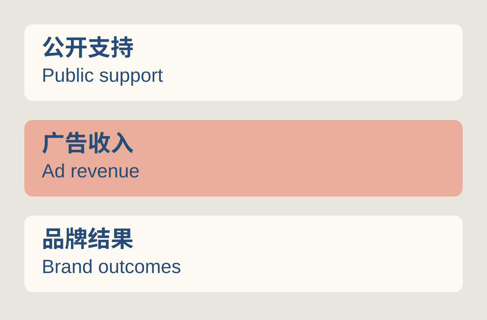

# Playboard: Read Super Chat Data for Sponsor Research

Status: local review draft; confirm the publication date before release.

Playboard Super Chat records can inform livestream research, but paid fan support, platform receipt and sponsorship outcomes are different measures.

Playboard is a YouTube research service whose methodology page describes Super Chat and Super Sticker statistics. Brands can use such records as leads about livestream support, not as creator net income, brand sales or the purchasing power of the entire audience. Record source, window, currency and coverage, then examine relevant work and an appropriate first-party record where needed. Sponsorship assessment should ultimately address the creator’s assignment, what viewers can understand and evidence of the brand’s own outcomes.

## Understand what the viewer purchased

[YouTube’s Supers explanation](https://support.google.com/youtube/answer/7288782?hl=en) describes viewers purchasing highlighted chat messages or stickers. Such payment belongs to the viewer’s relationship with creator content; it is not an automatic order record for a sponsor.

A viewer may support the program, celebrate an occasion or seek a response. The amount alone does not reveal motive or establish that every viewer will buy a brand’s product. Retain the behavior’s actual name instead of rewriting paid fan support as high brand conversion.

Where this support matters to the assignment, examine how the creator responds, handles the program’s rhythm and could express a sponsored message in that real setting. The object is the work and interaction context. It does not require identifying paying viewers privately or valuing an entire audience through one message. A sponsor can find the behavior interesting without treating it as an instruction to pressure fans to spend more, or as proof that the same willingness will transfer to an unrelated product at a different price.

## Read coverage through the provider’s explanation

[Playboard’s methodology explanation](https://playboard.co/en/about) describes Super Chat and Super Sticker statistics, different treatment of streams before and after January 10, 2020, and notes concerning Premieres and exchange-rate changes. These are provider descriptions, not an independent completeness audit performed here.

Retain the actual field and window when citing it. An all-time cumulative amount is not this month’s result. If one stream is missing, preserve the missing state instead of assigning zero support or concluding that the creator concealed information.

A brand needs to understand which question the material can answer. It may justify examining a kind of livestream without establishing capture of every historical record. Compare public statistics with the original program object to understand scope. A complete-looking column does not remove unknowns. The research note should make it possible to distinguish a provider’s stated collection rule, the particular records actually inspected and any broader conclusion the team is considering, rather than collapse those into one assertion of complete verified coverage.

## Align windows and currency before comparing

Daily, weekly and cumulative records serve different purposes. Identify objects, periods and currency before comparing them. Where conversion or display rules are unclear, a difference should not become a change in audience interest. The provider’s exchange-rate qualification is another reason to preserve the original basis.

Two channels displaying one currency do not automatically have equivalent stream counts, duration, content or observation conditions. A celebration stream may have a special context that should not become the expected outcome of every later sponsorship.

A comparison can retain sources, retrieval dates and open fields without forcing a ranking. If the brand needs a host who can explain a device, support payments are background; actual demonstrations and expression still need review. Let the assignment determine which data matters instead of ranking amounts first and constructing a buying rationale afterward. This can also reduce unnecessary collection, because some financial-looking public figures will turn out to add little to the real question the team needs answered.

## Public amounts do not establish actual receipt

The YouTube Supers help discussed above describes a creator share of confirmed revenue and its relevant deduction basis. A third-party displayed amount cannot simply be called money received, or multiplied by a percentage to claim knowledge of private net income.

Actual amounts can concern different record states and currency bases. If the collaboration has no reasonable need, do not request private settlement documents. The brand purchases defined work rather than a right to inspect all creator income.

The [YouTube revenue-and-scope guide](https://www.quickkol.com/blog/youtube-ad-revenue-sponsorship-scope/#answer) further explains platform metrics versus brand fees. Keep three objects here: an observed support record, an applicable platform earnings record and the brand purchase. They may relate without one filling a gap in another. A public-looking amount is particularly easy to turn into a precise financial conclusion that the source does not support. The useful research finding may instead be that a channel has visible fan-support activity worth understanding in context, with actual receipt remaining outside the review.

Each object has its own evidence; support amounts are not automatically net income or brand orders.

## Check an appropriate first-party field

[YouTube’s revenue-report explanation](https://support.google.com/youtube/answer/9314488?hl=en) separates Supers from other sources and includes Super Chat, Super Stickers and Super Thanks within that field. A first-party Supers figure and a third-party record discussing chat support should not be called identical totals without explaining their scope.

For a legitimate commercial question, ask an authorized person for a limited object, window and definition, accepting an appropriately redacted record. Do not request login secrets or promise that third-party and first-party material must reconcile item by item.

Where figures differ, inspect source and field before making accusations. A report can state that the reason for an unreconciled difference remains unconfirmed and explain whether it affects this collaboration. Verification is useful when it improves understanding, not when extra screenshots merely create an impression of certainty. Keep questions open where the material cannot answer them. A mismatch can then lead to a bounded follow-up rather than a broad allegation about a person’s honesty or a claim that the entire service is worthless.

## Watch the program around the support

Watch an appropriate passage in context rather than capture only a payment peak. The surrounding topic, creator response and whether a sponsor message would interrupt comprehension are content questions that an amount table cannot answer.

Suppose a brand purchases a livestream equipment demonstration. This is an editorial exercise. Support around a celebration may justify watching the channel, but does not establish willingness to buy that equipment. Examine explanation, camera arrangement and question handling before discussing the actual task.

Do not turn individual viewers’ spending into an obligation to maintain, or require extra paid interactions to manufacture sponsorship success. A collaboration can center on a clear demonstration and reasonable viewer questions instead of compressing all live value into immediate support revenue. Relevant program details produce a more useful brief than a popularity number. They can show whether the creator needs another camera angle, time for a practical example or a different position in the program, all of which concern the work the brand is considering rather than assumptions about fan wealth.

## Brand outcomes need their own evidence

Orders, qualified inquiries and other brand objectives need their own records and definitions. A Playboard support amount cannot replace a brand purchase record. Co-occurrence also does not establish that the sponsor caused all support or that support caused every sale.

The [comparable YouTube content-group method](https://www.quickkol.com/blog/youtube-analytics-sponsored-content-cohorts/#answer) helps place sponsored performance in an appropriate content context. Explain what was observed, where the data came from and which interpretations remain inferences. Without purchase data, report actual content delivery and relevant viewing material instead of replacing a gap with either zero or success.

Codes or links also need their attribution conditions and windows understood. No tool is treated here as complete end-to-end proof, and no fixed conversion multiplier is supplied. A useful report can retain unknowns if their effect on the conclusion is explicit. The team can then decide whether additional evidence is necessary, rather than treating a public fan-support amount as an easy substitute for a business result it was never designed to record.

## Name the finding proportionately

A proportionate finding might say that relevant support records were observed in a specified window and further livestream review is warranted. “The creator with the highest purchasing power” additionally claims a complete comparison, audience motive and business outcome that the material usually cannot establish.

If candidates must be compared, define the assignment and comparable conditions while allowing for different program cultures. Lower support is not a worse creator: an excellent demonstration may not center on viewer payments. The field is one part of this task.

Write the recommendation as a next action: a passage to examine, a limited question to ask or a condition to confirm. Avoid an unexplained composite score. Sources and open questions let a responsible person revisit the research and give the creator a chance to add relevant context, rather than only dispute a label that has already defined their income and commercial value. A narrower finding can be more useful precisely because it tells the team what it can reasonably do next.

## Use a tool lead to support real collaboration

Retain provider field, period, currency, program passages actually examined and unconfirmed coverage in the handoff. A proposal does not need every public number; keep information relevant to selection, production or assessment.

If the evidence cannot yet support a buying decision, continue work review or discuss a bounded option without pretending a complete audit has finished. Where relevant creative capability is already demonstrated, do not chase unrelated financial records simply to fill more data fields.

Playboard’s reasonable role in influencer marketing is helping formulate better content-research questions. Separating fan support, platform income and brand outcomes lets the team see the hosting, demonstration and communication capability it actually needs to purchase. Assess the collaboration against that assignment. A public record can remain useful as a lead while its limits stay explicit; usefulness does not require converting it into a complete account of private earnings or a guarantee about what a sponsor will achieve.

## Boundaries of a Super Chat record

| Record | Useful for | Does not establish alone |
| --- | --- | --- |
| Third-party support statistic | A lead for further livestream review | Entire private income |
| First-party Supers field | Revenue understanding within its scope | Identical scope to every provider |
| Program passage | Understanding expression and interaction | Every viewer’s motive |
| Brand business record | Discussing defined brand objectives | One cause of every change |

A research method, not a Playboard completeness audit, earnings forecast or conversion guarantee.

## Before citing Playboard

Retain what the record actually means.

- [ ] Confirm field, window and currency.
- [ ] Read the provider’s coverage explanation.
- [ ] Separate observed amounts from receipt.
- [ ] Review the relevant program context.
- [ ] Use appropriate separate evidence for brand outcomes.
- [ ] Use a bounded finding to assign the next action.

## Research date and limitations

Sources reviewed November 16, 2026. Methods, tables and decision rules are editorial recommendations. Hypothetical examples are not actual client results or industry benchmarks. Source geography and periods are specified where relevant.

## Start creator research with a clear task

Use QuickKOL to interpret a brief, discover relevant creators and research their work and contact routes. Verify data, commercial terms and outcomes at their source.

[Explore QuickKOL](https://www.quickkol.com/#capabilities)

## Sources

- [YouTube’s Supers explanation](https://support.google.com/youtube/answer/7288782?hl=en)
- [Playboard’s methodology explanation](https://playboard.co/en/about)
- [YouTube’s revenue-report explanation](https://support.google.com/youtube/answer/9314488?hl=en)
