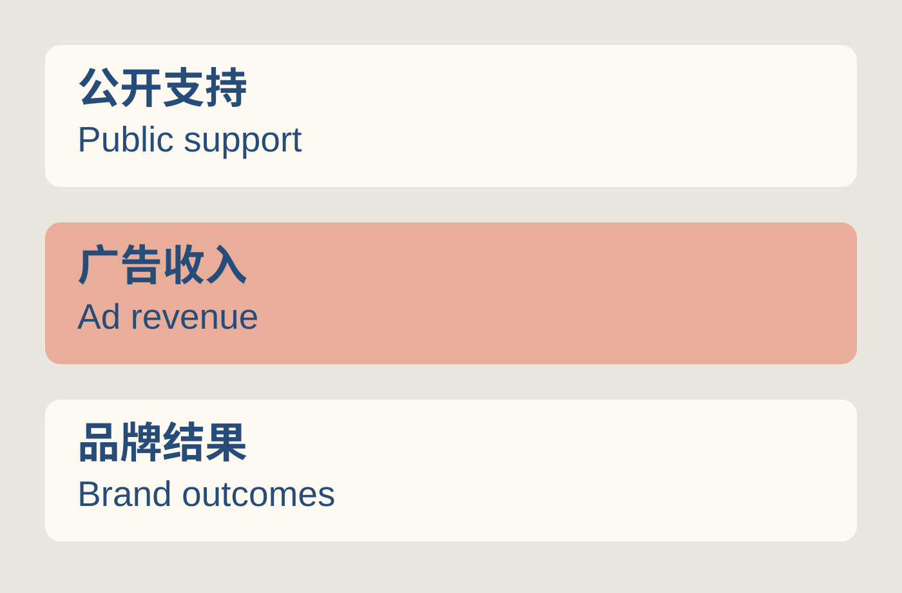

# Playboard 数据能说明多少赞助价值

状态：本地审阅稿；正式发布日期待确认。

Playboard 的 Super Chat 记录可以提供直播研究线索，但付费粉丝支持、平台实得与赞助成果不是同一指标。

Playboard 是 YouTube 数据研究服务，其方法页说明提供 Super Chat 与 Super Sticker 统计。品牌可以把这些记录当作理解直播支持行为的线索，但不能直接称为创作者净收入、品牌销售额或全部受众购买力。先记录来源、窗口、货币与覆盖条件，再观看相关内容并核对适当第一方资料。赞助判断最终要回答本次创作者能完成什么、观众可能理解什么，以及品牌有什么自己的成果证据。

## 先理解观众买了什么

[YouTube 的 Supers 说明](https://support.google.com/youtube/answer/7288782?hl=en)介绍观众购买突出显示的聊天信息或贴图等功能。这类付款发生在观众与创作者内容的关系中，不是某个赞助品牌订单的自动记录。

观众可能支持节目、表达祝贺或希望获得回应。仅凭金额不能知道具体动机，也不能推断所有观看者都愿意购买品牌产品。品牌研究应保留行为名称，而不是把“粉丝付费”改写成“品牌高转化”。

当这类支持与任务有关时，可以进一步看创作者怎样回应、如何处理内容节奏，以及赞助信息能否在真实节目中表达。这里研究的是作品与互动场景，不需要收集付款观众的私人身份，也不根据某一条信息对整个人群作价值判断。

## 按提供方说明理解覆盖

[Playboard 的方法说明](https://playboard.co/en/about)列出 Super Chat 与 Super Sticker 数据，并对 2020 年 1 月 10 日前后直播记录说明不同覆盖条件，同时注明 Premiere 与汇率变化等事项。这些是提供方描述，不是本篇独立完成的完整性审计。

引用时应保留实际字段与窗口，不把一个全时段累计数称为本月成果。找不到某次直播记录时，先保留缺失，不默认支持金额为零，也不据此判断创作者隐藏信息。

品牌需要知道这份资料适合回答什么。例如它可以提供进一步查看某类直播的理由，却不能直接证明所有历史记录都被捕捉。公开统计与节目原始对象相互参照，才有助于理解资料范围；不能只因数字列得完整，就认为所有未知已经消失。

## 先对齐窗口与货币

日榜、周榜与累计记录承担不同任务。先说明比较对象、期间及货币；换算或展示方式不明确时，不把差额解释成观众兴趣变化。提供方已说明汇率可能使金额变化，更需要保留原始口径。

不要因为两个频道都显示同一种货币，就默认其直播次数、时长、内容与观察条件相同。某次庆祝直播可能具有特别语境，不宜直接变成以后每次赞助的预期。

比较表可以保留来源、检索日期和未确认字段，不必强行排序。若品牌的问题是主持人是否能解释一款设备，付款支持只是背景；实际演示与表达样本仍需要阅读。让数据选择跟着任务，比先拿金额排名、再为结果寻找采购理由更合理。

## 公开金额不等于实际实得

上述 YouTube Supers 帮助说明对确认收入规定创作者分成，并说明相关扣除依据。不能把一个第三方显示金额直接说成到账，或简单乘一个比例就断言知道私人净收入。

实际金额可能涉及不同记录状态与货币依据。若本次合作没有合理需要，就不请求私人结算资料。品牌要购买的仍是明确工作，而不是获得审查创作者所有收入的权利。

[YouTube 广告收入与赞助范围指南](https://www.quickkol.com/zh/blog/youtube-ad-revenue-sponsorship-scope/#answer)进一步解释平台指标与品牌费用的差别。这里保留三个对象：观察到的支持记录、适用平台收益记录与品牌采购。它们可以有关联，但任何一项缺失都不能用另一项直接补齐；尤其不能把看起来公开的数额包装为精确的财务结论。

三个对象有各自依据，不把支持金额直接写成净收入或品牌订单。

## 核对适当第一方字段

[YouTube 的收益报告说明](https://support.google.com/youtube/answer/9314488?hl=en)将 Supers 与其他收入来源分开，并说明其中包括 Super Chat、Super Stickers 和 Super Thanks。一个写着 Supers 的第一方字段，与只讨论聊天支持的第三方记录，也不能不加解释就说是同一总额。

如果确有合理商业问题，向有权分享的人提出有限请求：需要哪个对象、窗口与定义，接受适当去敏记录。不要求登录秘密，也不承诺第三方数据一定能与第一方逐项相等。

出现差异先检查来源与字段，而不是直接指控。报告可记录“无法对齐的原因尚未确认”，并说明它是否影响当前合作决定。核对的价值是准确理解证据，不是用更多截图营造绝对确定；资料不能回答的问题，应保持开放。

## 观看付款发生的节目语境

相关节目需要看完整的适当片段，不能只截图付款高峰。观众在什么话题下支持、创作者怎样回应、品牌信息是否会打断理解，都是内容任务的问题，不从金额表自动得出。

假设品牌采购一个直播设备演示，这是编辑练习。某频道有庆祝活动支持，能说明值得继续看节目；它不能证明观众愿意购买设备。团队还需观察解释能力、镜头安排与提问处理，再讨论合适任务。

不要把个别观众的消费作为必须维持的要求，也不要求创作者用额外付费互动制造赞助成功。合作可以围绕清楚演示和合理观众问题，而不是把所有直播价值压缩成当场支持金额。真正有关的节目细节，会让 Brief 比一个热度数字更具体。

## 品牌结果需要品牌自己的证据

品牌订单、合格咨询或其他目标，需要各自记录与定义。Playboard 显示支持金额，不能替代品牌的购买记录；同场出现也不自动证明品牌促成全部支持，或支持促成全部销售。

[YouTube 可比内容组方法](https://www.quickkol.com/zh/blog/youtube-analytics-sponsored-content-cohorts/#answer)帮助把赞助表现放在适当内容背景中。报告要说明观察到什么、数据在哪里、哪些解释仍是推断。没有购买数据时，可以报告实际内容交付与适当观看资料，不把缺口填成零或成功。

如果另有折扣码或链接，仍需理解其归因条件与窗口。本篇不把某个工具当成全链路证明，也不给固定转化倍率。良好报告可以有未知，只要清楚它影响哪项结论，团队就能决定是否需要进一步资料。

## 给研究结论适当名称

可以写“在所看窗口内观察到相关支持记录，建议进一步审阅直播作品”，而不是“购买力最高的达人”。后者同时宣称了完整比较、观众动机与品牌结果，通常超过当前材料。

如果必须比较候选人，先确定任务与可比条件，并承认不同节目文化的差异。不把较低支持视为较差创作者；某些优秀演示可能并不以观众付费支持为核心。数据只是当前任务的一部分。

将建议写成下一步：看哪段作品、问哪个有限问题、确认哪项条件。避免给出无法解释的综合评分。具体来源与开放问题能让负责人复核，也让创作者有机会补充相关语境，而不是只能反驳一个已经替他们定义好收入与商业价值的标签。

## 用工具线索支持真实合作

交接保留提供方字段、期间、货币、实际看过的节目及未确认范围。无需把每个公开数字都复制进提案；只保留与选择、制作或评估有关的信息。

若当前资料不足以支持购买决定，可以继续看作品或讨论限定方案，不用假装完整审核已结束。若已经有相关创作能力证据，也不必为了凑数据而追索无关财务。

Playboard 对达人营销的合理用途，是帮助提出更好的内容研究问题。把粉丝支持、平台收入与品牌成果分开后，品牌才能看见真正需要购买的主持、演示与沟通能力，并按实际任务评价合作。

## Super Chat 记录的判断边界

| 记录 | 可用于 | 不能单独证明 |
| --- | --- | --- |
| 第三方支持统计 | 进一步查看直播的线索 | 全部私人收入 |
| 第一方 Supers 字段 | 适用范围内的收益理解 | 与所有第三方口径相同 |
| 节目片段 | 理解表达与互动背景 | 全部观众动机 |
| 品牌业务记录 | 按定义讨论本品牌目标 | 所有变化的单一原因 |

研究方法，不是 Playboard 完整性审计、收益预测或品牌转化保证。

## 引用 Playboard 前

保留记录的实际含义。

- [ ] 确认字段、窗口与货币。
- [ ] 阅读提供方覆盖说明。
- [ ] 把观察金额与实得分开。
- [ ] 查看相关直播语境。
- [ ] 品牌结果另找适当证据。
- [ ] 用有限结论安排下一步。

## 研究日期与使用边界

资料核验于 2026 年 11 月 16 日。文中方法、表格和决策规则为编辑建议，标为假设的示例不是实际客户结果或行业基准。外部资料的适用地区与时期按各段说明。

## 从任务开始达人研究

用 QuickKOL 理解 Brief、发现相关达人并研究作品与联系路径；数据、合作条件和结果仍需核验。

[了解 QuickKOL](https://www.quickkol.com/#capabilities)

## 来源

- [YouTube 的 Supers 说明](https://support.google.com/youtube/answer/7288782?hl=en)
- [Playboard 的方法说明](https://playboard.co/en/about)
- [YouTube 的收益报告说明](https://support.google.com/youtube/answer/9314488?hl=en)
