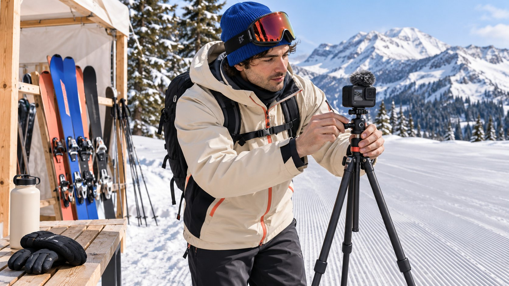
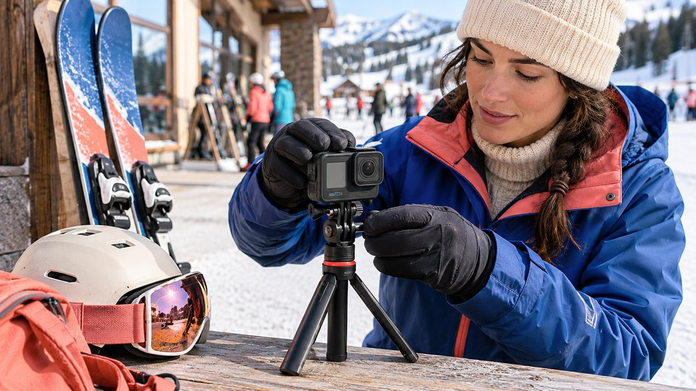

# Skier Guy: Brief a Ski Creator by Role and Terrain

Status: local review draft; confirm the publication date before release.

For a ski-creator collaboration, define presentation, product demonstration or on-snow filming first, then check location, production roles and conditions.

“Skier guy” alone does not identify one person. A brand can treat it as an initial descriptor for a ski creator and examine actual work against an assignment. Separate on-camera explanation, product detail and on-snow action, then confirm filming roles, venue conditions and professional on-site judgment. Popularity or dramatic footage does not establish every production or instructional capability. The brand may need a clear equipment explanation rather than a more dangerous action. A brief should allow actual conditions, suitable alternatives and defined use.

## Turn the search phrase into a role

A search descriptor is neither a complete identity nor proof of capability. Define the adult creator’s role: hosting a product introduction, showing preparation, describing personal use or participating in appropriately arranged action filming.

Do not infer private identity from a photograph or make male ski creator a fixed assumption about style or skill. For a particular person, verify through appropriate public business routes. For selection, begin with assignment and work.

The [creator-shortlist method](https://www.quickkol.com/blog/creator-shortlist-workflow/#answer) turns an initial lead into a discussable candidate. Relevant work should reveal actual contribution rather than only the most dramatic frame. A brand that knows its purchase can assess whether an experience matters to this collaboration instead of treating familiarity with snow as capability for every production responsibility. This also makes the first outreach more useful: the recipient can respond to a role and concept rather than guess whether the brand wants an instructor, performer, presenter, photographer or all of them under one informal description.

## Separate product shots from action shots

An equipment collaboration may need pocket locations, gloved operation or storage explained. These can be demonstrated in a suitable stationary setting instead of every detail appearing in motion. Ask what viewers need to see before choosing the shot.

Action footage supplies context without necessarily showing product detail clearly. One recorded use does not establish every performance claim or suitability in all weather. The brand provides facts, the creator describes genuine experience and production selects images that can communicate it.

Write the two shot types separately to assess additional operators, equipment or locations. Skiing capability does not automatically make one person director, following camera operator and product expert. Clear tasks also prevent missing detail from becoming an improvised demand for an unsuitable action on site. The final piece can combine atmosphere and explanation without pretending that a dramatic descent itself demonstrates a seam, closure or compatibility condition the camera never showed well enough to assess.

For gloved operation, identify the part and step the viewer must see, then check visibility in an appropriate rehearsal. Attractive establishing footage cannot substitute for that detail. Missing information needs a relevant shot rather than more atmosphere.

## Access to a venue is not filming approval

[Aspen Snowmass’s filming guidance](https://www.aspensnowmass.com/media) states that on-mountain filming requires relevant permitting and approval and directs inquiries to its team. This is a particular venue’s public requirement, not a legal explanation for every resort or confirmation that permission has been obtained.

For the real assignment, an appropriate person should confirm conditions for location, activity, equipment and use. Ordinary visitor access, earlier videos or local familiarity does not automatically replace this production arrangement. Identify who can explain the project to the venue and confirm feasibility.

Retain these dependencies in schedule and scope instead of describing an unconfirmed site as a fixed deliverable. Where conditions do not work, change the setting or shot rather than leave the creator solely responsible for resources they cannot promise. The brand states real needs, then develops a plan under applicable conditions. This makes a proposal reviewable before travel and equipment commitments depend on an assumption nobody has checked with the people responsible for the location.

## Assign on-site judgment to appropriate roles

[FIS’s skier-conduct code](https://assets.fis-ski.com/f/252177/49280306c8/fis-code-of-conduct-for-skiers-and-snowboarders-en.pdf) emphasizes responsibility toward others and adapting conduct to terrain, weather and conditions. It cannot replace on-site judgment for a production. This article provides no skiing instruction, difficulty recommendation or safety guarantee for a setting.

The brief should allow appropriate owners to stop or change an unsuitable shot rather than interpret delivery timing as a requirement to disregard conditions. Discuss creative, camera and on-site responsibilities for the real project instead of creator handles everything.

The photograph shows camera adjustment while stationary, illustrating preparation as a separate task rather than a moving-filming technique to imitate. A creative goal should not force someone to improvise a brand request while performing an activity needing attention. Capable, authorized people should design and assess the actual arrangement. Clear responsibility lets a producer change the expression when a planned shot is unsuitable, without treating a sensible production decision as the creator’s failure to fulfill an unconditional demand for dramatic footage.

Define camera preparation and product explanation as tasks; the actual site arrangement still needs appropriate confirmation.

## Prepare alternatives for changing conditions

Weather, location availability and visibility may change a plan. Identify which facts must be expressed and which images are preferred atmosphere, making adaptation possible without losing the assignment’s purpose.

For a hypothetical glove collaboration, viewers may need storage and operation explained. If action context is unavailable, discuss an appropriately confirmed stationary demonstration. It is not completion of the original moving shot and should not become proof of extreme-environment performance.

The [travel-creator feasibility guide](https://www.quickkol.com/blog/top-travel-influencers-itinerary-feasibility/#answer) addresses dependencies and execution. A ski collaboration likewise needs accurate names for alternatives and agreement on changed scope, resources and later use. Everything depends on weather is incomplete without explaining which real work remains proposed under changed conditions. A useful alternative identifies its explanatory value and limits, rather than simply substituting any snow image for a shot the brand originally hoped to obtain. That lets the creator and client make a concrete choice before either side assumes a different version has already been accepted.

## Confirm experience and product support separately

A creator can describe actual experience without one use supporting every durability, protection or environmental claim. The brand supplies appropriate support, particularly where an image may imply that a product guarantees an outcome.

[FTC’s endorsement-guidance FAQ](https://www.ftc.gov/business-guidance/resources/ftcs-endorsement-guides-what-people-are-asking) emphasizes honest, nonmisleading expression and commercial context in the US. It does not make genuine experience permission for every product statement. Review the actual audience and format too.

If the task concerns construction or personal impressions, retain that scope. Without support, omit a guarantee of reliability in every condition. Nor should a creator perform additional risky actions to compensate for missing brand evidence. An accurate detail can inform viewers more than an unconditional performance slogan. This distinction is useful during review because the brand can request a clearer explanation of an observed feature while declining a broader claim, rather than assume that reducing the claim makes the entire collaboration less valuable or less authentic.

## Discuss fees through actual production resources

A quote can distinguish concept, appearance, filming, editing, publication and agreed use, then discuss location, personnel and condition dependencies. Creators do not all need identical arrangements, and a follower tier should not imply every on-snow production resource.

If following-camera work, another language or a product version is added, identify the affected task. With an unconfirmed location or condition, provide a scope with assumptions instead of fixing both the ideal image and the minimum possible resources as guaranteed results.

Both parties need to understand preparation responsibilities rather than compress every unknown into all included. Scope discussion makes the plan executable and shows what should change when conditions change. That is more useful than discovering at closeout that one broad fee was interpreted as several different professional roles. It also lets a creator decline a role outside their demonstrated capability while still propose the presentation or production contribution they can appropriately deliver for the brand.

## Review whether the product was explained

Review agreed facts, visibility, experience and commercial context before asking whether action looks more dramatic. Attractive snow does not prove product detail was shown, and a complex movement does not automatically make the brand message clear.

Direct actionable comments at shots and statements. An obscured closure may need a suitable detail shot, not vague feedback that the piece lacks impact followed by an assumption that increased action risk is the remedy. Reconfirm resources and conditions when scope changes.

Later crops or advertising use can change the relationship between setting and original statement, requiring review for that use. One supplied version does not automatically cover every product, market or future year. Preserve meaning and authorization rather than only a high-resolution file. This gives a future editor a reason to retain a contextual passage or request another explanation instead of reusing an isolated image as evidence of a product performance that the original collaboration never claimed to establish.

## Finish selection with roles and conditions

The final proposal should explain why the ski creator suits the task, their actual responsibilities, who confirms venue and on-site conditions, and alternatives and unknowns. A search phrase does not determine identity, and popular work does not establish every skill.

A brand can choose a clear equipment explanation, reliable host or appropriate setting without making the most dramatic image its only criterion. A creator can describe their contribution and limits so the discussion becomes concrete.

For influencer marketing, skier guy should lead to actual work, suitable production and defined collaboration rather than a general skiing tutorial or private-person search. The selection result is an assignment that can be discussed, made and reviewed under appropriate conditions. It leaves the brand with a reasoned production choice, not simply a name associated with snow and an expectation that all creative, operational and performance questions will resolve themselves after the creator accepts.

## Distinct roles in a ski collaboration

| Task | Relevant work evidence | Confirm separately |
| --- | --- | --- |
| On-camera explanation | Clear product explanation and genuine experience | Statements and commercial context |
| Product detail | Visible detail and understandable actions | Equipment, people and setting |
| Action context | Actual contribution and relevant experience | Venue, conditions and on-site arrangement |
| Later use | Versions and uses | Authorization and new expression boundaries |

A brand-production framework, not skiing instruction, a venue permit or a safety guarantee.

## Before inviting a ski creator

Research work against the task and conditions.

- [ ] Turn the descriptor into a defined role.
- [ ] Separate product detail from action context.
- [ ] Have appropriate people confirm venue conditions.
- [ ] Define on-site and camera responsibilities.
- [ ] Prepare genuinely assessable alternatives.
- [ ] Retain product support and use scope.

## Research date and limitations

Sources reviewed November 16, 2026. Methods, tables and decision rules are editorial recommendations. Hypothetical examples are not actual client results or industry benchmarks. Source geography and periods are specified where relevant.

## Start creator research with a clear task

Use QuickKOL to interpret a brief, discover relevant creators and research their work and contact routes. Verify data, commercial terms and outcomes at their source.

[Explore QuickKOL](https://www.quickkol.com/#capabilities)

## Sources

- [Aspen Snowmass’s filming guidance](https://www.aspensnowmass.com/media)
- [FIS’s skier-conduct code](https://assets.fis-ski.com/f/252177/49280306c8/fis-code-of-conduct-for-skiers-and-snowboarders-en.pdf)
- [FTC’s endorsement-guidance FAQ](https://www.ftc.gov/business-guidance/resources/ftcs-endorsement-guides-what-people-are-asking)
