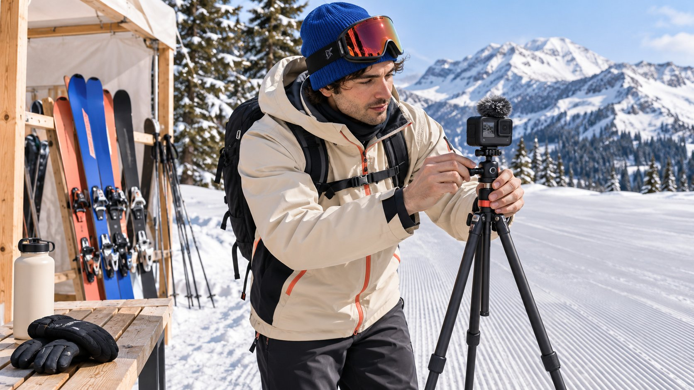
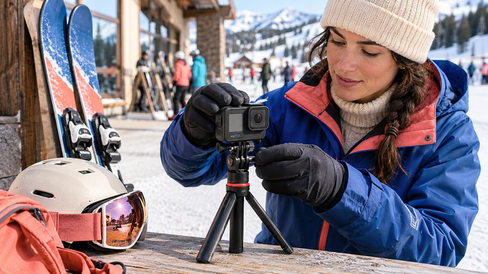

# 滑雪达人怎样按拍摄任务合作

状态：本地审阅稿；正式发布日期待确认。

选择滑雪达人合作，先确定需要本人讲解、产品展示还是雪上拍摄，再核对场地、制作角色和实际条件，不以惊险程度代替能力。

“skier guy”本身不足以确认某个人；品牌可以把它作为滑雪创作者的初步描述，再按任务研究实际作品。先区分镜头前讲解、产品近景与雪上动态内容，确认谁负责拍摄、场地条件和专业现场判断。不会因为粉丝多或画面刺激，就默认对方能承担所有制作与指导角色。需要的可能是一段清楚装备说明，而不是更危险的动作；提案应给真实条件、合理替代与明确使用范围留出位置。

## 先把搜索词转成角色

搜索描述不是完整候选人身份，也不是能力证明。先说明品牌需要成年创作者完成哪类表达：主持产品介绍、展示准备过程、解释个人使用经验，还是参与经过适当安排的动态拍摄。

不要从某张照片猜私人身份，也不把“男滑雪达人”变成固定风格或技能假设。若需要某个明确人物，应沿公开合法商业路径核对；若只是选人，则用任务与作品展开研究。

[达人候选清单方法](https://www.quickkol.com/zh/blog/creator-shortlist-workflow/#answer)帮助把初步线索整理成可讨论对象。相关作品应说明创作者实际贡献，而不是只保留最刺激的一帧。品牌知道自己想买什么，才能合理判断某种经验是否与本次合作有关，避免把看起来熟悉雪场当成所有制作职责都可交付。

## 把产品镜头与动态镜头分开

一项装备合作可能需要说明口袋位置、手套操作或收纳方式。这些内容可以在适当静止场景演示，不必都放进移动镜头。先问观众需要看清什么，再决定镜头形式。

动态画面能提供场景，但未必清楚展示所有产品细节。不能只因运动相机记录到一次使用，就宣称证明所有性能或适合所有天气。品牌提供准确事实，创作者说明真实经历，制作团队选择能表达它的画面。

把两类镜头分别写进范围，便于判断是否需要额外拍摄者、设备或场地。一个会滑雪的人不自动同时担任导演、跟拍与产品专家。任务拆清楚，也能避免现场发现近景缺失后，临时要求增加不合适的动作。

如果需要戴手套操作的画面，先说清观众要看到哪个部位与步骤，再用适当演练检查是否可见。不能只根据空镜漂亮，就默认产品说明已经足够；缺失信息应由相关镜头补充。

## 场地允许进入不等于允许拍摄

[Aspen Snowmass 的拍摄说明](https://www.aspensnowmass.com/media)要求山上拍摄取得相应许可与批准，并请团队联系其负责人。这是具体场地方的公开要求，不是本篇替所有雪场解释法律，也不代表已经拿到某项许可。

实际合作应由适当人员按地点、活动、器材与用途确认条件。普通游玩资格、过去拍过视频或创作者熟悉当地，都不能自动替代本次制作安排。需要知道谁能向场地说明项目，谁能确认实际可行。

在排期与报价中保留这些依赖，避免把未确认地点写成确定交付。若条件不适合，可以换场景或镜头，不必让创作者独自承担无法承诺的现场资源。品牌的任务是提出真实需求，再在适用条件下形成计划。

## 把现场判断交给合适角色

[FIS 的滑雪行为准则](https://assets.fis-ski.com/f/252177/49280306c8/fis-code-of-conduct-for-skiers-and-snowboarders-en.pdf)强调对他人负责，并要求行为适应地形、天气与现场条件。它不能替代具体制作的现场判断；本文不提供滑雪教学、动作难度建议或任何场景的安全保证。

品牌 Brief 应允许适当负责人停止或改变不合适镜头，不把按时交付理解为必须忽略现场条件。谁负责创作、谁负责相机、谁确认现场安排，需要按真实项目讨论，不能只写“达人全包”。

配图中的相机调整发生在静止场景，说明准备工作可以独立安排，并非展示值得模仿的移动拍摄方法。创作目标不应迫使参与者一边执行需要专注的活动，一边临时完成品牌要求；具体方案由有能力且获准的人员设计与判断。

把相机准备与产品说明安排成明确任务；现场方案仍需合适人员确认。

## 为天气与场景变化留替代

天气、可用场地与实际视线条件可能改变原计划。品牌先决定哪些事实必须表达，哪些画面只是期望氛围，就更容易在保留任务意义的前提下调整。

例如一项假设手套合作，需要观众看清收纳与操作，动态背景不可用时，可以讨论经过确认的静止场景演示。它不是原动态镜头已经完成，也不应偷换成经过极端环境验证的产品结论。

[旅游达人行程可行性指南](https://www.quickkol.com/zh/blog/top-travel-influencers-itinerary-feasibility/#answer)处理依赖与执行安排。滑雪合作同样需要给替代版本准确名称，并由双方确认范围、资源和后续使用是否变化。不要只写一切视天气而定，却不说明天气变化后还准备完成什么真实工作。

## 产品经验与功效依据分别确认

创作者可以讲实际经历，但一次个人使用不自动支持所有耐用、防护或环境适用陈述。品牌需要提供相应事实依据，尤其当画面容易让观众推断产品可以保障结果时。

[FTC 的代言指导问答](https://www.ftc.gov/business-guidance/resources/ftcs-endorsement-guides-what-people-are-asking)在美国情境下强调诚实、不误导的表达与商业关系。它不让一次真实体验成为所有产品陈述的通行证；实际合作仍应按受众与形式检查。

如果任务只是介绍构造或使用感受，就把范围保持清楚。没有适当依据，不加“任何条件都可靠”等保证；创作者也不应被要求用额外风险动作补足品牌缺少的证据。一个准确的细节说明，可以比无条件性能口号更有助于观众理解产品。

## 按真实制作资源讨论费用

报价可以区分构思、出镜、拍摄、剪辑、发布与约定使用，再讨论场地、人员与条件依赖。不是所有创作者都需要相同配置，也不应按一个粉丝档位默认包含全部雪上制作。

若临时新增跟拍、语言或产品版本，说明它改变哪项工作。地点或条件未确定时，可以给有假设范围，不把最理想画面与最低资源承诺同时写成固定结果。

品牌与创作者都需要知道谁承担哪类准备，不是把全部未知塞进“包干”。范围讨论有助于保留可执行计划，也让双方在条件变化时知道该改哪一项，而不是等结项后才争论一个笼统费用到底购买了多少不同职责。

## 审稿要看产品是否被讲清

成片审阅先看约定事实、画面可见性、体验表达与商业背景，而不是只比较动作是否更刺激。雪景漂亮不证明细节已经展示，技术动作复杂也不自动说明品牌信息清楚。

把可执行意见指向镜头与陈述。例如闭合部位被遮住，可以要求适当补充产品近景；不能只说不够震撼，再把解决办法默认成增加动作风险。需要改范围时，重新确认资源与条件。

后续裁切或广告复用，可能改变场景与原来陈述关系，应按实际用途重看。合作获得的一个版本，不自动涵盖所有产品、市场或未来年份。准确交付需要保留内容意义与许可，不只是保存一段高分辨率文件。

## 用角色与条件完成选人

最后提案应说明为何这位滑雪创作者适合任务、实际负责哪些工作、场地与现场条件由谁确认，以及有哪些替代与未知。不从搜索词推定身份，也不从作品热度推定所有技能。

品牌可以选择清楚装备解释、可靠主持或合适场景内容，不必把最惊险镜头作为唯一标准。创作者也可以明确自己贡献与不能承诺的部分，让讨论更具体。

Skier guy 这个描述若要进入达人营销，应该连接真实作品、合理制作与明确合作，而非一般滑雪教程或追逐私人身份。选人的结果，是一项在适用条件下可讨论、可制作、可审阅的任务。

## 滑雪合作的不同制作角色

| 任务 | 看什么作品依据 | 另需确认 |
| --- | --- | --- |
| 镜头前讲解 | 能否说清产品与真实体验 | 具体陈述与商业背景 |
| 产品近景 | 细节是否可见、动作是否可理解 | 设备、人员与场景 |
| 动态场景 | 实际贡献与适用经验 | 场地、条件与现场安排 |
| 后续使用 | 哪些版本与用途 | 授权与新表达边界 |

品牌制作框架，不是滑雪指导、场地许可或安全保证。

## 邀请滑雪达人之前

按任务与条件研究作品。

- [ ] 把描述转成明确角色。
- [ ] 分开产品细节与动态镜头。
- [ ] 由适当人员确认地点条件。
- [ ] 明确现场与相机责任。
- [ ] 准备真实可讨论的替代。
- [ ] 保留产品依据与使用范围。

## 研究日期与使用边界

资料核验于 2026 年 11 月 16 日。文中方法、表格和决策规则为编辑建议，标为假设的示例不是实际客户结果或行业基准。外部资料的适用地区与时期按各段说明。

## 从任务开始达人研究

用 QuickKOL 理解 Brief、发现相关达人并研究作品与联系路径；数据、合作条件和结果仍需核验。

[了解 QuickKOL](https://www.quickkol.com/#capabilities)

## 来源

- [Aspen Snowmass 的拍摄说明](https://www.aspensnowmass.com/media)
- [FIS 的滑雪行为准则](https://assets.fis-ski.com/f/252177/49280306c8/fis-code-of-conduct-for-skiers-and-snowboarders-en.pdf)
- [FTC 的代言指导问答](https://www.ftc.gov/business-guidance/resources/ftcs-endorsement-guides-what-people-are-asking)
