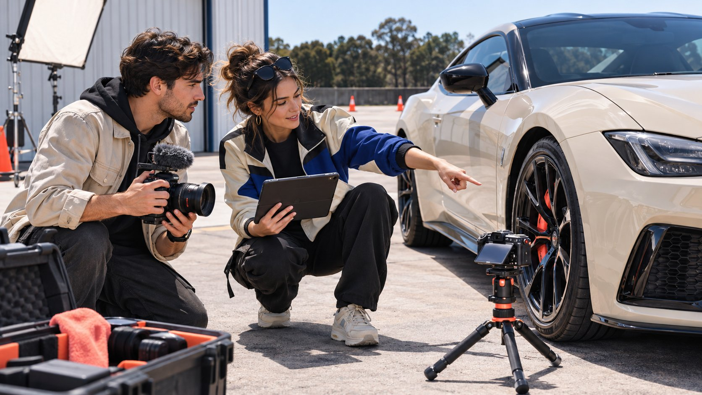
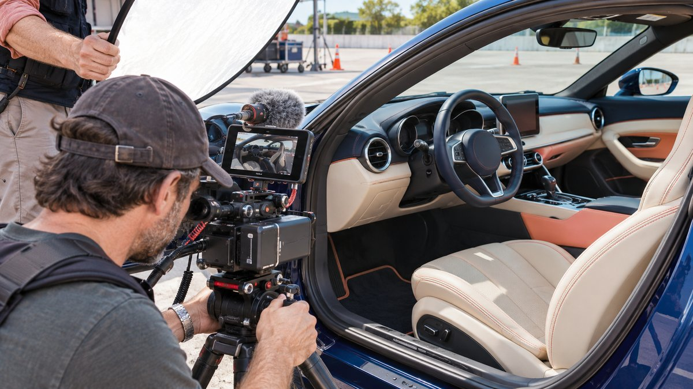

# Top Sports Car YouTube Channels: Build a Production Shortlist

Status: local review draft; confirm the publication date before release.

Research sports-car YouTube channels through the explanation and footage a brand needs. Use Shmee150, Carwow and Doug DeMuro as public leads, then assess work and production conditions.

For a brand researching “top sports car youtube channels,” define top as fit for the assignment rather than an unverified live ranking. Shmee150, Carwow and Doug DeMuro are official-source research leads for relevant storytelling, details and explanation, not audited catalogs or guaranteed partnership availability. Define the needed demonstration, then confirm vehicles, locations, people and use. Dramatic footage or channel scale does not establish production capability for every task or product performance. This is creator-selection guidance, not car-buying, racing or driving instruction.

## Define the product footage needed

An automotive-related brand may need cabin detail, accessory compatibility, storage or a hosted explanation. List facts viewers need to see before choosing creator and production arrangements.

Do not request a sports-car channel and assume driving footage is necessary. Many details can be explained with a stationary vehicle in a suitable location, with actual arrangements confirmed by appropriate people. This article provides no operating instruction or safety guarantee.

The [automotive creator-campaign guide](https://www.quickkol.com/blog/car-youtubers-automotive-campaigns/#answer) covers overall collaboration. Here research moves into shot tasks: who explains, who films, which vehicle is needed and which facts can be confirmed. Selection is not the most dramatic thumbnail; it is whether relevant work shows clear expression and actual contribution. Avoid choosing the most resource-intensive format for spectacle first and squeezing product information into whatever space remains. A concrete task can reveal that a detail presenter or an appropriate studio arrangement is more relevant than a dramatic road sequence the brand never needed to communicate its message.

## Shmee150: research experience-led storytelling

[Shmee150’s official introduction](https://shmee150.com/about-shmee150/) describes Tim Burton’s personal brand around supercar experiences, events and The Shmuseum content. This is a provider description, not an independently verified ranking, audience proportion or partnership calendar.

For experience-led storytelling, select relevant public samples and examine how a product enters the expression and what the presenter, team and location contribute. A visible personal collection does not mean any vehicle is available for a new assignment.

Record why a particular sample matters, then confirm current conditions through an appropriate public business route. A famous channel is a lead, not proof that the car, personal participation and permissions are secured. The proposal still needs actual work for the counterpart to assess and suggest alternatives. The brand should not ask a creator to reproduce a past experience merely because it looked appealing; instead explain the current product task and let the discussion establish what experience, setting and resources could genuinely support it now.

## Carwow: research comparison and detail explanation

[Carwow’s official review-method guide](https://www.carwow.co.uk/how-we-test-cars) describes Mat Watson’s video presentation and reviews including high-performance sports cars, with attention to interior details. A brand can study the explanation approach without turning it into a guaranteed positive review or sales promise.

For a functional comparison, define comparable objects, conditions and facts. Do not prewrite a winner and then present the creator’s expression as an independent conclusion. Name sponsored demonstration and independent review accurately.

Scale figures on different pages may reflect different dates; this article does not select the largest one for a table. The focus is relevant work and assignment, with current partnership routes, formats and resources still needing confirmation. A public program format does not establish that a brand can procure any version or obtain every associated activity of its presenter. Ask which work is actually proposed and what editorial conditions apply, rather than assume a familiar format will become a brand-controlled evaluation simply because sponsorship is being discussed.

## Doug DeMuro: use the official identity to find samples

[Doug DeMuro’s official introduction](https://www.dougdemuro.com/about) identifies his car videos and writing and links the associated YouTube channel. It helps verify the research subject without establishing current vehicles, formats or commercial terms.

Use the official channel to select work relevant to this detail-explanation task, then inspect visibility, sequence and actual roles. Public impressions do not establish that one style suits every product, and one detail sample is not certification of expertise in every model.

The photograph shows preparation for filming a stationary vehicle’s interior, emphasizing that an assignment can begin with suitable static detail. It depicts none of the named people or their actual projects. Confirm resources in the proposal and keep research leads separate from authorized production conditions. For each selected sample, record what the brand wants to learn from it rather than simply write good detail video. That makes the review actionable and avoids implying the whole catalog was watched when only a limited set of relevant works was examined.

Define the product detail to explain before arranging a suitable site, vehicle and production roles.

## Treat vehicle, location and people as real dependencies

A presenter’s interest does not automatically include a car, location or every production person. Confirm who supplies the vehicle, arranges the site, handles camera work and confirms product facts, retaining unresolved dependencies.

Past footage does not establish current permission. If moving content is genuinely needed, appropriately capable and authorized people should design and assess arrangements. A deadline should not lead to improvised risk. This article gives no driving, racing or action-execution instruction.

For a hypothetical storage accessory, list compatible vehicles, required close-ups and hosting first. If a vehicle cannot be confirmed, discuss a suitable alternative rather than conceal the gap until shoot day. The hypothetical accessory proposal can separate stationary detail, hosting and optional context. Confirm use, people and conditions for each so an optional image does not become an unconditional deliverable in handoff. The brand can then understand which information changes if one part is removed or replaced. Clear dependencies also support scope and fees instead of assuming a creator provides every expensive resource because the channel concerns sports cars. The brand should know which resource is part of the proposed work and which requires separate arrangement before it treats an appealing concept as a confirmed production plan.

## Separate product claims from editorial opinion

The brand supplies supported facts while the creator retains genuine experience and appropriate expression. An arrangement cannot turn an experience that never happened into praise, or replace specific accessory support with dramatic car images.

[FTC’s endorsement-guidance FAQ](https://www.ftc.gov/business-guidance/resources/ftcs-endorsement-guides-what-people-are-asking) emphasizes honesty, nonmisleading expression and material commercial relationships in the US. It is not a determination for every market, and disclosure alone does not support every product promise.

If the format is a sponsored demonstration, identify it accurately. If an assessment is requested, leave room for the assessment. Review specific facts, visibility or scope rather than demand a predetermined result because the work is insufficiently positive. A real collaboration can have a defined assignment without making the creator’s voice unconditional packaging for brand slogans. This gives both sides a workable review process: the brand can correct an inaccurate specification while preserving the distinction between that correction and an attempt to replace a genuine opinion with its preferred verdict.

## Later asset use needs a specific scope

Publication on a channel does not automatically let a brand download, crop and advertise indefinitely. Confirm account, format, time, market, edits and third-party elements for the actual use. Possessing a file is not clearance of every right.

Vehicle marks, music, other people and location material may need separate handling. A creator can agree to their contribution without necessarily authorizing every other participant’s rights. Appropriate people should check the actual use rather than rely on fame.

If a detail shot later moves to another product page, review its meaning again. A demonstration fitting one vehicle should not imply compatibility with every model without support. Retain facts and permission records so the next editor knows which use is confirmed and which remains an idea. This matters especially for close-ups that appear generic after cropping, because removing the surrounding vehicle context can also remove the condition that made the original product explanation accurate.

## Compare leads against the same assignment

Compare the three public leads against one brief, retaining work, contribution and open questions rather than giving an overall score without a consistent method. They are neither an exhaustive list nor a live ranking.

The [creator-shortlist method](https://www.quickkol.com/blog/creator-shortlist-workflow/#answer) helps record role, evidence, owner and next step. Decide whether the task needs personal experience, clear detail or a suitable comparison, then research which actual work demonstrates the relevant capability.

Do not fill gaps with private income estimates, unverified audience proportions or guessed fees. Mark missing information and update after appropriate contact. A shortlist helps the team understand why a lead matters and what to ask next, rather than make three familiar names look like production resources available on demand. Each row should distinguish the verified public identity from the proposed role, because identifying a channel correctly does not confirm its willingness, availability or ability to undertake the brand’s particular assignment.

## Make sports-car content serve the partnership decision

The final proposal states the explanation needed, relevant work, vehicle and site dependencies, actual roles, commercial context and later use. Keep important unconfirmed matters pending rather than hide them under top.

A brand can choose accurate product presentation over a more dramatic scene, and research a famous channel while still checking the assignment. The three official-source leads are starting points; actual collaboration needs its own confirmation.

Within influencer marketing, a sports-car channel article should produce an executable selection proposal. It should not become general car-buying recommendations, racing instructions or private-identity research. The task is understanding who contributes what, where it can be made and which evidence supports the decision. That leaves the team with a next step it can actually perform, such as reviewing one relevant work or asking about a specific resource, rather than a popularity list that provides no reasoned route from a channel name to a suitable brand collaboration.

## Three public channel research leads

| Lead | Further work review | Still confirm |
| --- | --- | --- |
| Shmee150 | Experience-led supercar storytelling | Actual work, vehicle and participation scope |
| Carwow | Product detail and comparative explanation | Actual format and editorial conditions |
| Doug DeMuro | Select relevant explanation samples through the official channel | Current assignment, people and resources |
| Any candidate | Review against the same brand task | Permissions, business conditions and use |

Research leads, not an exhaustive list, live ranking, independent performance audit or partnership guarantee; sources reviewed November 16, 2026.

## Before approaching an automotive channel

Build candidates from a product task.

- [ ] List product facts that must be visible.
- [ ] Verify official identity and relevant work.
- [ ] Confirm presenter, team and vehicle roles.
- [ ] Check site and production dependencies.
- [ ] Preserve genuine opinion and commercial context.
- [ ] Confirm specific permission and later use.

## Research date and limitations

Sources reviewed November 16, 2026. Methods, tables and decision rules are editorial recommendations. Hypothetical examples are not actual client results or industry benchmarks. Source geography and periods are specified where relevant.

## Start creator research with a clear task

Use QuickKOL to interpret a brief, discover relevant creators and research their work and contact routes. Verify data, commercial terms and outcomes at their source.

[Explore QuickKOL](https://www.quickkol.com/#capabilities)

## Sources

- [Shmee150’s official introduction](https://shmee150.com/about-shmee150/)
- [Carwow’s official review-method guide](https://www.carwow.co.uk/how-we-test-cars)
- [Doug DeMuro’s official introduction](https://www.dougdemuro.com/about)
- [FTC’s endorsement-guidance FAQ](https://www.ftc.gov/business-guidance/resources/ftcs-endorsement-guides-what-people-are-asking)
