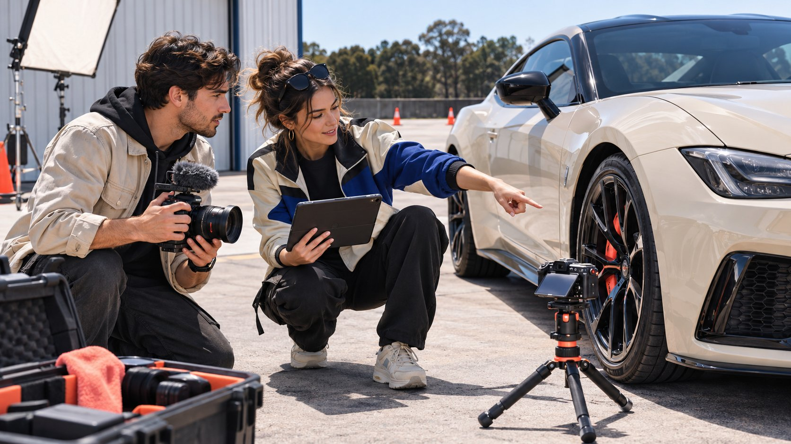
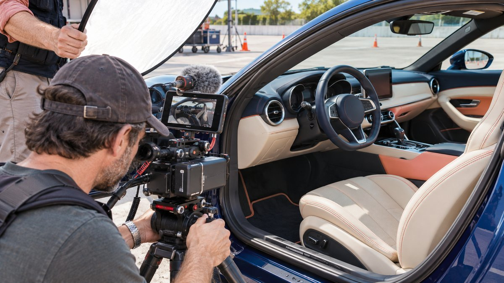

# 跑车 YouTube 频道怎样按任务筛选

状态：本地审阅稿；正式发布日期待确认。

研究跑车 YouTube 频道，先确定品牌需要哪种讲解与画面。以 Shmee150、Carwow 和 Doug DeMuro 为公开线索，按实际作品和制作条件建立候选名单。

品牌研究“top sports car youtube channels”，应先把 top 定义成适合任务，而非未经核验的实时排名。Shmee150、Carwow 与 Doug DeMuro 可作为有官方来源的研究线索，分别进一步查看相关叙事、细节与讲解样本；这不是对全部作品的审计或合作可用性保证。先确定需要展示什么，再核对车辆、场地、人员与使用范围，不把惊险画面或频道规模当作制作与产品效果证明。本篇服务达人合作选人，不提供购车、竞速或驾驶教程。

## 先写需要的产品镜头

汽车相关品牌可能需要座舱细节、配件兼容说明、收纳展示或一段主持解释。把观众需要看清的事实列出来，再决定哪种创作者与制作安排适合。

不能只说想找跑车频道，然后默认必须出现动态驾驶。许多细节适合在停稳车辆与适当场地中拍清；具体安排仍由合适人员确认，本文不提供操作与安全保证。

[汽车达人活动指南](https://www.quickkol.com/zh/blog/car-youtubers-automotive-campaigns/#answer)讨论整体合作。这里把研究进一步落到镜头任务：谁讲解、谁拍摄、需要哪款车辆与哪些可确认事实。选人依据不只是最刺激的缩略图，而是相关作品是否显示清楚表达与实际贡献。不要为了让场景更壮观，先决定资源最复杂的形式，再试图让产品信息挤进剩余空间。

## Shmee150：研究个人叙事

[Shmee150 的官方介绍](https://shmee150.com/about-shmee150/)将它描述为 Tim Burton 的个人品牌，涉及跑车经历、活动和 The Shmuseum 内容。这是提供方自述线索，不是本篇独立核验的排名、受众比例或合作档期。

品牌若需要围绕真实使用背景讲故事，可以进一步选相关公开样本，检查具体产品如何进入表达，以及本人、团队与场地各有什么贡献。不要因为看到个人收藏，就假定任何车辆都能为新项目使用。

研究记录写为什么某个样本与任务有关，再沿适当公开商务路径确认当前条件。一个有名频道可以成为线索，但不是车辆、本人参与与许可已经到位的证明。实际提案仍需说明希望完成的工作，给对方评估与提出替代的空间。

## Carwow：研究比较与细节解释

[Carwow 的官方评测说明](https://www.carwow.co.uk/how-we-test-cars)介绍 Mat Watson 的视频主持及包含高性能跑车的评测工作，也讨论车内细节。品牌可由此进一步研究解释方法，不把它改写成保证正面评测或保证销量。

如果任务需要比较某项功能，先明确可比对象、条件与事实。不要要求预先写好赢家，再把创作者的表达当作独立结论。普通赞助演示与独立评测，也应准确命名。

该站不同页面的规模资料可能有不同日期，本篇不选一个最大数填进表。当前研究关注相关作品与任务；实际合作渠道、形式与可用资源仍需确认。一个公开节目形式并不证明品牌有权采购任意版本，或取得主持人的所有其他活动关联。

## Doug DeMuro：从官方身份找到样本

[Doug DeMuro 的官方介绍](https://www.dougdemuro.com/about)说明其制作汽车视频与撰写汽车文章，并连接对应 YouTube 频道。这个来源帮助核对研究对象，不证明当前所有车辆、制作形式或合作条件。

品牌可以沿官方频道挑选与本次细节说明有关的作品，再检查可见性、解释顺序与实际角色。不要只凭公众印象就说某种风格一定适合所有产品，也不把一个细节讲解样本当作全部车型专业能力的认证。

本页配图展示停稳车辆内饰的拍摄准备，强调任务可以从适当静止镜头开始。它不是任何上述人物或频道的实际项目。具体资源由提案确认，研究线索与已获授权的制作条件始终分开。

先确定需要讲清的产品细节，再安排合适场地、车辆与制作角色。

## 将车辆、场地与人员当作实际依赖

出镜者愿意合作，不自动包括某辆车、某个场地或所有制作人员。需要确认谁能提供车辆、谁安排场地、谁负责相机与产品事实，哪些仍待核实。

不要从过去视频推定本次许可。动态内容若确有必要，应由具备相应能力和许可的人员制定与判断安排；品牌不能为了按时交付而要求临时冒险。本文不指导驾驶、竞速或动作执行。

假设合作只需要展示一款收纳配件，可以先列兼容车辆、必要近景与主持解释。若某辆车无法确认，就讨论适合替代，不把资源缺口隐藏到拍摄当天。还可以把假设配件提案分成停稳近景、主持讲解与可选场景三项。分别确认用途、人员和条件，避免可选画面在交接时变成无条件交付。品牌因此知道删去或替换某项，会影响什么信息。明确依赖也有助于报价，不让创作者因为频道与跑车有关，就被默认提供一切昂贵资源。

## 产品陈述与编辑意见分别确认

品牌提供可支持事实，创作者保留真实体验与合理表达。制作协议不能让未发生的体验变成肯定推荐，也不能用戏剧化车辆画面替代配件或产品的具体依据。

[FTC 的代言指导问答](https://www.ftc.gov/business-guidance/resources/ftcs-endorsement-guides-what-people-are-asking)在美国语境下强调诚实与不误导，并讨论重要商业关系。它不替所有市场作具体判断，也不让一句披露自动支持全部产品承诺。

如果内容是赞助演示，就按真实形式说明；如果希望取得评测意见，就给意见留下空间。审稿应指出具体事实、可见性或范围，不以“不够积极”为理由要求变成预设结论。真实合作可以有明确任务，同时不把创作者声音当成品牌口号的无条件包装。

## 后续素材使用需要具体范围

视频在频道发布，不自动表示品牌可下载、裁切并长期投放。实际使用需要确认账号、形式、时间、地区、编辑范围及第三方元素；文件到手不等于所有权利已经到位。

车辆标识、音乐、其他人物与场地素材可能需要分别处理。创作者能同意自己的贡献，不代表有权替所有其他参与方许可。适当人员按实际用途检查，不以频道知名度代替。

若后续把一个产品细节镜头放到不同产品页面，重新看含义是否仍准确。原先适用某款车的展示，不能无说明暗示所有车型兼容。保留事实与许可记录，才能让下一个编辑知道什么是已确认使用，什么还只是想法。

## 按同一任务比较候选线索

将三个公开线索按同一 Brief 比较，保留作品、实际贡献与待确认事项，不给没有统一方法的总分。它们并非完整频道名单，也没有实时排序。

[达人候选清单方法](https://www.quickkol.com/zh/blog/creator-shortlist-workflow/#answer)可以帮助记录角色、依据、负责人和下一步。品牌可先确定需要个人经历叙事、清楚细节或合适比较，再研究哪项实际作品最能说明相关能力。

不要把私人收入、未经验证受众比例或猜测报价填进空白。缺少资料就标明，联系后再更新。候选名单的价值，是让团队知道为什么研究某个线索，以及下一步具体问什么，而不是让三个知名名字看起来已经成为可随时调用的供应资源。

## 让跑车内容服务达人合作决策

最终提案写清需要的解释、相关作品、车辆与场地依赖、实际角色、商业背景和后续用途。任何重要事项未确认，就保持待确认，不用 top 这个词掩盖。

品牌可以选择准确产品展示，而不是更刺激场面；可以研究知名频道，也仍按真实任务核对。三条官方线索只是起点，合作条件需要双方自己的确认。

围绕达人营销撰写跑车频道主题，合理结果是一份可执行选人方案。它不变成一般购车推荐、赛车指南或私人身份研究，而是帮助品牌理解需要谁贡献什么、在哪里完成，以及哪些依据支持最终决定。

## 三个公开频道研究线索

| 线索 | 进一步研究方向 | 仍需确认 |
| --- | --- | --- |
| Shmee150 | 个人经历与跑车叙事 | 实际作品、车辆与参与范围 |
| Carwow | 产品细节与比较解释 | 实际形式与编辑条件 |
| Doug DeMuro | 沿官方频道选择相关讲解样本 | 当前任务、人员与资源 |
| 任何候选 | 按同一品牌任务审阅 | 许可、业务条件与使用范围 |

研究线索，不是完整名单、实时排名、独立效果审计或可合作保证；资料核验于 2026 年 11 月 16 日。

## 联系汽车频道之前

从具体产品任务建立候选。

- [ ] 列出必须可见的产品事实。
- [ ] 核对官方身份与相关作品。
- [ ] 确认本人、团队与车辆角色。
- [ ] 检查场地与制作依赖。
- [ ] 保留真实意见与商业背景。
- [ ] 确认具体许可与后续用途。

## 研究日期与使用边界

资料核验于 2026 年 11 月 16 日。文中方法、表格和决策规则为编辑建议，标为假设的示例不是实际客户结果或行业基准。外部资料的适用地区与时期按各段说明。

## 从任务开始达人研究

用 QuickKOL 理解 Brief、发现相关达人并研究作品与联系路径；数据、合作条件和结果仍需核验。

[了解 QuickKOL](https://www.quickkol.com/#capabilities)

## 来源

- [Shmee150 的官方介绍](https://shmee150.com/about-shmee150/)
- [Carwow 的官方评测说明](https://www.carwow.co.uk/how-we-test-cars)
- [Doug DeMuro 的官方介绍](https://www.dougdemuro.com/about)
- [FTC 的代言指导问答](https://www.ftc.gov/business-guidance/resources/ftcs-endorsement-guides-what-people-are-asking)
