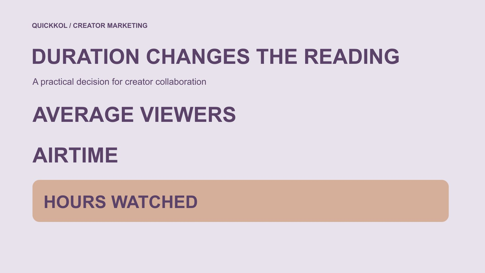
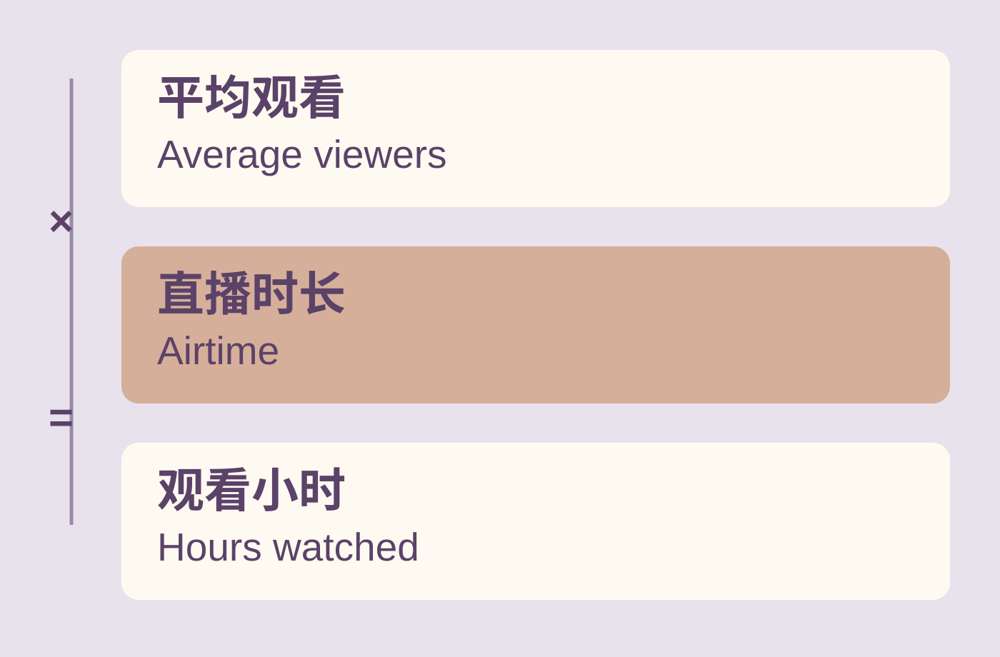

# Streamer Charts: Read the Duration Behind a Live Demo

Status: local review draft; confirm the publication date before release.

Use the Streams Charts watch-time relationship to understand a live demonstration without treating longer airtime or more accumulated hours as a better explanation.

QuickKOL editorial graphic; not actual account metrics or a platform interface.

If streamer charts refers to Streams Charts, confirm the service and then the field. Its Hours Watched definition multiplies average concurrent viewers by airtime in hours. This is accumulated viewing time, not unique people or proof that a product demonstration was fully understood. A brand can use the relationship to understand how audience scale and duration contribute to the total, then scope pacing, production resources and assessment around the real demonstration. Do not ask a creator to prolong a stream merely to accumulate hours.

## Confirm the service and research task

“Streamer charts” can also refer generally to rankings of livestreamers. This article discusses the service Streams Charts rather than invent another verified product from a similar phrase. It provides no paid-plan ranking or untested capability promise.

Start with the creator assignment being researched: explaining a device connection, showing product details or answering particular use questions. Channel, broadcast, category and platform data concern different levels. Identify the object before looking for a number. Explain the purpose to the creator before collecting additional records.

The [livestream channel-sample guide](https://www.quickkol.com/blog/twitch-tv-statistics-channel-category-sample/#answer) helps define comparison objects.

The [live sponsorship-window guide](https://www.quickkol.com/blog/twitch-statistics-live-sponsor-window/#answer) addresses whole-program and sponsored-segment alignment. This article specifically examines accumulated viewing time and production duration, rather than repeating segment acceptance. The brand needs to know whether duration supports expression, not use the largest total to justify every arrangement. Data helps formulate questions; the work still needs watching. This keeps a public statistics service connected to the influencer-marketing decision and prevents the research from becoming a general exercise in ranking entertainment channels unrelated to the proposed demonstration.

## Understand average viewers multiplied by time

[Streams Charts’ metric definitions](https://streamscharts.com/about) describe average viewers as concurrent audience averaged over time, and Hours Watched as that average multiplied by airtime in hours. Preserve the provider’s definition rather than rename it views, distinct people or average viewing time per person.

For example, 1,000 average concurrent viewers multiplied by two hours gives 2,000 hours watched. These invented inputs explain accumulation; they concern no actual channel and are not a benchmark. Read the total alongside its components.

The relationship also shows why a higher total can reflect longer airtime rather than only a larger concurrent audience. Actual records still need their sampling, windows and rounding understood; a homemade calculation should not silently replace the provider’s original field. The method explains units without proving complete accuracy for a particular program. It gives the brand a way to ask what changed in the components instead of treating every increase in hours as an increase in audience size or in the clarity of the sponsored message.

## Equal viewing hours can describe different programs

Continue the hypothetical example: 1,000 average viewers for two hours and 500 for four hours both yield 2,000 hours watched. They do not establish equal distinct audiences, production costs or pacing.

If the brand needs a concise operation explanation, four hours is not automatically more suitable because the accumulated total matches. Where a task genuinely requires a longer process, a lower average alone does not establish failure. Examine the work requirement before interpreting the data.

Do not derive individual stays from two averages or claim the same people watched throughout. Average concurrency summarizes simultaneous audience over time; it cannot reconstruct every personal path. The comparison’s direct value is revealing different resource and program conditions behind one total. It lets a producer discuss why a longer demonstration is needed, and gives a buyer a reason to ask whether the additional time performs useful work, instead of treating a numerical equivalence as proof that two sponsorship opportunities are interchangeable in every practical respect.

## Separate platform and provider fields

[Twitch’s analytics overview](https://help.twitch.tv/s/article/channel-analytics?language=en_US) separates Time Streamed, Minutes Watched, Average Viewers and other fields. Its definitions for broadcast duration, accumulated viewing time and average concurrency help explain why these objects are not interchangeable.

Retain the platform or provider, field, window and unit. Make minute-to-hour conversion explicit, but recognize that converting units does not resolve object or coverage differences. A third-party estimate should not automatically be called an original Twitch measurement.

Where the task genuinely needs first-party material, request a limited relevant record from an authorized person rather than account secrets. This article logged into no channel and performed no accuracy comparison across all platforms. A brand should understand the kind of evidence it has and the questions it cannot answer. That is more useful than presenting two similar labels as confirmed equivalents simply because they both mention viewers, and it leaves a later analyst able to investigate a discrepancy without reconstructing an undocumented substitution.

Accumulated viewing combines audience and time; it is not unique people or proof of product understanding.

## Plan duration around the explanation

A creator demonstration’s length should serve a particular understanding. An equipment collaboration might need interface detail, a connection sequence and an answer to a common misunderstanding. The brand supplies accurate product information; the creator develops expression suited to the program; both examine clarity.

Separate necessary steps from optional conversation and explain why an element needs time. Too fast can obscure an action, while excessive length can disperse the point. There is no universal optimal number of minutes for every product. Adjust through the actual assignment and rehearsal.

If a first rehearsal reveals a connection obscured by a hand, another camera position may solve it without extending the whole stream. Give a production problem a production answer instead of using airtime to compensate for an unclear image. Hours watched cannot alone determine which explanatory steps are missing or sufficient. Watching the rehearsal can therefore change the brief more usefully than increasing a duration target after seeing another channel’s larger accumulated statistic.

## Do not equate a long stream with high retention

A four-hour broadcast describes program duration, not a four-hour stay by every viewer. Accumulated viewing also cannot independently establish which passage was understood, whether the brand was remembered or whether someone intends to buy. Retention and viewing-path questions need appropriate separate fields and context.

Streams Charts explicitly describes some audience fields as estimates with platform limits. Retain that status rather than treat similarly named fields on every platform as one exact headcount. This article does not independently validate its estimation model.

For a decline or peak, examine program context before attributing the movement to the sponsor. Several conditions can change together. An explanation can remain a hypothesis instead of turning one curve into a comprehensive judgment of the creator’s ability. The report should identify what the observation suggests examining next, not imply that duration, attention, comprehension and purchase intent have all been measured merely because a watch-time total and a graph are available.

## Include commercial context in the program

[Twitch’s branded-content guidelines](https://help.twitch.tv/s/article/branded-content-policy?language=en_US) require the disclosure tool for applicable work and explain that the tool does not guarantee satisfaction of every relevant obligation. A long stream does not establish that each viewer saw the opening or already understands the brand relationship.

Check the actual platform, region and format. Creator and brand should understand commercial context in the relevant passage and revisit the object in a replay or later adaptation. This article determines no individual stream’s compliance.

Do not conceal a relationship to preserve an average audience or treat necessary explanation as disposable time. Plan that context with the product task so it supports accurate understanding. A natural program does not require making viewers guess the arrangement. This also keeps a performance discussion from becoming an instruction to remove information simply because the team assumes that an unexplained sponsored passage might hold attention better, an assumption that cannot substitute for appropriate disclosure or a truthful message.

## Report the total and the work separately

At closeout, separately record completion of the agreed demonstration, relevant viewing observations and evidence for business objectives. Hours Watched has its own meaning and should not be renamed purchasers or brand return.

Discuss changes after establishing comparable program scope. A larger total does not automatically recommend a longer next stream, and a shorter program is not automatically insufficient. Once the explanation is complete, extension may only add production burden without answering another question.

Connect the next action to the finding: another camera position, clearer question handling or a record needing its definition supplied. Keep these distinct from media delivery or sales issues. Creators receive actionable feedback and the brand sees which work its budget purchased instead of one accumulated statistic. The result is a production-learning discussion supported by data, rather than a demand to maximize a number whose components can increase without making the product any easier for viewers to understand.

## Make duration serve the collaboration

A final proposal should define the live task, duration assumptions, resources and use, with data sources and limits. A quality demonstration can be discussed without promising a particular hours-watched target. Any commercial performance commitment needs its own explicit conditions.

Where information is missing, retain uncertainty and arrange a suitable rehearsal. A creator’s valuable contribution may be explaining a complicated step more concisely, rather than repeating the same information longer. The brand should provide product support and usable feedback too.

The Streams Charts duration relationship helps decompose a total. Influencer marketing then needs to connect viewing opportunities with truthful expression, suitable production and defined scope. The longest stream is not automatically the best collaboration. A reviewable decision explains why the proposed length serves the actual task, what evidence will assess it and which questions remain open, leaving both parties able to discuss changes without confusing more airtime with a guaranteed improvement in results.

## Different tasks for duration fields

| Field | Describes | Does not establish alone |
| --- | --- | --- |
| Airtime | Broadcast duration | Every person stayed that long |
| Average Viewers | Average concurrent audience | All distinct viewers |
| Hours Watched | Relevant accumulated viewing time | The brand message was understood |
| Demonstration review | Actual steps and expression | It caused every sale |

Provider definitions and editorial interpretation, not a channel forecast or universal optimal duration.

## Before scoping a live demonstration

Use numbers to understand the assignment.

- [ ] Confirm service, object and window.
- [ ] Separate average audience, airtime and accumulated viewing.
- [ ] Retain provider and first-party field distinctions.
- [ ] Plan duration around explanatory steps.
- [ ] Include necessary commercial context in production.
- [ ] Report separate evidence for work and outcomes.

## Research date and limitations

Sources reviewed November 16, 2026. Methods, tables and decision rules are editorial recommendations. Hypothetical examples are not actual client results or industry benchmarks. Source geography and periods are specified where relevant.

## Start creator research with a clear task

Use QuickKOL to interpret a brief, discover relevant creators and research their work and contact routes. Verify data, commercial terms and outcomes at their source.

[Explore QuickKOL](https://www.quickkol.com/#capabilities)

## Sources

- [Streams Charts’ metric definitions](https://streamscharts.com/about)
- [Twitch’s analytics overview](https://help.twitch.tv/s/article/channel-analytics?language=en_US)
- [Twitch’s branded-content guidelines](https://help.twitch.tv/s/article/branded-content-policy?language=en_US)
