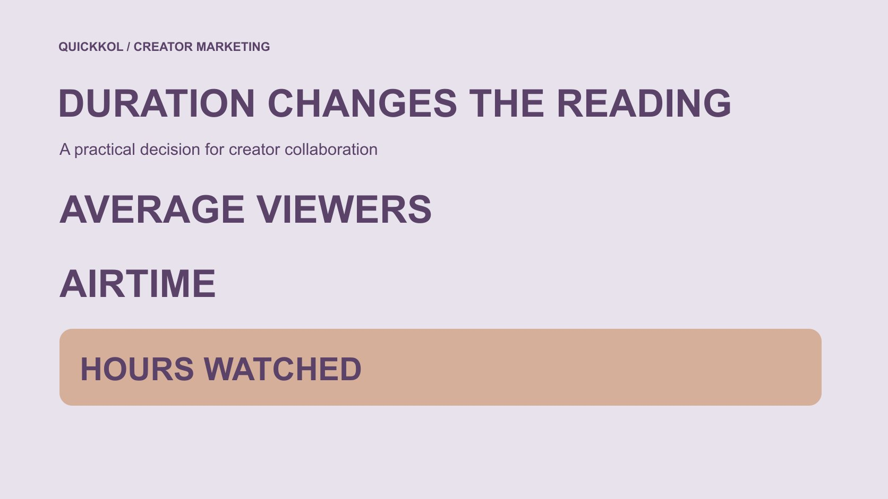
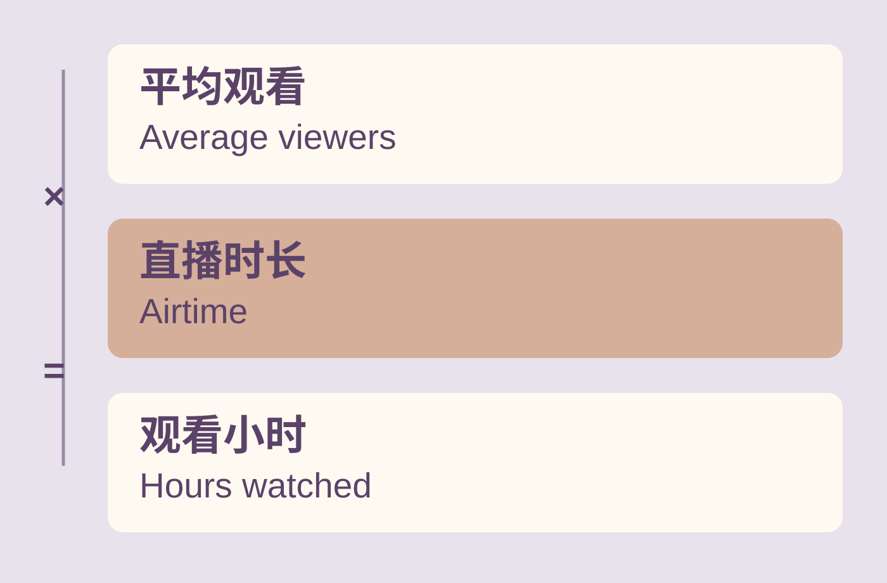

# Streams Charts 怎样解释直播观看时长

状态：本地审阅稿；正式发布日期待确认。

用 Streams Charts 的观看时长关系理解直播演示，不把更长开播或更高累计时长自动当作更好的产品解释。

QuickKOL 编辑图形；不呈现真实账号指标或平台界面。

如果搜索 streamer charts 是在找 Streams Charts，先确认平台名称，再核对字段。该服务将 Hours Watched 定义为平均同时观看人数乘以开播小时数；它表达累计观看时间，不是独立观众人数，也不证明产品演示被完整看懂。品牌可以据此理解时长与观众规模怎样共同影响总量，再按实际演示任务安排节奏、制作资源与评估。不要为了累积更多小时而要求达人无意义延长直播。

## 先确认平台与研究任务

“streamer charts”也可以只是泛指直播榜单。本篇按 Streams Charts 这项服务讨论，不把相似名称当成另一个已经验证的产品，也不提供付费套餐排名或未经测试的功能承诺。

品牌先写下准备研究的达人直播任务：例如解释设备连接、展示产品细节或回答特定使用问题。工具中的频道、节目、分类与平台数据，可能对应不同层级；看到数字前先确定要看哪个对象。向创作者解释需要这些记录的实际目的。

[直播频道样本研究指南](https://www.quickkol.com/zh/blog/twitch-tv-statistics-channel-category-sample/#answer)帮助确定比较对象。

[直播赞助窗口指南](https://www.quickkol.com/zh/blog/twitch-statistics-live-sponsor-window/#answer)处理整场与赞助时段的对应。这里专门解释累计观看时间与制作长度的关系，不重做时段验收。品牌需要知道时长是否支持表达，不是拿最大的累计值证明所有安排合理。数据能帮助提问，实际内容仍要观看。

## 理解平均观众乘时长的关系

[Streams Charts 的指标说明](https://streamscharts.com/about)把平均观众描述为同时观看的平均数，将 Hours Watched 写为平均观众乘以开播小时数。应保留这一提供方定义，不把它改成观看次数、独立人数或每个人的平均观看时长。

例如 1,000 平均同时观看与两小时相乘，得到 2,000 观看小时。这个纯假设说明累积关系，没有指向真实频道，也不是行业基准。数值大小需要与组成条件一起读。

同一关系也说明，总量更高可以来自更长时长，而不只是更大同时观众。实际记录中的采样、窗口与取整条件还需理解，不用自行推算替代提供方原字段。方法适合解释量纲，不能证明每个具体节目数据完全准确。

## 观看小时相同，节目可能不同

继续用假设：1,000 平均观众看两小时，与 500 平均观众看四小时，都对应 2,000 观看小时。但这不意味着相同独立人数、同样制作成本或相同内容节奏。

品牌如果需要一个简明操作说明，四小时并不因为总量相同就更适合。若任务确实需要长过程，较长安排也不能只因平均数较低就被判为失败。先看工作要求，再解释数据。

不要从两项平均值推导所有个人停留，也不要声称同一批人一直看完整场。平均同时观看是对时间上同时人数的概括，无法单独还原个人路径。比较的直接价值，是提醒负责人同一个总量背后可能有不同资源与节目条件。

## 把平台原始字段与提供方字段分开

[Twitch 的分析概览](https://help.twitch.tv/s/article/channel-analytics?language=en_US)把 Time Streamed、Minutes Watched、Average Viewers 与其他指标分开。它对直播总时长、所有观看时间和平均同时观看的定义，帮助理解这些对象为何不能互换。

核对记录时，先保留平台或提供方名称、字段、窗口与单位。分钟与小时换算应明确，但换算单位并不解决对象或覆盖差异。不要把第三方某个估计自动称作 Twitch 原始实测。

当本次任务确实需要第一方资料时，向有权分享的人请求有限相关记录，不索取账号秘密。本篇没有登录任何频道，也没有执行所有平台的准确性对比。品牌应知道看到的是哪种资料，以及哪些问题它还不能回答。

累计观看时间由观众与时长共同组成，不是独立人数或产品理解证明。

## 按观众要理解的步骤安排时长

达人演示的长度应服务具体理解。例如设备合作可能需要展示接口、说明连接顺序并回应一个常见误解。品牌要提供准确产品信息，创作者决定怎样用适合其节目的方式表达，再共同检查是否清楚。

把必要步骤与可选闲聊分开，并说明某个环节为什么需要时间。过快可能看不清，过长也可能使重点分散。这里没有给所有产品统一最优分钟数；应按实际任务与演练调整。

假设第一次演练发现连接镜头被手遮住，解决办法可能是改变机位，而非加长整场。让制作问题获得制作答案，比用更长开播补偿不清楚的画面更有效。观看小时无法单独决定哪些步骤缺失或已经足够。

## 不要把长直播直接叫高留存

开播四小时只是节目持续时间，不代表每位观众停留四小时。累计观看也不能独立说明哪一段被理解、是否记住品牌或是否准备购买。需要留存或观看过程问题时，另找适用字段与语境。

Streams Charts 对某些受众字段明确使用估计说明，并限定适用平台。品牌引用时应保留这种性质，不把所有平台的同名字段当作同一种精确人数。本篇不声称已经独立检验其估计模型。

看到掉落或高峰，也先看节目背景，不立即把变化归因于赞助。某个时刻可能有多个条件同时变化。可以提出待验证解释，但不要让一条曲线替代对创作者个人能力的全面判断。

## 把商业背景纳入直播安排

[Twitch 的商业内容指导](https://help.twitch.tv/s/article/branded-content-policy?language=en_US)要求适用内容使用披露工具，并指出工具不保证满足所有相关要求。即使直播很长，也不能假定每位观众都看过开头或已经知道本次品牌关系。

实际安排需要按平台、地区与形式核对。创作者与品牌应理解相关段落如何表达商业背景，并在回放或后续改编时重新检查对象。本文不对具体直播作合规裁决。

不要为维持平均观众而要求隐藏关系，也不把必要说明当作可以随意删去的冗余时间。说明应服务准确理解，与产品任务一起规划。节目自然感可以保留，但不能通过让观众猜测关系来获得。

## 分开报告总量与实际工作

结项可以分别记录约定演示是否完成、观察到的相应观看指标，以及品牌业务目标有哪些证据。Hours Watched 有自己的含义，不应被改成已经购买的用户数或品牌回报。

节目范围可比时，再讨论变化；不因本次总量较大就自动建议下次更长，也不因为较短就判为不足。若产品解释已完成，延长可能只增加制作负担，未必解决任何新问题。

下一步应对应发现：机位需要调整、问题环节需要更清楚，或记录需要补充定义。把这些与投放或销售问题分开，能让达人获得可执行反馈，也让品牌知道预算实际购买了哪些工作，而不是只看到一项累计指标。

## 让时长服务合作目标

最终提案写清本次直播任务、合理长度假设、资源与使用范围，并注明数据来源与限制。不需要承诺某个观看小时目标，才能讨论一项高质量演示；若存在商业指标约定，需另有清楚条件。

资料不足时，可以保留未知并安排合适演练。创作者最有价值的贡献，可能是把复杂步骤解释得更简明，而不是把同一信息重复更多遍。品牌也应准备真实产品依据与可执行反馈。

Streams Charts 的时长关系帮助拆解总量。达人营销要做的下一步，是让观看机会与真实表达、合适制作和明确合作范围相连，而不是把最长直播当作最好的合作。

## 直播时长字段的不同任务

| 字段 | 表达 | 不单独证明 |
| --- | --- | --- |
| Airtime | 播出持续时间 | 每人停留同样久 |
| Average Viewers | 平均同时观看 | 全部独立观众 |
| Hours Watched | 相关累计观看时间 | 品牌信息已被理解 |
| 演示审阅 | 实际步骤与表达 | 全部销售由此造成 |

提供方定义与编辑解释，非真实频道预测或统一最优时长。

## 安排直播演示之前

让数字帮助理解任务。

- [ ] 确认服务、对象与窗口。
- [ ] 分清平均观众、时长与累计观看。
- [ ] 保留提供方与第一方字段差异。
- [ ] 按解释步骤安排合理长度。
- [ ] 把必要商业背景纳入制作。
- [ ] 报告工作与成果的各自证据。

## 研究日期与使用边界

资料核验于 2026 年 11 月 16 日。文中方法、表格和决策规则为编辑建议，标为假设的示例不是实际客户结果或行业基准。外部资料的适用地区与时期按各段说明。

## 从任务开始达人研究

用 QuickKOL 理解 Brief、发现相关达人并研究作品与联系路径；数据、合作条件和结果仍需核验。

[了解 QuickKOL](https://www.quickkol.com/#capabilities)

## 来源

- [Streams Charts 的指标说明](https://streamscharts.com/about)
- [Twitch 的分析概览](https://help.twitch.tv/s/article/channel-analytics?language=en_US)
- [Twitch 的商业内容指导](https://help.twitch.tv/s/article/branded-content-policy?language=en_US)
