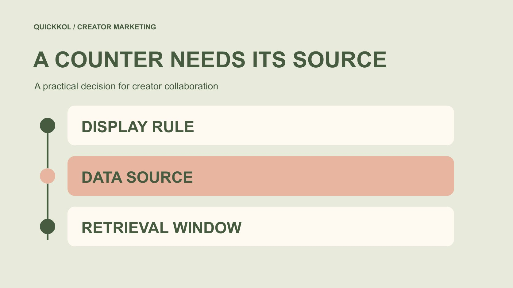
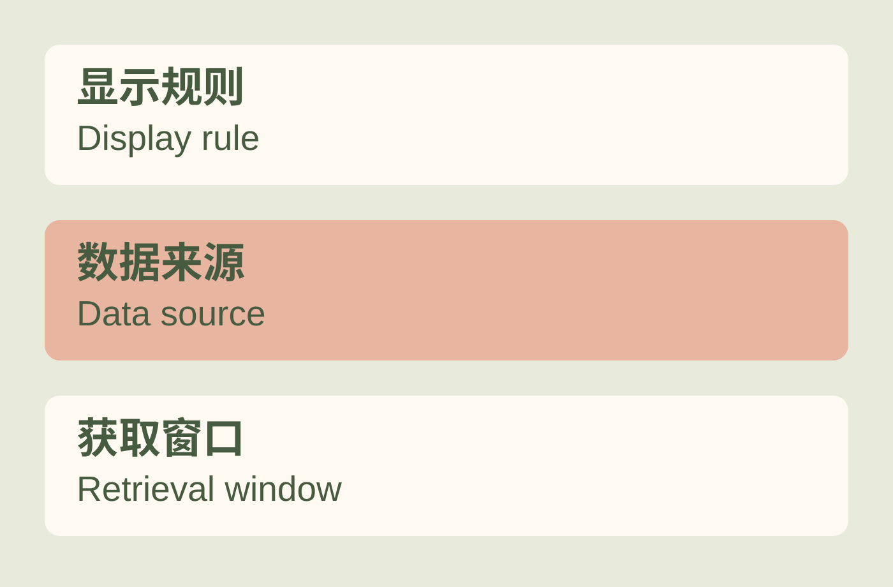

# TikTok Counter: Read Rounded and Updating Counts

Status: local review draft; confirm the publication date before release.

A moving TikTok counter or precise-looking number does not guarantee fresh or comparable data. Record object, field, display precision, source and time before using it in a creator report.

QuickKOL editorial graphic; not actual account metrics or a platform interface.

A TikTok counter may display followers, likes or views, so confirm the object and field first. An abbreviated display may not preserve full precision, and a refreshing page does not establish fresh source data. A third-party interface does not automatically access private creator analytics. Record source, retrieval time, observation window and unknowns before comparing like definitions. This article provides no scraping, authorization bypass or live-monitoring tool. It helps a brand use scale information accurately rather than turn count differences into a personal anomaly finding.

## Ask what the counter counts

Give every record a clear field name first. Account followers, likes on one video and likes across an account’s videos are different objects. One large number in an interface should not populate every scale field.

[TikTok’s video-field reference](https://developers.tiktok.com/docs/en/tiktok-api-v2-video-object) lists likes, comments, shares and views for a video separately. Preserve the content and field when citing it rather than turn video likes into account followers or call views distinct people.

If a proposal needs viewing context for one piece, account-level cumulative likes are not a substitute. Define the question before choosing information. Retain an appropriate link or identifier so the next colleague knows the object. If the original material does not identify it, leave the definition unknown instead of guessing from a nearby icon. The field name should remain beside the value in screenshots, tables and later presentations, because a number copied without its label can acquire a completely different meaning as it moves between teams.

## An abbreviated display cannot restore full precision

If an interface displays 100K, do not enter an exact 100,000 or calculate precise additions from it. First understand its abbreviation, rounding and update rules. This article has not verified a threshold for any particular counter.

[MDN’s number-format reference](https://developer.mozilla.org/en-US/docs/Web/JavaScript/Reference/Global_Objects/Intl/NumberFormat/NumberFormat) illustrates how compact display varies with locale and settings. It shows that formatting can reduce visible precision, not that TikTok or a provider necessarily uses that library or the same rules.

Two displays of 100K do not establish equal underlying values. A moving-looking number may also involve presentation logic. Retain the original display and identify unknown precision. Without a full source value, extra decimals cannot supply missing information, particularly when a formatting change might otherwise be mistaken for sudden growth. The useful reporting choice is often to retain the abbreviated form with a limitation, rather than expand it into an exact-looking figure that the team never actually observed.

## Official fields still have authorization and scope

[TikTok’s user-statistics API reference](https://developers.tiktok.com/docs/en/tiktok-api-v2-get-user-info) requires relevant authorization scopes and separates follower count, following count, likes across videos and publicly posted video count. Available fields do not mean any website can unconditionally obtain private data for any account.

No API request was performed here, and no tool integration is promised. Distinguish public page counts, appropriately authorized fields and provider estimates. The word API on a website does not remove source and permission checks.

Information needs should fit the task. Reviewing a collaboration generally does not require passwords, verification codes or control of an entire account. Appropriate owners should handle genuinely needed authorization and record actual source and scope rather than treat one consent as permanent access to every field and future use. A source can be technically legitimate while still unsuitable for the particular question, so ask both how it was obtained and what its definition allows the brand to conclude.

## Separate retrieval time from source-update time

The time you see a page may differ from when its provider obtained underlying information. An animation or local clock cannot independently establish a live source update.

The diagram separates display rule, source and retrieval window. Record times actually known: retrieval, any source-stated update and which are missing. Do not invent a fixed cache or refresh delay where the provider has not described one.

If one value appears in the morning and another elsewhere in the afternoon, check object, field and update timing before calling the difference net growth. Retain limits where coverage and methods are not public. Accurate timing can help investigate a discrepancy without resolving underlying definition or authorization issues automatically. If only retrieval time is known, say so explicitly. That leaves a later analyst able to compare the observations honestly instead of assuming every timestamp in the table marks a synchronized measurement of the underlying account.

A page refresh does not prove a live source; record only precision and timing actually known.

## Use like definitions for two snapshots

Before comparing, confirm the same account or content, field, suitable precision and interpretable timing. An abbreviated public count from one source and a complete estimate from another cannot simply be subtracted and called platform-confirmed change.

The [social-data accuracy guide](https://www.quickkol.com/blog/social-blade-accuracy-measurement-reconciliation/#answer) expands source reconciliation. A counter record can include whether comparison is appropriate and which condition is missing rather than force every pair into a trend.

Where a difference is appropriate, it describes the count difference between those observations, not who joined, why or the commercial result. Follows, unfollows, content distribution and source processing may occur between them; an aggregate does not contain every cause. Precision in the result should not add personal-behavior explanations never measured. If the original purpose was only describing approximate scale, a detailed growth calculation may be unnecessary altogether. Keep the analysis proportionate to the decision instead of creating a more demanding claim merely because two numbers happen to be available.

## Crossing a threshold does not establish fit

A brand may use scale conditions to prioritize research, but crossing a displayed number does not establish audience fit, credibility or capability to deliver. The counter supplies only part of the context.

Avoid overly precise decisions from an abbreviated number near a threshold. If a formal program has eligibility conditions, consult its current source and relevant requirements instead of using a third-party counter as the platform’s eligibility determination.

Work, expression, market conditions and collaboration resources still need research. A smaller account may suit a specific demonstration, while a large figure does not establish a host, language or permission. Selection reasons should connect to real contribution rather than use a numerical threshold as permission to skip other questions. If a decision truly depends on a boundary, identify the appropriate source needed to resolve that boundary and keep the decision pending when it is unavailable, rather than silently treat display precision as enough confirmation.

## Put counter information into an understandable report

Report object, field, source, original display, retrieval time and limits. If update behavior is unknown, say so instead of applying unsupported labels such as live, precise or verified.

The [view-count definition guide](https://www.quickkol.com/blog/tiktok-views-count-definition-comparison/#answer) expands metric differences. Here, avoid describing account-level accumulated likes as sponsor-video performance or a follower snapshot as actual brand reach. A changed field changes the supported conclusion.

For a hypothetical record, suppose the first display shows only 100K and the second supplies a full value without an underlying update time. Retain both separately without calculating precise additions. The next step is confirming comparable information for the same object and field. If the decision needs only approximate scale, the qualified display may be sufficient without pursuing unnecessary precision. This does not establish that either underlying value is wrong; it prevents the information from supporting a conclusion its available conditions cannot justify. A clear table is often more useful than decorative moving digits. Readers should understand how the information supports candidate research and which commercial results need other sources. Retain qualifications when moving material into proposals rather than copy only the largest number and leave new readers to guess its meaning. The record can remain concise: one properly labeled row with known times and an explicit precision limit can be more informative than several screenshots whose labels, source dates and relationship to the campaign have disappeared during presentation design.

## Different values do not automatically imply personal misconduct

Differences can arise from object, time, display precision, coverage or processing. Two values disagreeing does not justify a false-growth label for a creator. Check definitions and provenance before identifying an unresolved question.

Even a change worth reviewing remains distinct from an established fact. Do not track irrelevant user identities, request personal information beyond the task or promise to identify every action source.

Discuss effects only on the current decision. An unclear-precision figure may be unsuitable to establish a threshold without proving dishonesty. That wording protects research quality and lets a creator address a specific question instead of an overall accusation they cannot answer accurately. It also keeps a routine data reconciliation from expanding into a personal investigation when the likely issue may simply be that the team compared a displayed approximation with a differently timed source value and gave them the same field name.

## Make counting serve the actual creator task

A TikTok counter can provide limited scale context under a clear definition. It does not replace work review, authorization, audience understanding or business-outcome evidence, and every collaboration does not require live monitoring.

Ask which decision the number supports before deciding whether retrieval and updates are worthwhile. Decorative information should not cost unnecessary access, personal data or ongoing maintenance.

Retain object, source, time and precision so another person can understand and use the record. Within influencer marketing, the aim is reducing incorrect comparisons and overinterpretation rather than making digits look more exact or turning unknowns into facts about a creator. A useful final row explains the question answered and the limits still attached. That gives a brand a sound reason to use, defer or omit the figure instead of assuming that every available counter deserves a place in a campaign report.

## What a counter record should retain

| Field | Record | Avoid interpreting |
| --- | --- | --- |
| Object | Account or specific video | All counts are interchangeable |
| Display | Original abbreviation and known precision | Abbreviation restores an exact value |
| Source | Public, authorized or estimated scope | Any website has private data |
| Time | Retrieval and known source update | Animation means real time |

An editorial recording framework, not a live tool, API implementation guide or personal anomaly finding.

## Before citing a count

Define the field before discussing change.

- [ ] Are object and metric clear?
- [ ] What precision does the display retain?
- [ ] What are the source and authorization scope?
- [ ] Are retrieval and update times separate?
- [ ] Are the snapshots comparable?
- [ ] Which actual decision does it support?

## Research date and limitations

Sources reviewed November 16, 2026. Methods, tables and decision rules are editorial recommendations. Hypothetical examples are not actual client results or industry benchmarks. Source geography and periods are specified where relevant.

## Start creator research with a clear task

Use QuickKOL to interpret a brief, discover relevant creators and research their work and contact routes. Verify data, commercial terms and outcomes at their source.

[Explore QuickKOL](https://www.quickkol.com/#capabilities)

## Sources

- [TikTok’s video-field reference](https://developers.tiktok.com/docs/en/tiktok-api-v2-video-object)
- [MDN’s number-format reference](https://developer.mozilla.org/en-US/docs/Web/JavaScript/Reference/Global_Objects/Intl/NumberFormat/NumberFormat)
- [TikTok’s user-statistics API reference](https://developers.tiktok.com/docs/en/tiktok-api-v2-get-user-info)
