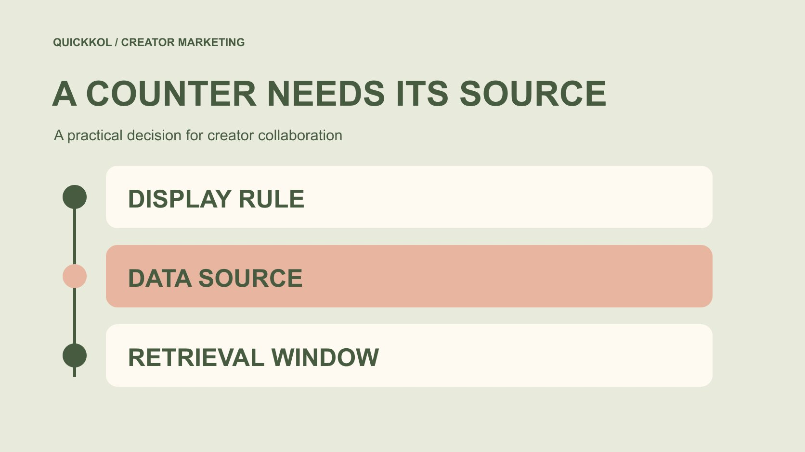
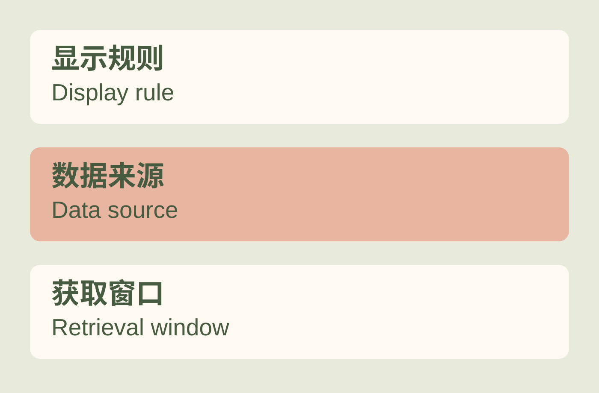

# TikTok 计数器怎样保留口径

状态：本地审阅稿；正式发布日期待确认。

TikTok 计数器的跳动与精确外观，不保证数据实时或口径相同。先记录对象、字段、显示精度、来源和时间，再用于达人合作报告。

QuickKOL 编辑图形；不呈现真实账号指标或平台界面。

TikTok counter 可以显示粉丝、点赞或观看等不同数字，使用前必须确认对象与字段。缩写显示未必保留全部精度，页面一直刷新也不证明来源实时更新；第三方界面更不自动获得创作者私有分析。品牌报告应记录来源、获取时间、观察窗口与未知，再比较同一口径。本文不提供抓取、绕过授权或实时监控工具，也不把计数差异当作个人异常结论，而是帮助团队准确使用规模资料。

## 先问计数器数的是什么

每项记录都应先有明确字段名称。账号粉丝、单条视频点赞与账号所有视频累计点赞，不是同一对象。不要因为界面只有一个大数字，就将它填进所有规模字段。

[TikTok 的视频字段说明](https://developers.tiktok.com/docs/en/tiktok-api-v2-video-object)将单条视频的点赞、评论、分享与观看分别列出。品牌引用时保留对应内容与字段，不把单条点赞变成账号粉丝，也不把观看称为独立人数。

假设合作提案需要说明某段内容的观看背景，就不应拿账号累计点赞替代。先定义问题，再选适合资料。记录对象的适当链接或标识，让下一位同事知道这个数对应什么；如果原资料根本没说明，就把它留为未知，而不是根据旁边图标猜一个口径。

## 缩写显示不能还原全部精度

如果界面显示 100K，不应自行填成精确的 100,000，更不能据此算出精确新增。需要先知道该显示采用什么缩写、舍入与更新规则。本篇没有核验任何具体计数器的阈值。

[MDN 的数字格式说明](https://developer.mozilla.org/en-US/docs/Web/JavaScript/Reference/Global_Objects/Intl/NumberFormat/NumberFormat)展示紧凑显示会随地区与设置改变表达。这里只说明格式可能减少可见精度，不表示 TikTok 或某服务一定使用该代码库或相同规则。

假设两个显示都为 100K，也不能证明底层值完全相等；一个看似跳动的数字也可能来自显示层处理。保留原始显示，注明精度未知。没有完整来源值时，不用更多小数位补足看不到的信息，尤其不要把格式变化误作突然增长。

## 官方字段也有授权与范围

[TikTok 的用户统计接口说明](https://developers.tiktok.com/docs/en/tiktok-api-v2-get-user-info)要求相关授权范围，并区分粉丝数量、关注数量、所有视频累计点赞与公开视频数量。存在这些字段，不代表任意网站都能无条件取得任何账号私有数据。

这里没有执行接口请求，也不承诺某工具已经接入。公开页面计数、合适授权取得的字段与提供方估算，应分别说明。不要因为网站写着 API，就跳过来源与权限核对。

品牌需要什么资料，应与任务相称。合作审阅通常不需要密码、验证码或整个账号控制。由合适负责人处理确实需要的授权，记录实际来源与可用范围，不把一次同意当作永久涵盖所有数据与未来用途。

## 分开获取与来源更新时间

你何时看到页面，与提供方何时获取底层资料，不一定相同。计数器的动画或本地时钟不能独立证明来源实时更新。

配图分开显示规则、资料来源与获取窗口。记录自己实际知道的时间：获取时间、来源注明的更新时刻，以及两者是否缺失。不要替没有说明的缓存或刷新机制编一个固定延迟。

假设上午看到一个数，下午在另一处看到不同值，应先核对对象、字段与更新时间，而不是立即写成净增长。提供方覆盖范围与方法若不公开，就保留限制。准确时间记录可以帮助排查差异，但不自动解决底层定义与授权问题。

页面刷新不是来源实时的证明；只记录真正知道的精度与时间。

## 两次快照要有相同口径

比较前确认同一账号或内容、同一字段、合适精度与可解释时间。一个来源的缩写公开数和另一个来源的完整估算，不能直接相减就称为平台确认变化。

[社交数据准确性核对指南](https://www.quickkol.com/zh/blog/social-blade-accuracy-measurement-reconciliation/#answer)进一步讨论来源差异。当前计数器记录可以增加一列是否可比较，说明缺失哪项条件，而不是强行把每对数字变成趋势。

如果适合计算差值，也只说明这两个观察之间的计数差，不自动说明哪些人加入、为什么变化或商业效果。期间可能有关注与取消、内容传播或来源处理，聚合数不包含全部原因。不要因为结果精确，就给它加上从未测量的个人行为解释。

## 达到门槛不等于适合合作

品牌内部可能用规模条件安排研究优先级，但显示达到某个数，不自动证明受众适合、内容可信或创作者能完成任务。计数器只是部分背景。

不要根据接近门槛的缩写数作过度精确决定。若某项正式计划有自己的资格条件，应查看该计划当前来源与相关要求，不能拿第三方计数器代替平台资格判断。

达人作品、表达能力、市场条件与合作资源仍要研究。一个较小账号可能适合具体演示，一个很大数字也不说明可提供某位主持人、某语言或某种许可。选人理由应连接真实贡献，不把计数门槛当成其他问题的通行证。

## 把计数资料放进可理解的报告

报告写明对象、字段、来源、原始显示、获取时间和限制。若无法确认更新机制，直接说明，不使用实时、精准或已核验等未经支持标签。

[观看计数口径指南](https://www.quickkol.com/zh/blog/tiktok-views-count-definition-comparison/#answer)进一步讨论不同指标。这里还要避免把账号累计获赞写成赞助视频表现，或把某时粉丝数写成品牌实际触达。字段一换，结论范围也会变。

例如假设第一份记录只显示 100K，第二份给出完整值，但没有底层更新时间。团队可以分别保存，不能计算精确新增。下一步是确认同对象、同口径且可比较的资料；若决策只需要大致规模，也可以保留带限制的显示而不再追求无必要精度。这不是宣称底层值一定错误，而是避免资料承担未被支持的结论。一张清楚表格通常比装饰性跳动数字有用。读者应能知道资料怎样支持候选人研究，哪些商业结果仍需另外来源。后续转到提案或汇报时，保留限定，不只复制最大那个数字，再让新读者自己猜它代表什么。

## 数据不同不自动说明个人异常

计数差异可能来自对象、时间、显示精度、覆盖或处理，不能只凭两处不同就给创作者贴虚假增长标签。先核对定义与资料来路，再决定是否存在尚未回答的问题。

即使变化值得研究，也要保留可疑信号与已证实事实的区别。不为查数而追踪无关用户身份，不索取超出任务的个人信息，也不承诺能识别每个动作来源。

如果品牌需要讨论影响，只限于当前决定。例如某个精度不明数不适合证明门槛，而不是认定对方不诚信。这样的表述既能保护研究质量，也能让创作者在具体问题上提供说明，而不是面对一个无法准确回应的总体指控。

## 让计数服务真实达人任务

TikTok counter 的合理用途，是在清楚口径下提供有限规模背景。它不替代作品研究、账号授权、受众理解或商业结果证据，更不是所有合作都需要的实时监控。

团队可以先问这个数字帮助决定什么，再确定是否值得获取与更新。如果只是装饰，不应为它付出不必要权限、信息或长期维护。

最终交付保留对象、来源、时间与精度，让别人能理解并接着用。围绕达人营销研究计数器，重点是减少错误比较和过度解释，而不是让数字看起来更精确，或把未知写成对创作者的事实。

## 计数器记录应保留什么

| 字段 | 记录内容 | 避免解释 |
| --- | --- | --- |
| 对象 | 账号或具体视频 | 所有数字可互换 |
| 显示 | 原始缩写与已知精度 | 缩写能还原精确值 |
| 来源 | 公开、授权或估算范围 | 任何网站都有私有数据 |
| 时间 | 获取与已知来源更新时间 | 动画等于实时 |

编辑记录框架，不是实时工具、接口操作指南或个人异常判断。

## 引用计数之前

先确定字段，再讨论变化。

- [ ] 对象与指标是否明确？
- [ ] 原显示保留多少精度？
- [ ] 来源与授权范围是什么？
- [ ] 获取与更新时间是否分开？
- [ ] 两次快照是否可比较？
- [ ] 它支持哪项实际决定？

## 研究日期与使用边界

资料核验于 2026 年 11 月 16 日。文中方法、表格和决策规则为编辑建议，标为假设的示例不是实际客户结果或行业基准。外部资料的适用地区与时期按各段说明。

## 从任务开始达人研究

用 QuickKOL 理解 Brief、发现相关达人并研究作品与联系路径；数据、合作条件和结果仍需核验。

[了解 QuickKOL](https://www.quickkol.com/#capabilities)

## 来源

- [TikTok 的视频字段说明](https://developers.tiktok.com/docs/en/tiktok-api-v2-video-object)
- [MDN 的数字格式说明](https://developer.mozilla.org/en-US/docs/Web/JavaScript/Reference/Global_Objects/Intl/NumberFormat/NumberFormat)
- [TikTok 的用户统计接口说明](https://developers.tiktok.com/docs/en/tiktok-api-v2-get-user-info)
