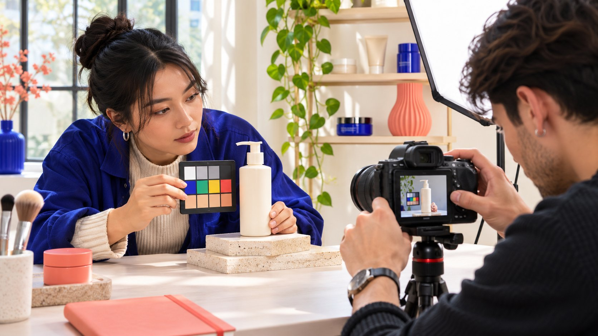
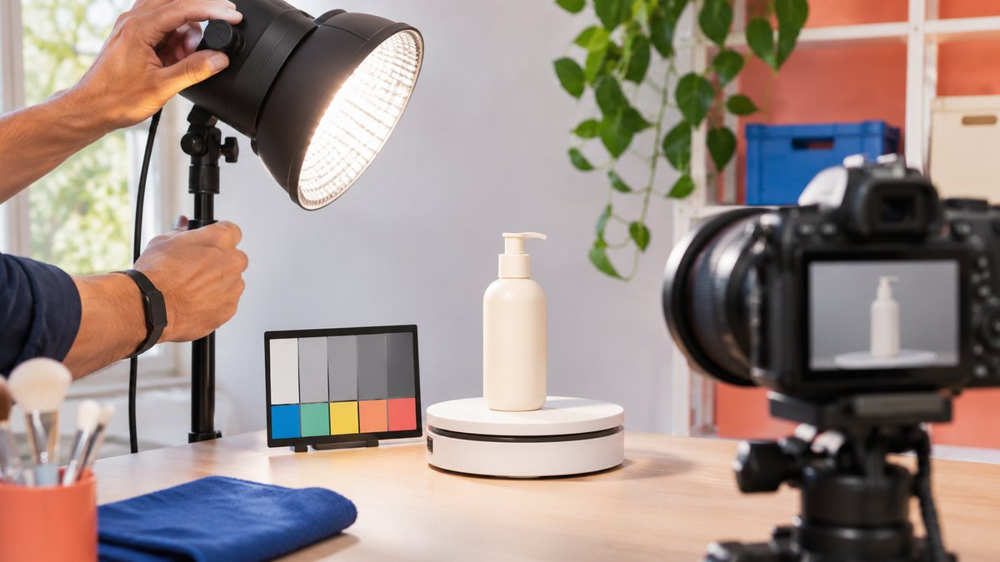

# TikTok Filters: Keep Sponsored Product Appearance Honest

Status: local review draft; confirm the publication date before release.

Review whether TikTok filters change what viewers understand about a sponsored product, using reference footage, filming conditions and the finished piece.

For sponsored TikTok content, start with the product statement: does the treated image imply an unsupported color, texture, shape or effect? Capture a comparable reference, agree the permitted visual treatment and inspect the finished edit, captions and commercial context. Filters are not categorically unusable, but saying a filter was used does not automatically resolve a misleading impression. The absence of a filter does not establish fair filming conditions either. Brand and creator need an explicit boundary between creative treatment and product evidence.

## Identify what the image appears to prove

Picking up a product, demonstrating an operation and describing a result can perform different communicative tasks. Turning a background purple is not equivalent to making skin appear smoother after application. Ask which visible change a viewer may attribute to the product before discussing the filter’s name.

A brand can identify the statement requiring support, such as showing how a container opens or depicting an actual color. Feedback that merely asks for something more premium leaves the creator unable to tell which changes affect facts.

The [product-claims review method](https://www.quickkol.com/blog/creator-product-claims-review/#answer) helps specify what needs support. This article examines the relationship between that statement and image treatment. It does not score a creator’s appearance or infer deliberate deception from a screenshot. Without originals, settings and context, a visual difference is a question to investigate. A useful review concerns the work object and its likely meaning, rather than personal judgments about somebody’s face, preferred aesthetic or normal production style. That focus also makes a requested revision easier to explain and perform.

## Separate decoration from a performance claim

[ASA’s beauty-filter explanation](https://www.asa.org.uk/news/the-mis-use-of-social-media-beauty-filters-when-advertising-cosmetic-products.html) says filters are not inherently problematic, but can mislead when they exaggerate the promoted product’s efficacy. This is UK guidance from 2021 concerning cosmetic influencer advertising, not this article’s legal conclusion for every region.

Use that boundary to formulate a review question: has the treatment changed the characteristic the product claims to improve? A tone change deserves particular attention when color is the advertised result. A shape transformation can affect a size demonstration. Neither question requires claiming that every decorative element performs the same function.

There is no need to deny the risk to preserve creativity or to ban every visual style. The brand explains product facts, and the creator proposes expression that does not replace those facts. Permission for a treatment should relate to the actual claim instead of a blanket statement that all in-app filters are acceptable. This gives the creator room to develop a distinctive piece while leaving both parties able to explain why a particular change was retained, modified or removed.

## Agree a comparable reference before filming

A reference should answer the actual question. For product color, retain the same object, lighting, angle and a suitable reference card. For an opening action, hand occlusion, camera distance and operational sequence may matter more. A reference card is not certification and does not remove every device difference.

Agree which material is retained, who can inspect it and the purpose of that inspection. Unrelated private footage and public release of every original are unnecessary. Defining this scope before production is more workable than demanding a complete reshoot after the finished piece arrives.

The article’s photograph shows the working relationship among camera, product and reference cards. It helps explain where to check; it is not evidence of a product’s efficacy. Examine the real assignment’s material rather than substitute an editorial photograph for a filming record. Ordinary equipment is not promised laboratory accuracy. The practical aim is a meaningful comparison for an identified concern, with known limitations, rather than an impressive-looking collection of files that cannot answer the question the brand actually needs resolved.

## Inspect more than the filter switch

Exposure, lighting direction, distance, white balance, editing and other treatments can influence interpretation. Switching off one filter does not justify calling the image completely authentic. The review concerns an accurate final expression rather than completion of a single toggle action.

[ASA’s cosmetics-production guidance](https://www.asa.org.uk/advice-online/cosmetics-the-use-of-production-techniques.html) considers pre- and post-production techniques alongside visual claims and warns against exaggerating what a product can achieve. It helps define the review scope here without producing an automatic compliance verdict for an individual shot.

Record conditions material to this statement. If comparison images use different lighting, ask whether they still support the claimed difference. Do not interpret every minor variation as manipulation; some reflect equipment or environmental changes. Retain uncertainty and ask the appropriate person whether a new shot or a narrower statement is needed. This is especially useful when the creator and brand are looking at different displays: disagreement about appearance should lead to a specified comparison, not immediate blame or an unsupported promise that every viewer will see exactly the same color.

A reference helps compare filming conditions; product efficacy still needs separate support.

## Give comparisons a defensible purpose

Before-and-after sequences can make production differences look like product results. State what is being compared, then keep relevant conditions reasonably consistent. The action, object and observation period need an explanation. Do not select the two most different images first and invent a result narrative afterward.

Suppose a creator films a tinted lip product. This is an editorial exercise, not a brand test. If the later shot becomes warmer, closer and smoother simultaneously, attributing every change to the product is unsupported. Recreate a meaningful comparison or change the piece to an application and texture explanation instead of making an unsubstantiated before-and-after conclusion.

The article determines neither efficacy nor inefficacy. The brand supplies appropriate product support, the creator describes genuine experience and production retains the relevant conditions. A visibly striking comparison does not establish that every consumer will obtain the same result. A smaller, supportable statement can provide viewers with more useful information than a dramatic transformation whose causes remain unclear, while still giving the creator a worthwhile demonstration to perform.

## A qualifier cannot replace an accurate impression

Adding “filter used” should not end the review of a misleading image. Under the ASA production guidance already discussed, a qualifier does not excuse an inherently misleading advertisement. Review the real project for its applicable region and format instead of copying UK guidance into a worldwide rule.

[TikTok’s commercial-content guide](https://support.tiktok.com/en/business-and-creator/creator-and-business-accounts/promoting-a-brand-product-or-service) addresses the applicable promotional-content disclosure setting. Commercial relationships and visual treatment are different questions. Selecting a collaboration label does not resolve a filter’s effect on product appearance; accurate treatment does not remove the need for commercial context.

Assign these checks appropriately, then read the finished object together. Where conditions need explanation, wording should be understandable and associated with the relevant statement. If the central image still creates a false impression, correct the image or narrow the claim rather than ask increasingly long small print to do work it cannot perform. This keeps the creator’s practical revision clear and avoids treating the addition of any disclosure as a universal repair for several unrelated concerns.

## Preserve the boundary through revisions and reuse

After an edit is accepted, cropping, captions, color treatment or recombination can change its meaning. Removing an environmental explanation may leave a close-up that appears to prove a different product effect. Check more than whether the same underlying file was used.

The scope of brand reuse needs separate agreement. The [beauty-creator claims guide](https://www.quickkol.com/blog/top-beauty-influencers-claims-review/#answer) helps examine recommendations, support and expression without replacing actual authorization. Permission to publish one version does not automatically authorize every advertising adaptation.

In the handoff, identify which shots support product facts, which are decorative context and which changes require another look. Files do not need to be covered in warnings. The next person needs to know which alteration affects the original judgment. This is particularly useful when another editor receives only a short clip and cannot reconstruct the filming conditions. A concise explanation of the approved purpose can preserve accuracy better than a broad instruction to keep everything natural, because it names the relationship the adaptation must retain.

## Include the creator in finding a solution

When a brand identifies a visual concern, ask what the creator intended to communicate and which relevant treatments were used. Space for an explanation helps distinguish an aesthetic choice, an implementation mistake and a statement the material genuinely cannot support. None should be decided solely from how confident either party sounds.

If removing a treatment would disrupt the piece’s style, explore separating a factual demonstration from decorative passages or choosing a treatment that does not change the relevant characteristic. The alternative still needs review; calling it a replacement does not make it approved. A collaborative revision can retain the creator’s recognizable voice while answering the actual factual question. Record that reasoning so another editor does not later restore the original treatment on the assumption that its removal was merely a matter of personal taste.

## Turn review comments into specific revisions

A useful comment identifies the concern: “This smoothing treatment affects the texture statement; provide a comparable reference or change this passage to an application explanation.” That gives the creator a way to reshoot, adjust or narrow the expression, unlike a vague judgment that it looks fake.

Record the reviewed version, known conditions, uncovered questions and next action. Where evidence does not support a statement, pause that statement without accusing the entire creator. If an assignment deliberately uses exaggerated fiction, examine whether viewers understand its nature rather than use a creative label to conceal a product promise.

TikTok filters can help express an appropriate idea; they should not manufacture unsupported efficacy. Give product facts, creator experience and visual design clear roles so both parties can deliver distinctive, explainable work. The completed review should leave a practical decision about the particular treatment, together with the reason and remaining limitations, rather than an absolute claim that filters are always acceptable or that an untreated image is always sufficient proof.

## Treatment and statement review

| Change | Review question | Possible next step |
| --- | --- | --- |
| Color tone | Does it alter the advertised color result? | Compare a reference and adjust treatment |
| Skin smoothing | Does it substitute for product performance? | Remove it or narrow the statement |
| Background decoration | Does it change interpretation of the real setting? | Review in actual context |
| Different comparison conditions | Can the difference still be explained? | Reshoot or stop the unsupported conclusion |

An editorial method, not a legal determination about an ad or a product test.

## Filter review for a collaboration

Inspect the real finished piece against the product statement.

- [ ] State what the image appears to prove.
- [ ] Agree treatment and reference material.
- [ ] Check lighting, distance and editing.
- [ ] Check commercial context and accuracy separately.
- [ ] Read the overall impression of a reused version again.
- [ ] Write specific, actionable revision requests.

## Research date and limitations

Sources reviewed November 16, 2026. Methods, tables and decision rules are editorial recommendations. Hypothetical examples are not actual client results or industry benchmarks. Source geography and periods are specified where relevant.

## Start creator research with a clear task

Use QuickKOL to interpret a brief, discover relevant creators and research their work and contact routes. Verify data, commercial terms and outcomes at their source.

[Explore QuickKOL](https://www.quickkol.com/#capabilities)

## Sources

- [ASA’s beauty-filter explanation](https://www.asa.org.uk/news/the-mis-use-of-social-media-beauty-filters-when-advertising-cosmetic-products.html)
- [ASA’s cosmetics-production guidance](https://www.asa.org.uk/advice-online/cosmetics-the-use-of-production-techniques.html)
- [TikTok: promoting a brand and content disclosure](https://support.tiktok.com/en/business-and-creator/creator-and-business-accounts/promoting-a-brand-product-or-service)
