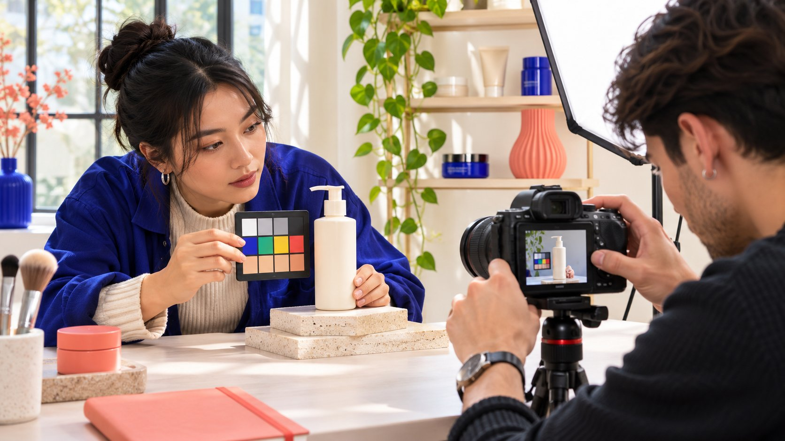
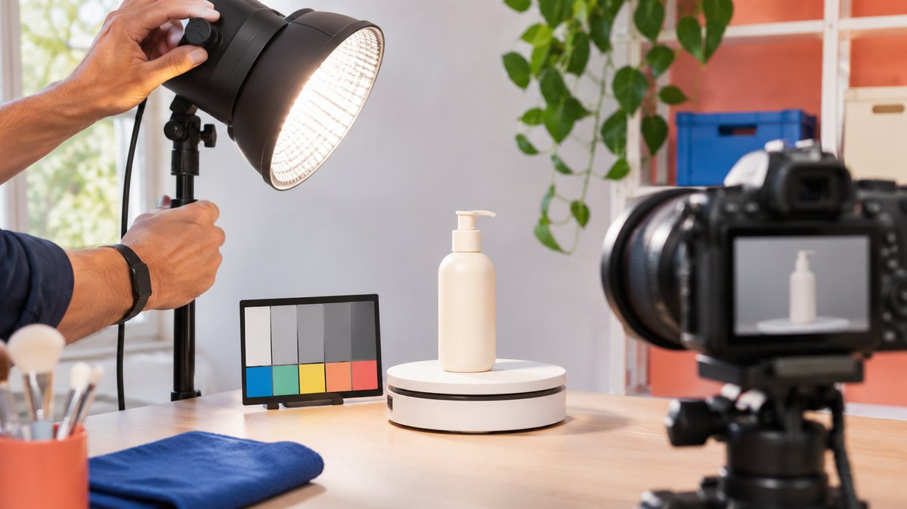

# TikTok 滤镜怎样保留真实产品表现

状态：本地审阅稿；正式发布日期待确认。

审查 TikTok 滤镜是否改变观众对赞助产品的理解，从参考画面、拍摄条件到最终成片保留可解释的视觉关系。

TikTok 滤镜的合作判断应从产品陈述开始：处理后画面是否让观众误以为产品具有实际上未被支持的颜色、肤质、形状或功效？先拍可比较的参考画面，说明允许的视觉风格，再核对最终剪辑、字幕与商业背景。滤镜并非一概不能使用，但“使用了滤镜”不自动解决误导；没有滤镜也不自动证明拍摄条件公平。品牌与达人需要共同保留产品表现与创意处理的边界。

## 先定义画面正在证明什么

达人拿起产品、展示操作与描述结果，可能分别承担不同表达任务。背景变成紫色，与涂抹后皮肤看起来更平滑，不是同样的改变。先问观众会把哪项视觉变化理解为产品效果，再讨论滤镜名称。

品牌可以提出需要支持的具体陈述，例如展示容器开启方式或某种实际颜色。不要只给“更有质感”的反馈，因为创作者无法据此判断哪些改变会影响事实。

[产品陈述审阅方法](https://www.quickkol.com/zh/blog/creator-product-claims-review/#answer)可以帮助明确需要证明什么。这里进一步检查画面处理与陈述的关系，不给创作者外貌评分，也不从截图推断某个人故意欺骗。没有原片、设置和背景时，视觉差异只能成为待核对问题。

## 把装饰与效果陈述分开

[ASA 的美颜滤镜说明](https://www.asa.org.uk/news/the-mis-use-of-social-media-beauty-filters-when-advertising-cosmetic-products.html)指出，滤镜本身并非必然有问题；当它夸大被推广产品的功效时，就可能误导。该资料是英国 2021 年指导，涉及化妆品达人内容，不是本篇对所有地区作出的法律结论。

这个边界可以用于提出审稿问题：画面是否改变了产品正在承诺改善的特征？如果推广的是颜色，改变色调就比添加不相关背景图形更值得检查。如果展示尺寸，形变处理可能改变理解。

不必为了保留创意而否认风险，也不需要把所有视觉风格都列成禁用。先由品牌解释产品事实，再让创作者提出不会替代这些事实的表现方式。允许或调整某种处理，应对应具体陈述，而不是一句全局的“平台滤镜都可以”。

## 拍摄前确定可比较的参考

参考画面要能回答实际问题。若要核对产品颜色，可以保留同一物体、光源、角度与适当参考卡的画面；若要看开启动作，重点可能是手部遮挡、镜头距离和操作顺序。参考卡不是认证，也不能消除所有设备差异。

与创作者约定哪些素材需要保留、谁能看以及用于什么检查。无需收集不相关私人片段或公开全部原片。事先说清范围，比成片完成后要求重拍所有内容更可执行。

本文配图展示相机、产品与参考卡的工作关系，帮助理解检查位置，并不是某产品功效证据。实际审阅应针对真实素材，不用一张编辑照片替代本次拍摄记录，也不承诺普通设备能获得实验室级准确度。

## 不要只检查滤镜开关

曝光、光线方向、镜头距离、白平衡、剪辑与其他处理，都可能影响理解。即使创作者关闭某个滤镜，也不应直接写成“画面完全真实”。需要核对的是最终表达是否准确，而不是有没有完成一个开关动作。

[ASA 的化妆品制作指导](https://www.asa.org.uk/advice-online/cosmetics-the-use-of-production-techniques.html)把拍摄前后技巧与视觉陈述放在一起讨论，并提醒画面不能夸大产品可实现的效果。本篇据此限定检查范围，不从指导推导每个镜头的自动合规结论。

记录会影响本次陈述的条件。例如两个比较画面光线不同，先问是否仍能支持所说差异。不要把所有细微差异都解释成操纵；有些只是设备或环境变化。保留未知，并请合适人员判断是否需要补拍或收窄说法。

参考画面用于比较拍摄条件；产品功效仍需要独立依据。

## 让前后对比承担合理任务

前后画面最容易把制作差异误读为产品结果。先说比较什么，再尽量保持相关条件一致。动作、物体和观察时间需要可解释；不能先选差异最大的两张，再编一个结果故事。

假设达人拍摄一款有色护唇产品，这是编辑练习，不是实际品牌测试。若后一个镜头同时变暖、放大并柔化肤质，就不能只把所有变化归给产品。可以重做可比较画面，或者把内容改为操作与质地说明，避免做无法支持的前后结论。

这里没有替产品判断有效或无效。适当结果证据由品牌提供，创作者说明真实体验，制作团队保留画面条件。即使比较看起来很明显，也不能把一次示范说成所有消费者都能获得同样结果。

## 说明不能替代准确表达

在误导画面上加“使用滤镜”，不应成为停止检查的理由。按前述 ASA 制作指导，说明不能为本身误导的广告提供通行证。实际项目仍需按适用地区与形式审阅，不把英国指导直接复制成全球规则。

[TikTok 的商业内容说明](https://support.tiktok.com/en/business-and-creator/creator-and-business-accounts/promoting-a-brand-product-or-service)则处理适用推广内容的披露设置。商业关系与视觉处理是不同问题：选择了合作标识，不代表滤镜对产品表现的影响已经解决；处理准确，也不代表可以省略商业背景。

把两项检查分别交给合适负责人，再一起阅读成品。需要说明条件时，文字应能被看懂并与相关陈述相邻。若画面核心仍造成错误印象，优先修正画面或收窄陈述，不让越来越长的小字承担它无法完成的工作。

## 在修改与复用中保留边界

成片通过后，后续裁切、字幕、调色或组合仍可能改变原来表达。例如原片的环境说明被裁掉，保留的近景就可能显得在证明另一项产品效果。不要只核对是否用了同一素材文件。

品牌复用内容的范围需要另外确认。[美妆达人陈述审阅指南](https://www.quickkol.com/zh/blog/top-beauty-influencers-claims-review/#answer)帮助判断推荐、产品依据与表达边界，但不替代具体授权。创作者允许发布一个版本，不自动表示品牌可以任意改成所有广告用途。

交付中说明哪些画面用于产品事实，哪些只是场景装饰，以及哪些修改需要重新看。文件无需贴满警示；让接手的人知道改变了什么会影响判断，才有助于在新用途下保持原来的准确性。

## 让创作者参与解决问题

品牌发现画面疑问后，可以先问创作者原本希望表达什么、采用了哪些相关处理。保留对方解释的空间，有助于区分风格选择、操作失误与确实不支持的陈述。

如果担心移除效果会破坏整体风格，可以尝试把产品展示与装饰段落分开，或采用不改变关键特征的设计。新方案仍需审阅，不能因为叫作替代版本就默认通过。

## 把审稿意见写成可执行修改

有效意见应指向实际问题：“此处柔化处理影响了纹理陈述，请提供同条件参考或改为操作说明。”相比“看起来太假”，它更能帮助创作者决定重拍、调整或收窄表达。

记录审过的版本、已知条件、未覆盖事项与下一步。没有材料支持某项结论时，可以暂缓该陈述，不必因此指控整位创作者。若本次任务就是夸张虚构效果，也要检查观众能否理解其性质，不能借创意名称掩盖产品承诺。

TikTok 滤镜的品牌价值在于帮助表达适合的创意，而非制造无法支持的功效。让产品事实、创作者经验与视觉设计各自承担清楚任务，双方才能交付有风格且可解释的作品。

## 视觉处理与陈述的关系

| 改变 | 检查问题 | 适当下一步 |
| --- | --- | --- |
| 色调 | 是否改变推广的颜色结果 | 比较参考并调整处理 |
| 肤质柔化 | 是否代替产品表现 | 移除或收窄陈述 |
| 背景装饰 | 是否改变对真实场景的理解 | 按实际上下文判断 |
| 前后条件不同 | 差异是否仍可解释 | 补拍或停止不支持的结论 |

编辑审阅方法，不是具体广告的法律裁决或产品测试。

## 滤镜合作审阅清单

围绕产品陈述检查真实成片。

- [ ] 说清画面在证明什么。
- [ ] 约定允许处理与参考素材。
- [ ] 核对光线、距离与编辑影响。
- [ ] 分别检查商业背景与准确性。
- [ ] 对复用版本重新读整体印象。
- [ ] 把意见写成具体可执行修改。

## 研究日期与使用边界

资料核验于 2026 年 11 月 16 日。文中方法、表格和决策规则为编辑建议，标为假设的示例不是实际客户结果或行业基准。外部资料的适用地区与时期按各段说明。

## 从任务开始达人研究

用 QuickKOL 理解 Brief、发现相关达人并研究作品与联系路径；数据、合作条件和结果仍需核验。

[了解 QuickKOL](https://www.quickkol.com/#capabilities)

## 来源

- [ASA 的美颜滤镜说明](https://www.asa.org.uk/news/the-mis-use-of-social-media-beauty-filters-when-advertising-cosmetic-products.html)
- [ASA 的化妆品制作指导](https://www.asa.org.uk/advice-online/cosmetics-the-use-of-production-techniques.html)
- [TikTok：推广品牌与商业内容说明](https://support.tiktok.com/en/business-and-creator/creator-and-business-accounts/promoting-a-brand-product-or-service)
