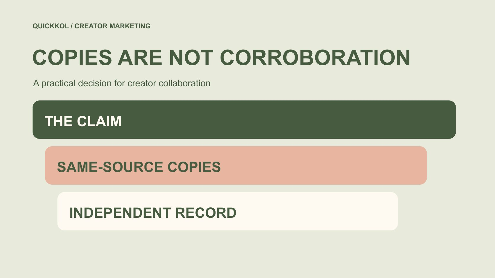
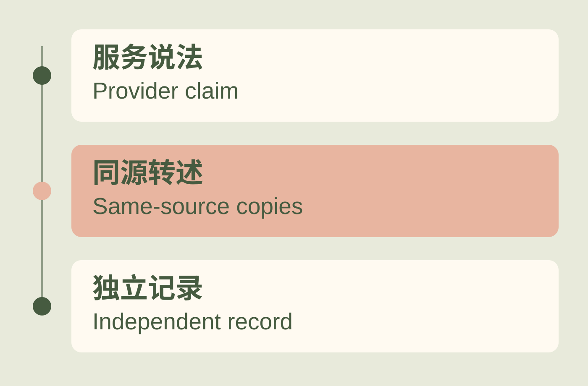

# TikTok Free Likes: Test the Claim, Not the Service

Status: local review draft; confirm the publication date before release.

Review a free-like promise through its wording, evidence provenance and account cost without trialing the service. Separate independent records from repeated promotional claims.

QuickKOL editorial graphic; not actual account metrics or a platform interface.

To review a “tiktok free likes” promise, identify its actual claim, supporting evidence and requested information or access. Repeated pages are not independent verification, and a displayed count is not genuine preference. There is no need to buy, log in or trial the service. Preserve wording, check public information and mark unsupported matters unconfirmed. This article judges no named provider and promises no action-by-action truth test. It explains how a brand can keep unsupported promises out of creator-collaboration decisions.

## Capture the promise before interpreting it

Real, safe, instant and permanent can concern different things. Record what the provider actually says rather than put an editorial interpretation in quotation marks or supply a guarantee missing from ambiguous copy.

Suppose a page promises an immediate increase in likes. It may concern a displayed count without explaining action origins, measurement timing or access requirements. Write these gaps as questions instead of translating increase directly into audience approval or business value.

Retain an accurate location and date, identifying material available only as a summary. If a page is unreadable, do not claim a full review. This process needs no account creation or submitted video. It examines the supported scope of a promise rather than determines which service is suitable to use. A clear record should let another reader distinguish the original wording from the reviewer’s concerns, without visiting the offer or assuming a more specific claim was made than the source actually contains.

## Map where the evidence came from

Three pages citing the same results image are not three independent verifications. A review repeating the provider’s statement does not become independent support because its layout differs.

The diagram separates original promotion, same-source copies and an independent record. Check who produced information, when, about which object and whether it answers the question. Independence does not guarantee sound methods; scope and limitations still matter.

A third party showing one count increase may not establish participants’ intentions, policy compliance or account safety. Do not make one artifact answer a question it never measured. A brand can record that suitable independent support is unavailable rather than count repeated source text to fill an evidence quota. The useful outcome is a source map with a stated limit, not a long list that makes a single underlying claim look more corroborated simply because several websites repeated it in different words or placed their own logo above the same image.

## A changed count does not establish genuine preference

[TikTok’s video-field reference](https://developers.tiktok.com/docs/en/tiktok-api-v2-video-object) lists likes, comments, shares and views as separate counts. Their names do not contain genuine product preference or purchase intent, and a brand report should not add those meanings automatically.

A screenshot also needs object, time and source. A cumulative value differs from additions during a period, and one refresh differs from a complete observation window. Without those conditions, even the scope of the promised numerical change may be unclear.

If affected actions cannot be identified, do not subtract a supposed genuine count or classify each person. Data literacy preserves unknowns instead of replacing facts with a provider score. Whether content explains a product can be reviewed appropriately as a separate question without making free numbers the sole success criterion. Ask what was actually measured before deciding what the evidence means, because a precisely displayed total can still leave the most important business interpretation unsupported.

## A safety promise needs a defined scope

No password required does not automatically mean no information or access risk. Contact details, downloads, connected applications, publishing capabilities or other requests may still be involved. Describe the specific requirement rather than summarize everything with a safe label.

[FTC’s app-permission advice](https://consumer.ftc.gov/articles/how-websites-and-apps-collect-and-use-your-information) emphasizes unnecessary information and access. Here it supports a minimum-necessary judgment, not equivalence between device permissions, platform connections and business approval, or a claim that this article audited an application.

Do not approve access merely to discover the complete process. If important requirements appear only after supplying information, record that limit and keep the action unperformed. Legitimate creator work can have a defined task and owner; opaque access should not be a default step for obtaining numbers. No problem found and safety established are different conclusions. State which was actually assessed, and do not treat a reassuring homepage as evidence about hidden steps that the reviewer deliberately did not perform.

More records do not establish independence; check the question each one actually answers.

## A free label does not remove other costs

Look beyond payment to time, information, access and distorted reporting. A supposedly free service can make content comparisons unusable or lead a team to report unknown actions as meaningful audience response.

If tasks and a displayed balance lead to a demand for deposits, stop following the sequence. [FTC’s task-scam alert](https://consumer.ftc.gov/consumer-alerts/2025/08/how-spot-avoid-task-scams) discusses that pattern and advises against paying to receive supposed earnings. It is general education, not an investigation finding about a named service.

This article does not recommend a small trial. An initial success display does not establish later reliability, and time already invested is not a reason to keep paying. Review can remain at the information level: record promises, requirements and unknowns, then decline to treat the offer as work the brand needs to procure. That decision does not require proving every possible harm or collecting more personal information from a creator simply to justify avoiding an unnecessary service.

## Do not change an account to test a promise

A trial can introduce actions, access or data that complicate the original question. The team should not assign a brand account, creator account or disposable account to validate a service.

If a request or action already raises concerns, distinguish the actual state and involve an appropriate owner instead of continuing to see what happens. A promise can lack necessary support without the reviewer executing it.

The [access-request triage guide](https://www.quickkol.com/blog/free-tiktok-like-request-security-triage/#answer) discusses pausing and verifying unexpected requests. Provider review instead asks whether a claim can support procurement or reporting. They can connect without a real-account experiment. Maintaining that boundary also avoids giving an unverified service traffic, information or possible authorization merely to produce an educational article. Record the unperformed steps honestly so the final review does not imply deeper testing than occurred. A limited public-information review can still support a limited decision, such as keeping a proposed purchase pending because its purpose and claimed evidence remain unclear.

## Distinguish unsupported from disproved

Unavailable independent evidence does not prove every sentence false. An unreadable page does not establish concealment, and an unusual count does not establish a creator’s participation.

State accurately that a promise cannot be confirmed from current information and is unsuitable as support for a brand conclusion. If a verifiable conflict exists, identify its specific object and scope rather than extend it to every person or activity.

That wording does not prevent caution. The team can decline an unnecessary purchase, withhold access and avoid unsupported figures without permanently labeling a person. Review strength should match the evidence. Preserve facts, reasonable questions and unknown states separately, updating them when new information arrives. A bounded decision is useful precisely because it does not require a total verdict: the brand can decide the offer is unnecessary for its campaign while acknowledging that this review did not investigate every aspect of the provider or determine the origin of each interaction.

## Replace the promise with a real collaboration objective

The brand may actually need a clear demonstration, suitable creator expression, a functioning inquiry route or interpretable reporting. Those objectives can be arranged through real work without purchasing audience actions.

The [content-test boundary guide](https://www.quickkol.com/blog/free-tiktok-likes-observation-not-approval/#answer) explains how added incentives limit comparison. Ask this proposal the same practical question: without the promised free number, what actual task makes the collaboration reviewable? If the answer is only a better-looking total, redefine the objective.

Discuss production, publication and reasonable measurement through a clear brief so creators know artificial inflation is not required. That is more consistent than warning about risks while accepting only guaranteed likes. Allocate resources to deliverable work and retain source, window and meaning with data. A creator can then propose an expression that serves the product rather than spend effort trying to satisfy an ungrounded numerical promise. This makes the brand’s expectations clearer before the next pitch or reporting deadline creates pressure to inflate a result.

## Deliver a bounded claim review

For example, a fictional supplier summary can record that the promise concerns a displayed total, its cited screenshots share one origin and no access was granted. The resulting action is to leave procurement unapproved, not to declare the creator responsible for false engagement. Each statement has a different evidence basis and should retain its own status.

The final record should identify the claim reviewed, source provenance, steps not performed and remaining unknowns, then make a proportionate decision. No trial should not become tested and ineffective, and missing information should not become personal misconduct.

An educational free-likes article should help brands understand access, false-interaction and data-meaning risks rather than list usable services, redemption steps or workarounds. Reviewing a promise is not finding an application for the service.

A clear review can conclude no purchase, no access and no use of the figure as preference evidence for now, while retaining room for updates. The brand receives an explainable decision and the creator a fair boundary. Neither requires proving what a person did from one signal. Preserve that limited scope in the handoff so another team does not summarize a cautious procurement decision as a comprehensive service investigation or a confirmed finding about anyone’s audience.

## Reviewing a free-like promise

| Promise | Review question | Boundary |
| --- | --- | --- |
| Real | What are the action source and measured object? | Count is not preference |
| Safe | Which information and access are involved? | Do not grant access to verify a promise |
| Instant | Which time, window and value? | Display change does not establish every meaning |
| Verified | Is support independent, with what method and scope? | Copies are not multiple supports |

An educational information review, not a service trial, recommendation, full audit or personal adjudication.

## Keep promises reviewable

Organize information without executing the service.

- [ ] Retain exact wording and provenance.
- [ ] Separate original information from same-source copies.
- [ ] Check the measured object and window.
- [ ] Record information and access requests.
- [ ] Separate unknown, unsupported and disproved.
- [ ] Limit the decision to the actual question.

## Research date and limitations

Sources reviewed November 16, 2026. Methods, tables and decision rules are editorial recommendations. Hypothetical examples are not actual client results or industry benchmarks. Source geography and periods are specified where relevant.

## Continue learning about metrics and evidence

Understand sources, windows, permissions and unknowns without judging a person from one signal or promising complete detection.

[Read the metrics decision guide](https://www.quickkol.com/blog/social-media-metrics-creator-decision-tree/)

## Sources

- [TikTok’s video-field reference](https://developers.tiktok.com/docs/en/tiktok-api-v2-video-object)
- [FTC: information use by websites and apps](https://consumer.ftc.gov/articles/how-websites-and-apps-collect-and-use-your-information)
- [FTC’s task-scam alert](https://consumer.ftc.gov/consumer-alerts/2025/08/how-spot-avoid-task-scams)
