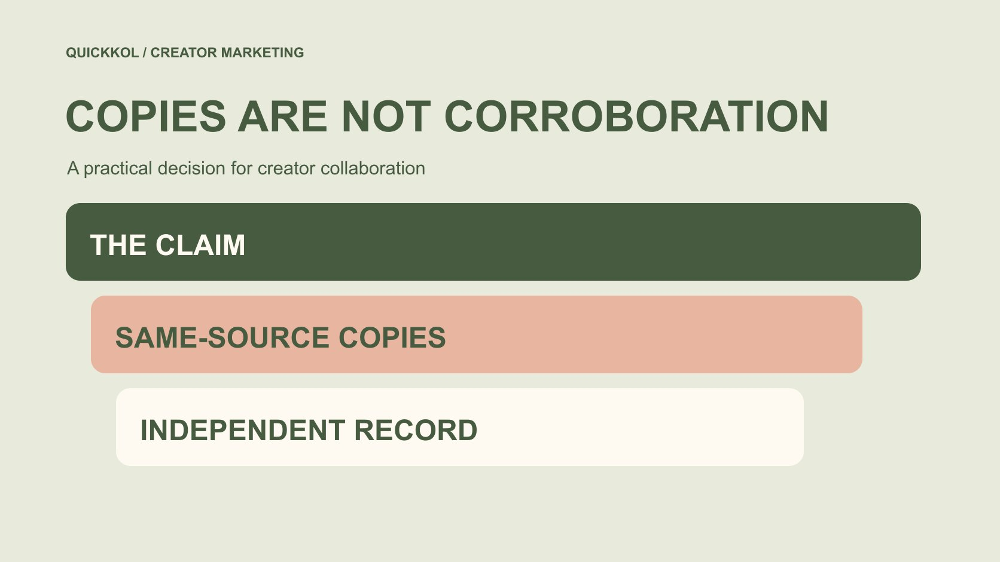
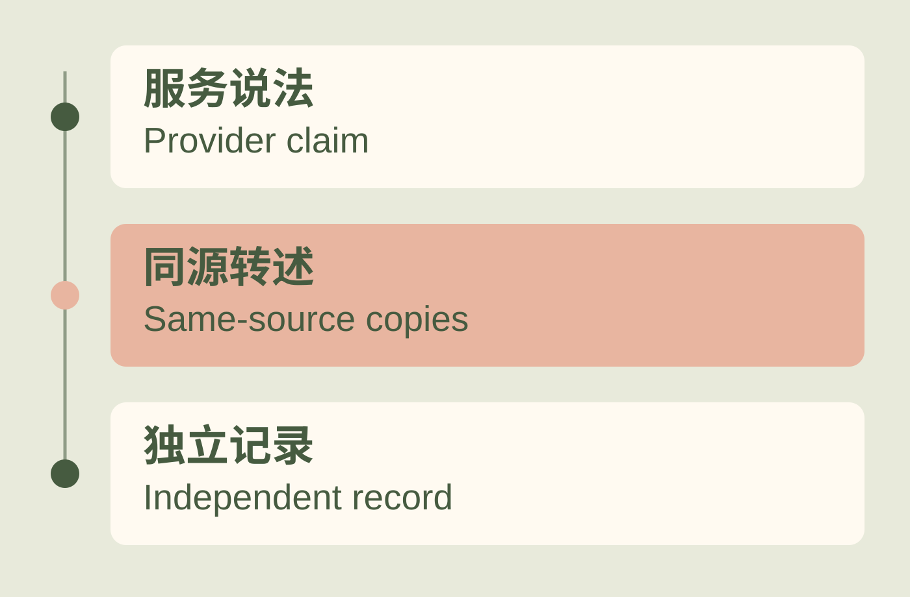

# 免费点赞服务的承诺怎样复核

状态：本地审阅稿；正式发布日期待确认。

审阅免费点赞承诺，可以从原话、证据来路与账号代价入手，不需要试用服务。把独立资料与同源宣传分开，保留无法核实的部分。

QuickKOL 编辑图形；不呈现真实账号指标或平台界面。

审阅“tiktok free likes”承诺，应检查它究竟声称什么、用什么证据支持，以及要求交出什么信息或权限。多个转载页面不等于独立验证，显示数字也不等于真实偏好。无需通过购买、登录或试用去测试服务；可以保留原话、核对公开资料，并把缺少依据的部分标为未确认。本篇不评价某个具名提供方，也不承诺判断每个动作真假，重点是品牌如何避免让未经支持的承诺进入达人合作决策。

## 先抄准承诺，再解释含义

“真实”“安全”“即时”“永久”可能分别指不同事项。记录提供方实际说了什么，避免把编辑理解放进引号，也不要替一句模糊宣传补上它没有说明的保证。

假设某页面说立即增加点赞。它可能声称显示数量变化，却未解释动作来源、统计时间或是否需要授权。品牌应把这些缺口写成问题，不把“增加”直接翻译成受众认可或业务价值。

资料记录保留准确出处与日期，注明哪些只看到摘要。页面无法读取时，不声称完整审阅过。这个过程不需要创建账号或提交视频；它是在审阅承诺的可支持范围，而不是验证哪家服务更适合使用。

## 将证据来路画出来

三个页面都引用同一张效果图，不构成三次独立验证。一个评测如果只是复述提供方声明，也不能因为版式不同就被计作独立支持。

配图把原宣传、同源副本与独立记录分开。核对是谁产生资料、何时产生、描述什么对象，以及是否真的回答当前问题。来源独立也不保证方法正确，仍需看范围与限制。

假设第三方展示一次数量增加，它未必能说明参与者真实意图、服务是否符合规则或账号是否安全。不要让一份证据回答它没有测量的问题。品牌可以记录尚无适当独立支持，而不是为了凑证据数量把同源文字反复计算。

## 数字变化不等于真实偏好

[TikTok 的视频字段说明](https://developers.tiktok.com/docs/en/tiktok-api-v2-video-object)将点赞、评论、分享与观看列为不同计数。字段名称本身并不包含“真实喜欢产品”或“购买意向”，品牌报告不能自行加上这些含义。

数量截图还需要对象、时间与来源。一个累计值与某段时间新增值不同，一次刷新与完整统计窗口也不同。缺少这些条件，连承诺的数字变化范围都可能无法准确说明。

如果无法知道哪些动作被影响，就不要扣出所谓真实点赞，或给每个人作真假判断。数据素养要求保留未知，而不是用一个提供方评分替代完整事实。内容是否讲清产品，可以另用合适审阅判断，不必让免费数字成为唯一成功标准。

## 安全承诺需要说明具体范围

“无需密码”并不自动等于没有信息或权限风险。还可能涉及联系方式、文件下载、连接应用、发布能力或其他请求。应描述具体要求，不用一个安全标签概括全部事项。

[FTC 的应用权限提醒](https://consumer.ftc.gov/articles/how-websites-and-apps-collect-and-use-your-information)强调不必要信息与权限的风险。这里借用最少必要的判断，不把设备权限、平台连接和业务批准当作相同概念，也不声称本篇已经审计某个应用。

不必为了看完整流程而先批准访问。如果关键要求只有交出资料后才能知道，记录这一限制并保持不执行。品牌对正常达人合作可有明确任务与负责人，不应把不透明访问当成获得数字的默认步骤。没有发现问题与已经证明安全，也是不同结论。

资料数量不等于独立性；每份记录仍要核对它实际回答的问题。

## 免费标签不消除其他代价

除了付款，还要看时间、信息、访问能力与报告失真。一次所谓免费服务，可能让品牌无法比较内容，或让团队把未知动作写成有效观众反应。

如果出现先做任务、显示余额，再要求存入资金等变化，应停止追随。[FTC 的任务骗局提醒](https://consumer.ftc.gov/consumer-alerts/2025/08/how-spot-avoid-task-scams)讨论这类路径，并提醒不要为了得到报酬先付款；它是一般教育资料，不是某具名服务的调查结论。

本篇不建议用小额试一试。初始显示成功不证明后续可靠，已经花费时间也不是继续付款的理由。审阅可以在资料层面完成：记录承诺、要求与未知，然后决定不把它作为品牌需要采购的营销工作。

## 不让测试承诺改变正常账号

试用可能新增动作、权限或数据，反而让原来想核对的情况更复杂。团队不应让品牌号、创作者账号或临时小号承担验证服务的任务。

如果已经存在请求或操作疑问，先区分实际状态，交给适当负责人处理，而不是继续验证看会发生什么。没有执行服务，也可以评估承诺是否缺少关键支持。

[账号风险处理指南](https://www.quickkol.com/zh/blog/free-tiktok-like-request-security-triage/#answer)讨论突然请求的暂停与核对。供应方审阅的任务则是决定某项承诺能否进入采购或报表依据；两者可以连接，却不必通过真实账号实验完成。保持边界，也能避免为了写一篇教育文章而给未核实服务增加流量、资料或潜在授权。

## 把未支持与已证伪分开

没有找到独立证据，不等于已经证明每句话是假的。页面无法读取，不等于提供方隐藏；一个数字异常，也不足以认定某位达人参与了操作。

可以准确写某项承诺在当前资料下无法确认，不适合作为品牌结论依据。若有可核实冲突，指出具体对象与范围，不把它扩大成全部人员或所有活动的评价。

这种表述并不妨碍品牌谨慎选择。团队可以不采购不必要服务、不提供访问，也不使用无支持数字，同时不给个人贴永久标签。审阅的强度应与资料相称；已知事实、合理问题和未知状态分别保存，后续有新资料再更新。

## 让正常合作目标替代数字承诺

品牌真正需要的可能是清楚产品演示、适合的创作者表达、有效咨询路径或可解释的结果记录。这些目标可以按真实工作安排，不需要购买观众动作。

[内容测试边界指南](https://www.quickkol.com/zh/blog/free-tiktok-likes-observation-not-approval/#answer)说明额外激励怎样限制比较。当前提案也应问：若没有这个免费数字，合作还能通过什么实际任务被审阅？如果答案只是数字好看，就应重新定义目标。

用明确 Brief 讨论制作、发布与合理测量，让创作者知道品牌不要求人工膨胀。它比一边提醒风险、一边又用保证点赞作为验收更一致。预算与资源投入可交付工作，数据则保留来源、窗口与实际含义。

## 交付一份有边界的承诺审阅

例如一份假设供应方摘要，可以记录承诺涉及显示总数、所引截图同源且没有批准访问。当前决定是不批准采购，而不是认定创作者承担虚假互动责任。各句有不同依据，应保留独立状态。

最终记录应说明审阅的具体承诺、资料来路、未执行步骤与仍未知事项，再给出与证据相称的决定。不要把没有试用说成已测试无效，也不把缺少资料写成个人违规。

教育向 free likes 文章应帮助品牌识别权限、虚假互动和数据意义风险，而不是展示可用服务、兑换步骤或绕过方式。核对承诺，不等于给服务找使用场景。

一份清楚审阅可以得出当前不采购、不授权、不把数字当作偏好依据，同时保留未来更新空间。品牌得到的是可解释决定，创作者得到的是公平边界；两者都不需要凭单一信号证明某个人做了什么。

## 审阅免费点赞承诺

| 承诺 | 核对问题 | 保留边界 |
| --- | --- | --- |
| 真实 | 动作来源与测量对象是什么 | 计数不等于偏好 |
| 安全 | 涉及什么信息与访问 | 不靠授权验证承诺 |
| 即时 | 哪个时间、窗口与值 | 显示变化不证明全部意义 |
| 已验证 | 是否独立、方法与范围如何 | 副本不等于多重支持 |

教育性资料审阅，不是服务试用、推荐、完整审计或个人裁定。

## 让承诺保持可核对

在不执行服务的前提下整理资料。

- [ ] 保留准确原话与出处。
- [ ] 区分原资料与同源副本。
- [ ] 核对数字对象与窗口。
- [ ] 记录信息与访问要求。
- [ ] 区分未知、未支持与已证伪。
- [ ] 把决定限定在实际问题。

## 研究日期与使用边界

资料核验于 2026 年 11 月 16 日。文中方法、表格和决策规则为编辑建议，标为假设的示例不是实际客户结果或行业基准。外部资料的适用地区与时期按各段说明。

## 继续学习指标与证据

理解来源、窗口、权限与未知；不凭单一信号判断个人，也不承诺完整检测。

[阅读指标决策指南](https://www.quickkol.com/zh/blog/social-media-metrics-creator-decision-tree/)

## 来源

- [TikTok 的视频字段说明](https://developers.tiktok.com/docs/en/tiktok-api-v2-video-object)
- [FTC：网站与应用的信息使用](https://consumer.ftc.gov/articles/how-websites-and-apps-collect-and-use-your-information)
- [FTC 的任务骗局提醒](https://consumer.ftc.gov/consumer-alerts/2025/08/how-spot-avoid-task-scams)
