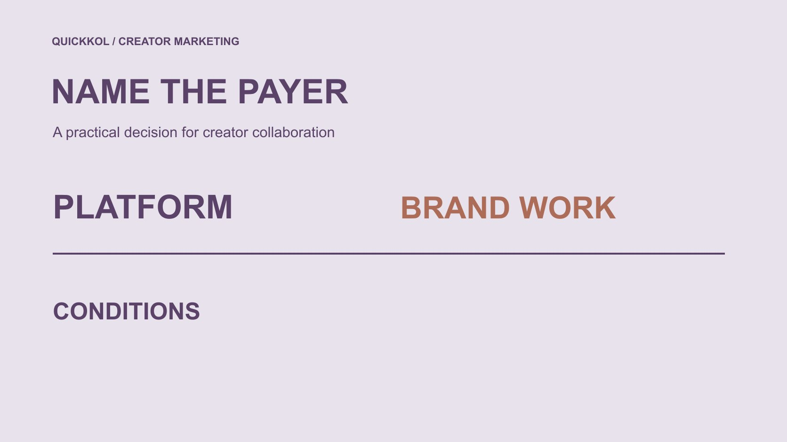
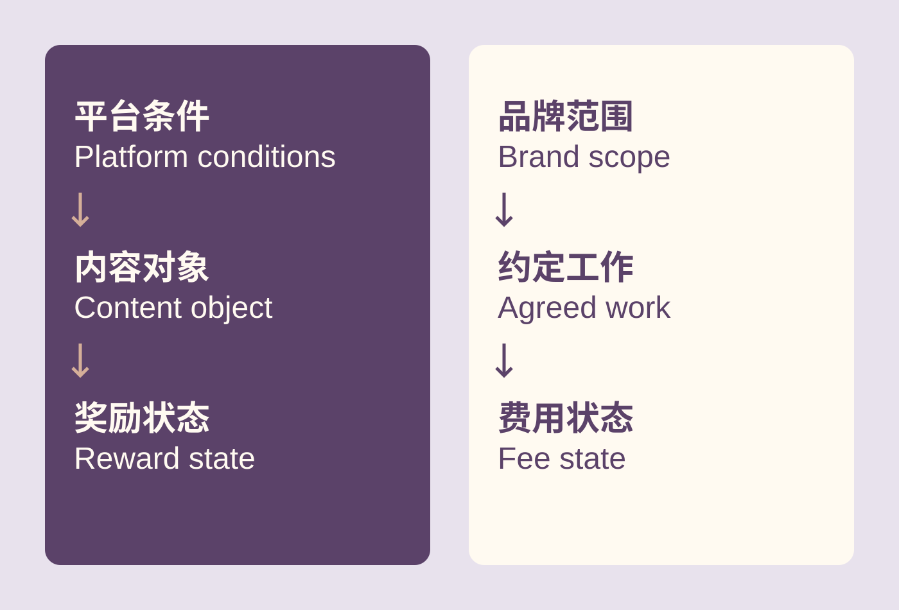

# Get Monetized on TikTok: Build a Brand-Ready Revenue Plan

Status: local review draft; confirm the publication date before release.

A TikTok revenue plan needs a payer, a defined work object and explicit eligibility and payment conditions. Brand sponsorship and platform rewards are separate arrangements.

QuickKOL editorial graphic; not actual account metrics or a platform interface.

To get monetized on TikTok, separate platform rewards, brand work and any other applicable route, then check eligibility, the work object and actual payment conditions for each. Prepare genuine work, clear scope and a checkable contact route so a brand can assess what it needs to buy. A follower number cannot guarantee a deal or income. Historical Creator Rewards launch conditions do not establish whether an account can join today; check current applicable guidance and account status. Record estimated rewards, confirmed fees and actual receipt separately.

## Identify who pays for which work

A platform may reward content meeting a program’s conditions. A brand may purchase production, publication or licensed use. Other applicable arrangements have their own terms. They can coexist in one creator business without sharing one eligibility rule or amount simply because all are called monetization.

The [creator sponsorship-proposal method](https://www.quickkol.com/blog/creator-sponsorship-proposal-brand-review/#answer) helps define the task a brand needs. A product explanation can demonstrate production and expression without proving membership in every platform program or impersonating an existing client sponsorship.

Organize the plan by payer, task, conditions, evidence source and state. An explicit unconfirmed field is more useful than a complete-looking monthly income target. The brand should also understand that it is discussing a defined collaboration, not the creator’s entire private income. This keeps the conversation focused on purchasable work and avoids treating one visible platform counter as an explanation of every revenue stream the creator might have.

## Keep historical thresholds dated

[TikTok’s rewards-program launch announcement](https://newsroom.tiktok.com/introducing-the-new-creator-rewards-program/?lang=en) on March 18, 2024 listed conditions including age 18 or above, 10,000 followers, at least 100,000 views in the preceding 30 days and a personal account in good standing in an available market. These figures have a historical period; they are not verified here as today’s worldwide thresholds.

They illustrate that eligibility can concern account, geography, age and window together, rather than a follower total alone. The current main help route did not provide a complete readable body in this review, so no unverified latest country list or payment rate is supplied.

When preparing to join, inspect the official conditions and terms applicable to the actual account. A brand should not turn a historical threshold into a minimum for every commercial relationship or require unrelated growth services to reach it. The relevant buying question remains whether the creator can perform the proposed work under appropriate conditions.

## Separate account and content eligibility

[TikTok’s rewards-content explanation](https://support.tiktok.com/en/business-and-creator/creator-rewards-program/how-is-the-creator-rewards-program-different-from-the-tiktok-creator-fund) distinguishes original material meeting program conditions and excludes sponsored content among the forms it discusses. An enrolled account does not allow a brand to promise equivalent platform rewards for this sponsored piece.

Retain the correct assignment for each work object. Self-initiated production, brand commissions and other arrangements may have different purposes and conditions. Changing a label does not make them the same revenue object.

This article determines no individual video’s eligibility and offers no way to bypass conditions. Check the applicable rules and platform state for the real project. The revenue-plan illustration separates platform-content conditions from brand-work scope to avoid placing one piece inside two unverified earnings promises. It is a method for organizing questions, not an automatic approval path or a calculation of what the creator will receive. The distinction should remain clear in both the working plan and any commercial proposal sent to a brand.

Platform rewards and brand fees have separate conditions; a shared account or piece does not automatically combine them.

## Prepare genuine work for brand opportunities

A brand needs to assess what the creator can help viewers understand and whether relevant production and expression are demonstrated. Select task-related samples and identify actual contribution, conditions and appropriate reference scope. Self-initiated practice should not impersonate paid client work.

A clear product demonstration, reliable interview or practical setting can be more useful than a broad growth promise. Where relevant work is missing, propose a bounded concept or suitable test instead of inventing customers, inflating data or guaranteeing success.

Retain dates, definitions and sources in commercial materials. Followers, views, interactions and orders are not interchangeable proof. Accurate work gives a brand a basis for discussion without requiring the creator to pretend an established mature business already exists. It also makes feedback actionable: the recipient can identify the missing capability or condition instead of debating an unsupported claim about the audience the creator supposedly delivers.

## Treat collaboration routes as separate arrangements

[TikTok One’s collaboration-eligibility guide](https://support.tiktok.com/en/business-and-creator/tiktok-one/tiktok-one-eligibility) describes a creator-brand route with some region-dependent conditions. It is not the same program as Creator Rewards. A threshold or state from one cannot substitute for the other.

Whether a route is needed or suitable depends on the assignment and current applicable conditions. Platform eligibility does not establish brand willingness to buy, a confirmed quote or permission for every use. Joining a route is not a deal guarantee.

Appropriate public business channels can also support discussion of a real task, with clear identity, scope and authority. A creator need not provide passwords or verification codes to demonstrate professionalism. An opportunity inside a platform still requires understanding who supplies what, how the work is completed and how it is recorded. That assessment concerns the actual collaboration rather than the prestige or familiarity of the interface in which the opportunity appeared.

## Tie a quote to work and use

For brand work, state what production, creator-account publication and subsequent brand use include separately. Languages, versions, locations and use periods can change the assignment and need discussion instead of being compressed into one collaboration.

The [income-scope and cost method](https://www.quickkol.com/blog/how-much-influencers-make-gross-net-workload/#answer) distinguishes fees, revenue, working costs and the remainder. This article supplies no universal rate card and does not derive an acceptable sponsorship fee from platform rewards. Platform income does not replace the production resources and use conditions of this assignment.

Offer an estimate with assumptions or ask which options the brand needs. Retaining an unknown is compatible with a serious proposal. An unconditional promise covering every use, revision and outcome makes the actual purchase harder to assess. Clear scope gives the creator a more realistic way to plan workload and lets the brand compare alternatives without relying on a follower-tier price chart or assumptions about private earnings.

## Include commercial context in the work

[TikTok’s commercial-content guide](https://support.tiktok.com/en/business-and-creator/creator-and-business-accounts/promoting-a-brand-product-or-service) requires the applicable disclosure setting for promotional content, including own-business and third-party commercial arrangements. Select according to the actual relationship rather than treat hidden context as a monetization tactic.

Check platform settings alongside explanations needed for the specific region and format. The brand supplies accurate product support, and the creator speaks from genuine experience instead of making unsupported recommendations to obtain payment.

Assign preparation and final-object checking during planning. Disclosure should not remain a proposal topic that never appears in the finished work. Clear commercial context can coexist with natural content and helps the brand assess the expression it purchases. A revenue target should not become a reason to remove necessary conditions. This is a practical production responsibility, not a promise that selecting one platform label resolves every requirement for every audience and later use.

## Separate amounts from payment states

Estimated platform rewards, a fee under discussion, confirmed receivables and money actually received need accurate names. A number appearing does not establish completion of settlement conditions or income after all costs.

Record object, currency, period and appropriate state. An undecided item should not become paid. Use suitable nonsensitive references for brand payment questions rather than place account secrets in a portfolio or widely forwarded spreadsheet.

When a plan changes, explain the affected work and period. One publicly discussed large case does not predict the next piece’s income, and somebody else’s screenshot is not a worldwide platform rate or commercial quote. Explicit states help collaboration more than a precise-looking forecast. They let both sides identify whether a question concerns scope, an estimate, a condition still pending or an actual payment record, rather than argue about different meanings of the same amount.

## Rehearse a plan with a hypothetical assignment

Suppose a creator has a self-initiated storage demonstration and receives an invitation to discuss a new product explanation. This is not a client case. Record the assignments separately. The invitation does not automatically turn the earlier work into advertising, and program membership does not automatically reward the new brand piece.

The creator proposes production scope, the brand identifies publication and use needs, and both check conditions before confirming a fee and next step. There is no need to add all potential income together merely to make the plan look complete.

If one route remains unavailable, the creator can still prepare genuine work and a clear proposal without claiming approved eligibility. The useful outcome is a plan explaining payer, task and open conditions, not a monthly earnings promise with every cell filled. It creates an informed basis for discussion even when no particular brand deal or platform acceptance has yet occurred.

## Assign the next step appropriately

Retain an owner for open items on each route: an authorized person checks account eligibility, the brand supplies product facts, relevant creators produce the work and appropriate commercial staff confirm payment conditions. A technical entry cannot make these decisions automatically.

Update for material changes rather than rewrite every forecast after daily counter fluctuations. Monetization can support sustainable production without a threshold, template or popular pattern guaranteeing stable income.

A brand can assess actual work, task fit and accountable communication. A creator can explain what they can deliver and check eligibility, fees and settlement through applicable routes. Both can discuss real collaboration without first accepting an uncheckable earnings story. The plan remains useful precisely because it distinguishes preparation from acceptance and acceptance from receipt, leaving each party able to identify a concrete next action rather than a vague obligation to grow until somebody pays.

## Separate conditions for revenue routes

| Record | Check | Do not assume |
| --- | --- | --- |
| Platform program | Account, market and current eligibility | One threshold guarantees acceptance |
| Content object | Actual task and applicable scope | Every piece qualifies for rewards |
| Brand work | Production, publication and use | Platform income determines the fee |
| Amount state | Estimated, confirmed, receivable and received | A displayed amount is received |

An editorial planning framework, not guaranteed monetization, a fixed price or a current worldwide eligibility list.

## Before discussing TikTok revenue

Retain a payer, conditions and state for each work object.

- [ ] Separate platform rewards from brand tasks.
- [ ] Check current conditions for the actual account.
- [ ] Explain your contribution through genuine work.
- [ ] Tie a quote to defined work and use.
- [ ] Prepare necessary commercial context.
- [ ] Record estimates, receivables and receipts separately.

## Research date and limitations

Sources reviewed November 16, 2026. Methods, tables and decision rules are editorial recommendations. Hypothetical examples are not actual client results or industry benchmarks. Source geography and periods are specified where relevant.

## Start creator research with a clear task

Use QuickKOL to interpret a brief, discover relevant creators and research their work and contact routes. Verify data, commercial terms and outcomes at their source.

[Explore QuickKOL](https://www.quickkol.com/#capabilities)

## Sources

- [TikTok: Creator Rewards launch (2024)](https://newsroom.tiktok.com/introducing-the-new-creator-rewards-program/?lang=en)
- [TikTok: rewards content scope](https://support.tiktok.com/en/business-and-creator/creator-rewards-program/how-is-the-creator-rewards-program-different-from-the-tiktok-creator-fund)
- [TikTok: TikTok One eligibility](https://support.tiktok.com/en/business-and-creator/tiktok-one/tiktok-one-eligibility)
- [TikTok: promoting a brand and content disclosure](https://support.tiktok.com/en/business-and-creator/creator-and-business-accounts/promoting-a-brand-product-or-service)
