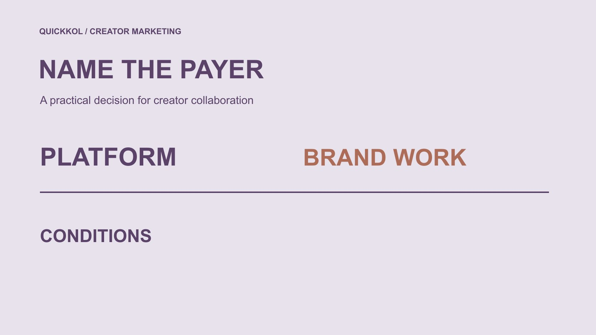
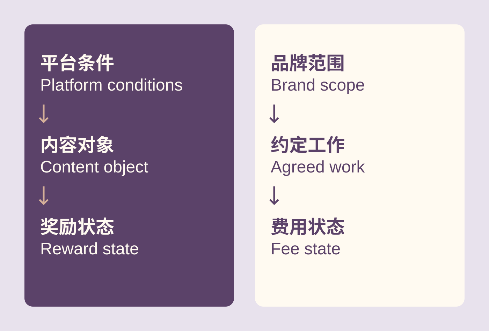

# TikTok 变现怎样准备合作收入计划

状态：本地审阅稿；正式发布日期待确认。

TikTok 变现计划需要分清谁付款、为哪项工作付款，以及哪些资格、内容和结算条件仍待确认，不能把品牌赞助与平台奖励合成一个收益承诺。

QuickKOL 编辑图形；不呈现真实账号指标或平台界面。

希望在 TikTok 变现，先把平台奖励、品牌合作和其他适用收入路线分开，再核对每条路线的资格、工作对象与实际付款条件。创作者可以准备真实作品、清楚的合作范围与可核验联系，让品牌判断需要购买什么；不能靠一个粉丝数字保证接单或收入。Creator Rewards 的历史发布条件与当前账号是否可加入也不是同一问题，应以当时可用的官方说明和账号状态重新检查。收益估计、费用确认与最终收到款项需要分别记录。

## 先说明谁为哪项工作付款

平台可能为符合计划条件的内容提供奖励，品牌可能购买制作、发布或使用许可，其他适用项目也有自己的条件。它们可以出现在一个创作者业务里，但不能因为都叫变现，就共用一项资格或金额。

[达人合作提案方法](https://www.quickkol.com/zh/blog/creator-sponsorship-proposal-brand-review/#answer)帮助把品牌需要的任务写清。一个产品解释样本，能展示制作与表达能力；它不必先证明创作者参与所有平台计划，也不应被包装成已经获得的客户赞助。

计划表可按付款方、任务、适用条件、数据来源与状态组织。先留出尚未确认的位置，比填写一个看似完整的每月收入目标更实用。品牌也应知道自己讨论的是具体合作，不是创作者全部私人收入。

## 历史门槛只作有日期的参考

[TikTok 的奖励计划发布说明](https://newsroom.tiktok.com/introducing-the-new-creator-rewards-program/?lang=en)在 2024 年 3 月 18 日列出当时条件，包括至少 18 岁、10,000 粉丝、此前 30 天至少 100,000 次观看，以及计划可用市场中的良好状态个人账号。这些数字有明确时期，不是本篇确认的全球当前门槛。

它们说明资格可能同时涉及账号、地区、年龄与窗口，不能缩成“粉丝到数就可以”。本次当前主帮助页未提供完整可读正文，因此不补写未经核实的最新国家清单或收入单价。

创作者实际准备加入时，应查看自己账号适用的官方资格与条款。品牌则不应把历史门槛当成所有商业合作的最低资格，也不要求对方为了达到一个数字接受无关的增长服务。

## 内容合格与账号合格分开

[TikTok 的奖励内容说明](https://support.tiktok.com/en/business-and-creator/creator-rewards-program/how-is-the-creator-rewards-program-different-from-the-tiktok-creator-fund)区分符合计划要求的原创内容，并在说明中排除赞助内容等形式。品牌不能因为创作者账号已加入某计划，就承诺本次赞助作品还会获得同样的平台奖励。

创作者应给不同作品保留正确任务说明。自主制作、品牌委托和其他安排可能有不同目的及条件，不能只调整一个标签就声称它们变成了同一种收入对象。

本篇不对具体视频资格作裁决，也不提供绕过条件的方法。实际项目需要检查适用规则与平台状态。收入计划图把平台内容条件与品牌工作范围分开，就是为了避免一条作品被同时放进两个没有核实的收益承诺中。

平台奖励与品牌费用各有自己的条件，不能因同一账号或作品就自动合并。

## 用真实作品准备品牌合作

品牌需要判断创作者能帮助观众理解什么，以及是否具备相关表达和制作能力。选择与任务有关的样本，说明实际贡献、制作条件与可引用范围，不把自主练习伪装成付费案例。

一个清楚产品演示、可靠访谈或实际场景说明，可以比笼统说自己能带来增长更有用。没有相关样本时，可以先提出有限概念或讨论合适测试，不需要编造客户、夸大数据或承诺一定成功。

准备合作资料时，保留数据来源、日期与定义。粉丝、观看、互动和订单不是可以任意替换的证明。品牌能根据准确作品开始讨论，创作者也不用为了得到第一次合作而假装已经拥有完整成熟业务。

## 合作入口也有独立条件

[TikTok One 的合作资格说明](https://support.tiktok.com/en/business-and-creator/tiktok-one/tiktok-one-eligibility)介绍创作者与品牌合作入口，并说明某些条件会随地区不同。这个入口与 Creator Rewards 不是同一项目，不能拿一个计划的数字或状态替代另一个。

是否需要或适合使用某个入口，由当前任务与适用条件决定。平台资格不等于品牌愿意购买、报价已经确认或所有素材用途获准。不要把加入入口当作获得合作的保证。

品牌也可以通过合法公开商业路径讨论具体任务，关键是实际身份、范围和授权清楚。创作者不应为证明专业而交出密码或验证码；平台页面里的合作机会，也仍需要理解本次到底由谁提供什么、怎样完成以及如何记录。

## 报价对应范围与使用

对品牌任务说明制作、本人账号发布和后续品牌使用分别包含什么。新增语言、版本、场地或使用期限，可能改变工作，需要相应讨论，而不是把所有需求塞进“合作一条”里。

[收入范围与成本方法](https://www.quickkol.com/zh/blog/how-much-influencers-make-gross-net-workload/#answer)帮助区分费用、收入、工作成本和剩余金额。本篇不提供统一价格表，也不从平台奖励推算创作者应该接受的赞助费。平台收入高低不替代本次制作资源和使用条件。

可以给出有假设的估价，或先问品牌需要什么选项。未知条件保留，不代表提案不专业；无条件保证所有用途、所有修改和所有结果，反而使双方无法判断实际在购买什么。

## 把商业背景纳入成品

[TikTok 的商业内容说明](https://support.tiktok.com/en/business-and-creator/creator-and-business-accounts/promoting-a-brand-product-or-service)要求适用推广内容使用内容披露设置，涉及自身业务或第三方商业关系等情况。实际选择应对应真实安排，不把隐藏关系当作变现技巧。

平台设置与具体地区、形式下需要的说明都应检查。品牌提供准确产品依据，创作者表达真实经验，不能为了获得付款说出没有经历或无法支持的推荐。

在计划阶段安排谁准备、谁核对最终对象，避免只在提案里讨论披露，成片却没有体现。清楚商业背景可以与自然内容共存，也能让品牌更准确判断自己购买的是怎样的表达，而不是让收益目标成为删除必要条件的理由。

## 把金额与付款状态分开

平台显示的估计奖励、品牌讨论中的费用、已确认应收和实际收到款项，都需要准确名称。一个数字出现，不代表它已满足所有结算条件，也不代表它是扣除全部成本后的收入。

记录金额对应对象、币种、时间与适当状态，尚未确定的部分不要填成已支付。向品牌确认付款问题时，使用适当非敏感关联，不把完整账户秘密放在作品集或广泛转发的表格里。

如果需要调整计划，说明影响哪个工作和哪段时间。不从一次高额公开案例推断自己的下一条内容必然收入相同，也不把别人截图中的平台单价当作全球适用的报价。清楚状态比看起来精确的收益预测更能帮助实际合作。

## 用一个假设任务练习计划

假设创作者有自主拍摄的收纳演示，又收到品牌讨论新产品说明的邀请。例子不是实际客户。两项作品分别记录任务；品牌邀请不使自主作品自动成为广告，品牌作品也不因账号参与计划就自动获得奖励。

创作者提出明确制作范围，品牌说明所需发布与使用，双方核对实际条件后再确认费用与下一步。没有必要为了让计划看起来完整，先把全部潜在收入相加。

若某条路线尚未可用，可以继续准备真实作品和清楚提案，但不能冒称资格已批准。练习的有效结果是一份能回答谁付款、为哪项任务和哪些条件待确认的计划，而不是每个格子都填满的月收入承诺。

## 把下一步交给适当负责人

收入计划应保留每条路线的待确认事项与负责人：账号资格由合法负责人检查，产品事实由品牌提供，制作由相关创作者完成，付款条件由适当商业人员确认。技术入口不能自动替团队完成这些决定。

定期按实质变化更新，而不是每天根据计数波动重写全部预测。变现可以帮助可持续创作，但没有一个门槛、模板或热门模式保证稳定收入。

对品牌而言，最值得评估的是具体作品、任务适配与负责沟通。对创作者而言，最可执行的是把自己能完成的工作讲清，并沿适用路线核对资格、费用和结算。这样双方能讨论真实合作，而不必先相信一份无法核验的收益故事。

## 收入路线的独立条件

| 记录 | 核对 | 不能默认 |
| --- | --- | --- |
| 平台计划 | 账号、市场与当前资格 | 达到一个数字即获准 |
| 具体内容 | 实际任务与适用范围 | 所有作品都符合奖励 |
| 品牌合作 | 制作、发布与使用条件 | 平台收入决定赞助费 |
| 金额状态 | 估计、确认、应收与收到 | 显示数字就是已到账 |

编辑计划框架，不是保证变现、固定价格或全球当前资格清单。

## 讨论 TikTok 收入前

为每项工作保留付款方、条件和状态。

- [ ] 区分平台奖励与品牌任务。
- [ ] 核对实际账号当前适用资格。
- [ ] 按真实作品说明自己的贡献。
- [ ] 报价对应明确范围与用途。
- [ ] 准备必要商业关系表达。
- [ ] 把估计、应收和收到分别记录。

## 研究日期与使用边界

资料核验于 2026 年 11 月 16 日。文中方法、表格和决策规则为编辑建议，标为假设的示例不是实际客户结果或行业基准。外部资料的适用地区与时期按各段说明。

## 从任务开始达人研究

用 QuickKOL 理解 Brief、发现相关达人并研究作品与联系路径；数据、合作条件和结果仍需核验。

[了解 QuickKOL](https://www.quickkol.com/#capabilities)

## 来源

- [TikTok：Creator Rewards 发布（2024）](https://newsroom.tiktok.com/introducing-the-new-creator-rewards-program/?lang=en)
- [TikTok：奖励计划的内容范围](https://support.tiktok.com/en/business-and-creator/creator-rewards-program/how-is-the-creator-rewards-program-different-from-the-tiktok-creator-fund)
- [TikTok：TikTok One 合作资格](https://support.tiktok.com/en/business-and-creator/tiktok-one/tiktok-one-eligibility)
- [TikTok：推广品牌与商业内容说明](https://support.tiktok.com/en/business-and-creator/creator-and-business-accounts/promoting-a-brand-product-or-service)
