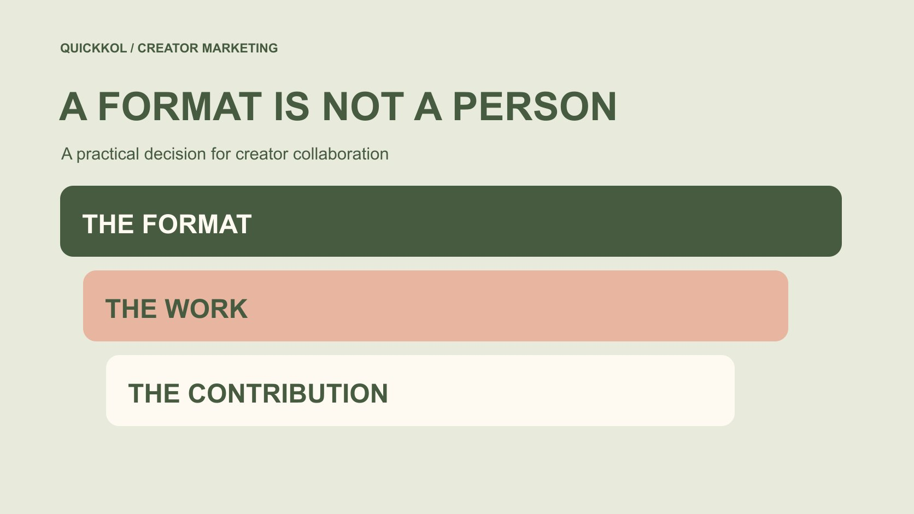
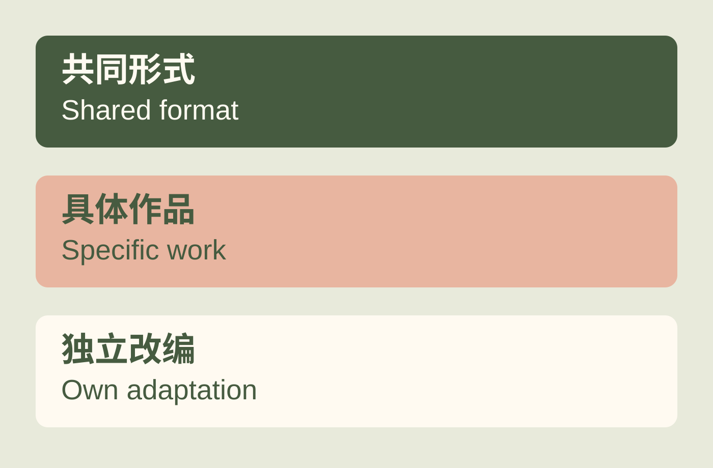

# Tik Tok Trends: Identify the Creator Contribution

Status: local review draft; confirm the publication date before release.

Separate a recurring TikTok format, a traceable creator contribution and the new brand assignment so a collaboration purchases meaningful creative work.

QuickKOL editorial graphic; not actual account metrics or a platform interface.

When researching Tik Tok trends, distinguish a recurring format, a particular creator’s traceable contribution and the new work required for this collaboration. Popularity or the order in which you encounter posts does not prove origin, and credit does not automatically supply commercial-use permission. Record observed sources and uncertainty, then discuss relevant contributions, necessary permissions and an original brand adaptation with the creator. A trend supplies creative context; it cannot replace assessment of actual work and the assignment.

## Describe the format before assigning origin

Begin with a description that does not name a person: a viewer poses a question, for example, and a creator uses three objects to explain different answers. Then identify a particular work’s wording, movements, filming arrangement or explanation. This reveals whether the brand likes a general structure or details somebody contributed.

The first post you encountered establishes your discovery path only. Rankings, reposts and recommendation surfaces do not independently identify an originator. With incomplete evidence, say that this work inspired the assignment instead of declaring one inventor of an entire trend.

The distinction supports a more accurate invitation: which capability interests the brand, whether specific elements need to remain and what will be newly created. It also prevents a popularity list from becoming a purchasing list in which a creator is asked merely to repeat another person’s work. A description of the actual contribution gives the brand a reason to approach someone beyond the fact that a post is visible, while leaving room to acknowledge what the research has not established.

## Use discovery tools as sources of leads

[TikTok’s Creative Center explanation](https://ads.tiktok.com/resources/help/article/creative-center) describes advertising examples, trending hashtags and creative resources. These can provide leads, but the public description does not make those pages a complete originator directory or establish that the visible sample represents all creators.

Record the date, page category and objects actually visible. Keep selected ads distinct from other content, and hashtag-level information distinct from an individual work. The [current-trend relevance method](https://www.quickkol.com/blog/tiktok-trends-today-creator-relevance-check/#answer) addresses whether a pattern still suits a live assignment. This article focuses on contribution and the new creative task.

Where a format appears across several communities, allow for multiple paths of circulation. A proposal does not need to compress incomplete information into one definitive source. Discovery tools help formulate questions for further work review; they cannot replace watching context, locating relevant primary expression and speaking with the creator. The resulting research note should let a colleague understand what was observed and where an interpretation began, rather than present the interface’s ordering as a verified history of creativity on the platform.

## Trace the particular work and contribution

Retain the work’s source link, visible publication information, observed elements and relationship to the proposal. A timestamp does not prove the entire history; it helps another reviewer find the same object. Reposters or curators may provide useful leads while remaining distinct from the work’s author.

When attribution is disputed, preserve competing accounts and evidence gaps rather than decide a person’s status by comment-section voting. If the assignment depends on the disputed element, develop expression that does not require it or ask an appropriate person to examine the issue further.

Unrelated private information is unnecessary. The task is understanding a contribution, not investigating the creator’s whole life. State what was observed, what remains unknown and why it matters to the collaboration. That is more useful than a confidence score concealing an uncheckable source. It also keeps the team from treating a research gap as either proof of wrongdoing or permission to claim that no contributor exists, two conclusions that the same incomplete material cannot establish.

## Keep credit separate from permission

[TikTok’s creator-credit announcement](https://newsroom.tiktok.com/crediting-tools/?lang=en) introduced tools for tagging, mentioning and crediting inspirational videos in 2022. It documents an attribution initiative. The historical announcement is not a tested current interface here and does not supply commercial permission for every work.

Discuss acknowledgment separately from copying a particular asset, recording, arrangement or expression. Naming someone cannot substitute for necessary authorization for the actual use. Conversely, permission for one use should not erase agreed acknowledgment of a contribution.

Specify an understandable location and form of credit in the new piece instead of leaving later copy editors to guess. Keep unresolved permission explicit and consider another idea while it is clarified. This recognizes creative work and gives the brand a realistic view of the assignment’s limits. It also prevents a common briefing error: treating a small credit line as a complete purchasing arrangement when nobody has discussed the object to be supplied, how the brand intends to use it or what the creator is actually being asked to make.

Recognizing a format does not establish its origin or provide commercial permission.

## Treat music as its own condition

[TikTok’s commercial-music explanation](https://support.tiktok.com/en/business-and-creator/creator-and-business-accounts/commercial-use-of-music-on-tiktok?lang=en) recommends its Commercial Music Library for content promoting a brand, product or service and says its licenses for music outside that library do not cover commercial use. Other sounds need appropriate rights; popularity is not clearance.

This article determines no track’s worldwide permission. Check the actual sound, region and use under current conditions. Visibility inside the app, availability to a personal account and a brand’s later cross-platform advertising are separate questions.

If a trend depends on a recording whose commercial use cannot be confirmed, preserve the narrative rhythm while redesigning the sound or choose a suitably authorized alternative. Do not ask a creator to change labels covertly or conceal the commercial relationship. Music belongs in the creative discussion before the finished piece depends on it. This also gives the creator a useful constraint to solve, instead of an instruction to reproduce an existing video exactly and a late demand to remove the element on which that reproduction was built.

## Buy adaptation capability and a new contribution

Write the brief as a problem rather than “shoot this exact post.” Explain what the audience needs to understand, which product facts must remain, which format is being considered and what observation, demonstration or explanation the creator will add.

The [executable creator-brief guide](https://www.quickkol.com/blog/write-a-useful-campaign-brief/#answer) helps define these tasks. Suppose a folding stand needs an explanation of stored and open states. A creator could organize three shots in a familiar everyday setting. This exercise requires neither copying another person’s wording nor pretending to originate the entire format.

Connect the new contribution to production scope: practical filming, language adaptation, a setting or a complete narrative. Value does not always require inventing a new format. Clear explanation, genuine experience and audience-appropriate execution can be purchasable work, provided they are named accurately rather than inflated into ownership of a trend. The brand can then assess an actual proposal and the creator can explain the labor involved, without either party relying on the vague promise that following a familiar pattern will automatically deliver viral performance.

## Review the contribution rather than similarity

Review should ask more than how closely the new piece resembles its reference. Does it solve the brand’s problem, preserve facts, acknowledge relevant contributions and use material within the agreed scope? Greater similarity is not automatically better execution.

When a creator proposes another opening or structure, ask how it helps the audience instead of rejecting it merely for departing from the reference. The brand can identify a missing required fact and request a concrete correction without describing every stylistic difference as unprofessional.

Record accepted creative decisions so the handoff reveals what the creator actually contributed. This is not a universal originality score or a legal judgment about a particular work. The goal is a review that explains this assignment’s value, rather than imitation as its only acceptance criterion. That approach can support a more candid conversation about scope changes too: a substantially new demonstration or storyline should be discussed as work, not hidden inside a demand to make the original reference feel slightly different.

## Retain uncertainty and reasons for updates

Before release, an earlier source, another attribution or a change in music conditions may appear. Give that information a maintainable place and identify which expression it affects instead of rewriting the entire trend study indiscriminately.

A new example of circulation may not change the contribution assessment. Discovery of a borrowed element needing discussion should change the relevant assignment. Separating observed facts from editorial inference helps the team respond proportionately.

Do not claim the complete history has been found or ask a creator to prove that no similar internet work exists. Reasonable review can have an explicit scope: primary works examined, people consulted, uses confirmed and questions still open. Transparent scope is easier to hand over and revisit than an absolute originality-verified stamp. It also leaves another reviewer able to add useful evidence without having to overturn a grand conclusion the original research never had enough information to support in the first place.

## Turn the trend into a collaboration decision

Finish with three explicit decisions: the format being considered, contributions requiring acknowledgment or further checking, and the new work this creator will make. Then confirm material, music, commercial context and later use before arranging production.

Where these conditions remain unclear, continue research or select another expression instead of filling unknowns with facts to catch a trend. Declining one popular reference does not mean missing the only opportunity. A brand can choose a collaboration that better supports an accurate product explanation.

The useful result is not merely a latest-ranking screenshot. It explains why this creator is relevant, which capability is being purchased and what the new work will give viewers. Recognizing an existing contribution while preserving room for new creation supports discussion of real work instead of pursuit of attention somebody else has already received. That remains a practical influencer-marketing decision even when the final format is familiar and no one promises that the adaptation will match the reference’s public performance.

## Three layers before a trend becomes a brief

| Layer | Retain | Does not automatically mean |
| --- | --- | --- |
| Recurring format | Mechanism and observed sources | One originator has been established |
| Particular contribution | Work, elements and context | Credit supplies commercial permission |
| New assignment | New expression and scope | Imitation reproduces performance |
| Material conditions | Music, permissions and actual use | In-app visibility allows every reuse |

An editorial framework, not a complete origin history, rights determination or live trend ranking.

## From trend to creator assignment

Explain format, contribution and new work separately.

- [ ] Describe the mechanism before assigning an inventor.
- [ ] Retain primary works actually examined.
- [ ] Separate credit from necessary permission.
- [ ] Check music for the actual commercial use.
- [ ] Give the creator a clear problem and room to contribute.
- [ ] Hand over unknowns and reasons for updates.

## Research date and limitations

Sources reviewed November 16, 2026. Methods, tables and decision rules are editorial recommendations. Hypothetical examples are not actual client results or industry benchmarks. Source geography and periods are specified where relevant.

## Start creator research with a clear task

Use QuickKOL to interpret a brief, discover relevant creators and research their work and contact routes. Verify data, commercial terms and outcomes at their source.

[Explore QuickKOL](https://www.quickkol.com/#capabilities)

## Sources

- [TikTok’s Creative Center explanation](https://ads.tiktok.com/resources/help/article/creative-center)
- [TikTok’s creator-credit announcement](https://newsroom.tiktok.com/crediting-tools/?lang=en)
- [TikTok’s commercial-music explanation](https://support.tiktok.com/en/business-and-creator/creator-and-business-accounts/commercial-use-of-music-on-tiktok?lang=en)
