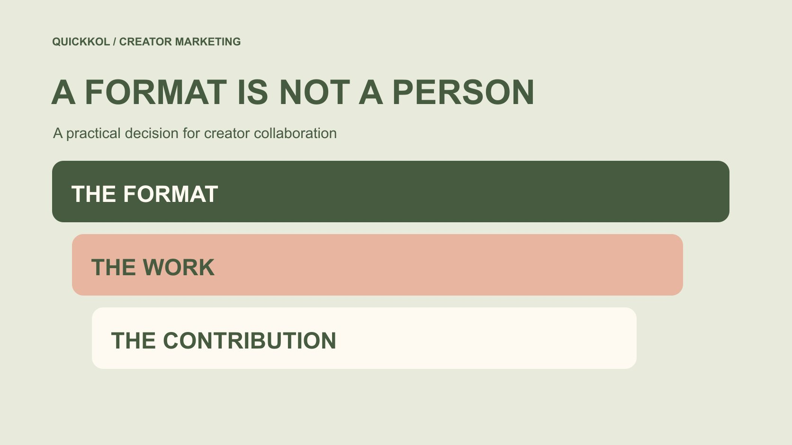
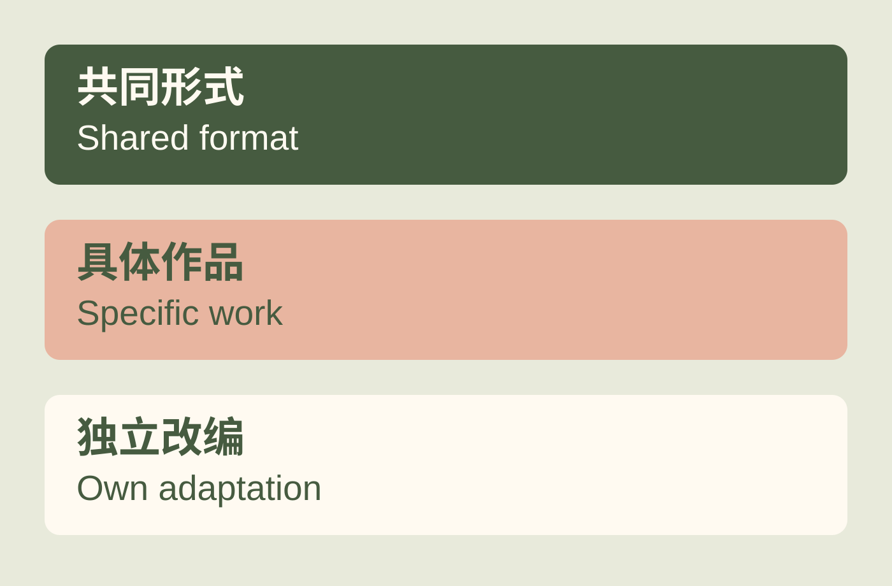

# TikTok 趋势里谁贡献了创意

状态：本地审阅稿；正式发布日期待确认。

看到 TikTok 趋势后，分清公共格式、可追溯的创作者贡献与本次品牌新任务，让合作建立在实际创意上。

QuickKOL 编辑图形；不呈现真实账号指标或平台界面。

品牌研究 TikTok 趋势时，应区分三层：反复出现的内容格式、某位创作者可以追溯的具体贡献，以及本次合作要新增的工作。热门出现顺序不等于原创证明，署名也不等于自动获得商业使用许可。记录看到的来源与不确定性，再与达人讨论怎样保留相关贡献、取得所需许可并制作适合品牌的新表达。趋势可以提供创意背景，但不能代替对创作者作品与本次任务的判断。

## 先描述格式，不急着认定原创

先用不带姓名的语言描述内容机制：例如观众提出一个问题，创作者用三个物品给出不同答案。再记录某条作品的特定台词、动作、拍摄安排或解释方式。这样更容易知道品牌喜欢的是一般结构，还是某个人做出的细节。

自己最早看到的帖子，只能证明发现路径。排序、转发和推荐页面不能独立确认最早创作者。资料不足时，可以写“本次灵感来自此作品”，而不是替整个趋势宣布唯一发明者。

这种记录帮助品牌提出准确合作邀请：希望对方发挥哪种能力，是否需要沿用具体元素，哪些部分准备重新创作。它也避免把热度名单直接变成采购名单，让达人只负责重复别人作品而没有发挥空间。

## 把发现工具当作线索来源

[TikTok 的创意中心说明](https://ads.tiktok.com/resources/help/article/creative-center)介绍广告实例、趋势话题和创作资源。它可以帮助发现内容线索，但公开说明没有让这些页面变成完整原创者名录，也不能证明所见样本代表所有创作者。

记录查看日期、页面类别与当时可见对象，不把广告精选与普通内容、话题统计与单条作品混为一谈。需要判断热度是否仍适合当前合作时，可参考[当日趋势相关性检查方法](https://www.quickkol.com/zh/blog/tiktok-trends-today-creator-relevance-check/#answer)；本篇专门处理创意贡献的归属与新任务。

如果一个格式在多个群体出现，允许存在多条传播路径。没有必要为了提案看起来确定，把信息压成唯一来源。发现工具适合提出进一步看作品的问题，不能替代观看完整语境、查找相关原始表达和与实际创作者沟通。

## 追溯具体作品与贡献

可以记录原始作品链接、可见发布时间、实际观察到的元素及与本次提案的关系。时间记录本身不证明全部历史；它只是帮助下一位审阅者找到相同对象。转发者或整理者也可能提供有用线索，但应与作品作者分开。

遇到署名争议时，先保留不同说法与证据缺口，不根据评论区投票裁决个人。若任务依赖争议元素，可以先改为不依赖它的新表达，或请适当人员进一步核实。

品牌没有必要保存无关私人信息。任务是理解作品贡献，不是调查创作者全部生活。准确记下“看到了什么、还不知道什么、为什么与合作有关”，比用一个置信度分数掩盖无法核对的来源更有帮助。

## 把署名与使用许可分开

[TikTok 的创作者署名公告](https://newsroom.tiktok.com/crediting-tools/?lang=en)在 2022 年介绍了标记、提及和为视频注明灵感来源的工具。它说明平台鼓励贡献归属；历史公告不是本篇实测的当前界面，也不构成所有作品的商业许可。

讨论合作时，分别问如何说明灵感，以及是否需要复制某个具体素材、录音、编排或表达。注明姓名不能替代实际用途的必要授权；反过来，已经取得某项使用许可，也不应因此抹去双方约定的贡献说明。

在本次作品里安排可理解的署名位置与形式，不把全部责任交给后续文案同事猜。若某项权限尚未明确，保留待确认状态，先讨论替代创意。这样既承认创作者劳动，也能让品牌知道交付范围有哪些真实限制。

观察到熟悉格式，不等于已经确认原创归属或获得商业使用许可。

## 把音乐另列为适用条件

[TikTok 的商业音乐说明](https://support.tiktok.com/en/business-and-creator/creator-and-business-accounts/commercial-use-of-music-on-tiktok?lang=en)建议推广品牌、产品或服务的内容使用商业音乐库，并指出平台持有的库外音乐许可不覆盖相应商业使用。使用其他声音时，需要核对适当权利，不因声音正在流行就默认可用。

这里不提供具体曲目的全球许可结论。实际项目要按当前音乐对象、地区与用途核实；平台内可见、在个人账号听得到，以及品牌后续可跨平台投放，是不同问题。

如果趋势的主要吸引力来自一段无法确认商业用途的录音，可以保留叙事节奏而重新设计声音，或采用权限清楚的替代方案。不能要求达人偷偷替换标签或隐瞒商业关系。音乐条件需要进入创作讨论，不等成片依赖它后才开始解决。

## 购买适配能力与新贡献

把 Brief 写成问题，而不是“照着这条拍”。说明品牌需要观众理解什么，哪些产品事实必须保留，准备采用什么格式，以及希望创作者新增什么观察、演示或解释。

[可执行达人 Brief 指南](https://www.quickkol.com/zh/blog/write-a-useful-campaign-brief/#answer)帮助把这些任务写清。假设一款折叠支架需要说明收纳与展开差别，创作者可以用自己熟悉的日常场景组织三个镜头。这个练习不需要复制另一人的台词或假装原创整个格式。

把新贡献与制作范围联系起来：需要实拍、语言改编、场景安排还是完整叙事？不是所有价值都体现为发明全新格式。清楚解释、真实体验和适合受众的执行，也可以是值得采购的工作，但应准确命名而不是夸大成独占趋势。

## 让反馈指向贡献而非复制程度

审稿不应只问与参考视频有多像。可以问新作品是否解决品牌问题、是否保留真实事实、是否说明相关贡献，以及是否在允许范围内使用素材。过度接近参考，未必是高质量执行。

若达人提出新的开场或结构，让他说明它怎样帮助观众理解，而不是因偏离参考就退回。品牌也可以指出必需事实没有被表达，要求具体修正，不把个人风格差异说成不专业。

记录被采用的新决定，让最终交接能看出创作者做了什么。这里没有给原创性打通用分数，也不对具体作品作法律判断。目标是一份能解释本次工作价值的审阅，而不是把模仿程度当成所有合作的唯一验收标准。

## 保留不确定性与更新原因

发布前可能发现更早来源、相关署名或音乐条件变化。给这些信息一个可维护位置，说明它影响哪项表达，而不是不加区分地重写整份趋势研究。

如果只是新的传播实例出现，不一定改变本次贡献判断；如果发现所借用元素需要重新讨论，就应更新相应任务。将已经观察到的事实与编辑推断分开，有助于团队作出适度回应。

不要声称查到了全部历史，也不要要求创作者证明所有互联网内容不存在。合理尽责可以有清楚范围：看过哪些原始作品，咨询了谁，哪些用途已确认，哪些仍保留未知。范围透明，比绝对的“原创已验证”更容易交接与复核。

## 把趋势变成具体合作决定

最终可以形成三项清楚结论：准备采用的格式、需要承认或进一步核实的贡献，以及本次达人负责创造的内容。再确认素材、音乐、商业背景与后续使用范围，才能进入实际制作安排。

若这些条件还不清楚，可以继续研究或改选表达，不必为了赶趋势把未知填成事实。没有采用某条热门内容，也不代表错过唯一机会；品牌可以选择更能支持真实产品解释的合作。

趋势研究最有价值的结果，不是一张最新排名截图，而是让品牌知道为什么找这位创作者、要购买哪项能力，以及新作品将给观众什么。承认现有贡献并保留新创作空间，能让双方讨论实际工作，而不是只追逐别人已经获得的热度。

## 趋势进入合作前的三层判断

| 层次 | 保留什么 | 不自动意味着 |
| --- | --- | --- |
| 公共格式 | 内容机制与观察来源 | 唯一创作者已确定 |
| 具体贡献 | 作品、元素与相关语境 | 署名即商业许可 |
| 新任务 | 要新增的表达与范围 | 模仿即可获得相同热度 |
| 素材条件 | 音乐、授权与适用用途 | 平台内可见即任意复用 |

编辑判断框架，不是完整原创历史、权利裁决或实时趋势榜单。

## 从趋势到合作任务

分别说明格式、贡献和本次新工作。

- [ ] 描述机制，不先认定发明者。
- [ ] 保留实际看过的原始作品。
- [ ] 区分署名与必要使用许可。
- [ ] 核对音乐与实际商业用途。
- [ ] 给达人明确问题与新贡献空间。
- [ ] 交接未确认事项与更新原因。

## 研究日期与使用边界

资料核验于 2026 年 11 月 16 日。文中方法、表格和决策规则为编辑建议，标为假设的示例不是实际客户结果或行业基准。外部资料的适用地区与时期按各段说明。

## 从任务开始达人研究

用 QuickKOL 理解 Brief、发现相关达人并研究作品与联系路径；数据、合作条件和结果仍需核验。

[了解 QuickKOL](https://www.quickkol.com/#capabilities)

## 来源

- [TikTok 的创意中心说明](https://ads.tiktok.com/resources/help/article/creative-center)
- [TikTok 的创作者署名公告](https://newsroom.tiktok.com/crediting-tools/?lang=en)
- [TikTok 的商业音乐说明](https://support.tiktok.com/en/business-and-creator/creator-and-business-accounts/commercial-use-of-music-on-tiktok?lang=en)
