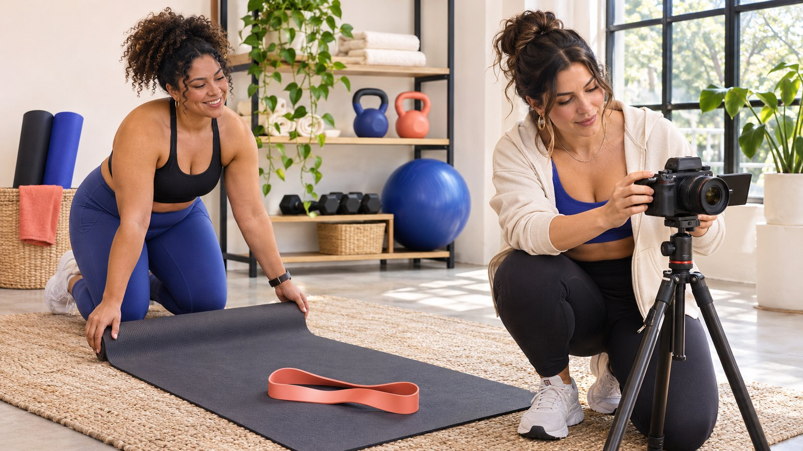
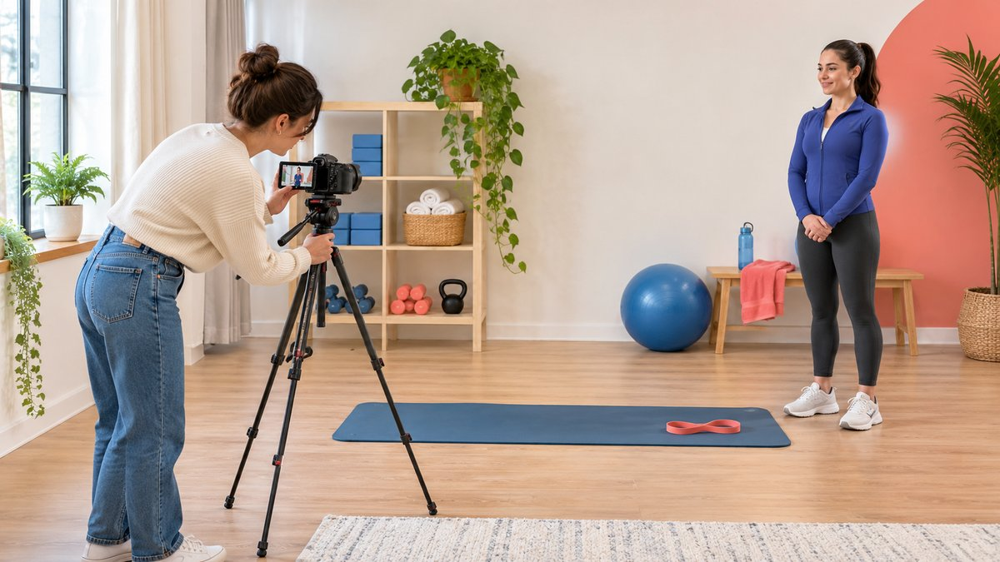

# Fitness Girl: Scope a Women-Led Creator Demonstration

Status: local review draft; confirm the publication date before release.

Fitness creators can present products, describe experience or provide specialist explanation. Review work and credentials against the actual role rather than appearance.

In influencer marketing, “fitness girl” should become a defined collaboration with an adult woman fitness creator rather than an appearance ranking. Specify whether the assignment shows product details, describes personal experience or involves instruction requiring relevant expertise. Different people may handle these tasks. Attractive footage, audience size and a training routine do not establish professional qualifications. Review work, relevant credentials and proposed statements before arranging production. The result should be an accurate, respectful assignment whose responsibilities can actually be assessed.

## Start with what viewers need to understand

Suppose a brand wants a gym bag demonstrated. Viewers may need its compartments, straps or packing sequence explained rather than a training program. Write that explanatory task first to identify an appropriate adult creator and decide whether other expertise is needed.

Selection should not require a particular body to prove a product result. Different appearances and presentation styles can serve relevant work. Assess whether the agreed facts are explained clearly and what the creator actually contributed. Do not infer health, private habits or professional identity from a photograph.

The [creator-shortlist method](https://www.quickkol.com/blog/creator-shortlist-workflow/#answer) helps turn a descriptor into roles and work evidence. Record one or two genuinely relevant capabilities instead of treating all fitness content as one occupation. A specific first message also lets the recipient explain what they can handle and what requires collaboration. It creates a useful conversation about a job rather than an invitation to embody an undefined ideal that neither party can fairly review.

## Allocate demonstration, experience and instruction

A demonstration explains visible operation or construction. Personal experience describes one person’s experience under particular conditions. Specialist instruction can involve judgments about training. They need different support and should not merge automatically into fitness-creator collaboration.

Showing which items fit in a bag does not require the presenter to prescribe exercise to each viewer. Describing a strap during one shoot does not prove a health benefit or suitability for every body. If specialist judgment is added, revisit the person, content scope and review process.

Clear responsibilities let a suitable presenter collaborate with a specialist instead of making frequent fitness posting proof of every capability. Confirm the expression needed before settling fees and production. An agreed quote should not become a reason to add unsupported professional statements. Keep a short role description beside each planned segment so an editor knows whether the footage communicates a product fact, a limited experience or an appropriately reviewed explanation with a different basis.

## Verify credentials relevant to this assignment

[NASM’s digital-badge explanation](https://support.nasm.org/what-is-a-digital-badge) describes verification through the associated Accredible credential page. This is one issuer’s example, not a claim that this article queried anyone or that all fitness credentials are equivalent or include medical responsibilities.

When the proposal actually needs specialist expertise, obtain an appropriate verification route from the person and check the credential name, holder and currently confirmable status. Compare its scope with the assignment instead of saving an abbreviation from a social biography. Record what remains unconfirmed.

A credential also does not replace communication or production capability. A qualified person may need camera or hosting support; an effective presenter may demonstrate a product without taking an instructional role. The result is not an overall score for a person. It explains which confirmed capabilities support this job and which roles still need arranging. That distinction makes a shortlist useful to a producer rather than simply a collection of impressive titles that nobody connected to the planned scenes.

## Use the camera to show product details

The photograph shows filming distance between an adult creator and camera operator, illustrating that a product demonstration needs space, framing and assigned roles. It is not an exercise demonstration, results comparison or specialist instruction.

Before filming, list details that must be visible: a closure, material appearance or the product’s scale in frame. Rehearse the explanation to see whether hands obscure an important part, captions cover information or the setting suggests an unintended use.

Clothing and camera position should serve the assignment and respect the agreed participation. Do not add unrelated body close-ups to attract attention or crop an ordinary movement into a claim about results. Review images against the product and explanation. When a detail is missing, obtain an appropriate shot instead of blaming the presenter’s appearance. This makes feedback actionable and gives the creator a concrete way to resolve a production problem without turning an ordinary review into a judgment about their body or identity.

Confirm filming distance and product visibility in advance; the scene provides no training instruction or evidence of results.

## Personal experience does not establish health effects

[FTC’s health-product advertising guidance](https://www.ftc.gov/business-guidance/resources/health-products-compliance-guidance) discusses support for health claims in the US and explicitly covers influencer marketing. Genuine experience alone does not establish an implied health result for purchasers. A brand cannot use a creator’s sincerity to bypass support for its own advertising claim.

This article gives no health or training advice. For an ordinary collaboration, separate observable details, personal impressions and broader efficacy statements in the draft, then have appropriate people review the latter. An everyday fitness setting should not imply that a product guarantees a changed body or function.

When the available facts support a construction detail, explain that detail accurately. Removing an unsupported promise still leaves room for a useful demonstration; stronger adjectives or more dramatic footage cannot fill the evidence gap. The final expression should match its actual support rather than rely on a small qualification elsewhere. Review the overall scene too, because a caption can be modest while the surrounding images imply a much broader result.

## Include the commercial relationship in the content

[FTC’s endorsement-guidance FAQ](https://www.ftc.gov/business-guidance/resources/ftcs-endorsement-guides-what-people-are-asking) emphasizes honest, nonmisleading endorsement and commercial context in the US. Review the actual audience, format and relationship rather than assuming that a fitness setting removes the issue.

The brief can explain the arrangement, preserve the creator’s honest expression and review the finished video, captions and later versions. A request to sound like natural sharing should not conceal relevant context where viewers are unlikely to see it.

Disclosure and claim support are separate jobs. Explaining a gifted product or fee does not substantiate efficacy, while an accurate product statement does not replace a material commercial connection. Assign reviewers so neither side assumes the other already checked. For later advertising use, examine whether the relationship remains clear in that format instead of relying on the original filename. The team should be able to point to what viewers will actually encounter, including a shorter cut, rather than only to an approval comment in an internal conversation.

## Discuss scope through actual contributions

Work review should establish who developed the concept, presented, filmed and edited. An account can show a team’s output; the final video does not prove the on-camera person independently performed every task. Include necessary collaboration in scope.

The [female fitness-model production-rights guide](https://www.quickkol.com/blog/female-fitness-model-production-rights-brief/#answer) expands production and use boundaries. This article first resolves the assignment and specialist roles: which shots explain a product, which expressions require appropriate expertise and which facts the brand supplies.

Discuss fees through those tasks rather than expecting a follower tier to price every responsibility. If specialist explanation or another participant is added, identify the changed work and resources. Clear scope also lets a creator propose a better arrangement instead of accepting an undefined role to retain the opportunity. A presenter can contribute strongly while declining a coaching responsibility, and that can still produce the right collaboration when the brand describes its needs accurately enough to allocate them among suitable people.

## Make review comments actionable

Not enough fitness energy is incomplete feedback. Identify which detail viewers cannot see, which statement exceeds support or which role remains unconfirmed. Connect each comment to an actual change rather than pressure a participant to alter bodily presentation.

If captions obscure a bag opening, reposition them or obtain a suitable detail shot instead of requesting unnecessary body display. If a script sounds like individualized instruction, seek appropriate review or return to the agreed demonstration.

Retain the conditions of the original experience. Removing a phrase limiting a statement to this use can turn a bounded observation into an unconditional recommendation. Review the meaning of shorter versions too, rather than skipping them because the source file once received approval. The aim is accurate understanding of what the creator did and did not establish. This also gives the editor a practical reason to retain context, instead of treating every qualification as disposable material whenever the video needs to become shorter.

## Finish with a respectful, defined proposal

The final proposal should explain why this adult creator suits the actual task, which work supports that judgment, which specialist roles need verification and how product and commercial expression will be reviewed. A search phrase, appearance or audience count cannot answer these questions.

The right result may be a product-only demonstration or an explanation made with specialist collaboration. Different arrangements need different scopes; belonging to fitness content does not make them interchangeable.

Using fitness girl within influencer marketing should move the discussion toward actual work, defined responsibilities and respectful production. The brand gains a collaboration it can discuss concretely, and the creator knows the contribution requested rather than inheriting every professional capability viewers might assume from an image. For the hypothetical bag project, list a compartment close-up, a packing demonstration and a hosted explanation as separate tasks, each with a reviewer. Assess whether the agreed information is clear rather than whether a body meets an unstated expectation. That is a better basis for selection than asking one person to represent expertise, production capacity and product proof without ever specifying which of those the campaign truly requires.

## Fitness-collaboration roles and support

| Role | Review | Do not assume |
| --- | --- | --- |
| Product presentation | Relevant details and communication work | Instructional credentials |
| Personal experience | Genuine experience and conditions | Equivalent results for everyone |
| Specialist explanation | Relevant credentials, role and review | Coverage of every professional field |
| Production collaboration | Actual contribution and resources | One person performs every task |

An editorial selection framework, not training, health advice or a credential-certification service.

## Before contacting a fitness creator

Define the assignment before researching suitable people.

- [ ] Confirm adult participants and a defined role.
- [ ] List details viewers need to see.
- [ ] Separate experience from specialist statements.
- [ ] Verify relevant credentials and unknowns.
- [ ] Confirm production contributions and reviewers.
- [ ] Review commercial context and later versions.

## Research date and limitations

Sources reviewed November 16, 2026. Methods, tables and decision rules are editorial recommendations. Hypothetical examples are not actual client results or industry benchmarks. Source geography and periods are specified where relevant.

## Start creator research with a clear task

Use QuickKOL to interpret a brief, discover relevant creators and research their work and contact routes. Verify data, commercial terms and outcomes at their source.

[Explore QuickKOL](https://www.quickkol.com/#capabilities)

## Sources

- [NASM’s digital-badge explanation](https://support.nasm.org/what-is-a-digital-badge)
- [FTC’s health-product advertising guidance](https://www.ftc.gov/business-guidance/resources/health-products-compliance-guidance)
- [FTC’s endorsement-guidance FAQ](https://www.ftc.gov/business-guidance/resources/ftcs-endorsement-guides-what-people-are-asking)
