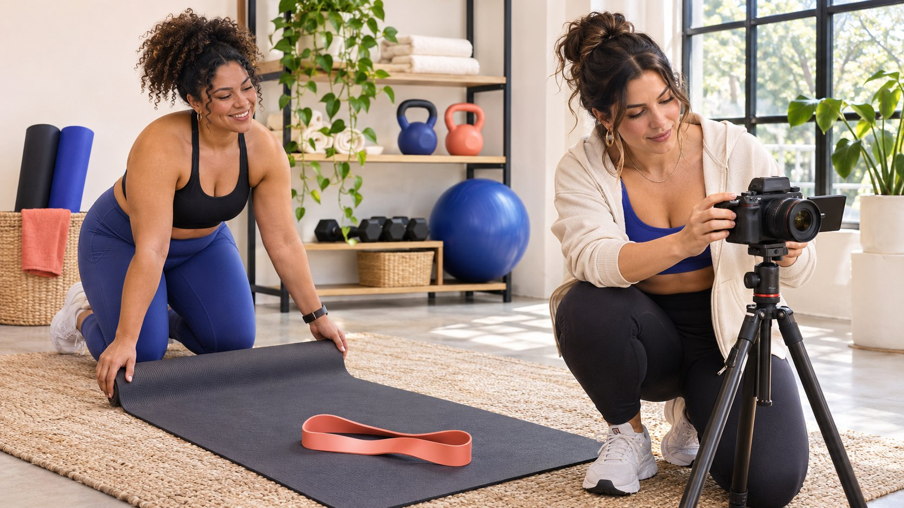
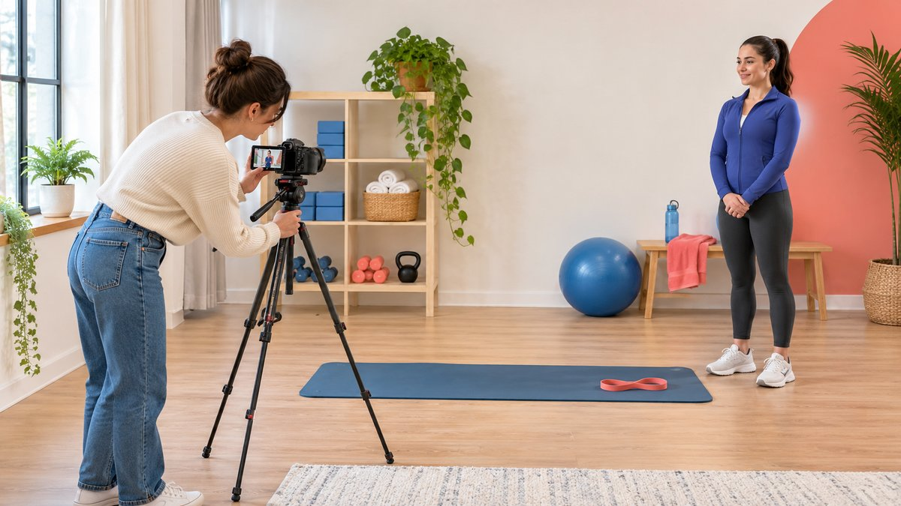

# 女性健身达人怎样分清演示与指导

状态：本地审阅稿；正式发布日期待确认。

健身达人能承担产品展示、个人体验或专业讲解等不同任务。按实际角色看作品与资格，避免以外形替代专业依据。

在达人营销中，“fitness girl”应当转成成年女性健身创作者的明确合作角色，而不是外形排行榜。品牌先说明需要展示产品细节、描述个人体验，还是承担需要相应专业能力的指导。三类工作可以由不同人员完成；好看的画面、粉丝数量和训练习惯都不自动证明专业资格。按作品、相关资质与具体陈述研究人选，再安排拍摄与审稿，才能把合作放在准确、尊重且可执行的范围内。

## 先写观众需要理解什么

假设品牌准备展示运动包。观众可能需要看清隔层、肩带或装载方式，而不是接受训练计划。先把这项解释写出来，才能判断哪类成年创作者适合，以及是否需要其他专业人员。

选人的任务不应要求某种身材证明产品效果。不同体型与表达风格可以承担相关内容；研究应看能否把约定事实讲清，以及作品中实际负责什么。不要从照片推断健康状况、私人习惯或职业身份。

[达人候选清单方法](https://www.quickkol.com/zh/blog/creator-shortlist-workflow/#answer)可以把初始描述整理成角色与作品依据。记录一两项真正相关的能力，比把所有健身内容都当作同一种工作更实用。首次联系就说明任务，也方便创作者指出自己能承担与需要额外协作的部分。

## 演示、体验和指导分别安排

产品演示回答看得见的操作与构造；个人体验描述某人在特定条件下的感受；专业指导则可能涉及具体训练判断。它们有不同依据，不能在一句“健身达人合作”里自动合并。

例如展示包内能装哪些道具，不要求创作者替每位观众安排运动。讲某次拍摄时肩带的使用体验，也不证明产品改善健康或适合所有身体状况。若任务增加专业判断，应重新确认人选、内容范围和审核方式。

把职责写清，可以让合适的讲解者与专业人员合作，而不是要求一个人因经常发布健身视频就承担全部责任。团队先确认需要哪种表达，再确定费用与制作安排；不能用报价已经确定为理由，临时塞入超出原任务的专业陈述。

## 核对与本次任务有关的资格

[NASM 的数字证书说明](https://support.nasm.org/what-is-a-digital-badge)介绍通过对应 Accredible 证书页核验已取得资格的方式。这是一个发证机构的例子，不代表本篇已经查询任何人，也不意味着所有健身资格相同或涵盖医疗职责。

如果提案确实需要专业能力，向本人取得适当公开核验路径，核对资格名称、持有人与当前可确认状态。将它与任务需要比较，而不是只保存社交主页里的缩写。无法确认的部分，应记录待核实。

资格也不能替代清楚表达与制作能力。一个人可能具备专业背景，却需要摄影或主持协作；另一个人可能适合展示产品，却不承担指导。研究的结果不是给人打总分，而是说明这次工作由哪些已确认能力支持，以及哪些角色仍要另行安排。

## 用镜头表达可见的产品细节

本页配图展示成年创作者与摄影者之间的拍摄距离，说明产品演示也需要空间、取景与角色安排。它不展示某种训练动作，更不是效果对比或专业指导。

拍摄前列出必须看清的细节，例如闭合位置、材质外观或产品在画面中的比例。让摄影者与讲解者试一次表达，判断手部是否挡住关键位置、字幕是否遮盖信息，以及场景是否让观众误解用途。

服装与机位应服务于任务，并尊重参与者同意的范围。不要为增加关注而临时要求不相关身体特写，或把普通动作裁切成效果暗示。画面评价应具体指向产品与解释；如果问题是细节没拍到，就补足相关镜头，而不是把它归咎于创作者外形。

提前确认镜头距离与产品可见性；画面不展示训练指导或效果证明。

## 个人体验不能替代健康依据

[FTC 的健康产品广告指导](https://www.ftc.gov/business-guidance/resources/health-products-compliance-guidance)在美国情境下讨论健康陈述依据，也明确涵盖达人营销。真实体验本身不足以证明产品能为购买者带来暗示的健康结果。品牌不能借创作者的真诚绕过自身陈述所需支持。

本篇不提供健康或训练建议。对一般产品合作，实用做法是把原稿中可观察细节、个人感受与广泛功效陈述分开，再由适当人员检查后者。不要让普通运动场景暗示一件产品保证改变体型或身体功能。

如果产品事实只支持某个构造说明，就按这个范围讲清。删除无依据承诺后，仍可以制作有帮助的演示；不必用更多强烈词语或更戏剧化画面补足。最终表达需要与实际证据一致，而不是只在角落放一句限定语。

## 把商业关系放进实际内容

[FTC 的代言指导问答](https://www.ftc.gov/business-guidance/resources/ftcs-endorsement-guides-what-people-are-asking)强调美国语境下诚实、不误导的代言及商业关系处理。合作的实际受众、形式和连接关系需要检查，不能因为产品出现在健身场景就自动省略。

品牌可在 Brief 中说明双方关系，给创作者保留真实表达空间，再检查最终视频、字幕与后续版本。不能一边要求“像自然分享”，一边把必要背景藏到观众不容易看到的位置。

披露与产品依据是两项工作。说明获得产品或费用，不会自动让功效陈述有依据；产品陈述准确，也不能代替需要说明的合作关系。审稿时各有负责人，避免双方都以为另一人已经检查。若后续改成广告，重新看它在新形式中是否仍清楚，而不是只沿用一个文件名。

## 按作品贡献谈制作范围

作品研究应问谁做构思、讲解、拍摄与剪辑。一个账号可能呈现团队成果，不能从视频成品默认全部由镜头前的人独立完成。合作需要相应人员时，就把协作安排放进范围。

[女性健身模特制作权利指南](https://www.quickkol.com/zh/blog/female-fitness-model-production-rights-brief/#answer)进一步讨论制作与使用边界。本篇先解决任务与专业角色：哪些镜头是产品说明，哪些表达需要适当资格，品牌提供哪些事实资料。

报价讨论可以按这些工作展开，而不是只按粉丝规模估算所有职责。若需要增加专业讲解或第二位出镜者，说明它改变的任务与资源。清楚范围也便于创作者提出更合适方案，而不必为了保留合作而接受一个无法准确承担的笼统角色。

## 把审稿意见写成可执行动作

不要用“不够有健身感”作为唯一反馈。应说明观众看不清哪个细节、哪句表达超出依据，或哪个角色尚未确认。每项意见要连接实际修改，而不是推动参与者改变身体表现。

例如运动包开口被字幕挡住，可以重新安排字幕或补合适近景；不应要求创作者增加不必要身体展示。若稿件像在提供个人指导，则请适当人员检查或把范围改回已约定演示。

保留原来体验的条件。删去一句“只说这次使用感受”，可能把有限陈述改成无条件推荐。后续短版同样需要检查意义，而不是以源文件曾通过审批为由跳过。审阅目标是让观众准确理解创作者做了什么与没有证明什么。

## 形成尊重且明确的合作提案

最终提案应说明成年创作者为何适合实际任务，哪些作品支持判断，哪些专业角色需要核验，以及产品与商业表达如何审阅。不要把搜索词、外形或关注人数当作这些问题的答案。

合适结果可能是纯产品演示，也可能是创作者与专业人员共同完成的说明。不同安排应有不同范围，不能因为同属健身内容就默认可互相替代。

围绕达人营销使用 fitness girl 这个词，应把讨论带向真实作品、明确职责和尊重的制作过程。在假设运动包项目中，可把隔层近景、装载演示与主持解释列成三项任务，并分别指派检查人。这样审阅的是约定信息是否清楚，而不是身体是否符合某种期待。品牌得到一项可以具体沟通的合作，创作者也知道自己被邀请贡献什么，而不是承担观众可能从形象中推断的全部专业能力。

## 健身合作的角色与依据

| 角色 | 应看什么 | 不能自动推定 |
| --- | --- | --- |
| 产品展示 | 相关细节与表达作品 | 专业指导资格 |
| 个人体验 | 真实经历与适用条件 | 所有人都有同样结果 |
| 专业讲解 | 相关资格、职责与审核 | 所有专业领域都被涵盖 |
| 制作协作 | 实际贡献与资源 | 一个人完成所有工作 |

编辑选人框架，不是训练、健康建议或资格认证服务。

## 联系健身达人之前

先确定任务，再研究适合的人。

- [ ] 确认成年参与者与明确角色。
- [ ] 列出观众要看清的细节。
- [ ] 区分体验与专业陈述。
- [ ] 核对相关资格及未知。
- [ ] 确认制作贡献与审稿人。
- [ ] 检查商业关系与后续版本。

## 研究日期与使用边界

资料核验于 2026 年 11 月 16 日。文中方法、表格和决策规则为编辑建议，标为假设的示例不是实际客户结果或行业基准。外部资料的适用地区与时期按各段说明。

## 从任务开始达人研究

用 QuickKOL 理解 Brief、发现相关达人并研究作品与联系路径；数据、合作条件和结果仍需核验。

[了解 QuickKOL](https://www.quickkol.com/#capabilities)

## 来源

- [NASM 的数字证书说明](https://support.nasm.org/what-is-a-digital-badge)
- [FTC 的健康产品广告指导](https://www.ftc.gov/business-guidance/resources/health-products-compliance-guidance)
- [FTC 的代言指导问答](https://www.ftc.gov/business-guidance/resources/ftcs-endorsement-guides-what-people-are-asking)
