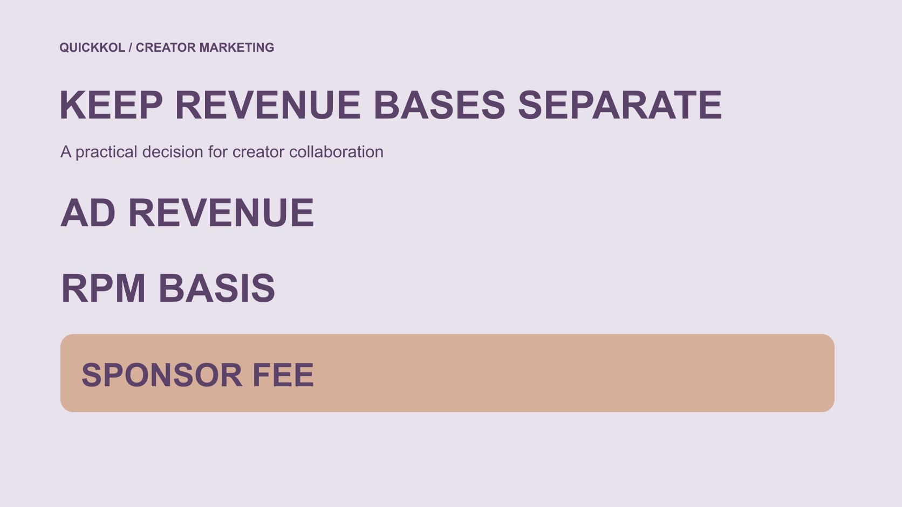
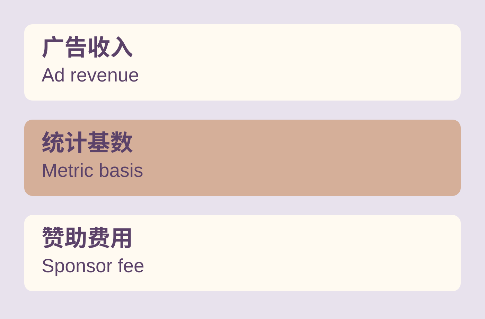

# YouTube Ad Revenue: Keep Sponsorship Economics Separate

Status: local review draft; confirm the publication date before release.

YouTube ad revenue, RPM, CPM and brand fees concern different objects and denominators. Separate those bases before discussing work and sponsorship budgets.

QuickKOL editorial graphic; not actual account metrics or a platform interface.

YouTube ad revenue is one part of platform monetization, not a creator’s entire income or the fee a brand should pay. CPM describes advertiser cost; RPM describes creator revenue per thousand views under its applicable definition. Their denominators, revenue sources and position relative to revenue sharing differ. A sponsor should discuss production, publication and use for this assignment instead of multiplying public views by an online rate to infer private earnings. Any financial record needs a source, period, content type and estimated or finalized state.

## Identify the revenue under discussion

A YouTube video can carry platform advertising, a brand recommendation and other applicable commercial arrangements. Sharing one work object does not make their payers, calculation bases or settlement conditions identical. Define the question first: understanding a platform report or purchasing creator work?

For a collaboration budget, the brand generally needs to discuss production, publication and possible material use. If the task is only content fit, there is no reason to request a complete private earnings record. The relationship between amount and assignment matters more than a precise-looking channel valuation.

The [creator income-and-cost guide](https://www.quickkol.com/blog/how-much-influencers-make-gross-net-workload/#answer) distinguishes fees received, production costs and the remainder. This article further separates platform metrics from brand procurement. It supplies no financial investment advice and does not claim a public counter explains the creator’s entire business. Keeping the question explicit also helps a creator respond proportionately: a commercial proposal can describe the requested work without becoming a disclosure of unrelated income or an argument about what strangers think the channel should already earn.

## Ad revenue is not every estimated earning

[YouTube’s ad-revenue metrics guide](https://support.google.com/youtube/answer/9314357?hl=en) distinguishes Estimated ad revenue from Estimated revenue, which includes multiple revenue types. Inspect field names in a screenshot or export instead of renaming similar-looking amounts as advertising income.

The current help page also names a YouTube Creator Partnerships exception when describing brand deals excluded from RPM. Avoid an absolute claim that every brand-related fee is always outside the metric.

Records covering the same period may concern a channel, one video or different content groups. Where sponsorship assessment needs data, request only an appropriate, task-related subset. If object and window are missing, retain that gap instead of calculating a replacement simply to complete a comparison table.

A brand can ask which revenue sources a record includes without requiring an explanation of every unit of private income. The purpose is preventing a mixed metric from entering the wrong conclusion, not inspecting personal finances. A clear name reduces confusion without establishing that a screenshot is authentic or complete. The answer might also show that the field is unnecessary for this buying decision, allowing the discussion to return to content, workload and use rather than collect sensitive information that neither side needs.

## Do not substitute RPM for CPM

Under the same YouTube metrics explanation, CPM concerns advertiser cost per ad impressions before revenue sharing. RPM concerns creator revenue after sharing and can include several platform revenue sources. Videos and Shorts also differ in the viewing basis; Shorts RPM uses engaged views.

Do not multiply CPM by every video view to obtain creator take-home income, or turn a channel’s RPM directly into a brand sponsorship quote per thousand views. Retain the original field, content type, period and denominator. A familiar abbreviation does not guarantee an identical definition across channels or systems.

This article offers no universal rate. Brand procurement and platform ad auctions are different arrangements. Even if both can be expressed per thousand, each needs an explanation of included costs, counted views and unresolved conditions. Similar mathematical formatting does not create equivalent economic meaning. A reviewer should be able to state why a particular denominator is appropriate for the question before using it in a comparison or presenting a figure as a reasonable commercial benchmark.

## Revenue shares also need their correct bases

[YouTube’s partner-earnings overview](https://support.google.com/youtube/answer/72902?hl=en) describes different module arrangements: 55% of relevant net revenue for Watch Page ads and 45% of the revenue allocated to a creator under the Shorts arrangement. These are not two percentages applied to the same total, nor a guarantee of an individual’s receipt.

A brand discussing a sponsored demonstration may not need these percentages in its quote conversation at all. They explain platform payment arrangements rather than determine labor, locations, versions or material-use fees for this assignment.

Membership in a module does not establish that someone earns enough to work free or must discount a proposal. A change in a platform arrangement also does not justify promising income from the next piece. Return to defined work and mutually understood commercial terms instead of treating a public program explanation as the person’s agreement or private settlement. The relevant distinction is between understanding the platform’s stated basis and claiming knowledge of what a specific creator actually received after all applicable conditions.

One video can relate to different payment arrangements; define metric denominators and purchased scope separately.

## Define the brand purchase separately

A sponsorship may include concept development, filming, editing, creator-account publication and other agreed uses. Different combinations require different resources. Identify the needed work before discussing a fee and options, rather than compress every task into one video.

The [creator scope-negotiation method](https://www.quickkol.com/blog/how-to-negotiate-with-influencers-offer-options/#answer) helps present alternatives. A brand might discuss production alone versus production plus publication, then confirm use conditions according to actual needs. This is not a fixed rate card or a conversion of channel size into a default price.

Suppose a desktop product explanation requires a setting and close demonstration. This is an editorial example, not a client case. Platform advertising income from an earlier video, high or low, does not establish the labor for the new assignment or the rights the brand will obtain. Compare defined proposals instead of earnings guesses detached from the task. That gives the creator a chance to explain resource differences and lets the brand make a budget choice without pretending a platform metric already prices the proposed work.

## Use explicit assumptions to understand a ratio

A simple exercise illustrates why the denominator matters. Suppose a defined group of videos has 100,000 applicable views and 300 currency units of corresponding revenue in a specified window. The ratio is three units per thousand. These invented inputs are neither a benchmark nor a forecast for any channel.

If the 300 includes multiple revenue sources, calling the result a pure advertising-income rate is incorrect. Changing to Shorts or another window requires checking the applicable definition again. Correct arithmetic cannot rescue a misidentified field.

Do not apply the exercise’s figures arbitrarily to a public channel. Where the creator has not supplied relevant records, income can remain unknown. A brand can still discuss content quality, relevant audience evidence and actual scope without first manufacturing a scientific-looking earnings estimate. The exercise is useful precisely because all inputs and assumptions are named; removing those conditions while keeping the neat numerical result would turn an explanatory example into an unsupported claim about a person.

## Do not describe an estimate as money received

The earnings overview already discussed notes that monthly estimates can change and finalized earnings are confirmed in the appropriate account record. This article neither reproduces a full payment timetable nor operates an account. Distinguish estimated, finalized and received amounts instead of calling every visible number net income.

If a commercial discussion genuinely needs an amount, retain an appropriate nonsensitive reference, currency, period and state. Public materials should not expose payment-account secrets. Brand receivables, confirmations and actual payment also need their own arrangement’s records rather than being mixed into platform settlement states.

When a record changes, explain whether the field, period or settlement progress changed. An ordinary adjustment does not prove earlier fabrication; a screenshot likewise does not establish that every condition is complete. Questions should concern the particular record rather than become unsupported judgments about the whole creator. This allows the team to correct a report without pretending either that every estimate is unreliable or that every displayed balance has already become money available to spend.

## Handle commercial labeling and reporting separately

[YouTube’s branded-content labeling guide](https://support.google.com/youtube/answer/154235?hl=en) requires the applicable paid-promotion selection for branded content, sponsorships and commercial relationships, while reminding partners of applicable requirements. Discussion of platform advertising revenue should not obscure the brand relationship in this assignment.

A sponsored piece may still need its platform advertising and other monetization understood under actual conditions. That does not automatically approve every statement, asset or later use. Platform settings, genuine experience, product support and authorization each need appropriate handling.

In reporting, retain the definition of the brand assignment rather than count all creator platform income as value produced for this sponsor. A successful video does not establish sponsorship return merely because advertising income exists alongside it. Purchased work, observed outcomes and causal interpretation should remain separate. That distinction gives the final report a clear object and prevents the commercial team from adding unrelated revenue to make the campaign appear more profitable than its evidence supports.

## Finish with scope and evidence

A final record can be direct: what the brand buys, what the quote includes, which evidence will assess it and which amounts or outcomes remain unknown. Calculating every potential platform revenue stream is not a prerequisite for an informed collaboration discussion.

If the fee is disputed, return to version, production and use options and explain which work changes with each adjustment. Avoid bargaining through an online claim about what the creator earns per thousand, or requiring guaranteed views or orders to compensate for an unsupported valuation.

YouTube advertising economics are worth understanding, but influencer procurement needs its own questions and evidence. Keep platform metrics in their appropriate context and write sponsorship scope as actual work. Both parties can then compare proposals, explain budgets and discuss outcomes honestly after delivery. A sound commercial decision can acknowledge that private platform earnings remain unknown while still making a clear, reviewable purchase of the capability the brand needs.

## Revenue bases to keep distinct

| Field or arrangement | Concerns | Cannot directly replace |
| --- | --- | --- |
| Estimated ad revenue | Relevant advertising-income record | Entire private income |
| RPM | After-share revenue rate under its applicable view basis | A sponsorship quote |
| CPM | Ad-impression cost basis | Creator receipt per video view |
| Brand fee | Agreed work, publication and use | A platform-income forecast |

An explanatory framework with no universal rate or inference of an individual creator’s income.

## Before discussing revenue

Define the question before choosing a field.

- [ ] Separate platform and brand arrangements.
- [ ] Retain field, denominator, content type and period.
- [ ] Check revenue sources and sharing basis.
- [ ] Discuss a quote against actual work and use.
- [ ] Distinguish estimated, finalized and received states.
- [ ] Do not invent missing private amounts.

## Research date and limitations

Sources reviewed November 16, 2026. Methods, tables and decision rules are editorial recommendations. Hypothetical examples are not actual client results or industry benchmarks. Source geography and periods are specified where relevant.

## Start creator research with a clear task

Use QuickKOL to interpret a brief, discover relevant creators and research their work and contact routes. Verify data, commercial terms and outcomes at their source.

[Explore QuickKOL](https://www.quickkol.com/#capabilities)

## Sources

- [YouTube’s ad-revenue metrics guide](https://support.google.com/youtube/answer/9314357?hl=en)
- [YouTube’s partner-earnings overview](https://support.google.com/youtube/answer/72902?hl=en)
- [YouTube’s branded-content labeling guide](https://support.google.com/youtube/answer/154235?hl=en)
