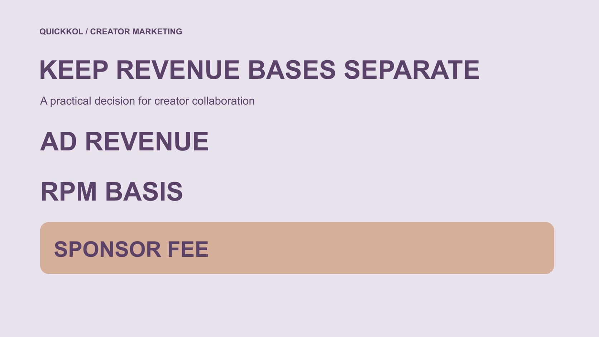
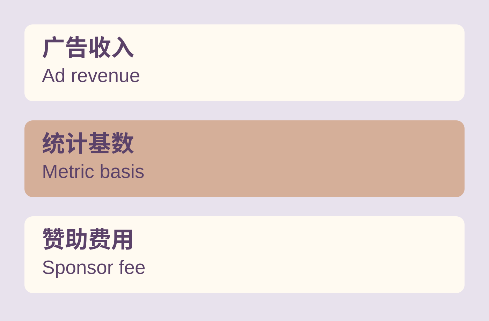

# YouTube 广告收入与赞助费

状态：本地审阅稿；正式发布日期待确认。

YouTube 广告收入、RPM、CPM 与品牌赞助费使用不同对象和分母。把这些依据分清，才能讨论真实工作与合作预算。

QuickKOL 编辑图形；不呈现真实账号指标或平台界面。

YouTube 广告收入是平台广告变现的一部分，不等于创作者全部收入，也不等于品牌合作应该支付的费用。CPM 描述广告成本，RPM 描述相应口径下每千次观看的创作者收入；分母、收入来源与分成位置不同，不能直接互换。品牌应讨论本次制作、发布及使用范围，而不是拿公开观看数乘一个网上单价推定私人收入。需要金额记录时，先确认来源、期间、内容类型和估计或最终状态。

## 先说清本次讨论哪项收入

YouTube 视频可能同时承载平台广告、品牌推荐和其他适用商业活动。它们出现在同一作品里，不代表付款方、计算依据或结算条件相同。先把当前问题写清：是在理解平台报告，还是采购一项达人工作？

如果是合作预算，品牌通常需要讨论对方要制作什么、在哪发布以及是否还要使用素材。若只需要看内容适配，就没有理由要求全部私人收入记录。金额与任务的联系，比一个看起来精确的频道估值更重要。

[达人收入与成本指南](https://www.quickkol.com/zh/blog/how-much-influencers-make-gross-net-workload/#answer)帮助区分收到的费用、制作成本和剩余金额。本篇进一步处理平台指标与品牌采购之间的边界，不提供财务投资建议，也不声称一个公开计数能解释创作者全部业务。

## 广告收入不是所有估计收益

[YouTube 的广告收入指标说明](https://support.google.com/youtube/answer/9314357?hl=en)将 Estimated ad revenue 描述为视频广告收入，而 Estimated revenue 包含多种收入类型。阅读截图或导出时，先检查字段名称，不能把相似金额统一改叫广告收入。

当前帮助页在说明 RPM 不包含一般品牌交易时，另列 YouTube Creator Partnerships 例外，因此不能写成任何品牌费用都永远不进入该指标。

同一段时间的不同记录，也可能覆盖频道、某条视频或不同内容组。需要与赞助表现讨论时，只请求与本次任务有关且适当分享的数据。来源缺少对象和窗口，就保留缺口，不为了凑齐比较表补一个推算值。

品牌可以提出“这份记录包含哪些收入来源”的问题，而不是要求对方证明每一元来自哪里。这里的目的不是检查私人财务，而是避免让混合指标进入错误结论。清楚名称能减少误解，但不自动证明某份截图真实或完整。

## RPM 与 CPM 不能直接互换

按同一份 YouTube 指标说明，CPM 以广告展示为依据、在平台分成前表达广告主成本；RPM 在分成后表达创作者收入，并可包含多种平台收入。视频与 Shorts 还存在观看口径差别，后者按 engaged views 计算 RPM。

因此，不应把 CPM 乘所有视频观看数当作创作者实得，也不能把某频道 RPM 直接当成品牌的每千次赞助报价。引用数据时保留原字段、内容类型、期间和分母，避免把同名缩写看成所有渠道都一样。

本篇不给全球统一单价。品牌采购与平台竞价是不同安排，即使都能写成每千次形式，也需要各自说明成本包括什么、观看如何计数，以及是否存在未实现条件。形式相似，不会让经济含义自动相同。

## 分成比例也需要正确依据

[YouTube 的合作伙伴收益说明](https://support.google.com/youtube/answer/72902?hl=en)列出不同模块的不同安排：观看页广告为相关净收入的 55%，Shorts 为分配给创作者的收入份额的 45%。这不是把同一个总额分别乘两个比例，也不是某个创作者的实得保证。

如果品牌只是讨论一段赞助演示，未必需要把这些比例带进报价。它们帮助理解平台付款安排，不决定本次创作的人工、场景、版本或素材使用费用。

不要根据对方参与某个模块，就断言他赚得多、可以免费工作或必须降低报价。也不要以平台分成变化为理由，替创作者承诺下一条作品的收入。实际采购要回到明确工作与双方认可的商业条件，不拿公开计划说明代替个别协议或私人结算。

同一视频可以关联不同付款安排；指标分母与采购范围需要分别定义。

## 单独定义品牌购买的工作

赞助可以包含构思、实拍、剪辑、本人账号发布与其他约定用途。不同组合需要不同资源。先确认品牌需要哪一项，再讨论费用和可选范围，不把所有任务压缩成“发一条视频”。

[达人范围协商方法](https://www.quickkol.com/zh/blog/how-to-negotiate-with-influencers-offer-options/#answer)可帮助给出不同方案。例如品牌可以讨论仅制作与制作加发布的区别，再按实际需要确认使用条件。这里不提供固定价表，也不把频道规模换算成默认费用。

假设品牌需要桌面产品解释，创作者要安排场景与近景演示，这是编辑示例，不是客户案例。某条旧视频的平台广告收入，无论高低，都不能说明这次制作需要多少劳动或品牌将取得怎样的权利。可比较的是明确定义的提案，而不是脱离任务的收入猜测。

## 用正确假设理解比率

一个简单练习可以说明分母的重要性：假设某报告定义的一组视频，在指定窗口有 100,000 次适用观看、对应收入 300 个货币单位，其比率为每千次 3 单位。这个假设不是行业基准，也不是对任何频道的预测。

如果 300 包含多种收入，就不能把结果命名为纯广告收入率。如果换成 Shorts 或换一个窗口，先重新检查适用定义。即使算术无误，字段理解错误也会使结论失去意义。

不建议给公开频道随意套用练习数字。创作者没有提供相关记录时，明确收入未知即可。品牌仍能根据作品质量、相关受众证据与实际范围讨论合作，而不必先制造一个看似科学的收入估计。

## 不要把估计金额说成已到账

前述收益说明提醒月度估计可能调整，最终收益另在适当账户记录中确认。本篇不复述完整结算时间表，也不操作任何账号。报告需要准确区分估计、最终与实际收到，不把一个可见数字统一叫净收入。

如果合作讨论确实涉及某个金额，记录适当非敏感依据、币种、期间与状态。对外资料避免暴露支付账户秘密。品牌赞助的应收、确认与实际付款，也应按自己的安排记录，不混进平台收益状态。

记录发生变化时，说明是字段更新、期间变化还是实际结算进展。正常调整不自动证明此前有人造假；同样，界面截图也不保证所有条件已经完成。问题应指向具体记录，不成为对整位创作者的无根据评价。

## 商业标识与收入报告分别处理

[YouTube 的商业内容标识说明](https://support.google.com/youtube/answer/154235?hl=en)要求相关品牌内容、赞助或商业关系使用适当的付费推广选择，并提醒合作双方仍需理解适用要求。平台广告收入讨论不应掩盖本次品牌关系。

赞助视频可能仍需按实际条件理解平台广告和其他变现，但品牌不该因此假设所有陈述、素材与后续用途自动获准。平台设置、真实体验、产品依据和授权范围都要由合适人员处理。

报告中保留这次品牌任务的定义，不把创作者所有平台收入记为本品牌带来的价值。某个视频表现好，也不能单凭同时存在的广告收入就证明赞助投资回报。购买的工作、观察到的结果与因果解释，应在交付中分开表达。

## 以范围和依据完成合作判断

最终记录可以非常直接：品牌购买什么、报价包含什么、使用什么数据评价，以及哪些金额或结果仍未知。不需要把每个潜在平台收入都算出来，才能开始有根据的合作讨论。

如果双方不同意费用，回到版本、制作与使用选项，说明调整会改变哪项工作。避免用“网上说你每千次能赚多少”压价，也不要求创作者以保证观看或订单补偿一个没有依据的估值。

YouTube 广告收入值得理解，但达人营销采购需要自己的问题与依据。把平台指标留在正确语境，把赞助范围写成实际任务，双方才更容易比较提案、解释预算，并在合作后如实讨论成果。

## 不要混用的收入依据

| 字段或安排 | 关注 | 不能直接替代 |
| --- | --- | --- |
| Estimated ad revenue | 相应广告收入记录 | 全部私人收入 |
| RPM | 适用观看口径下的分成后收入率 | 赞助报价 |
| CPM | 广告展示成本口径 | 每次观看的创作者实得 |
| 品牌费用 | 约定工作、发布与使用 | 平台收入预测 |

说明框架；无统一行业单价，不推定具体创作者收入。

## 讨论收入前核对

先说明问题，再选择字段。

- [ ] 分开平台与品牌付款安排。
- [ ] 保留字段、分母、内容类型与期间。
- [ ] 核对收入来源与分成依据。
- [ ] 按实际制作及使用讨论报价。
- [ ] 区分估计、最终与收到状态。
- [ ] 未知私人金额不自行补算。

## 研究日期与使用边界

资料核验于 2026 年 11 月 16 日。文中方法、表格和决策规则为编辑建议，标为假设的示例不是实际客户结果或行业基准。外部资料的适用地区与时期按各段说明。

## 从任务开始达人研究

用 QuickKOL 理解 Brief、发现相关达人并研究作品与联系路径；数据、合作条件和结果仍需核验。

[了解 QuickKOL](https://www.quickkol.com/#capabilities)

## 来源

- [YouTube 的广告收入指标说明](https://support.google.com/youtube/answer/9314357?hl=en)
- [YouTube 的合作伙伴收益说明](https://support.google.com/youtube/answer/72902?hl=en)
- [YouTube 的商业内容标识说明](https://support.google.com/youtube/answer/154235?hl=en)
