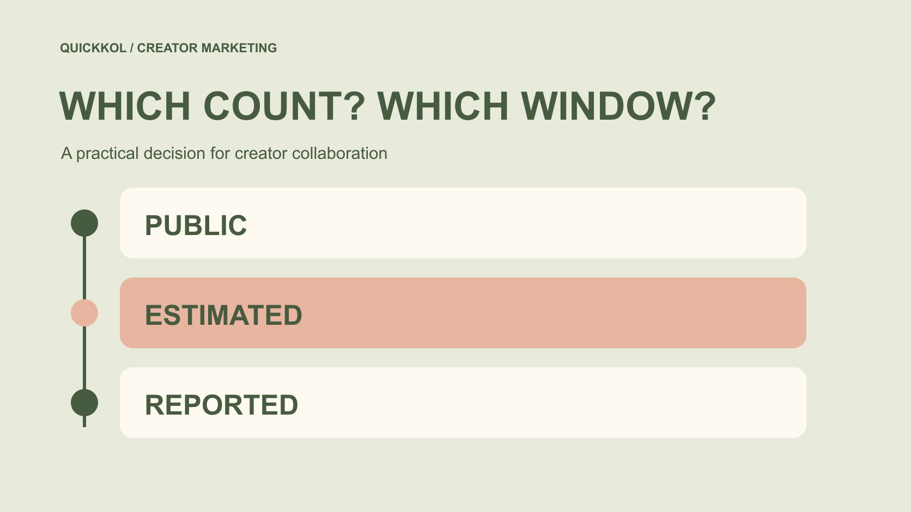
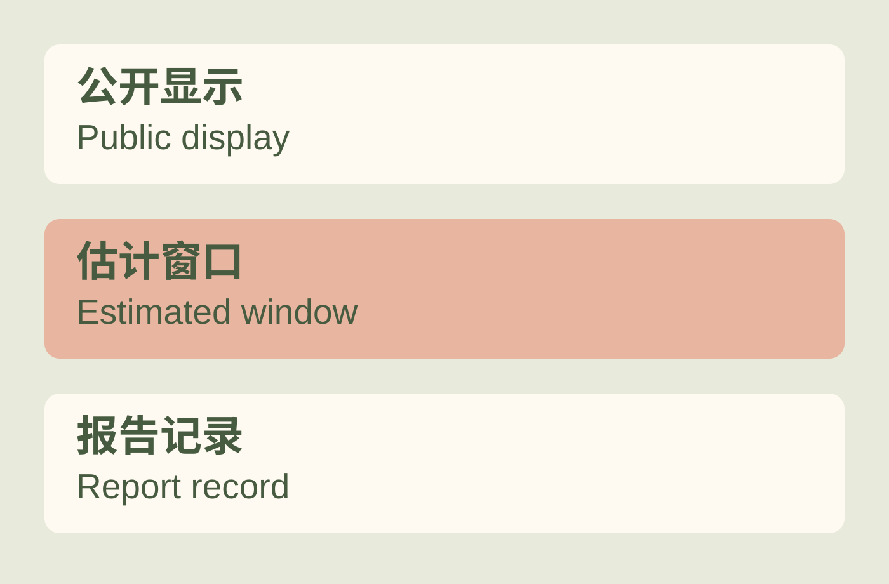

# Count Views: YouTube Reporting for Brands

Status: local review draft; confirm the publication date before release.

At campaign close, retain the meaning of public views, realtime estimates and windowed records before explaining differences or drawing conclusions.

QuickKOL editorial graphic; not actual account metrics or a platform interface.

To count views for a sponsored YouTube piece, fix the work link, field, source, reporting window and retrieval time before comparing like records. Public displays, Realtime estimates and period reports may answer different questions and update at different times. YouTube’s current guidance also identifies an August 24, 2026 cross-format counting update, so undated old definitions are unsafe. Investigate conditions before interpreting a discrepancy, retain unresolved differences and keep views distinct from unique people, sponsored orders or proof of manipulation.

## Start with one defined work object

Identify the agreed work rather than name only the channel. An original upload, an edited version, a Short and a later repost can be different objects. Links, title changes and page locations should let a reviewer find the same piece.

State the brand’s question: whether publication occurred, how many applicable views fell in a defined window or what the content suggests for improvement. The [creator-metrics decision guide](https://www.quickkol.com/blog/social-media-metrics-creator-decision-tree/#answer) connects fields with decisions. Closing a campaign does not require collecting every public counter.

If parties discuss different pieces, correct the object before the number. Comparing a whole channel’s cumulative total with one sponsored upload produces a difference without explanatory value, however large it looks. Object definition begins reconciliation; it is not an integrity judgment and does not require unrelated work or private-account access. It gives both sides a shared reference so later questions concern an identifiable record instead of several different meanings hidden behind the same informal description of the campaign video.

## Check the current view definition

[YouTube’s view-count explanation](https://support.google.com/youtube/answer/2991785?hl=en) currently says views across formats are counted when playback starts from August 24, 2026, while distinguishing relevant earnings and eligibility bases. Reviewed November 16, 2026, this article does not carry an old universal watch-duration rule forward as the current public-count definition.

Retain the field and applicable explanation, especially when reporting crosses a definition change. More public views do not automatically mean everyone finished, understood the product or satisfied a monetization condition. Different questions need appropriate fields.

This article determines no individual playback’s acceptance and supplies no inflation method. The platform handles counting. The team’s task is interpreting the record it can actually see and avoiding an unverified online rule in campaign acceptance conditions. That distinction matters when a familiar number appears to change meaning over time: a report should explain the relevant basis rather than present historical and current figures as directly comparable simply because both columns are called views.

## Record both reporting window and retrieval time

“As of today” is not the same window as this week. A public cumulative display, a selected report period and the time a screenshot was saved need separate names. Time zones and the actual publication moment can affect boundaries; preserve the original record instead of assuming them.

Screenshots taken at different times do not support an immediate claim that somebody underreported the difference. Reading at the same moment does not guarantee equivalent periods either. Put these conditions in one working record before identifying any comparable portion.

There is no need to make every number equal each day. Agree a reasonable recording point for closeout and a route for later correction. That point is a working arrangement, not a platform guarantee that data will never change afterward. When new material arrives, identify the replaced record and reason instead of deleting the earlier object without explanation. This gives the final report a traceable basis while avoiding the false precision of a total whose cutoff nobody can reconstruct.

## Give realtime estimates their proper role

[YouTube’s channel-overview guide](https://support.google.com/youtube/answer/9314414?hl=en) describes recent Realtime performance and comparisons for 60 minutes and 48 hours. That supports early observation, not substitution for the final cumulative total of any closeout window. The counting help also warns that realtime estimates may differ from the watch page.

Ask which report was supplied before quoting it. A realtime record can describe recent activity without becoming all historical finalized views by adding chart columns. Retain any content-format filter too.

If the brand needs lead to feedback, separate an initial observation from the closeout record. Operations can discuss newly published work without labeling the early estimate a final result. Explicit purpose is more practical than demanding one screenshot prove every period. It also prevents a report from switching between realtime and cumulative fields whenever one happens to produce a larger number. A consistent record choice should follow the question and agreed window, not the desire for the most flattering total available at the moment.

Align object, field and window before interpreting numerical differences.

## Do not rename views as people

[YouTube’s unique-viewer explanation](https://support.google.com/youtube/answer/7577916?hl=en) describes an estimated audience for a period and accounts for matters such as devices and repeat viewing. It is different from public views and is not an exact personal-identity list verified by this article.

If the brand needs an estimate of distinct viewers, request the appropriate field and window instead of renaming plays. Unique viewers across separate videos should not simply be added because one person may watch several pieces.

Where that field is unavailable, report views and leave people unknown. This does not erase completed work; it keeps the conclusion accurate. Nor does a difference between total views and estimated people prove cheating. Repeats and estimation need their own definitions. A report can preserve the useful viewing record while declining a larger claim about audience size, rather than treating every limitation as a reason either to reject the collaboration or to invent a more impressive number for the final presentation.

## Rehearse reconciliation with a hypothetical difference

Suppose a public page shows 12,000 views on Tuesday, a creator supplies a report of 9,000 for the preceding week and another chart concerns the latest 48-hour estimate. These are not client figures. Shared video identity does not make different periods contradictory.

Record each period, retrieval time and field, then request the same-window record actually needed. If it is unavailable, the finding is that the material cannot yet be compared directly. Do not invent a number between them or select the largest value as performance.

If conditions align and a difference remains, retain the unresolved part and ask a suitable follow-up. The exercise does not promise every difference can disappear. Successful reconciliation identifies which records support the conclusion and which do not, rather than forcing every source to display one number. This lets the team close a defined part of the report while leaving a specific question open, instead of delaying every unrelated decision until an impossible appearance of total numerical agreement has been achieved.

## Write a specific reconciliation state

Use states such as object matches and window unconfirmed, same-window fields aligned, or unexplained difference remains. These describe records rather than assign a creator an honesty score. Correct an identified citation error and its affected conclusion without expanding it into a judgment of every historical result.

The platform can confirm and adjust engagement, and its public help describes temporarily slowed or changed counts. A freeze, decline or screenshot difference is not automatic evidence of inflation. Equally, normal adjustment mechanisms do not justify ignoring a concrete problem.

Assign an object and owner to the next action: supplying an original window, explaining a filter or updating the reported field. Keep unanswered questions explicit. This helps brand and creator correct a record together instead of debating an undefined correct view count. It also distinguishes a clerical correction from a substantive unresolved concern, allowing each to receive the attention it needs without treating every discrepancy as either trivial or conclusive proof of misconduct.

## Choose a separate comparison for interpretation

Count reconciliation asks whether records share a basis; it does not automatically explain a performance change. For content learning, the [comparable YouTube content-group method](https://www.quickkol.com/blog/youtube-analytics-sponsored-content-cohorts/#answer) selects references by relevant format and assignment rather than an arbitrary historical maximum.

Retain appropriate context such as product, publication timing, promotion and structure. These may support an explanation without co-occurrence proving causation. A reconciliation table should not impersonate a complete attribution analysis.

Orders or qualified inquiries need corresponding business records. Views can be useful observations without substituting for every commercial outcome. Reconcile first, then interpret against an explicit question. That avoids using an attractive total to conceal the assignment while also avoiding rejection of completed content merely because sales data is absent. Both the creator’s work and the brand’s results can be discussed accurately when their evidence remains distinct, rather than allowing one count to become a universal measure of production quality, audience comprehension and business return.

## Hand over a reviewable closeout record

Retain work, field, source, period, retrieval time, applicable definition and unresolved differences. The record need not be elaborate. Another reviewer should find the same object and understand which comparisons hold and which require confirmation.

When updating, state the affected record and conclusion instead of silently replacing an old value with another basis. Do not mark unperformed verification as passed or unavailable private data as verified. Publication can be confirmed while a viewing interpretation remains open. Keep the underlying reference available to an appropriate reviewer rather than retain only an untraceable summary chart.

Counting views helps influencer marketing when brand and creator can discuss work from the same understandable fact. Preserve definitions, windows and unknowns so the number has a defensible purpose rather than become decorative certainty. The final deliverable should make a next decision easier: accept an identified record, request a bounded clarification or limit a conclusion. It does not need to eliminate every difference in the platform’s reporting system to be an honest and useful closeout.

## Order for reconciling viewing records

| Check | Retain | Avoid |
| --- | --- | --- |
| Work object | Actual link and version | Channel totals replacing one piece |
| Field | Original name and applicable definition | Renaming views as people |
| Time | Reporting window and retrieval time | Directly comparing different periods |
| Difference | Explained and open portions | Treating a mismatch as proof of fabrication |

A closeout method, not a complete platform audit, realtime counter or one-signal fraud detector.

## Viewing checks before closeout

Explain the current record in order.

- [ ] Fix the work and version.
- [ ] Confirm original field and current definition.
- [ ] Record period and retrieval time separately.
- [ ] Name realtime estimates separately.
- [ ] Separate views, unique people and orders.
- [ ] Retain unresolved differences and the next action.

## Research date and limitations

Sources reviewed November 16, 2026. Methods, tables and decision rules are editorial recommendations. Hypothetical examples are not actual client results or industry benchmarks. Source geography and periods are specified where relevant.

## Start creator research with a clear task

Use QuickKOL to interpret a brief, discover relevant creators and research their work and contact routes. Verify data, commercial terms and outcomes at their source.

[Explore QuickKOL](https://www.quickkol.com/#capabilities)

## Sources

- [YouTube’s view-count explanation](https://support.google.com/youtube/answer/2991785?hl=en)
- [YouTube’s channel-overview guide](https://support.google.com/youtube/answer/9314414?hl=en)
- [YouTube’s unique-viewer explanation](https://support.google.com/youtube/answer/7577916?hl=en)
