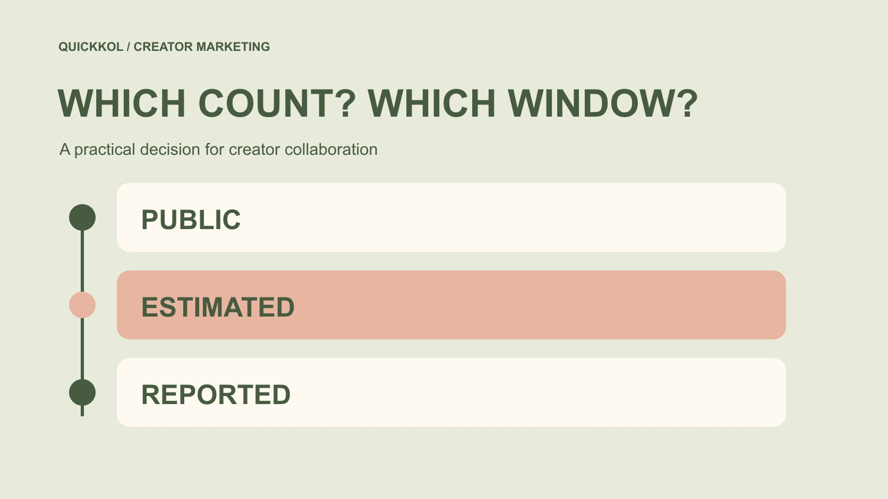
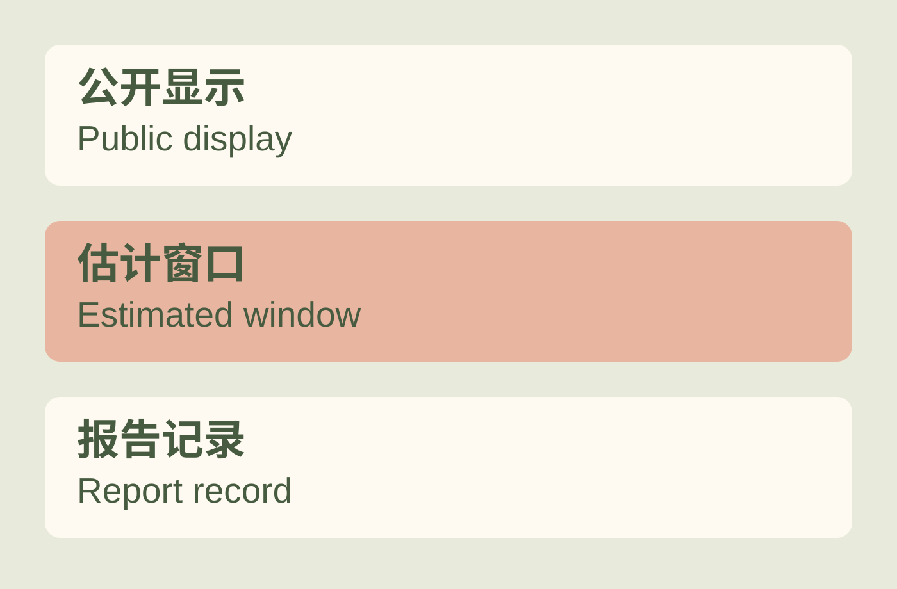

# 核对达人视频观看数

状态：本地审阅稿；正式发布日期待确认。

结项时保留公开观看、实时估计和指定窗口记录的原始含义，再决定差异如何说明，避免把不一致直接归为造假。

QuickKOL 编辑图形；不呈现真实账号指标或平台界面。

核对达人 YouTube 观看数，先固定作品链接、字段、来源、窗口与检索时间，再比较同类记录。公开观看数、Realtime 估计和指定期间报表不一定回答同一问题，也不一定同时更新。YouTube 当前说明还列出 2026 年 8 月 24 日跨格式观看起算更新，因此不能沿用没有日期的旧口径。差异应先检查定义与条件，保留尚未解释的部分；观看不是独立人数，也不能直接证明赞助订单或造假。

## 从一条明确作品开始

先确认本次约定的作品，而不是只写频道名称。原始视频、剪辑版、Shorts 与后续转载，可能是不同对象。链接、标题变化和页面位置也应能让审阅者找到同一条内容。

写下品牌需要回答的问题：是否完成发布、指定窗口有多少相应观看，还是内容值得怎样改进。[达人指标决策指南](https://www.quickkol.com/zh/blog/social-media-metrics-creator-decision-tree/#answer)帮助把字段对应到实际决定。结项不必把所有公开计数都收集一遍。

若双方谈的是不同作品，先纠正对象，再处理数值。把完整频道累计数与一条赞助视频比较，得到的差异即使巨大也没有解释价值。定义对象是后续核对的起点，不是对任何一方的诚信判断，也不要求查看创作者无关内容或私人账户。

## 先核对当前观看定义

[YouTube 的观看计数说明](https://support.google.com/youtube/answer/2991785?hl=en)目前写明，自 2026 年 8 月 24 日起，各格式在视频开始播放时计入观看，并区分相关收益与资格依据。本稿核验于 2026 年 11 月 16 日，不把旧的统一观看秒数规则继续当作当前公共计数定义。

品牌需要保留所用字段与当时说明，尤其当报告跨越口径变化。公共观看增加，不自动意味着所有人看完、理解了产品，或符合某项收益资格。问题不同，就需要对应字段。

本文不判断具体播放是否被平台接受，也不提供刷量方法。计数规则由平台处理；团队能做的是正确解释自己看到的记录，并避免把某个未经核实的网上经验复制进合作验收条件。

## 记录窗口与观察时间

“截至今天”与“本周”不是同一窗口。公开页面的累计值、报告选择期间，以及保存截图的时间，需要各自名称。时区与作品实际发布时间也可能影响边界，先保留原记录，不自行假定。

两个截图取于不同时间，不能用差额直接说明某个团队漏报；同一时间读取，也不保证数据窗口一致。核对时先把这些条件摆到同一张工作表中，再判断是否有可比较部分。

不必每天追求所有数字完全相等。结项可以约定合理记录时点，并保留后续修正路径。这个时点是双方工作安排，不是平台保证数据从此不再变化。若出现新资料，说明哪一项记录被替代以及为什么，比删除旧记录而不留解释更清楚。

## 把实时估计放在适当位置

[YouTube 的频道概览说明](https://support.google.com/youtube/answer/9314414?hl=en)介绍 Realtime 的近期表现与 60 分钟、48 小时比较。它适合早期观察，不应被直接当成任何结项窗口的最终累计。观看计数帮助也提醒实时估计可能不同于观看页。

因此，先问对方提供的是什么报告，再决定如何引用。实时记录可以说明某段近期活动，但不能靠把图上柱状值相加，就声称获得全部历史最终观看。不同格式筛选也需保留。

如果品牌需要及时反馈，可以把初步观察与结项记录分开。这样运营能够讨论刚发布内容，而不把早期估计写成最终成果。资料用途清楚，比要求创作者用一个无法满足的截图证明所有窗口更实际。

先对齐对象、字段与窗口，再解释数字差异。

## 不把观看总数改叫人数

[YouTube 的独立观众说明](https://support.google.com/youtube/answer/7577916?hl=en)把 Unique viewers 描述为指定期间的估计观众规模，并解释跨设备、重复观看等处理。它与公开观看不是同一对象，也不是本篇验证过的精确个人身份清单。

如果品牌想知道大致接触了多少独立观众，应请求适当字段与窗口，而不是把播放次数换个标题。不同视频的独立观众也不适合直接相加，因为同一人可能看多条内容。

没有相关字段时，就报告观看并说明人数未知。这样不会削弱已完成的工作，只是让结论保持准确。也不应从总量与人数差别推断有人作弊；重复观看与估计处理，本就需要按不同定义理解。

## 用假设差异练习核对

假设同一视频公开页在周二显示 12,000 次，创作者提供的上周报告为 9,000 次，另一张图是最近 48 小时估计。这不是实际客户数据。三个值不能先被叫作互相矛盾，因为对象相同而窗口不同。

团队先记录各自期间、检索时间与字段，再请求真正需要的同窗口记录。无法拿到时，结论是当前资料不能直接比较，不是补出一个中间数，也不是选择最大值作为成绩。

如果条件已对齐而仍有差异，可以保留未解释部分并继续问适当问题。练习不承诺所有差异都能完全消除。核对的成功，在于知道哪些记录能支持结论、哪些还不能，而不是强迫所有来源显示同一个数字。

## 把核对结果写成具体状态

可以使用“对象一致，窗口待确认”“同窗口字段已对齐”“仍有未解释差异”等清楚状态。它们说明资料关系，不给创作者打诚信分数。若发现引用错误，修正对应记录与结论，不扩大成对所有历史表现的评价。

平台可能确认与调整互动计数，公开帮助也说明计数可能暂缓或改变。不要把一次冻结、下降或截图差别自动当作刷量证据；同样，不应因为存在正常调整机制就忽略实际问题。

下一步应有对象与负责人：补充原始窗口、解释筛选条件，或更新报告字段。不能回答的问题继续标明。这样的交付能帮助品牌和达人共同纠正记录，而不是让双方围绕一个没有定义的“正确播放量”争论。

## 解释表现时另选合理比较

观看核对解决记录是否在同一口径，不能自动解释为什么表现变化。要学习内容，可采用 [YouTube 可比内容组方法](https://www.quickkol.com/zh/blog/youtube-analytics-sponsored-content-cohorts/#answer)，按相关格式与任务选择参照，而不是随意挑一个历史最高值。

品牌产品、发布时间、投放与内容结构等背景，需要适当记录。它们可能帮助提出解释，但同时发生不等于已经证实原因。不要让一张核对表承担完整归因分析。

若本次还涉及订单或合格咨询，应另用相应业务记录。观看可以是有用的观察，却不是所有商业成果的替身。先核对、再按明确问题解释，能避免用漂亮总量掩盖实际任务，也能避免因为没有销售数据就否认内容已经交付。

## 交接可复核的结项记录

结项保留作品、字段、来源、期间、检索时间、适用定义和未解决差异。记录无需复杂；另一位审阅者应能找到同一对象，知道哪些比较已成立，哪些仍要确认。

后续更新说明影响哪条记录和结论，不悄悄把原值替成另一种口径。没有执行的核验，不写成通过；没有取得的私人数据，不写成已验证。可以明确完成发布核对，同时保留观看解释的问题。原始记录需要让适当负责人能够找到，而非只留一张无法追溯的汇总图。

Count views 对达人营销的价值，是让品牌与创作者基于同一个可理解事实讨论工作。把口径、窗口和未知留下来，数字才有可靠用途，而不是变成要求双方相信的装饰。

## 观看记录的核对顺序

| 检查 | 保留 | 避免 |
| --- | --- | --- |
| 作品 | 实际链接与版本 | 频道累计代替单条作品 |
| 字段 | 原始名称与适用定义 | 观看改叫人数 |
| 时间 | 报告窗口与检索时间 | 不同期间直接比较 |
| 差异 | 已解释与待确认部分 | 不一致即认定造假 |

结项核对方法，不是平台完整审计、实时计数器或单一欺诈检测。

## 结项前的观看核对

按顺序解释当前记录。

- [ ] 固定作品与版本。
- [ ] 确认原始字段和当前定义。
- [ ] 分别记录期间与读取时刻。
- [ ] 把实时估计单独命名。
- [ ] 区分观看、独立人数与订单。
- [ ] 保留未解释差异与下一步。

## 研究日期与使用边界

资料核验于 2026 年 11 月 16 日。文中方法、表格和决策规则为编辑建议，标为假设的示例不是实际客户结果或行业基准。外部资料的适用地区与时期按各段说明。

## 从任务开始达人研究

用 QuickKOL 理解 Brief、发现相关达人并研究作品与联系路径；数据、合作条件和结果仍需核验。

[了解 QuickKOL](https://www.quickkol.com/#capabilities)

## 来源

- [YouTube 的观看计数说明](https://support.google.com/youtube/answer/2991785?hl=en)
- [YouTube 的频道概览说明](https://support.google.com/youtube/answer/9314414?hl=en)
- [YouTube 的独立观众说明](https://support.google.com/youtube/answer/7577916?hl=en)
