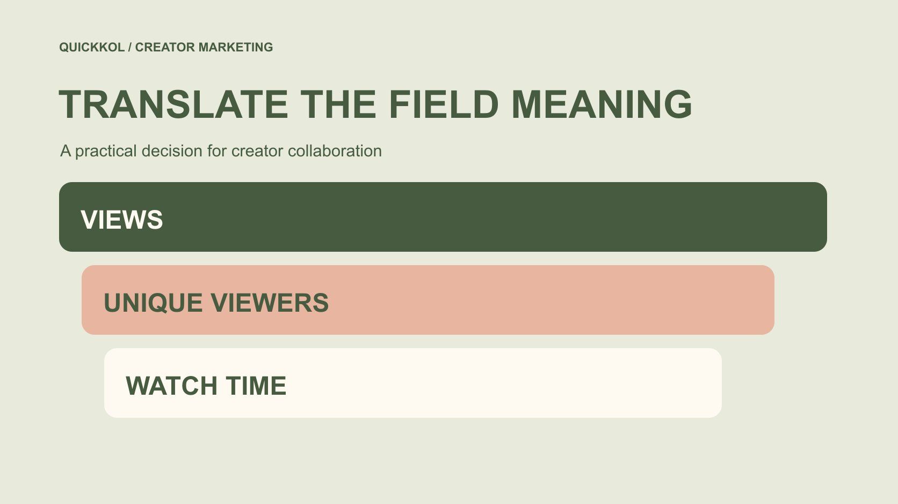
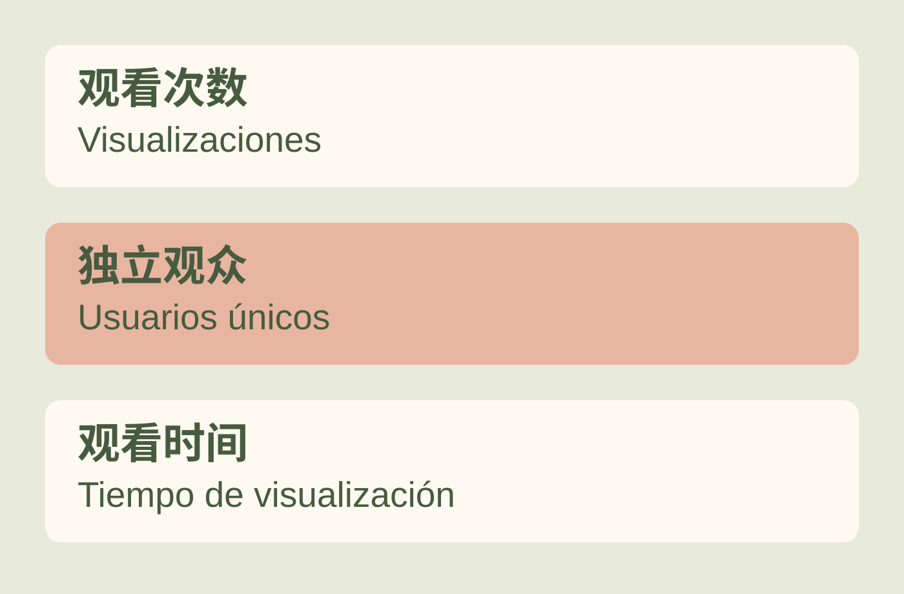

# Views en YouTube: Align a Multilingual Sponsor Report

Status: local review draft; confirm the publication date before release.

Translate a Spanish YouTube sponsor report by retaining the field’s object, unit and period, rather than replacing words while changing the measure.

QuickKOL editorial graphic; not actual account metrics or a platform interface.

“Views en YouTube” generally concerns YouTube viewing data. In Spanish help, visualizaciones refers to views, usuarios únicos to estimated unique viewers and tiempo de visualización to watch time. These are not synonyms. A multilingual creator report should retain the original field, source, content object, period and unit before adding an English or Chinese explanation. Translation must not turn views into people or accumulated time into average duration, or remove estimation, counting updates and unavailable-data limits.

## Identify the record being translated

A Spanish keyword does not mean the brand needs a generic follower-growth tutorial. The real task may be a Chinese team receiving a Spanish creator report, or an agency handing the same collaboration result to an English-speaking client. Identify the source object before deciding which words need explanation.

Retain the page, screenshot or export source and whether it concerns a channel, video, Short, livestream or another object. A familiar-looking number can have a different period or filter. Translators need not invent missing context; they can return a specific question to the supplier.

The [creator-metrics decision guide](https://www.quickkol.com/blog/social-media-metrics-creator-decision-tree/#answer) helps identify the decision the report supports. Acceptance, content learning and business outcomes have different needs. A field should not replace the needed measure merely because its label is easier to translate. Accurate translation starts with the question rather than completion of an attractive glossary. It keeps the work connected to a real creator collaboration and prevents a language handoff from silently becoming a new analysis with different objects and claims.

## Keep visualizaciones as views

[YouTube’s Spanish overview guide](https://support.google.com/youtube/answer/9314414?hl=es) uses Visualizaciones for the relevant view count and separates it from watch time, subscriptions and other fields. Explain it as views in English or viewing count in Chinese while retaining the report source and content type.

Do not rewrite it as how many people watched unless another people-based field is actually under discussion. Replays, different objects and counting conditions prevent a count from becoming a distinct audience automatically. A small simplification in ordinary language can create a substantially larger claim for the brand reader.

Add a short explanation at first use, then remain consistent. Each row need not repeat a long definition, but rotating among impressions, reach and people to avoid repetitive wording is inappropriate. Terminological consistency matters more than copy variety when different words can represent different events. This also gives a designer clear labels for a chart: visual elegance should not be achieved by shortening the label until it loses the distinction the reader needs to interpret the number correctly.

## Retain estimation in usuarios únicos

[YouTube’s Spanish unique-viewer guide](https://support.google.com/youtube/answer/7577916?hl=es) describes usuarios únicos as an estimated audience over a given period. Retain estimated unique viewers in English and the equivalent estimation qualifier in Chinese, rather than exact identified people or all followers.

It also explains that someone watching several videos can appear in each video’s field while being combined at channel level. Adding individual-video unique audiences does not automatically produce a deduplicated audience for the whole collaboration.

Do not remove estimated for brevity. Without the field, do not invent people from total views; a period-based field is not all historical audience. This article accessed no real account and validated no estimation model. It preserves concepts and limits from public guidance so the brand understands the question being answered. A clear qualification is part of the meaning rather than optional small print, and should survive the handoff into slides, emails and any later summary that cites the translated report.

## Keep the unit of watch time

Tiempo de visualización refers to watch time, and the help explicitly labels horas, meaning hours. It is different from average view duration and from the creator’s broadcast airtime. Retain both unit and actual window in translation.

If a worksheet needs minutes, make the conversion explicit and retain the source value. A hypothetical 60 hours equals 3,600 minutes. This is a unit exercise, not a client result or an assertion that each viewer watched for 60 hours.

Do not divide accumulated time by a mismatched public count and call the result the official average duration. The original average field can have its own applicable denominator. Request it where needed instead of inventing a plausible answer. Correct units are necessary alongside correct objects and calculation bases. A translated column should tell the reader which quantity it preserves, rather than use the broad word engagement to hide whether the source concerned time, counts or an average of a particular viewing group.

Retain object and unit when translating; these three fields are not substitutes.

## Keep dates with counting changes

[YouTube’s Spanish counting guide](https://support.google.com/youtube/answer/2991785?hl=es) also identifies the August 24, 2026 cross-format view-count update. Reviewed November 16, 2026, this article does not apply an old universal seconds threshold to the current public-view explanation.

Where a historical report used another definition, retain its basis and period. A shared language does not make cross-period measures comparable, while different languages do not necessarily make them different. Examine the actual field and conditions rather than the shape of its name alone.

Advertising, earnings and eligibility material may concern another viewing object too. A common translation error is stripping qualifications until only a generic word for views remains. A brand can request brevity without requesting a change in the underlying factual relationship. Keep a dated definition note when needed so a later reviewer understands why the present mapping was chosen and which part should be revisited if platform guidance or the report’s actual field changes.

## Translate period and filters with the field

A visualizaciones column still needs its work object, period and filters. Turning the past 48 hours into total views changes meaning even if the dictionary translation is flawless.

Retain original time wording, relevant time zone and retrieval time. Where they were not supplied, name the gap. Videos, Shorts, live, paid and other applicable scopes should not be mixed automatically during the language handoff.

The [sponsored view-count reconciliation guide](https://www.quickkol.com/blog/youtube-sponsored-view-count-reconciliation/#answer) addresses comparisons across sources and windows. Translators can use the same object record instead of changing screenshots while translating. If new material is needed, identify the new and old versions and the reason, so the report owner knows which value entered the conclusion. They should not receive a number whose source has changed invisibly. This preserves a useful boundary between language work and data collection: either may legitimately change the report, but the change should remain explicit enough for another person to understand and review.

## Rehearse wording with a hypothetical report

Suppose one relevant record shows 1,200 views, 800 estimated unique viewers and 60 hours of watch time, with conditions assumed aligned for the exercise. These are invented figures, not a benchmark or any creator’s actual performance.

Retain views, estimated unique viewers and watch time in English and equivalent separate names in Chinese. “1,200 users watched for an average of 60 hours” turns events into people, accumulated time into an average and removes estimation simultaneously.

A summary can say that the corresponding viewing and time records were observed in that window while leaving purchase and complete product understanding unproven. The aim is concise accuracy, not combining three numbers into a more persuasive story. Any additional interpretation needs its assumptions identified. A reviewer can then tell whether a disagreement is about translation, data scope or a new inference, rather than debate a sentence in which all three have been changed together without acknowledgment.

## Review the reader’s likely interpretation

Ask someone familiar with the target language and assignment to read the finished object rather than compare a glossary alone. Review title, chart unit, note and summary together. Retaining estimated in prose while a chart claims exact people is still inconsistent.

Spanish labels can remain as source terms without making the entire report a three-language collage. Explain the mapping first, then use clear language for the reader and a route back to the original record. Repeated keyword stuffing adds no value to the handoff. If another regional version uses a different label, retain that actual source wording and check its meaning rather than treat this glossary as a complete inventory of every interface.

When correcting, identify the field and affected conclusion. A language preference can be discussed as readability; a changed object, unit or window changes factual meaning. Separate those kinds of feedback to help creator and brand communicate without describing ordinary translation revision as dishonesty. It also helps the final editor prioritize a misleading chart label over a harmless stylistic difference, because the two do not create the same risk to the reader’s interpretation.

## Deliver a report that leads back to its source

The final report should retain a concise mapping, sources, objects, periods, units, versions and open questions. Not every reader needs all raw detail, but an appropriate reviewer should be able to trace the conclusion. That prevents meaning from expanding every time the report is forwarded.

Without unique-viewer or business evidence, report the available views and time with limits. Another language does not create another verified outcome, and completed translation does not establish completion of an entire data review.

Multilingual work around views en YouTube should help a brand understand what happened around creator content. Keep counts, estimated people and time in their correct places so different teams can continue discussing actual work, suitable comparisons and another collaboration. A useful translation preserves the measure’s boundaries as carefully as its words. That gives a client a comprehensible report without asking the creator to accept a stronger claim than the source ever supplied.

## Chinese and English explanations of Spanish fields

| Source label | Explanation | Retain the boundary |
| --- | --- | --- |
| Visualizaciones | Views | Events are not distinct people |
| Usuarios únicos | Estimated unique viewers | Retain period and estimation |
| Tiempo de visualización (horas) | Watch time in hours | Accumulated time is not average duration |
| Duración media de las visualizaciones | Average duration under its applicable basis | Check original field and denominator |

Explanations based on reviewed official help, not testing of every regional interface or a universal conversion dictionary.

## Before translating a creator report

Preserve meaning before polishing expression.

- [ ] Find the source record and actual object.
- [ ] Separate views, estimated people and time.
- [ ] Retain unit, period and filters.
- [ ] Check the dated counting definition.
- [ ] Do not fill missing fields with new conclusions.
- [ ] Align the finished chart and summary.

## Research date and limitations

Sources reviewed November 16, 2026. Methods, tables and decision rules are editorial recommendations. Hypothetical examples are not actual client results or industry benchmarks. Source geography and periods are specified where relevant.

## Start creator research with a clear task

Use QuickKOL to interpret a brief, discover relevant creators and research their work and contact routes. Verify data, commercial terms and outcomes at their source.

[Explore QuickKOL](https://www.quickkol.com/#capabilities)

## Sources

- [YouTube’s Spanish overview guide](https://support.google.com/youtube/answer/9314414?hl=es)
- [YouTube’s Spanish unique-viewer guide](https://support.google.com/youtube/answer/7577916?hl=es)
- [YouTube’s Spanish counting guide](https://support.google.com/youtube/answer/2991785?hl=es)
