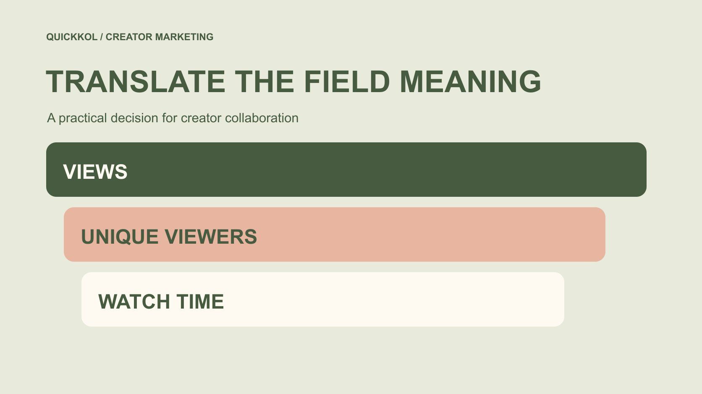
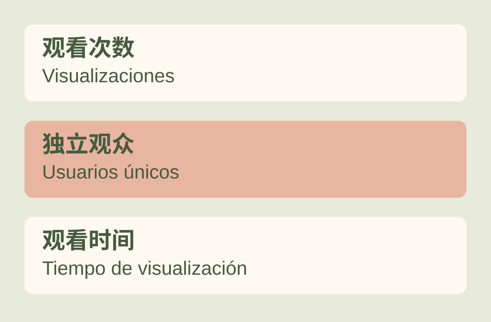

# YouTube 西语观看字段怎样对齐

状态：本地审阅稿；正式发布日期待确认。

把西语 YouTube 报表翻译成品牌能使用的记录，需要保留字段对象、单位与期间，不能只把词换成另一种语言。

QuickKOL 编辑图形；不呈现真实账号指标或平台界面。

“views en YouTube”通常是在问 YouTube 观看数据。西语帮助页中的 visualizaciones 对应观看次数，usuarios únicos 对应估计独立观众，tiempo de visualización 对应观看时间；三者不是同义词。品牌整理跨语言达人报告时，应保留原字段、来源、内容对象、期间与单位，再给出中文或英文说明。翻译不应把观看改成人数或把累计时长改成平均停留，也不能省略估计性质、计数更新和未取得资料的限制。

## 先确定是在翻译哪份记录

西语关键词并不意味着品牌需要一篇泛泛的涨粉教程。实际任务可能是中国团队收到西语创作者报表，或代理需要将同一合作结果交给英文客户。先确认原始对象，再决定哪些词需要解释。

保留页面、截图或导出来源，明确是频道、某条视频、Shorts、直播还是其他对象。一个看起来熟悉的数，可能使用不同期间与筛选。翻译人员无需猜测不存在的上下文，可以把问题交回资料提供者。

[达人指标决策指南](https://www.quickkol.com/zh/blog/social-media-metrics-creator-decision-tree/#answer)帮助确认报告要支持什么决定。交付验收、内容学习和业务成果的需求不同，不能因为一个词更容易翻译就让它代替真正需要的字段。准确翻译从理解问题开始，而不是从填满一张漂亮词汇表开始。

## 将观看次数保留为次数

[YouTube 的西语概览说明](https://support.google.com/youtube/answer/9314414?hl=es)使用 Visualizaciones 表示相关观看次数，并将其与观看时间、订阅等字段分开。转成中文时可说明为观看次数，英文用 views，但仍保留实际报告来源与内容类型。

不要写成“有多少人观看”，除非明确是在讨论另一项人数字段。重复播放、不同对象与平台计数条件，都让次数不能直接变成独立人数。普通语言省略一两个字，可能使品牌读者形成更大的结论。

团队可以在首次出现时附简短解释，后续保持一致。不必每一行重复长篇定义，也不要用曝光、触达或播放人数轮流替换来避免文字重复。报表术语的一致性，比文案上的变化更重要，因为不同词可能实际对应不同事件。

## 把独立观众的估计性质留下

[YouTube 的西语独立观众说明](https://support.google.com/youtube/answer/7577916?hl=es)将 usuarios únicos 描述为指定期间的估计观众规模。中文可用估计独立观众，英文用 estimated unique viewers，而不是精确身份人数或全部粉丝。

原文还说明，同一个人看多条视频时，在各视频中可能分别计入，但频道层面会合并。因此把每条视频独立观众相加，并不能自动获得整个合作的不重复受众。

翻译不应为了简洁删去估计。没有该字段时，不从总观看自行补出人数；字段只覆盖某个期间，也不称作所有历史受众。本篇没有读取真实账号或验证估计模型，只根据公开说明保留正确概念与限制，让品牌知道这项资料在回答什么。

## 观看时间需要保留单位

Tiempo de visualización 指观看时间，帮助页明确列出 horas，即小时。它与平均观看时长不是同一字段，也不等于直播开播时长。翻译时同时保留单位与实际窗口。

如果工作表需要分钟，可以明确换算并保留原值，例如一个假设记录的 60 小时对应 3,600 分钟。这只是单位练习，不是客户成果，也不是所有观看者平均看了 60 小时。

不要把累计时长除以一个不匹配的公开观看数，就称为官方平均观看时长。原始平均字段可能有自己的适用分母；没有资料时可以提出请求，而不自行创造一个看似合理的答案。单位正确是必要条件，字段对象与计算依据也要正确。

翻译标签时保留对象与单位；这三个字段不互相替代。

## 给口径变化保留日期

[YouTube 的西语计数说明](https://support.google.com/youtube/answer/2991785?hl=es)同样列出 2026 年 8 月 24 日跨格式观看计数更新。本稿在 2026 年 11 月 16 日核验，不把旧资料中的统一秒数条件继续用于当前公共观看解释。

如果历史报告使用不同说明，保留当时口径与时期。语言相同不代表跨期指标一定可直接比较，语言不同也不代表指标一定不同；需要实际看字段与条件，而不是仅根据词形判断。

对平台广告、收益或资格资料，还要留意它们是否讨论另一种观看对象。翻译过程中最容易发生的错误，是把限定语省掉后，只剩一个通用的“观看”。品牌可以要求简洁，但不能要求简洁到改变了原来的事实关系。

## 把时期和筛选一起翻译

一列名为 visualizaciones 的记录，还需要知道是哪一条作品、什么期间与哪些筛选。将“过去 48 小时”省成“总观看”，就算词典翻译完全正确，也会改变资料含义。

核对稿中保留原始时间表达、对应时区和读取时间；如果这些信息没有提供，就明确缺失。视频、Shorts、直播、付费与其他适用范围，也不应在语言交接时自动混合。

[达人视频计数核对指南](https://www.quickkol.com/zh/blog/youtube-sponsored-view-count-reconciliation/#answer)处理不同来源与窗口的比较。翻译团队可以沿用同一对象记录，避免一边翻译一边换成新截图。需要新资料时，说明新旧版本与原因，保证报告负责人知道哪个值进入了最终结论，而不是只看到一个已经换过来源的数字。

## 用一份假设报表练习表达

假设同一相关记录显示 1,200 次观看、800 估计独立观众与 60 小时观看时间，条件暂按已对齐理解。这是练习数据，不是行业基准，也不代表任何创作者实际表现。

中文可以分别命名这三项，英文也保留 views、estimated unique viewers 与 watch time。不能写成“1,200 名用户平均看了 60 小时”，因为它同时把次数变人数、累计变平均，还丢掉估计性质。

若需要一句摘要，可以写在该窗口观察到相应观看与时间记录，并指出它不直接证明购买或全部产品理解。练习的目标是让精简表达仍然准确，不是把三个数拼成更有说服力的故事。任何额外解释，都要知道自己新增了什么假设。

## 审阅读者会怎样理解

请熟悉目标语言与项目的人读最终对象，而不只对照术语表。标题、图表单位、脚注和摘要需要一起看；正文保留估计，图表标题却写“精确人数”，仍然不一致。

西语标签可以作为来源词保留，不需要把整篇报告做成三语混排。首次说明对应关系后，按目标读者使用清楚语言，并给审阅者找到原记录的路径。不要为了 SEO 反复堆放同一关键词。其他地区版本若使用不同标签，保留实际来源用词再核对含义，不把本篇词表当成所有界面的完整清单。

需要更正时，指出被改变的字段与受影响结论。若只是语言选择不同，可以讨论可读性；若对象、单位或窗口改变，就应处理事实含义。两类意见分清，有助于创作者与品牌沟通，也不把正常翻译修订误当成数据不诚实。

## 交付一份能回到来源的报告

最终报告保留精简术语对应、来源、对象、时期、单位、版本与未决问题。不是每位读者都需要原始细节，但适当审阅者应能核对结论依据，避免转发之后词义越来越宽。

如果没有取得独立观众或业务资料，就只报告实际有的观看与时长，说明限制。不因为多了一种语言，就多出一项已经验证的成果；也不因为翻译完成，就声称完成了整套数据审核。

Views en YouTube 的跨语言工作，最终应帮助品牌理解达人内容实际发生了什么。把次数、估计人数和时间留在正确位置，才能在不同团队之间继续讨论真实作品、适当比较与下一次合作。

## 西语字段的中文与英文解释

| 原字段 | 解释 | 保留边界 |
| --- | --- | --- |
| Visualizaciones | 观看次数 | 次数不是独立人数 |
| Usuarios únicos | 估计独立观众 | 保留期间与估计性质 |
| Tiempo de visualización (horas) | 观看时间（小时） | 累计不是平均停留 |
| Duración media de las visualizaciones | 适用观看的平均时长 | 核对原字段与分母 |

按核验时官方帮助整理的解释，不是所有地区界面的逐项实测或通用转化词典。

## 翻译达人报表之前

保留含义，再整理表达。

- [ ] 找到原记录与实际对象。
- [ ] 分开观看、估计人数与时间。
- [ ] 保留单位、期间和筛选。
- [ ] 核对有日期的计数定义。
- [ ] 不把缺失字段补成新结论。
- [ ] 让最终图表与摘要表达一致。

## 研究日期与使用边界

资料核验于 2026 年 11 月 16 日。文中方法、表格和决策规则为编辑建议，标为假设的示例不是实际客户结果或行业基准。外部资料的适用地区与时期按各段说明。

## 从任务开始达人研究

用 QuickKOL 理解 Brief、发现相关达人并研究作品与联系路径；数据、合作条件和结果仍需核验。

[了解 QuickKOL](https://www.quickkol.com/#capabilities)

## 来源

- [YouTube 的西语概览说明](https://support.google.com/youtube/answer/9314414?hl=es)
- [YouTube 的西语独立观众说明](https://support.google.com/youtube/answer/7577916?hl=es)
- [YouTube 的西语计数说明](https://support.google.com/youtube/answer/2991785?hl=es)
