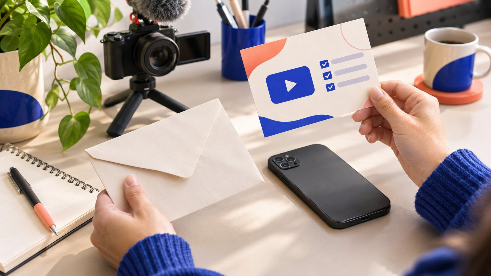
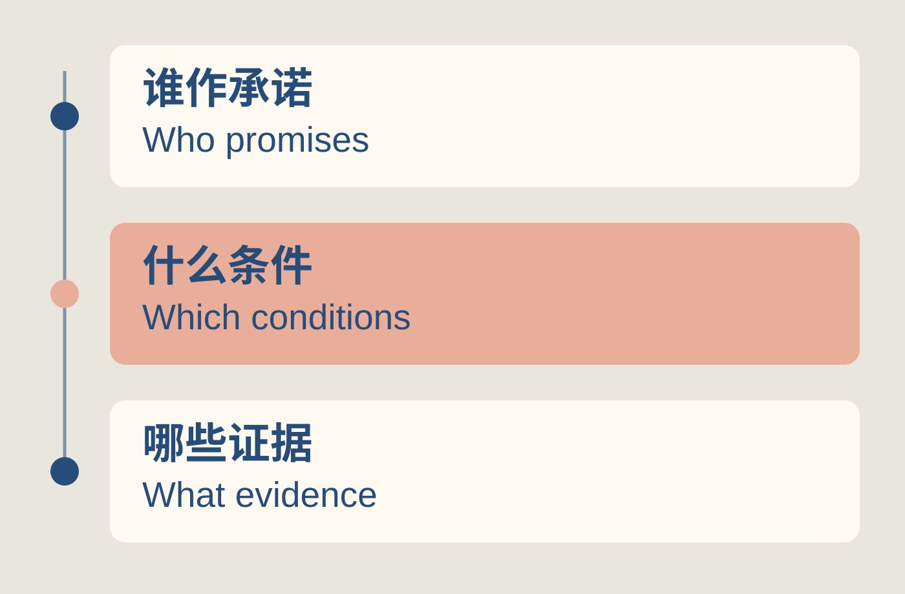

# YouTube Watch Rewards Tracker: Check the Claim

Status: local review draft; confirm the publication date before release.

For a watch-reward tracker claim, identify the promisor, recipient and conditions instead of mixing creator monetization, brand incentives and an unverified balance.

The phrase “YouTube watch rewards tracker” does not establish an official program paying viewers under that name. This review did not identify one uniquely defined YouTube program from the phrase. Separate creator monetization, a brand’s incentive and a third party’s reward claim, then examine payer, conditions, source and records. Stop payments and verify independently where supposed earnings require a deposit to withdraw. Brands should also avoid treating incentivized viewing as organic interest or completed sales.

## A name does not establish an official program

A play symbol, familiar platform name and the word tracker can describe many objects without proving an official YouTube relationship. A specific invitation needs its own source and identity checked; the keyword cannot act as certification.

A brand team may encounter such a claim in a creator proposal, supplier material or viewer activity. Retain its exact wording, promisor and an appropriate nonsensitive reference instead of recording an ambiguous name as a confirmed platform feature.

Where the material does not identify a definite program, say it remains unconfirmed. Research can continue without clicking an unknown claiming route, paying or surrendering account secrets to complete the article. The task is understanding the promise’s actual structure, not organizing a participation tutorial to prove it exists. A bounded finding can explain which questions require answers before the brand associates its name, creator or audience with an offer, while avoiding an unsupported assertion that every similarly worded service has the same operator or conduct.

## Separate creator monetization from viewer rewards

[YouTube’s partner-earnings overview](https://support.google.com/youtube/answer/72902?hl=en) describes creator revenue through advertising and other applicable features. It does not establish any third party’s watch-to-earn promise. Recipient and work object differ, even when both descriptions contain YouTube.

A creator may receive revenue for qualifying content, a platform arrangement or brand work. A viewer activity needs its own promisor and conditions. If a brand offers a product experience or another incentive, describe the arrangement accurately instead of borrowing a creator earnings explanation to imply official backing.

Ask who pays, whom they pay, for which action and after which conditions. Retain gaps where answers are unavailable. Clear routes help prevent creators being asked to forward an earnings story they cannot explain themselves and show the brand whether the proposal reasonably relates to this marketing assignment. They also stop a legitimate explanation of one revenue route from becoming apparent evidence for a different offer whose source, obligations and actual payment remain unverified.

## Separate a promise from an observed record

Possible earnings, a displayed balance, satisfaction of a condition and money actually received are different states. A rising number in a screenshot does not independently establish withdrawable funds or let a brand claim that a reward was fulfilled.

Retain the object and time examined, then ask what appropriate evidence supports its state. Do not request payment-account secrets or require someone to put in more money to prove a supplier’s balance. An unconfirmed state belongs in the project decision.

Suppose a proposal shows a simulated balance. This is an editorial example, not a real service case. It can demonstrate an interface concept without becoming a customer reward already received. Brand review should distinguish process illustration, marketing promise and observed event. That remains necessary even when a presenter sounds confident or provides a polished recording, because presentation quality cannot supply the missing evidence that the record describes an actual completed payment rather than a representation of one.

## Paying to unlock earnings is a serious warning

[FTC’s task-scam alert](https://consumer.ftc.gov/consumer-alerts/2025/08/how-spot-avoid-task-scams) describes simple online tasks, false balances and later requests for deposits, and warns against paying to get paid. This is US consumer education, not a finding against an unverified name in this article.

Where a specific invitation requires a top-up, task completion payment or money to withdraw supposed earnings, stop payments and verify through an independent trusted route. Another screenshot supplied by the sender should not be the only evidence. If account or payment information was involved, an appropriate owner should handle protection and subsequent records.

A brand should not ask a creator to endorse this unexplained arrangement or have viewers test withdrawal using real funds. Retain suitable evidence and route the issue to someone able to handle it instead of completing more tasks to demonstrate commitment. A risk signal can justify pausing without a comprehensive personal accusation. This is a proportionate action on the offer’s conditions, while facts about the operator and any broader conduct remain subject to proper verification.

Understand the promise before treating a displayed balance as a reward received.

## Incentivized engagement also needs policy review

[YouTube’s fake-engagement policy](https://support.google.com/youtube/answer/3399767?hl=en) prohibits artificial increases in views, likes and other metrics, and content that exists solely to incentivize engagement. It also warns that a hired promoter’s actions can affect a channel. Outsourcing does not remove the need for brand and creator to understand the method.

This article does not classify every rewarded research activity or promotion identically. Examine the real design, applicable platform rules and conditions. If its core is getting people to watch or interact for the number itself, stop describing it as organic distribution and request appropriate review.

No bypass, traffic-purchasing or simulated-viewer method is provided here. A brand can introduce a product through genuine creative work and appropriate promotion without asking a creator to carry an unexplained growth promise. Calling an activity rewards, research or promotion does not replace assessment of its actual actions. The policy question should be resolved before treating a supplier’s promised volume as an approved deliverable or placing a creator’s channel inside the arrangement.

## An incentive changes interpretation of the data

If viewing or responding is influenced by a reward, retain that condition in the report instead of mixing it directly with an unincentivized organic sample. Even completed activity does not establish that the same behavior would occur without the reward.

The [sponsored view-count reconciliation guide](https://www.quickkol.com/blog/youtube-sponsored-view-count-reconciliation/#answer) explains fields and windows. Here the known invitation context also matters. Naming the incentive is not a complete causal analysis, but removing it makes comparison easier to distort.

A brand can report actual work and suitable observations without renaming views as distinct people, purchase intent or completed orders. A hypothetical group watching because of an activity is not a benchmark. If the question is product comprehension, use an appropriate feedback task rather than reward-generated clicks as a substitute for all learning. That keeps the measurement connected to what the brand needs to understand and avoids making an apparently larger interaction count carry claims about independent interest that the design itself has not tested.

## Ask the supplier answerable questions

Ask for the promisor, terms source, actual actions, data source, payment conditions and access requirements. Questions should concern the arrangement without collecting unrelated participant information or requiring a risky action in exchange for an answer.

If a response repeats earnings slogans, supplies recommendation screenshots from the same source or pressures immediate entry, keep the state unconfirmed. Repeated versions of one claim are not independent evidence. Pause that part of an activity while continuing content work that does not depend on it.

Verification need not assume guilt. It helps the brand understand the promise it is preparing to make. An explanation does not establish every fact, while an absent explanation does not justify conclusions about every action of a person. Describe the current evidence and the bounded decision taken. That makes the review useful to a project owner who must decide whether to proceed, revise or seek further information, without turning an incomplete supplier conversation into an unsupported public allegation.

## Include creator and audience communication

If the claim has entered a brief or creator script, identify which passages need pausing or correction. Do not ask the creator to keep forwarding an unconfirmed reward or make unaware viewers bear testing risk.

The [educational YouTube subscription-anomaly guide](https://www.quickkol.com/blog/youtube-free-subscribers-brand-anomaly-review/#answer) distinguishes signals from established facts. Keep known circumstances, open questions and recommended actions separate here too. An unconfirmed payer is not proof that every participant was defrauded. A major unresolved condition also should not remain described as an official guarantee.

Let an authorized owner determine appropriate communication and avoid widely circulating sensitive screenshots. This article does not replace handling a particular incident. It supports a consistent sequence: protect relevant people, stop unexplained promises and update facts and next actions through trusted sources. Communication can be clear about a pause and its reason without claiming the team has completed an investigation it has not performed, or requiring a creator to defend an arrangement whose operator has yet to answer basic questions.

## Return to a genuine creator assignment

The brand may really need a product explanation, genuine experience or appropriate content feedback rather than an unverified viewing income. Redefine that task and discuss creator capability, participation conditions and evidence without first accepting a reward balance.

If an activity is genuinely planned, assess platform, rules, incentive and reporting for its real design. Another person’s success screenshot is not a guarantee. Leave an unsupported element open or remove it rather than cover an old gap with a new promise. Record who will approve a revised invitation before it is shared.

The phrase YouTube watch rewards tracker can lead to verification questions; it cannot provide the answers automatically. Influencer marketing should let brand, creator and audience understand their participation, its purpose and the facts actually confirmed. Transparent conditions and bounded conclusions provide a better basis for collaboration than a quick-earnings narrative. The review’s practical result may be a revised content assignment that serves the brand without relying on the reward claim at all.

## Objects to verify in a watch-reward claim

| Object | Need to know | Does not equal |
| --- | --- | --- |
| Promisor | Actual source and responsible party | A platform name proves affiliation |
| Amount | Promised, displayed, conditional or received | A screenshot proves receipt |
| Action | Actual participation and platform rules | Outsourcing removes review |
| Data | Incentive context and observation scope | Viewing proves organic purchase intent |

An educational verification framework, not a rewards recommendation, earnings guarantee or allegation against an unverified party.

## When encountering a reward-tracker claim

Stop unverified promises and risky actions.

- [ ] Identify who promises what to whom.
- [ ] Separate creator earnings from viewer incentives.
- [ ] Do not deposit money to withdraw supposed earnings.
- [ ] Check platform rules and the actual engagement design.
- [ ] Retain the incentive’s effect on interpretation.
- [ ] Record facts, unknowns and next actions separately.

## Research date and limitations

Sources reviewed November 16, 2026. Methods, tables and decision rules are editorial recommendations. Hypothetical examples are not actual client results or industry benchmarks. Source geography and periods are specified where relevant.

## Learn more about data and evidence boundaries

Understand the record, source and unknowns before discussing content and business outcomes.

[Read the metrics decision guide](https://www.quickkol.com/blog/social-media-metrics-creator-decision-tree/)

## Sources

- [YouTube’s partner-earnings overview](https://support.google.com/youtube/answer/72902?hl=en)
- [FTC’s task-scam alert](https://consumer.ftc.gov/consumer-alerts/2025/08/how-spot-avoid-task-scams)
- [YouTube’s fake-engagement policy](https://support.google.com/youtube/answer/3399767?hl=en)
