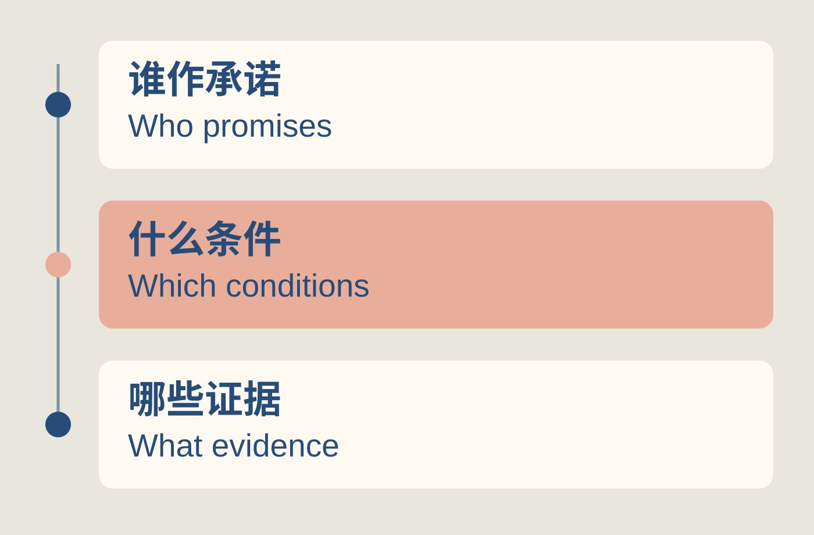

# YouTube 观看奖励承诺该怎样核验

状态：本地审阅稿；正式发布日期待确认。

遇到观看奖励追踪说法，先确认谁承诺、给谁付款和哪些条件；不要把创作者变现、品牌激励与未核实余额混成一种官方奖励。

“YouTube watch rewards tracker”不能单凭名称被认定为同名官方观看领钱计划。本篇未将它定位为唯一明确的 YouTube 官方项目。先区分创作者平台变现、品牌自己承诺的激励，以及第三方声称的观看奖励，再检查谁负责付款、条件、来源与实际记录。对于要求先充值才能提取所谓收益的说法，应停止付款并独立核实；品牌也不能把激励观看当作自然兴趣或已实现销售。

## 名称不是官方项目证明

播放符号、熟悉平台名和“tracker”字样，可以描述很多不同对象，不能证明与 YouTube 存在官方关系。收到具体邀请时，需要另核对真实来源与对象，而不是让关键词本身承担认证作用。

品牌团队可能在达人提案、供应商材料或观众活动中遇到这类说法。先保留准确原文、承诺方与适当非敏感依据，不要把一个模糊名称直接写成已确认平台功能。

若当前资料无法定位明确项目，就说明尚未确认。研究仍可以继续，但不需要点击未知领取入口、付款或交出账号秘密来完成本篇内容。核验任务是理解承诺的真实结构，不是为了证明它存在而替其组织参与教程。

## 创作者变现与观众奖励分开

[YouTube 的合作伙伴收益说明](https://support.google.com/youtube/answer/72902?hl=en)介绍创作者通过广告与其他适用功能获得收益。它不能被拿来证明任意第三方承诺的“观看就赚钱”。付款对象与工作对象不同，名称里都出现 YouTube 也不能合并。

创作者可能因合格内容、平台安排或品牌工作获得收入，而观众活动则需要自己的承诺方与条件。品牌如果提供产品体验或其他激励，应准确说明安排，不借用平台收益说明暗示官方担保。

核对时可以逐项问：谁付款、给谁、对应什么动作、何时满足什么条件？任何一项不知道，就保留空缺。清楚路线有助于防止达人被要求转发自己也无法解释的收益故事，也让品牌知道这是否与本次营销任务有合理关系。

## 把承诺与已发生记录分开

“可以赚取”、界面显示余额、达到某个条件与实际收到款项，是不同状态。截图中的上升数字不能独立证明已经存在可提取资金，也不能让品牌声称奖励已履行。

保留所看对象与时间，问当前状态有什么适当依据。不要为了核对而索取支付账户秘密；也不要求参与者继续投入金钱，以替供应商证明一个余额真实。未确认状态应进入项目判断。

假设某个提案展示模拟余额，这是编辑例子，不是真实服务案例。它可以说明演示界面如何运作，不能被写成客户已经拿到的奖励。品牌审稿时要避免把流程示意、营销承诺和实际发生事件混在同一句话里。

## 先付款解锁收益是重要风险

[FTC 的任务骗局提醒](https://consumer.ftc.gov/consumer-alerts/2025/08/how-spot-avoid-task-scams)描述了以简单线上任务、假余额和后续充值要求吸引人的模式，并提醒不要为了得到付款而先付款。该资料是美国消费者教育，本文不据此对任何未核实名称直接定罪。

如果具体邀请出现充值、补足任务或交钱才能提现等要求，应停止付款，沿独立的可信渠道核实，不接受发送者提供的另一张截图作为唯一证明。若已经涉及账号或付款信息，由适当负责人处理保护与后续记录。

品牌不应让达人为这种未解释安排背书，也不要求其观众用真实资金测试是否能取出所谓余额。保留适当证据并将问题交给能处理的人，比继续完成更多任务以证明自己认真更合理。风险信号足以支持暂停，不需要先作完整个人指控。

先理解承诺结构，不把展示余额当作已经收到的奖励。

## 激励互动还需要核对平台规则

[YouTube 的虚假互动政策](https://support.google.com/youtube/answer/3399767?hl=en)禁止人为增加观看、点赞等指标，并禁止仅以激励互动为目的的内容。它也提醒，委托推广者的行为可能影响频道。不能因为活动由供应商执行，就认为品牌与创作者无需理解方法。

这里不把每种有奖励的研究或活动都统一判定；需要看真实设计、平台要求与适用条件。若方案核心是为了数字而让人观看或互动，应先停止把它当作自然传播方案，并请合适人员审阅。

本篇不提供绕过规则、购买流量或模拟观众的做法。品牌可以用真实创意与合适推广介绍产品，不需要让达人为无法解释的增长承诺承担风险。名称叫奖励、研究或推广，都不能取代对实际动作的判断。

## 激励会改变数据的解释

如果观看或回应受到某种奖励影响，报告必须保留这种条件，不能与无相关激励的自然样本直接混用。活动即使确实发生，也不自动证明同样行为会在没有奖励时出现。

[达人视频计数核对指南](https://www.quickkol.com/zh/blog/youtube-sponsored-view-count-reconciliation/#answer)帮助理解字段与窗口；这里还要保留观众为何被邀请参与的已知背景。奖励说明不等于完整因果分析，但删除这项条件会让比较更容易失真。

品牌可以报告实际任务完成与适当观察，不把相关观看写成独立人数、购买意图或已成交。假设某组人因活动参与看视频，这不是行业基准。要理解产品解释是否清楚，可以另设计合适反馈问题，而不是用奖励获得的点击替代所有内容学习。

## 给供应商可回答的核验问题

可以要求说明承诺方、条款来源、实际动作、数据来源、付款条件和权限需求。问题围绕方案本身，不需要收集参与者无关私人信息，也不应要求执行风险动作来换取答案。

如果回复只是重复收益口号、提供来自同一来源的推荐截图或催促立即加入，就保留未确认状态。多个相同来源的转述，不会自动成为独立证据。可以暂缓这一部分活动，继续不依赖它的内容工作。

核验并非要把每个供应商先当成有罪；它要让品牌知道自己准备承诺什么。供应商能解释不等于全部事实已经验证，不能解释也不足以推出关于个人所有行为的结论。报告应准确说明当前证据与所采取的有限决定。

## 把达人与观众沟通纳入处理

如果相关承诺已经进入 Brief 或创作者文案，先明确哪些内容需要暂停或更正。不要要求达人继续转发尚未确认的奖励，也不要让不知情的观众承担测试风险。

[教育向的 YouTube 订阅异常指南](https://www.quickkol.com/zh/blog/youtube-free-subscribers-brand-anomaly-review/#answer)讨论异常与事实的区分。这里同样将已知情况、待核验问题与建议动作分开。说明不能夸大：尚未确认付款方，不应写成已证实所有参与者受骗；发现重大条件问题，也不能继续写成官方保证。

由有权负责的人确认适当沟通范围，避免把敏感截图广泛传播。文章不代替具体事件处置，但可以帮助团队保持一致：先保护相关人员，停止无法解释的承诺，再按可信来源更新事实与下一步。

## 用真实任务替代奖励故事

品牌最终需要的可能是产品解释、真实体验或适当内容反馈，而非一项无法核实的观看收益。把任务重新写清，就能讨论创作者能力、参与条件与证据，而不用先相信奖励余额。

如果确实计划活动，按真实设计核对平台、规则、激励与报告，不复制他人成功截图作为保证。没有适当依据的部分，可以留空或取消，不必用新承诺掩盖旧缺口。修改后的邀请由适当负责人确认后，再向相关人员分享。

YouTube watch rewards tracker 这组词可以触发核验问题，不能自动提供答案。达人营销应让品牌、创作者和观众理解各自参与什么、为什么参与，以及哪些事实已经确认。透明条件与有限结论，比快速赚钱的故事更适合作为合作基础。

## 观看奖励说法的核验对象

| 对象 | 需要知道 | 不等于 |
| --- | --- | --- |
| 承诺方 | 真实来源与责任方 | 出现平台名即官方 |
| 金额 | 承诺、展示、条件或收到 | 截图即实得 |
| 动作 | 实际参与与平台要求 | 供应商执行就无需核对 |
| 数据 | 激励背景与观察范围 | 观看即自然购买意图 |

教育核验框架，不是奖励计划推荐、收益保证或对未核实主体的指控。

## 看到奖励追踪承诺时

停止未经核实的承诺与风险动作。

- [ ] 先确认谁向谁承诺什么。
- [ ] 区分创作者收益与观众激励。
- [ ] 不为提取所谓收益先充值。
- [ ] 核对平台与实际互动设计。
- [ ] 保留激励对数据解释的影响。
- [ ] 事实、未知与下一步分别记录。

## 研究日期与使用边界

资料核验于 2026 年 11 月 16 日。文中方法、表格和决策规则为编辑建议，标为假设的示例不是实际客户结果或行业基准。外部资料的适用地区与时期按各段说明。

## 继续学习数据与证据边界

先理解记录对象、来源和未知，再讨论内容与业务结果。

[阅读指标决策指南](https://www.quickkol.com/zh/blog/social-media-metrics-creator-decision-tree/)

## 来源

- [YouTube 的合作伙伴收益说明](https://support.google.com/youtube/answer/72902?hl=en)
- [FTC 的任务骗局提醒](https://consumer.ftc.gov/consumer-alerts/2025/08/how-spot-avoid-task-scams)
- [YouTube 的虚假互动政策](https://support.google.com/youtube/answer/3399767?hl=en)
