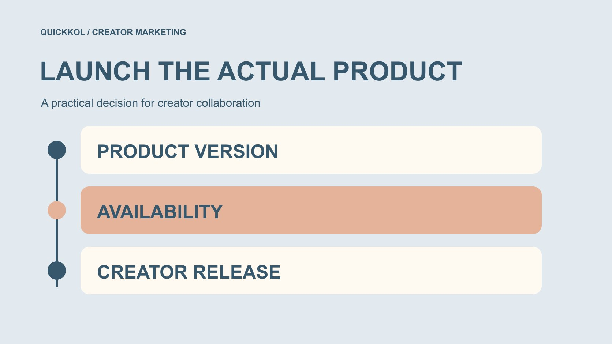
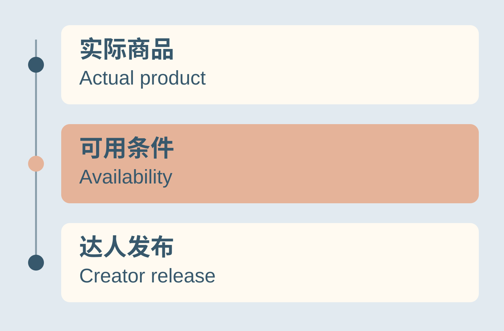

# Active Clothes Brands: Coordinate a Creator Launch

Status: local review draft; confirm the publication date before release.

Connect active-clothing creator launch content to the actual style, destination and availability, with clear product changes, release confirmation and response ownership.

QuickKOL editorial graphic; not actual account metrics or a platform interface.

Active clothes brands preparing a creator launch should connect the garment shown with the actual sale version, then confirm the destination, availability and response owner. Sending a sample, approving content and releasing it are separate decisions. When the product, price or supply arrangement changes, an owner should identify affected footage and copy rather than leave the creator guessing. A prepared launch lets viewers understand what is shown, gives creators a clear basis for what they can say and equips the brand to answer the questions their work brings.

## Map the actual route from content to product

Creator content, the brand account and a product page may have different owners. State where viewers should go and what they need to find, then check whether each step concerns the same product. An existing page is not automatically the right destination for new content.

The [activewear movement-evidence guide](https://www.quickkol.com/blog/activewear-apparel-brands-movement-evidence/#answer) helps arrange an actual demonstration, but the assignment must still correspond to the sale version. Showing a pocket holding an object while the page defaults to a style without that pocket breaks the route from explanation to purchase.

This check does not make the creator responsible for inventory or website management. The brand supplies accurate destinations and information, the creator delivers the agreed content, and both know who handles a mismatch. Clear responsibilities are more executable than asking everyone to watch one group conversation on launch day. The route also gives reviewers a practical task: follow the same next step a viewer would take and identify where the explanation stops matching the product offered.

## Identify the product version actually filmed

A prelaunch sample can differ from the finished product. The brand should identify actual differences and those affecting public statements rather than treat visual similarity as proof that every detail applies. Leave unconfirmed performance or materials as questions instead of completing them through inference.

[FTC’s textile-label guide](https://www.ftc.gov/business-guidance/resources/threading-your-way-through-labeling-requirements-under-textile-wool-acts) explains fiber, origin and responsible-business information for most covered U.S. products. Production should use verified information for the relevant product, not derive its full description from an early sample or another color version.

Record the relationship between the filmed item and final version so reviewers can identify supported shots. If a detail has changed, discuss another shot, a narrower statement or a later release. Earlier effort is not a basis for publishing inaccurate product content. The version record should be understandable without the person who originally packed the sample, allowing another release owner to make the same assessment from the actual information supplied.

## Give launch statements a factual owner

Statements such as available now, buy tomorrow or every color in stock need support from real arrangements. Give creators confirmed wording and scope, with a way to communicate changes, rather than expect them to announce a provisional plan from internal discussion.

[FTC’s advertising basics guide](https://www.ftc.gov/business-guidance/advertising-marketing/advertising-marketing-basics) emphasizes truthful, evidence-based advertising in the United States. For launch content, check the actual statement instead of treating an attractive countdown as proof of availability.

Review product facts, campaign information and personal experience separately. A creator can describe actual experience without guaranteeing stock in every region; brand approval of product information does not authorize invented personal impressions. Each statement needs an appropriate factual owner. Several people seeing a draft does not establish that someone verified it. A useful review comment identifies the fact and the confirmed replacement wording, so the creator can make a precise correction without guesswork about which part of the launch promise is still provisional.

## Make the destination show the choice explained

One page may contain several colors, sizes or bundles. Check the default selection, whether viewers can locate the version shown and whether the campaign route remains valid. A working link establishes access, not agreement between content and destination.

For example, a short video may show a blue set while the destination defaults to a single gray item. Check how viewers locate the set and whether the displayed price concerns the same combination, rather than inspect the page title alone. The page owner can correct the route or provide an accurate explanation before the creator completes the content around it.

If sales have not begun, use an information page or waiting arrangement consistent with reality rather than hide the limit behind available-to-buy wording. The brand should decide whether publication still serves the task instead of asking the creator to guess when a system will be ready.

The graphic separates product, availability and release. Completing one stage still leaves the next owner responsible for their part. This method does not promise zero mistakes; it locates specific issues where they can be handled rather than call every inconsistency a creator’s misunderstanding of the brief. A check performed close to release can also reveal a changed default selection that was correct during the first review but no longer matches the garment shown.

Content approval, product availability and release are separate decisions.

## Use an explicit release decision

Content approval may establish usable creative and facts without establishing that today is the release date. Identify who confirms timing and which version, destination and conditions their decision covers. Silence should not be interpreted as a new authorization.

Creators need to know whether the agreed time remains valid and how to proceed when it changes. If the brand changes the launch day, explain the effect and next step before discussing additional work. Cancellation or reshoot terms return to the parties’ arrangement rather than a universal rule supplied here.

Suppose samples are ready but the featured color cannot be supplied. An owner can discuss an available version, an explanation without a sales promise or a delay. Each affects the content and needs a recorded decision rather than a calendar change alone. The record should also say what happens to previously accepted copy, because a creator preparing several posts could otherwise use the new date while retaining wording that no longer describes the launch accurately.

## Check commercial relationships with release facts

[FTC’s influencer disclosure guide](https://www.ftc.gov/business-guidance/resources/disclosures-101-social-media-influencers) explains clear disclosure of relevant connections such as payment or products in the United States. A compressed launch schedule should not remove the actual relationship when copy is shortened. Check platform settings against applicable requirements too.

Confirm that personal experience corresponds to the item used. An early version can be shown with accurate conditions, but experience of an untried final product cannot be described as established. Disclosure of a partnership does not independently substantiate its product statements.

For later reuse, check that relationship and version remain accurate. Words such as today or just launched may not fit another use. Maintain time-sensitive wording with the asset’s scope rather than rely only on an old approval screenshot. The new owner should be able to see whether an asset needs a factual update before sharing it, rather than assume that earlier clearance remains suitable for every subsequent placement.

## Assign post-release product responses

Viewers may ask about size, region, supply or care. Prepare the relevant brand owner and information so creators know what they can answer from experience and what belongs with the brand. Publication does not establish round-the-clock customer service from the creator.

For an unconfirmed question, retain its wording, relevant version and handling status. Do not give an unsupported answer simply to keep comments active. When correcting an error, identify the actual change instead of removing context until viewers cannot understand it.

Repeated questions may reveal missing information in content or at the destination. The brand may need clearer facts or a more discoverable selection, rather than the question count establish campaign failure or exceptional popularity. The benefit of response work is resolving a real obstacle. Give that work a bounded follow-up period and a continuing brand route, so a creator can complete the commissioned role while viewers still have somewhere appropriate to ask later questions.

## Review the connection between content and records

Record which creator published which version, destination and period. Retain product and availability changes to interpret differences rather than rank content produced under unlike conditions as simply better or worse.

Link clicks, attributed orders and incremental sales are different questions. Report a record under its actual definition instead of assigning every sale during the campaign to a creator. Limited stock can affect action, but actual records are needed; it cannot explain every difference by assumption.

The review can recommend a specific next step, such as correcting the default color, supplying version information earlier or improving question routing. Connect each recommendation to an observed issue instead of turn one launch into a success formula for every active-clothing brand and creator. A narrow, evidenced change is easier to execute and assess at the next release than a general instruction to improve launch coordination with no owner, affected item or confirmation point.

## Hand over a launch record someone can execute

The [exercise-clothing sample handoff guide](https://www.quickkol.com/blog/exercise-clothing-creator-sample-custody/#answer) covers the physical item and condition; the launch record covers product facts, destinations and release conditions. Connect them without sending every internal discussion to a creator or a public page.

Include the final product version, actual content, destination, confirming owner, response arrangement and unresolved questions. Another owner should know the next action without needing the earliest participant to explain the status sheet.

For active clothes brands, creator launches ultimately depend on accurate expression and actual fulfillment. Attractive content matters, and so does the product and response route receiving its audience. Connecting those responsibilities turns launch preparation into meaningful influencer-marketing work. It gives a brand a basis for commissioning the next collaboration and a creator a clear understanding of the contribution they are being asked to make, with product and operational responsibilities held by the people able to confirm them.

## Three launch confirmations

| Item | Inspect | Who acts next |
| --- | --- | --- |
| Product version | Whether the sample corresponds to the sale product | Product owner explains differences |
| Destination | Route, default selection and availability | Page and supply owners respond |
| Release conditions | Version, timing and public wording | Release owner gives an explicit decision |
| Response | Questions, information and handling status | Brand and creator act within their roles |

Editorial handoff framework, not an availability guarantee, industry benchmark or individual legal advice.

## Connect four facts before release

Make sure the actual product and team can receive the content’s audience.

- [ ] Confirm filmed and sale-version correspondence.
- [ ] Give product statements a factual owner.
- [ ] Open the destination and check selections.
- [ ] Separate content approval from release confirmation.
- [ ] Retain commercial relationships and actual experience.
- [ ] Assign post-release questions and changes.

## Research date and limitations

Sources reviewed November 17, 2026. Methods, tables and decision rules are editorial recommendations. Hypothetical examples are not actual client results or industry benchmarks. Source geography and periods are specified where relevant.

## Start creator research with a clear task

Use QuickKOL to interpret a brief, discover relevant creators and research their work and contact routes. Verify data, commercial terms and outcomes at their source.

[Explore QuickKOL](https://www.quickkol.com/#capabilities)

## Sources

- [FTC’s textile-label guide](https://www.ftc.gov/business-guidance/resources/threading-your-way-through-labeling-requirements-under-textile-wool-acts)
- [FTC’s advertising basics guide](https://www.ftc.gov/business-guidance/advertising-marketing/advertising-marketing-basics)
- [FTC’s influencer disclosure guide](https://www.ftc.gov/business-guidance/resources/disclosures-101-social-media-influencers)
