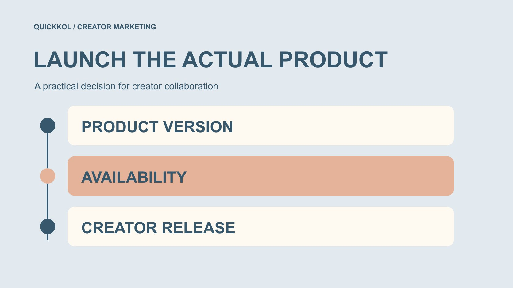
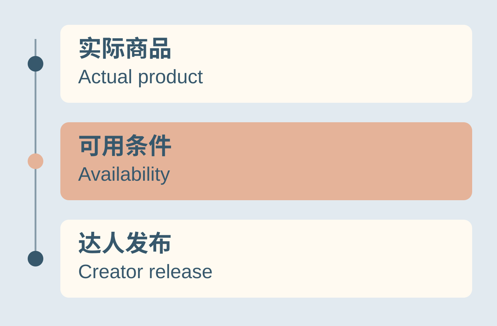

# 运动服新品怎样对齐达人发布

状态：本地审阅稿；正式发布日期待确认。

把运动服达人上市内容连接到真实款式、商品页和可供安排，明确产品变更、发布确认与上线后的回应责任。

QuickKOL 编辑图形；不呈现真实账号指标或平台界面。

Active clothes brands 准备达人上市合作，应先把内容中的衣物与实际商品版本连接起来，再确认观众要去的页面、可供情况与回应责任。寄出样品、审核成片和允许发布是不同节点。产品、价格或供货安排变化时，负责人要判断哪些镜头与文案需要更新，而不是让达人自己猜。一次准备充分的上市合作，应让观众看懂展示了什么，达人知道何时可以说什么，品牌能够接住内容带来的具体问题。

## 先画出内容到商品的实际路径

达人内容、品牌账号与商品页可能由不同人管理。先写观众看完要去哪、需要找到什么，再核对各环节是否说的是同一件产品。不要把已有商品页当作自动适合新内容的目的地。

[运动服动作证据指南](https://www.quickkol.com/zh/blog/activewear-apparel-brands-movement-evidence/#answer)可以帮助安排真实展示，但内容任务仍要与实际在售版本对应。例如演示口袋容纳物品，页面却默认没有该口袋的款式，说明与购买入口之间就出现断点。

这项路径核对不要求达人承担库存或网站管理。品牌负责提供准确入口和资料，达人负责约定内容，双方知道遇到不一致时先联系谁。把职责明确下来，比上线当天要求所有人临时盯着同一个群聊更可执行。

## 确认拍到的是哪一版产品

上市前样品可能与最终商品不同。品牌要说明哪些差异真实存在，哪些会影响公开表述，不能因为样品外观相似就认定全部信息适用。对尚未确认的性能与材料，保留问题而不是补写推断。

[FTC 的纺织品标签指南](https://www.ftc.gov/business-guidance/resources/threading-your-way-through-labeling-requirements-under-textile-wool-acts)在美国范围内说明多数适用产品的纤维、产地与负责企业信息。拍摄团队应使用对应商品的已核对资料，不从早期样品或另一颜色版本推断完整描述。

记录样品与最终版本的关系，让审稿人知道哪些镜头有依据。如果产品细节已经改变，讨论重新拍摄、限定表述或延后发布。先前投入时间，不足以让不准确的产品内容继续上线。

## 把上市说法交给事实负责人

“现已发售”“明天可买”“所有颜色都有”等说法，需要实际安排支持。品牌应给达人确认后的文案与范围，并说明发生变化时如何通知。不要让对方根据内部聊天中的暂定计划宣布。

[FTC 的广告基础指南](https://www.ftc.gov/business-guidance/advertising-marketing/advertising-marketing-basics)在美国语境下强调广告真实且有依据。对上市内容，这意味着需要核对具体说法，而不是把一个醒目的倒计时当作可供事实证明。

可以把产品事实、活动信息与个人体验分开审阅。达人可以真实描述自己的体验，但不能替品牌保证每个地区都有货；品牌确认商品信息，也不应替达人编造使用感受。每项表述都有适合确认的人，才不会因为多人都看过稿就误以为全部已核实。

## 目的地要展示内容里的选择

同一商品页可能有不同颜色、尺码或套装。核对打开时默认显示什么，观众能否找到内容展示的版本，以及活动入口是否仍然有效。链接正常打开，只说明可以访问，不代表内容一致。

例如短片展示蓝色套装，入口却默认选择灰色单件。审阅人应确认观众怎样找到套装，以及价格是否对应同一组合，而不是只看页面标题。发现问题后由页面负责人修改或给出准确说明，达人再按确认后的入口完成内容。

如果尚未开售，可以选择与实际情况相符的信息页或等待安排，不能用已经可买的措辞掩盖限制。是否适合继续发布，由品牌结合实际任务决定，不让达人猜测系统何时完成。

图形把产品、可供与内容发布分开。每个阶段完成后还需要下一位负责人确认自己的部分。这个方法不承诺零差错，但能把具体问题定位到可以处理的环节，而不是把所有不一致都归为达人没有理解 Brief。

内容批准、商品可供与发布决定是不同节点。

## 用明确确认代替沉默默认

成片审核通过，可能只表示创意与事实可以使用，不一定表示今天就该发布。品牌应说明谁有权确认时点，以及确认的是哪个版本、哪个入口与哪些条件。没有回复不应被解读为新一轮授权。

达人需要知道约定时间是否仍有效，以及遇到变化怎样继续。若品牌更改上市日，先说明影响与下一步，再讨论额外工作。临时取消或重拍的商业安排应回到双方约定，不由本文设统一规则。

假设样品已经到位，但某个主推颜色仍不能供应。负责人可以讨论换成可供版本、改为不含销售承诺的说明，或延后。每种选择都会影响内容，应留下确认结果，而不是仅把日历上的日期改掉。

## 商业关系与上线事实一起检查

[FTC 的达人披露指南](https://www.ftc.gov/business-guidance/resources/disclosures-101-social-media-influencers)在美国场景下说明付费、赠品等相关联系的清晰披露。上市发布节奏再紧，也不应让实际关系在缩短文案时消失。平台操作仍需按适用要求确认。

品牌与达人还要核对个人体验是否对应实际样品。展示早期版本，可以说明真实条件；不能把尚未经历的最终产品体验写成已确认感受。披露合作也不自动证明产品说法准确。

如果发布后要复用素材，检查新的说明是否仍然保持关系和版本。旧内容中的“今天”或“刚上市”可能不适合以后使用。把时间词与素材范围一起维护，比仅保留一张通过审核的截图更能帮助后续负责人。

## 安排上线后的产品问题回应

观众可能询问尺码、地区、供货或护理。品牌应准备对应负责人和资料，让达人知道哪些能据真实体验回答，哪些转给品牌。内容发布不代表达人已经承担全天候客服。

对无法即时确认的问题，保留原文、相关版本和处理状态。不要为了保持评论区热闹而迅速给出没有依据的答案。纠正错误时说明具体改变，不删除上下文后让观众无法理解。

如果多人反复询问同一信息，检查内容与目的地是否缺失。它可能是品牌资料需要补充，也可能是产品选择难找，不宜直接把问题数量当成活动失败或爆红证明。回应的价值在于处理真实阻碍。

## 复盘内容与销售记录的连接

记录哪位达人发布了哪个版本、使用什么入口、对应哪个时段。产品变更与供货变化也要保留，帮助理解表现差异，不把不同条件下的内容简单排成优劣榜。

链接点击、订单归因与新增销售是不同问题。能看到某项记录，就按定义报告，不自动把活动期间所有收入归给达人。库存不足也可能影响行动，但需要实际记录才能判断，不用它解释所有差异。

复盘可以给出具体下一步，例如改正默认颜色、提前提供版本说明或调整问题转交。每项建议对应观察到的问题，避免把一次上市经验泛化成适用于所有运动服品牌和达人的成功公式。

## 交接可继续执行的上市记录

[运动服样品交接指南](https://www.quickkol.com/zh/blog/exercise-clothing-creator-sample-custody/#answer)负责实物与状态，上市记录负责产品事实、目的地和发布条件。团队可以把两者关联，但不需要把所有内部讨论都交给达人或放进公开页面。

交接包含最终产品版本、实际内容、入口、确认人、回应安排和仍未解决的问题。下一位负责人应能判断接下来要做什么，而不必询问最早参与项目的人才能理解一张状态表。

Active clothes brands 的达人上市合作，最后落在准确表达与真实履约上。内容是否好看很重要，商品与回应能否承接同样影响合作体验。把这些环节连接起来，才是与达人营销相关的上市准备。

## 上市准备的三个确认

| 事项 | 检查什么 | 谁继续 |
| --- | --- | --- |
| 产品版本 | 样品与实际商品是否对应 | 产品负责人说明差异 |
| 目的地 | 入口、默认选择与实际可供 | 页面与供应负责人处理 |
| 发布条件 | 版本、时点与公开说法 | 确认人给出明确决定 |
| 上线回应 | 问题、资料与处理状态 | 品牌与达人按角色继续 |

编辑交接框架，不是供货保证、行业基准或个别法律意见。

## 发布前连接四项事实

确保内容能被真实商品与团队承接。

- [ ] 确认拍摄与在售版本关系。
- [ ] 让产品说法有事实负责人。
- [ ] 实际打开入口并检查选择。
- [ ] 区分成片审核与发布确认。
- [ ] 保留商业关系与真实体验。
- [ ] 安排上线后问题与变更处理。

## 研究日期与使用边界

资料核验于 2026 年 11 月 17 日。文中方法、表格和决策规则为编辑建议，标为假设的示例不是实际客户结果或行业基准。外部资料的适用地区与时期按各段说明。

## 从任务开始达人研究

用 QuickKOL 理解 Brief、发现相关达人并研究作品与联系路径；数据、合作条件和结果仍需核验。

[了解 QuickKOL](https://www.quickkol.com/#capabilities)

## 来源

- [FTC 的纺织品标签指南](https://www.ftc.gov/business-guidance/resources/threading-your-way-through-labeling-requirements-under-textile-wool-acts)
- [FTC 的广告基础指南](https://www.ftc.gov/business-guidance/advertising-marketing/advertising-marketing-basics)
- [FTC 的达人披露指南](https://www.ftc.gov/business-guidance/resources/disclosures-101-social-media-influencers)
