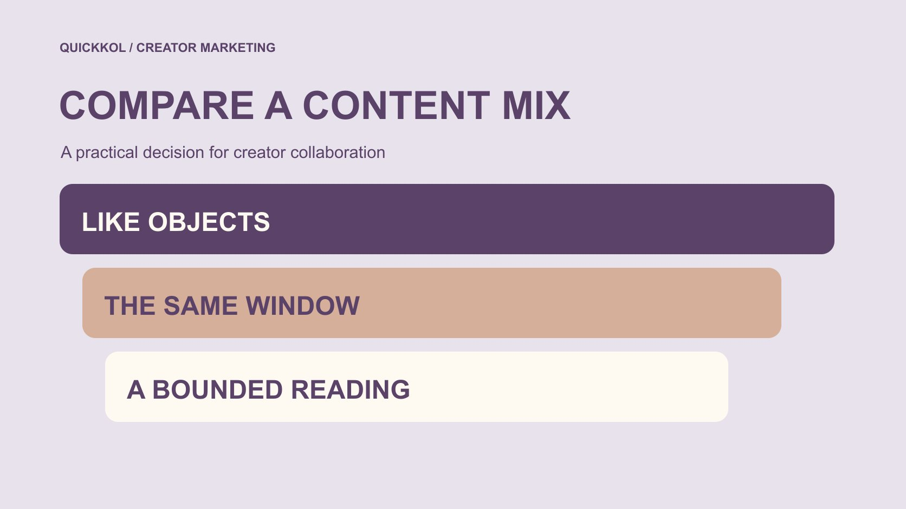
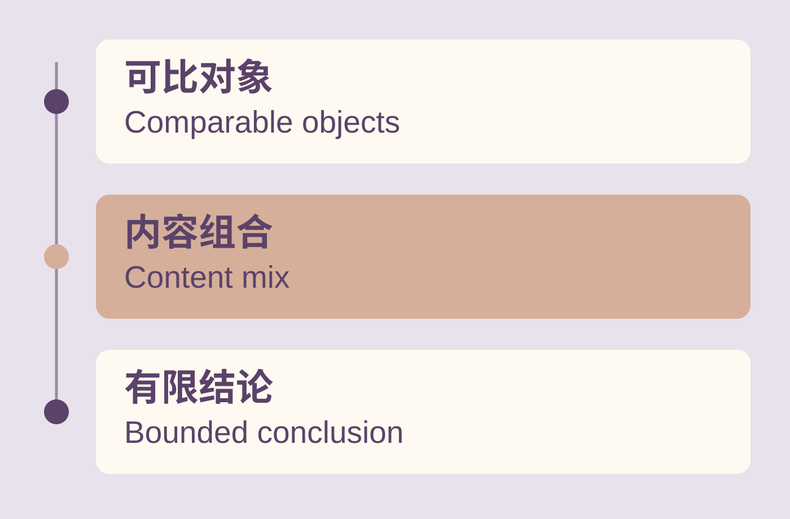

# Competitive Benchmarking Analysis for Creator Content Mix

Status: local review draft; confirm the publication date before release.

Define a comparable content mix before checking time, metric definitions and extremes, with a reproducible hypothetical showing why aggregation methods answer different questions.

QuickKOL editorial graphic; not actual account metrics or a platform interface.

Competitive benchmarking analysis of creator content starts with the decision the comparison should support, then selects a content mix with comparable tasks, platforms and interpretable periods. Retain underlying records, numerators, denominators, content age, distribution context and missing values; inspect aggregate activity, individual results and variation separately. Aggregate rates and averages of individual rates answer different questions, so do not select whichever looks better. Competitor public records rarely establish all paid activity, orders or private information. A comparison can inform production and research without independently proving greater incremental sales.

## Move from account totals to content tasks

If the brand wants to improve product explanation, compare relevant explanatory content instead of a competitor’s combined comedy, events and branded posts. An account can define a research boundary without being a naturally comparable unit.

The [creator-pilot comparison guide](https://www.quickkol.com/blog/benchmarking-creator-pilot-comparison-design/#answer) helps frame the question before comparison. This article examines analysis once records exist, keeping one overall average from hiding unlike tasks. Identify each content type and why it belongs in the sample.

Suppose brand A often publishes demonstrations while brand B publishes event clips. Their overall engagement difference may reflect content mix. Compare demonstrations separately before describing composition, rather than assign the whole difference to creator quality. The content’s actual role is a better basis for inclusion than an account name. This gives the team a specific exclusion rule as well: a large but unrelated entertainment post should not enter merely because it would improve one side of the comparison.

## Inspect the composition of the mix separately

In another hypothetical, C’s ten posts contain eight demonstrations and two event clips, while D has two demonstrations and eight event clips. Similar publication dates still leave the overall results mixing different jobs. Retain that composition before selecting the comparison scope.

Report demonstrations and event clips separately with their record counts. Do not equalize counts by selecting one side’s best items and the other side’s newest ones; inclusion rules must be reproducible. If a group has no suitable records, state that the comparison cannot be completed instead of silently substituting another type. The resulting report can explain both the content strategy observed and the smaller like-for-like comparison available, without pretending they are the same question. It also shows when collecting additional relevant records would be more useful than calculating another overall average.

## Fix the observation scope and retain content age

Collecting numbers on one day does not give posts equal time to accumulate activity. Content published last week and yesterday can appear in a current-total table without being described as having experienced the same window.

Use a shared post-publication duration where records support it, or explicitly compare cumulative visible records on one observation date when historical snapshots are unavailable. These answer different questions. Retain the limitation rather than reconstruct nonexistent earlier performance.

Record platform, publication date and observation date. Mark deleted, private or unavailable content as such instead of assigning zero. Zero means observed absence of activity; missing means unknown. Combining them can make a mix appear weaker without evidence. A clear scope also identifies when the comparison needs updating: another snapshot should be a new observation, not silently replace the earlier values and remove the ability to reproduce the report originally handed to a decision-maker.

## Interpret platform fields under their actual definitions

[YouTube’s impressions guide](https://support.google.com/youtube/answer/9314486?hl=en) distinguishes registered thumbnail impressions, views arising from them and other view records. Replacing the impression denominator with all views while retaining the original click-through-rate label changes the meaning.

Likewise, similar names for views, reach and interaction across platforms do not make fields interchangeable. For an editorially defined metric, identify included actions and the denominator instead of presenting it as a native platform field or industry standard.

Keep public records separate from authorized account information. Competitive analysis cannot assume access to unpublished watch time, advertising or transactions. Narrow the question when a field is missing instead of infer all performance from visible likes. A metric dictionary can be short: name the source field, unit, content scope and any transformation applied, giving another analyst enough information to see whether two rows really belong in the same calculation.

## Inspect your own mix through authorized records

[YouTube’s Advanced Mode guide](https://support.google.com/youtube/answer/9717005?hl=en) describes comparisons by video, group and period with metric and filter changes. This concerns data the user is authorized to access, not a function for inspecting any competitor’s private account.

For your own creator content, group videos serving the same task and retain the filters, fields and export period. Check for mixed formats or other distribution instead of treat one saved report as a permanently identical sample.

The diagram emphasizes comparable objects, content mix and bounded conclusions. More detailed account data is not automatically more comparable; explain why the records answer one question and which conditions differ. Let the analysis design precede chart selection so another person can reproduce it. If an owner shares only a screenshot, request the task-relevant scope and definitions rather than demand unrelated account access simply to make the report look more complete.

Define the comparison question before choosing groups and aggregation.

## Aggregate rates and average rates answer different questions

The following is hypothetical, not an industry benchmark. Define an action rate as selected action counts divided by views. A1 has 100 views and 10 actions, giving 10%; A2 has 2,000 views and 20 actions, giving 1%.

A’s mean post rate is (10% + 1%) ÷ 2 = 5.5%. Its aggregate rate is (10 + 20) ÷ (100 + 2,000), approximately 1.43%. The first gives each post equal weight; the second aggregates the selected view volume. They cannot be exchanged without explanation.

If B has two posts with 1,000 views and 40 actions each, both methods give 4%. A and B change relative order with the question. Preserve both definitions rather than display only the number that makes one brand win. Actions are also not deduplicated people. A person may contribute more than one selected action, so the hypothetical calculation should never be described as the percentage of distinct viewers who engaged.

## Inspect variation before selecting creators

[NIST’s measures-of-location guide](https://www.itl.nist.gov/div898/handbook/eda/section3/eda351.htm) distinguishes the mean from the median and explains that extreme values can affect the mean. Applied to creator records, this is a statistical-method reference, not evidence that every account follows one distribution.

Inspect individual records, sample size and range before choosing a summary. One high-performing item in a small sample warrants contextual research rather than automatic removal for a tidy average or being treated as every future result.

Check whether an extreme comes from a different task, content age or visible special event. Retain unknowns where it cannot be explained instead of labeling a person consistently efficient or unreliable. The comparison should inform the next assessable assignment rather than complete a judgment about an individual through one number. Preserve any inclusion decision so a reviewer can see whether the conclusion depends on a particular record and consider it without the result being hidden.

## Explain differences without inventing their cause

If one set of demonstrations records more actions, describe the observed difference before investigating topic, format, distribution and task. Factors changing together do not show that one produced the entire result.

Competitor public content particularly lacks complete context. Absence of a visible advertising marker does not establish absence of paid support, and visible activity cannot establish all spending, revenue or return.

Label proposed explanations as hypotheses and identify the evidence needed. A later owned project can observe one specific change while the original competitive comparison remains bounded. Retaining uncertainty is more reliable than replacing missing records with a plausible story. The report can still make a practical suggestion, such as testing a clearer closeup, if it explains that the suggestion follows from content review rather than a proven causal effect calculated from the competitors’ public engagement totals.

## Read the content alongside the numbers

Numbers describe activity under a recording method; content review can reveal whether the demonstration is clear, a statement retains its conditions and the next step corresponds. They inform each other without subjective visual appeal becoming a statistically established improvement.

Keep a short note for relevant items, identifying where the key action appears and what viewers need to understand. Retain task-relevant research leads without copying whole works or collecting unrelated personal information.

A high action rate can still accompany content that does not answer the current product question. Conversely, an accurate demonstration may support production research while public records are insufficient for buying distribution. Choose by use rather than give every creator one overall rank. The analyst should identify whether a recommendation concerns a production style, an audience question or a commercial invitation so the next owner does not purchase a broad package on the basis of a narrower finding.

## Deliver a reproducible comparison record

Retain sample rules, observation times, field definitions, raw values, calculations, missingness and interpretation limits. Another owner should reproduce the result rather than receive only a chart with an unidentified denominator.

The [creator-performance benchmark guide](https://www.quickkol.com/blog/creator-performance-benchmarks/#answer) offers further context without supplying industry representativeness that this sample does not have. Separate editorial choices, hypothetical examples and actual collection; the table here must not be renamed QuickKOL industry research.

The value of competitive benchmarking analysis is helping a brand choose what to research or test next. Explaining the objects, comparability and remaining unknowns gives a basis for another creator assignment without turning competitor numbers into a guarantee. A final recommendation should therefore name the next task and evidence owner, leaving the calculation available for review instead of forcing a universal best-creator conclusion from a comparison designed to answer a much smaller question.

## Hypothetical records: retain reproducible counts

| Content | Views | Selected actions | Action rate |
| --- | --- | --- | --- |
| A1 | 100 | 10 | 10% |
| A2 | 2,000 | 20 | 1% |
| B1 | 1,000 | 40 | 4% |
| B2 | 1,000 | 40 | 4% |

Entirely hypothetical custom actions ÷ views, not a native platform metric, unique-person rate or industry benchmark. A aggregates to about 1.43% with a 5.5% mean post rate; B gives 4% under both.

## Before handing over a comparison

Make the comparison understandable and reproducible.

- [ ] Define the decision, task and inclusion rules.
- [ ] Retain publication dates and observation scope.
- [ ] Confirm fields, counts and missing values.
- [ ] Inspect aggregate and individual performance.
- [ ] Separate explanations from established facts.
- [ ] Propose an executable next research task.

## Research date and limitations

Sources reviewed November 17, 2026. Methods, tables and decision rules are editorial recommendations. Hypothetical examples are not actual client results or industry benchmarks. Source geography and periods are specified where relevant.

## Start creator research with a clear task

Use QuickKOL to interpret a brief, discover relevant creators and research their work and contact routes. Verify data, commercial terms and outcomes at their source.

[Explore QuickKOL](https://www.quickkol.com/#capabilities)

## Sources

- [YouTube’s impressions guide](https://support.google.com/youtube/answer/9314486?hl=en)
- [YouTube’s Advanced Mode guide](https://support.google.com/youtube/answer/9717005?hl=en)
- [NIST’s measures-of-location guide](https://www.itl.nist.gov/div898/handbook/eda/section3/eda351.htm)
