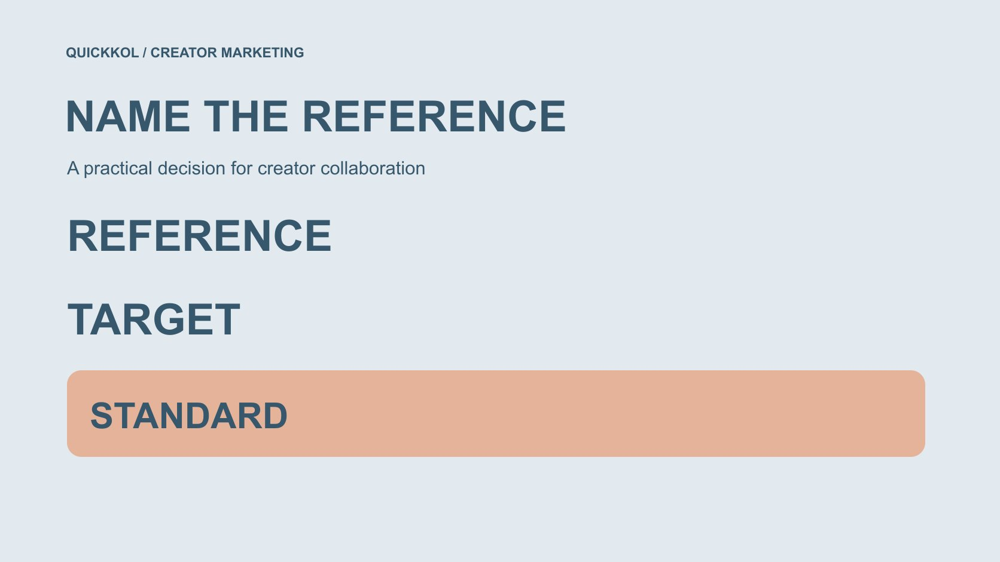
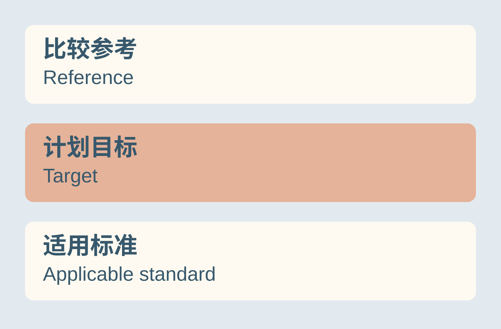

# What Is Competitive Benchmarking in Creator Marketing?

Status: local review draft; confirm the publication date before release.

Distinguish competitor, comparison reference, owned baseline, future target and required standard before choosing a meaningful benchmark for creator work.

QuickKOL editorial graphic; not actual account metrics or a platform interface.

Competitive benchmarking compares important attributes with selected competitors to understand gaps and possible improvements. In influencer marketing, it can examine relevant content tasks, production processes or interpretable metrics without making a competitor’s number a promise required of every creator. This article distinguishes comparison references, owned baselines, future targets and required standards as practical editorial categories. They serve different purposes. Define what the brand wants to improve before choosing an object and evidence suited to that question.

## Benchmarking is a research activity

[ASQ’s benchmarking guide](https://asq.org/quality-resources/benchmarking) describes comparing products, services and processes while emphasizing understanding your own work and focusing the question. Creator marketing can use that approach for a defined task instead of reduce it to whose number is largest.

A brand improving product explanation can study how relevant demonstrations retain a key action. Examine actual expression and conditions rather than select a high-view account and assume every practice suits the brand.

This article explains the reference’s role first. The [creator content-mix analysis guide](https://www.quickkol.com/blog/competitive-benchmarking-creator-content-mix-analysis/#answer) covers detailed grouping and aggregation. With the definition clear, the brand knows whether it is studying a gap, setting an assignment or assessing completed work, rather than allowing benchmark to change meaning throughout a meeting. A comparison becomes useful when it identifies something the team can inspect and potentially change, with the evidence boundary retained for the next decision.

## A competitor is not automatically the best task reference

A brand selling similar products may be a competitor while its content remains unsuitable for the current task. Event entertainment and operating instructions can require different roles and resources. Competition does not make all content comparable.

Conversely, a clear demonstration from another category may inform production without establishing direct market-competitive performance. Explain why the reference was chosen so colleagues distinguish method learning from competitive judgment.

For example, an organizer brand can study how an equipment creator makes a small operation visible. It cannot then claim its storage content trails the entire photography industry. That is an expression-method reference, not a cross-industry ranking. The creator brief can ask for a similarly understandable action without requesting the same script, personality or finished image. Separating the transferable principle from the original expression gives the new creator room to contribute work appropriate to the actual product and audience question.

## A baseline describes the starting position

Here, baseline means an owned starting position recorded under a stated method. It can concern earlier relevant content or a process state, but needs an object, period and definition instead of remembered performance presented as precise history.

A baseline and competitive reference can be used together. One helps describe your change; the other suggests an improvement direction. Neither automatically explains causation. Exceeding earlier numbers does not establish that a new creator produced every incremental result.

Without suitable history, retain the unknown and establish a repeatable record for future work. Inventing an average to complete a proposal makes every later comparison depend on a fictional starting position. Research can begin with a gap rather than pretend all information exists. The report should explain what can be assessed now and what a later observation might add, allowing a brand to commission a bounded task without an unsupported before-and-after promise.

## A target is an intention, not an external fact

A brand can propose a target based on the task and resources while explaining its rationale and what the creator controls. A competitor’s high-performing post does not automatically make the same number an agreed future deliverable.

Distinguish content completion from business outcomes. Completing a clear demonstration and reaching a market share are not equally controllable work. Discuss what the brand hopes to observe without describing the hope as an evidence-backed guarantee.

The diagram separates reference, target and standard to make the vocabulary usable. If a target changes, explain whether the work and resources change too rather than judge completed creator work by a new, previously undiscussed requirement. A target can remain ambitious while the collaboration accurately identifies responsibilities, evidence and uncertainty; clarity does not require promising an outcome that depends on distribution, product availability or choices outside the creator’s control.

Comparison, planning and acceptance rely on different bases.

## A required standard needs its own basis

Here, standard refers to a specific requirement to satisfy, such as agreed content facts, delivery specifications or applicable rules. It differs from typical performance observed during research; a competitor average should not silently become a passing threshold.

Identify where a requirement comes from. An agreed version, a currently applicable platform condition and a creative idea the brand wants to explore have different status. Calling all of them standards makes it unclear what is negotiable and what must already be met.

Creators should understand their actual commitment, and brands should supply the information needed. A more polished reference can support discussing another production without establishing that work meeting the original agreement is unacceptable. Assess the real assignment and confirmed conditions. This keeps benchmarking useful for learning without turning every new reference found during review into an additional obligation imposed after filming is complete.

## An average is not a universally applicable standard

[NIST’s measures-of-location guide](https://www.itl.nist.gov/div898/handbook/eda/section3/eda351.htm) distinguishes summaries such as the mean and median. When a brand sees an average, ask which records it summarizes instead of assume it applies to every creator and task because it is called a benchmark.

Sample size, content type, age and extremes can affect interpretation. An industry average without corresponding scope should not directly eliminate a candidate. A small sample is a small-sample reference rather than a whole-market standard.

This changes reporting language too. State an observed mean for a comparable group without deleting conditions and claiming every normal creator should achieve it. A summary helps understand records without supplying future guarantees or a complete judgment of a person’s ability. If the figure does not answer the commissioning question, choosing another relevant evidence route is more useful than adding precision to an average whose underlying scope remains unknown.

## Authorized owned comparisons still need scope

[YouTube’s Advanced Mode guide](https://support.google.com/youtube/answer/9717005?hl=en) describes comparisons across videos, groups and periods. It supports research into authorized owned records without granting private access to any competitor or selecting a task-relevant sample for the team.

Group relevant demonstrations under a consistent method and retain filters, dates and metrics. Exclude unsuitable content by a predetermined rule rather than because its performance disappoints. Do not pretend to know unpublished competitor fields.

A comparison control completes only part of the work. Meaning comes from the objects, definitions and ability of another owner to reproduce the result. Two lines on a chart need not answer the same question, and a gap does not establish its cause. The reviewer should identify what remains comparable and what is merely displayed together, making the report useful even where available records cannot support the larger competitive conclusion originally hoped for.

## Separate the terms through a hypothetical brief

Suppose a brand wants clearer creator product explanations. Its earlier video offers a starting position, another brand’s relevant work supplies a competitive reference, making a key action visible is the next assignment’s aim, and using the correct product version is an agreed requirement.

They connect without being interchangeable. High views on the reference do not require the creator to guarantee identical views; weaknesses in the earlier video do not prove every later improvement was caused by the new person. Establish each basis before deciding the content needed.

This hypothetical contains no client result. It gives the team clear terms: reference for learning, baseline for the start, target for direction and requirement for what must be met. The creator can identify the actual work being commissioned. A reviewer can likewise distinguish a useful suggestion drawn from the reference from a correction needed to meet an existing agreement, reducing confusion when comments arrive from several brand owners.

## Adapt a finding to your own assignment

A gap can lead to a research question, such as how another item makes a detail visible, rather than a demand to copy the whole work. Consider your product, viewer question, resources and agreed use scope.

Choose one specific change to observe, such as a necessary closeup or earlier accurate product information. Explain the rationale and evidence needed without promising that a small edit will match every competitor outcome.

The [creator-performance benchmark guide](https://www.quickkol.com/blog/creator-performance-benchmarks/#answer) provides further context on record scope. Return comparison to the next assignment with an owner able to act, unknowns and a later observation. Where evidence is insufficient, recommend further research instead of present a learning reference as a proven method. The outcome can be a more precise brief even when no universal performance threshold emerges, because the brand now understands which part of production it wants to improve and how that question might be assessed.

## Finish the definition with accurate terms

What is competitive benchmarking is answered through a comparison with defined objects and important attributes. It is not a universal average table or a complete judgment of every creator’s value. Its use depends on the question and evidence.

Label comparison reference, owned starting point, future target and required standard separately in the handoff. A summary from a limited sample should retain that scope instead of become a universal threshold through repeated retelling.

When brand and creator use the same terms for the assignment, comparison is easier to turn into actual improvement. Knowing why an example is being studied, what should change and what remains to confirm is more useful than simply asking for the industry benchmark. The definition serves practical collaboration when it makes responsibilities and evidence clearer, leaving future outcomes open to the records needed to assess them.

## Four bases that are easily confused

| Term | Question answered | Creator-work example |
| --- | --- | --- |
| Comparison reference | What to learn from or compare with | A relevant competitor demonstration |
| Owned baseline | What the starting position was | Earlier content under a stated method |
| Future target | What improvement is intended | Explain a key action in the next assignment |
| Required standard | What must be met | Use the agreed correct product version |

Practical editorial distinctions used here, not a claim that every industry gives each term one exclusive formal meaning.

## Before selecting a benchmark

Establish what the reference is for.

- [ ] Define the creator task to improve.
- [ ] Explain why the comparison object is relevant.
- [ ] Retain the owned baseline and unknowns.
- [ ] Do not turn an average directly into a passing threshold.
- [ ] Separate targets from delivery requirements.
- [ ] Connect the finding to an assessable next task.

## Research date and limitations

Sources reviewed November 17, 2026. Methods, tables and decision rules are editorial recommendations. Hypothetical examples are not actual client results or industry benchmarks. Source geography and periods are specified where relevant.

## Start creator research with a clear task

Use QuickKOL to interpret a brief, discover relevant creators and research their work and contact routes. Verify data, commercial terms and outcomes at their source.

[Explore QuickKOL](https://www.quickkol.com/#capabilities)

## Sources

- [ASQ’s benchmarking guide](https://asq.org/quality-resources/benchmarking)
- [NIST’s measures-of-location guide](https://www.itl.nist.gov/div898/handbook/eda/section3/eda351.htm)
- [YouTube’s Advanced Mode guide](https://support.google.com/youtube/answer/9717005?hl=en)
