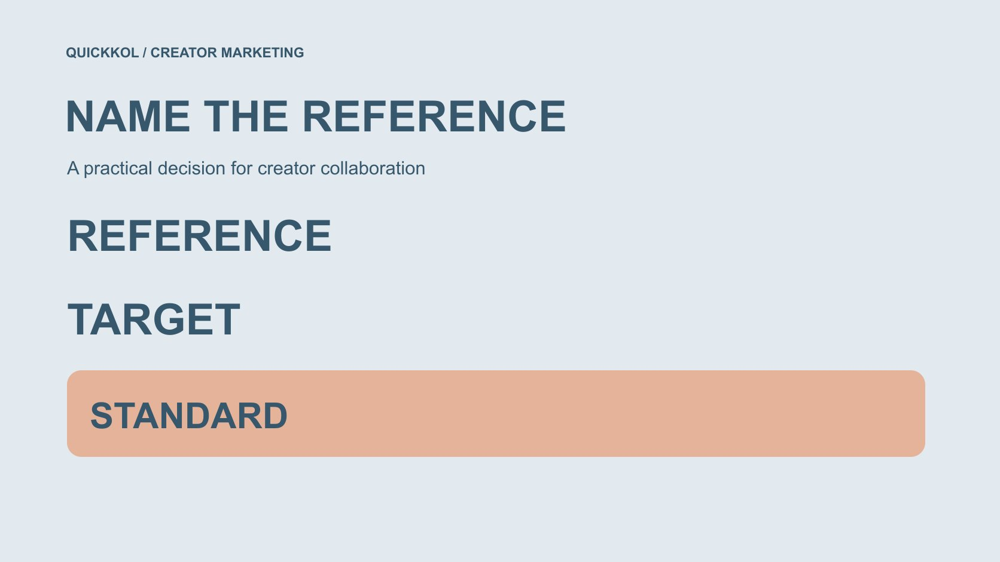
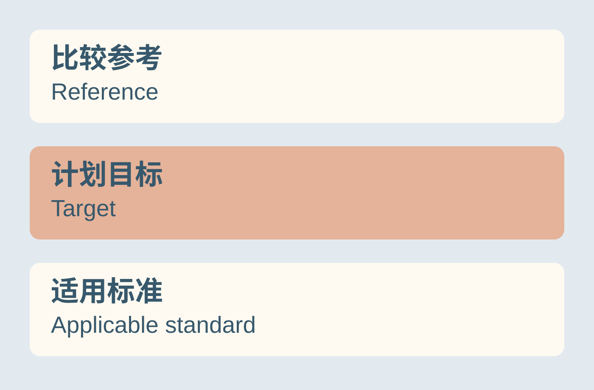

# 达人营销怎样理解竞争基准

状态：本地审阅稿；正式发布日期待确认。

先区分竞争对象、比较参照、自有起点、未来目标与必须满足的要求，再为达人任务选择有意义的基准。

QuickKOL 编辑图形；不呈现真实账号指标或平台界面。

Competitive benchmarking 是围绕重要属性，与选定竞争对象作比较，以理解差距和可能改进方向。在达人营销中，可以比较相关内容任务、制作流程或可解释指标，但不能把竞品某个数字自动当作每位达人的承诺。本文将比较参照、自有基线、未来目标和必须满足的要求作编辑性区分：它们各有用途，不宜互换。先决定品牌要改善什么，再选择能回答问题的对象与证据，才是 what is competitive benchmarking 的实用答案。

## 基准比较是一项研究活动

[ASQ 的基准比较说明](https://asq.org/quality-resources/benchmarking)介绍比较产品、服务与流程，并强调理解自己的工作与收窄问题。对于达人营销，可以借用这项方法研究具体任务，而不是把它简化成谁的数字最大。

例如品牌想改善产品讲解，可以研究相关演示怎样保留关键动作。比较需要看真实表达和条件，不能只挑一个高播放量账号，再把其所有做法当作适合自己。

本篇先解释比较参照的角色。更详细的数据分组与汇总，可读[达人内容组合分析指南](https://www.quickkol.com/zh/blog/competitive-benchmarking-creator-content-mix-analysis/#answer)。定义清楚后，品牌才知道自己是在研究差距、设定任务还是评估已经完成的工作，避免同一个“benchmark”在会议中不断改变含义。

## 按任务选择参照对象

同类商品品牌可以是竞争对象，但其内容未必适合当前任务。活动娱乐短片与产品操作说明，可能需要不同角色和资源。竞争关系不使全部内容天然可比。

反过来，另一品类的清楚演示可以帮助研究某种制作方法，但它不是当前市场竞争表现的直接证据。说明为什么选择这个参照，能让团队区分方法学习与竞争判断。

例如收纳品牌可以研究摄影设备创作者怎样展示细小操作，学习镜头如何让动作可见。它不能因此宣称自己的收纳内容落后于整个摄影行业。本例是表达方法参照，不是跨行业表现排名。

## 基线说明自己从哪里开始

本篇把基线理解为按明确方法记录的自有起点。它可以是先前相关内容或流程状态，但必须有对象、时期与口径，不把记忆里的大致表现写成准确历史。

基线与竞争参照可以同时使用。前者帮助看自己的变化，后者帮助提出可能改进方向；两者都不自动解释变化原因。一个项目超过过去数字，也不能单独证明新达人产生全部增量。

没有合适历史资料时，先保留未知，建立今后能重复的记录。为了让提案完整而补写一个平均值，会让之后每次比较都依赖虚构起点。研究可以从缺口开始，不需要假装所有数据已经具备。

## 目标是想达到什么，不是外部事实

目标可以由品牌基于任务和资源提出，但需要说明为什么合理，以及达人能控制哪一部分。竞争对手某条内容很高，不自动使同样数字成为双方同意的未来交付。

目标还要区分内容完成与业务结果。完成一段清楚演示，与达成某个市场占比，不是同样可控制的工作。品牌可以讨论希望观察什么，但不能把希望写成已经有证据保证。

配图将参照、目标与标准分开，帮助负责人解释每个词。若团队改变目标，应说明任务和资源是否相应变化，而不是在完成后才换一个未讨论的要求来判断达人表现。

比较、计划与验收使用不同依据，避免互相替代。

## 标准或要求需要另有依据

本篇把标准用于指必须满足的具体要求，例如双方确认的内容事实、交付规格或适用规则。它不同于研究中看到的典型表现，不宜从竞品平均数直接转成合格线。

实际要求来自哪里，要能说明。合同中约定的版本、平台当前适用条件与品牌希望探索的创意，不是同一性质。把它们全部叫标准，会让团队不知道哪些可以讨论、哪些需要先满足。

达人应清楚自己承诺完成什么，品牌也要提供履约所需资料。某个参考作品看起来更精致，可以支持讨论新制作，不自动说明已经完成的约定内容不合格。评价应回到真实任务与确认条件。

## 平均表现不是统一适用的标准

[NIST 的集中位置说明](https://www.itl.nist.gov/div898/handbook/eda/section3/eda351.htm)区分均值、中位数等概括方式。品牌看到一个平均值，应先问它概括哪些记录，不能只因为被称为 benchmark 就认为适合所有达人和任务。

样本量、内容类型、观察年龄与极端值可能改变解读。没有对应范围的行业平均，不宜直接用来淘汰候选人。若只是一个小样本，就如实叫小样本参照，而不是全市场标准。

这也影响报告语言。可以说某组可比内容的观察平均是多少，但不能省略条件后写正常达人都应达到。一个概括值帮助理解记录，不会自动提供未来保证或对个人的完整能力判断。

## 自有比较也要选对范围

[YouTube 的高级模式说明](https://support.google.com/youtube/answer/9717005?hl=en)介绍按视频、组别和时间比较。这可以支持自有资料研究，不说明可以访问任何竞争账号的私人数据，也不替团队选择任务相关样本。

品牌可以将相关演示按一致方法整理，保留筛选、时间和指标。若某条内容不适合，应按先定规则处理，而不是因为表现不好才移出。没有公开的数据，不在竞争记录中假装知道。

一个工具里的比较按钮只完成操作的一部分。实际含义来自对象与口径，以及是否能让另一位负责人复算。工具能画出两条线，不代表它们回答同一个问题，更不代表差距已经由某个原因解释。

## 用一个假设 Brief 分开四个词

假设品牌要改善达人产品说明。自有旧视频可以提供起点，另一家品牌的相关作品可以作为竞争参照，下一次希望观众看清关键动作是任务目标，而双方确认必须使用正确产品版本是要求。

四者连接，但不能互换。竞争作品有高观看，不等于达人必须保证相同观看；旧视频有问题，也不证明所有改进都由新人造成。先写各项依据，再决定需要怎样的新内容。

本例没有真实客户结果。它让团队可以用清楚语言讨论：参照提供学习，基线记录起点，目标表达方向，要求规定需要满足什么。达人因此知道自己要交付哪一项具体工作。

## 从差距提出适合自己的改进

差距可以引出研究问题，例如对方怎样让一个细节更可见，而不是要求达人复制整条作品。品牌需要考虑自己产品、受众问题、资源和已确认使用范围。

可以选择一个具体变化先观察，例如补充必要近景或提前提供准确产品资料。说明选择理由和需要什么证据，不承诺一次小改动一定达到竞争者全部表现。

[达人表现基准指南](https://www.quickkol.com/zh/blog/creator-performance-benchmarks/#answer)可以继续帮助判断记录范围。比较最后应回到下一项任务，由能执行的人负责，保留未知和后续观察。没有合适依据时，建议进一步研究，胜过把学习参照包装成已证实方法。

## 用准确名词结束定义

What is competitive benchmarking 的答案，是一项有明确对象与重要属性的比较研究。它不是一张万能平均表，也不替品牌决定每位达人的价值。实际用途取决于问题和证据。

交接时分别注明比较参照、自有起点、未来目标与必须满足的要求。若某个数字只是有限样本中的概括，就保留原来的范围，不让它在转述中变成统一标准。

品牌和达人能用同样语言理解任务，比较就更容易转成真实改进。知道为什么研究某个例子、希望改变什么和还要确认什么，比只说要达到行业 benchmark 更有帮助。

## 四种容易混淆的依据

| 名称 | 回答什么 | 达人合作例子 |
| --- | --- | --- |
| 比较参照 | 与什么对象学习或比较 | 相关竞争品牌的演示作品 |
| 自有基线 | 原来处于什么状态 | 按方法记录的先前内容 |
| 未来目标 | 希望改善什么 | 下一次讲清某个关键动作 |
| 要求标准 | 必须满足什么 | 使用双方确认的正确产品版本 |

本篇采用的编辑性工作区分，不是将所有术语固定为某个行业的唯一正式定义。

## 选择一个基准之前

先确认这个参照要做什么。

- [ ] 写清需要改善的达人任务。
- [ ] 说明比较对象为什么相关。
- [ ] 保留自有起点与未知。
- [ ] 不要把平均值直接变成合格线。
- [ ] 分开目标与实际交付要求。
- [ ] 让结论连接下一项可核对工作。

## 研究日期与使用边界

资料核验于 2026 年 11 月 17 日。文中方法、表格和决策规则为编辑建议，标为假设的示例不是实际客户结果或行业基准。外部资料的适用地区与时期按各段说明。

## 从任务开始达人研究

用 QuickKOL 理解 Brief、发现相关达人并研究作品与联系路径；数据、合作条件和结果仍需核验。

[了解 QuickKOL](https://www.quickkol.com/#capabilities)

## 来源

- [ASQ 的基准比较说明](https://asq.org/quality-resources/benchmarking)
- [NIST 的集中位置说明](https://www.itl.nist.gov/div898/handbook/eda/section3/eda351.htm)
- [YouTube 的高级模式说明](https://support.google.com/youtube/answer/9717005?hl=en)
