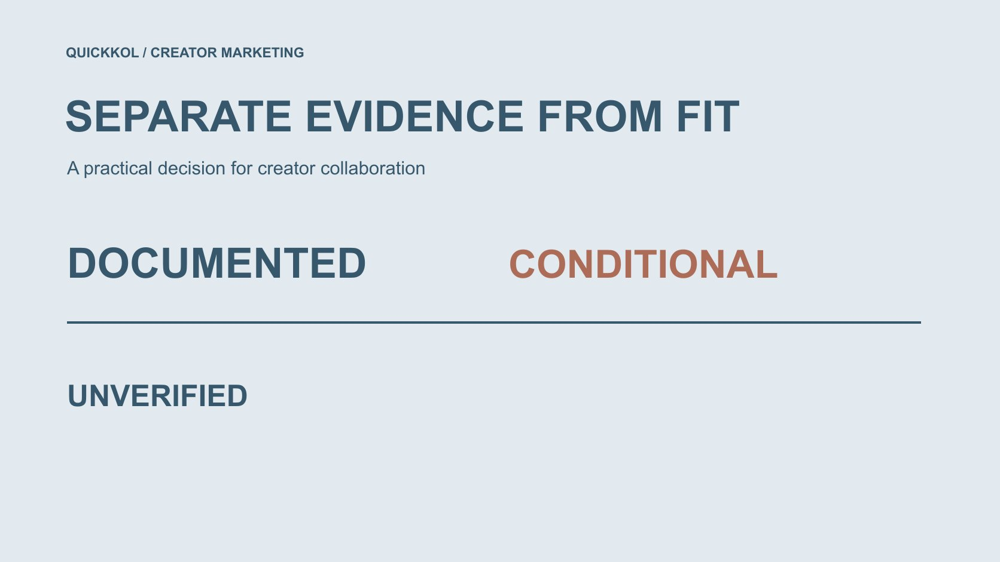
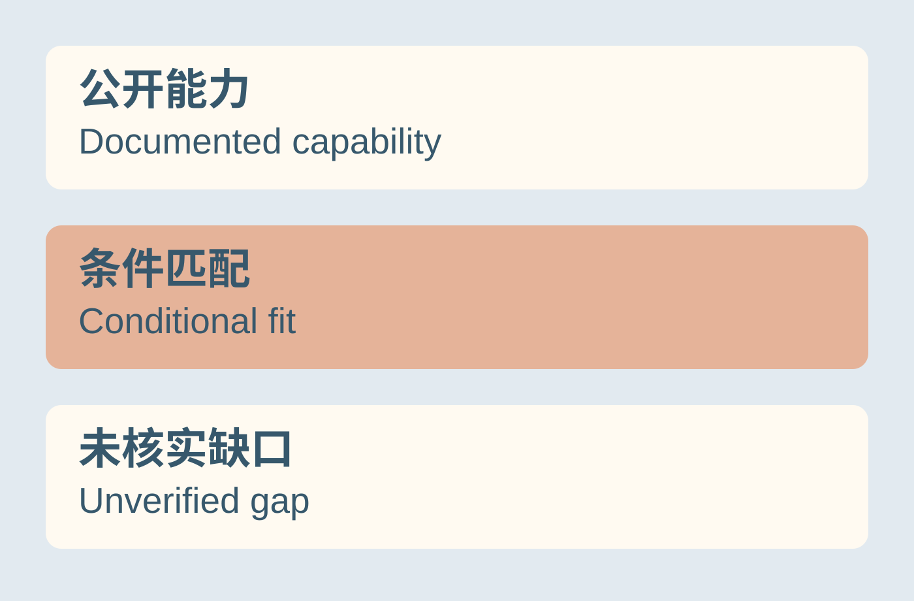

# CreatorIQ Strengths and Weaknesses: Separate Evidence From Fit

Status: local review draft; confirm the publication date before release.

Assess CreatorIQ strengths and limitations by separating provider-described capabilities, brand requirements and unverified questions before making a supported fit decision.

QuickKOL editorial graphic; not actual account metrics or a platform interface.

Assess CreatorIQ company strengths weaknesses against a specific creator program. Public material describes discovery, content review, campaign management and payments within one product system, potentially useful for brands coordinating several teams. Limitations require questions about adoption, information preparation, current version, market eligibility and total cost, rather than presenting untested issues as proven defects. This article uses official public material without claiming hands-on testing, an internal financial review or independent performance measurement.

## Define the program being assessed

A brand commissioning one demonstration has different needs from a team coordinating regions, agencies and finance. Define actual work, participants and fragile handoffs before deciding whether a capability matters.

The [CreatorIQ commercial-evaluation guide](https://www.quickkol.com/blog/creatoriq-pricing-commercial-scope-questions/#answer) helps organize procurement questions. This article focuses on evidence behind strengths and limitations rather than impose one demonstration script on every purchase.

An assessment can conclude that further discussion is worthwhile, a capability needs confirmation or the present task does not require it. Objectivity does not require an equal number of invented positives and negatives, and an unknown should not become a negative fact. A useful opening brief identifies the decision owner and the problem the product would need to solve, keeping the evaluation connected to creator work instead of a general impression of company prominence.

## Discovery: bring relevant work into research

[CreatorIQ’s discovery description](https://www.creatoriq.com/influencer-marketing-solution/creator-search) discusses content, keywords, filters and recommendations for finding creators. A team researching work from a brief may value fewer separate steps to surface leads.

This is a provider capability description, not verification that every public account is included or all audience information is complete and accurate. Original work, data scope and confirmation remain necessary.

The conditional strength is bringing relevant content into candidate discussion; the corresponding requirement is understanding where information came from and which question it supports. Finding someone does not confirm availability, identity, willingness or commercial fit. An evaluator should therefore examine whether the returned material helps explain the proposed contribution, rather than infer that a large collection or a recommendation label has completed the brand's creator-selection decision.

## Campaign management: central handoffs may be valuable

[CreatorIQ’s campaign-management description](https://www.creatoriq.com/influencer-marketing-solution/influencer-campaign-management) covers onboarding, content review, communication, contract and payment workflows, and reporting. Central records may address a real need for teams currently coordinating through fragmented messages.

A feature's existence does not establish a particular time saving, and real-time marketing language should not become a claim that every data point has no delay. Confirm refresh, status and coverage for the actual version and workflow.

Describe the strength as a capability-task relationship, such as review comments reaching the same content record. A limitation in application is that the brand still needs owners for facts, uses and exceptions; software cannot independently decide responsibilities the team has not defined. This distinction supports a fair assessment without portraying ordinary implementation work as a proven defect in the provider's product.

## Payments: separate paying entities from recipient markets

[CreatorIQ’s payments product update](https://www.creatoriq.com/whats-new-in-creatoriq/global-payments) describes the new-version service and separates current availability for US and Canadian legal entities from later regional plans and recipient markets. Paying into several markets does not mean every brand entity can already adopt the same service.

Confirm the brand's legal entity, product version, funding arrangement and finance handoff. This article gives no tax determination and treats a product introduction as neither a successful transaction nor proof of account eligibility.

The capability may help campaign and finance staff share corresponding statuses, but approved, processed and received need their actual definitions. The provider must confirm eligibility and terms rather than a market count substitute for them. This is a concrete scope limitation to investigate, with no need to infer a wider weakness in all of the company's payment-related products.

A strength needs a task; an unknown needs verification.

## Adoption work depends on team readiness

A central system needs usable information and a defined process. If contacts, asset versions, historical use scope and payment statuses are confused, importing them will not make the underlying facts correct.

That is adoption work to assess for any management tool, not a finding that CreatorIQ is difficult to use. Identify records to bring in, confirmers and retained unknowns before judging whether the plan is feasible.

Training also means more than learning buttons. Content, procurement and finance need a shared understanding of a status. If no relevant owner exists, resolve the responsibility rather than expect software to complete the organization. A realistic evaluation can identify this preparation as a brand-side dependency, allowing the provider to explain available support without turning an unfinished internal process into an unsupported product criticism.

## More capability is not automatically more relevant

Complex coordination features may have little immediate value for a small assignment. That is a mismatch between the current task and product scope, not proof the product is too complex or costly for every brand.

Separate essential, occasional and presently unnecessary work. However extensive a demonstration, return to the question of which creator task becomes easier to complete accurately.

If the team expects growth, identify the basis and timing rather than use an undefined future possibility as the present decision. Flexibility can matter while the purchasing reason remains concrete. A focused assessment may reasonably value a smaller part of the product, or defer a decision until the program has defined requirements, without inventing a universal company weakness from one team's limited current need.

## Data scope needs to support the intended conclusion

For performance comparison, ask about source, refresh scope, organic and paid status, missing items and metric definitions. Central reporting does not make every source directly additive.

The [influencer-success measurement guide](https://www.quickkol.com/blog/measure-influencer-success-contribution-review/#answer) connects records with decisions. Interaction observations should not automatically become unique people or causal sales; missing business inputs cannot be supplied by a reporting interface to produce true ROI.

This is an evaluation requirement, not an allegation that CreatorIQ reports are wrong. Keep provider descriptions, actual samples and the brand's data conditions separate to understand what a report can do. A useful question asks which decision a particular field supports and what remains outside its scope, rather than demand a single score that conceals differences between creator work, media delivery and downstream business records.

## Write unknowns as questions to confirm

Without account testing, do not describe the interface as smooth or difficult; without a current quote, do not invent annual fees; without a verified issue, do not allege a reliability defect.

Turn unknowns into bounded questions: how target-language work is found, what regional teams can view or whether the particular payment service applies. Specific questions invite checkable answers.

Retain response date, applicable version and unresolved portions. A positive sales conversation does not pass every capability, and an unanswered question does not prove a feature is absent. This keeps the assessment useful even before a purchase, since another reviewer can see exactly which conclusions rely on public descriptions and which depend on a future demonstration, written confirmation or agreement for this brand.

## Connect total cost to the actual work

Evaluation can include product charges, adoption, information preparation, training and brand staff time, using actual quotes and explicit assumptions. Prices for different scopes are not directly comparable without adjustment.

This article has no current applicable quote and provides neither a precise price nor payback period. Request scope for the actual program before identifying included, additional and internally borne costs.

Cost matters through completing work rather than dividing a feature count by a starting price. A strong capability does not create savings if unused, and a low price does not complete a task missing a critical handoff. A budget assessment can still identify a useful next step by naming the unanswered cost item and the person who needs to confirm it, without filling the gap with an unsupported industry estimate.

## Illustrate fit with two hypothetical teams

Suppose team A coordinates regions, creative review and finance, with its most fragile handoff between campaign work and payment. It has reason to investigate central management and eligible payment capabilities further.

Team B needs one demonstration and already has a publisher. It can define production and use first without purchasing team A's scope merely because that team needs complex coordination.

Neither hypothetical is a client result or a purchase recommendation. Strength changes with the task and limitations need specificity. One product can have different value for different teams without a universal high or low score. The assessment should explain the actual dependency each team faces, helping a decision owner understand why the same public feature description leads to different next questions rather than contradictory product judgments.

## Deliver an evidence-based fit conclusion

The final assessment should include the task, provider-described capabilities, confirmed conditions, unknowns and next action. A marketing page is not an independent test, and an untested concern is not a proven fact.

A useful answer to CreatorIQ company strengths weaknesses may identify a capability worth confirming, a scope that does not currently fit and the owner of the check. It does not require a single label for the entire company.

Return the conclusion to creator work: researchable content, owned review, and appropriate payment and data responsibilities. Evaluation then serves an actual decision to continue, adjust or defer. This preserves both the potential value of the provider's capabilities and the limits of the present evidence, leaving the brand with an actionable assessment rather than a generic product verdict.

For example, check whether the content owner can access the information needed and whether finance can receive an approved payment matter under their real responsibilities. One action in a sales demonstration should not stand for confirmation on behalf of every team member or every future campaign.

## Make strengths and limitations assessable

| Described capability | Potential value | Confirm |
| --- | --- | --- |
| Content-first discovery | Relevant work enters research | Coverage, source and creator arrangements |
| Central campaign records | Shared place for review and handoff | Ownership and adoption work |
| New-version payments | Campaign-finance coordination | Entity, eligibility and version |
| Reporting | Shared scoped observations | Definitions, timing and gaps |

Conditional analysis of provider descriptions, not hands-on testing, performance rankings or an internal company review.

## Six questions for the evaluation owner

Connect each question to creator work.

- [ ] Which handoff needs improvement?
- [ ] Which described capabilities relate?
- [ ] What has the provider confirmed?
- [ ] What information must the brand prepare?
- [ ] Which costs and eligibility remain unknown?
- [ ] Who owns the next verification?

## Research date and limitations

Sources reviewed November 17, 2026. Methods, tables and decision rules are editorial recommendations. Hypothetical examples are not actual client results or industry benchmarks. Source geography and periods are specified where relevant.

## Start creator research with a clear task

Use QuickKOL to interpret a brief, discover relevant creators and research their work and contact routes. Verify data, commercial terms and outcomes at their source.

[Explore QuickKOL](https://www.quickkol.com/#capabilities)

## Sources

- [CreatorIQ: creator discovery](https://www.creatoriq.com/influencer-marketing-solution/creator-search)
- [CreatorIQ’s campaign-management description](https://www.creatoriq.com/influencer-marketing-solution/influencer-campaign-management)
- [CreatorIQ’s payments product update](https://www.creatoriq.com/whats-new-in-creatoriq/global-payments)
